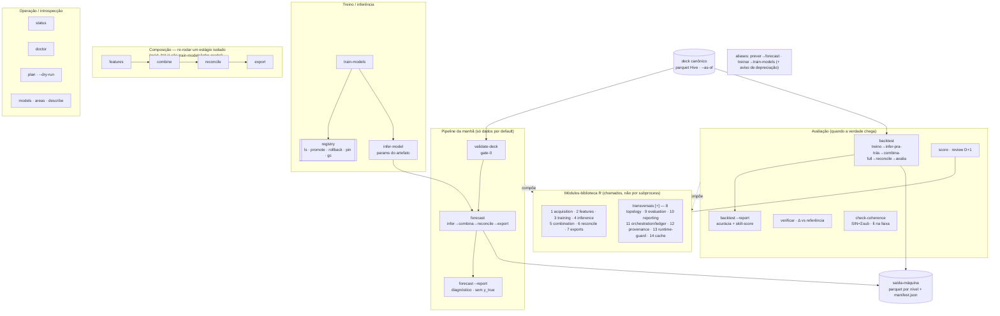

# CLI modular `prevcarga` — documento de OBJETIVO

> **Status:** DRAFT · 2026-10-10 · plano ativo (tier `docs/roadmap/`).
> **Natureza:** documento de *objetivo* (como vai ser) + propostas adicionais. O estado atual e o
> caminho até aqui estão no doc irmão **[CLI-MODULAR-ONDE-ESTAMOS.md](./CLI-MODULAR-ONDE-ESTAMOS.md)**.
> **Pré-requisito de runtime:** a CLI alvo é **R-only** (R + renv, empacotado no bundle) — depende de
> fechar **[MIGRACAO-COMBINA-R.md](./MIGRACAO-COMBINA-R.md)** (M1…M6), que tira o Python do caminho e
> reescreve a casca `prevcarga` em Rscript+docopt. A camada modular **nasce** nessa reescrita (M5).

---

## 0. Objetivo

Transformar o `prevcarga` de uma **casca fina Python** que veste runners bash por `subprocess`+ENV
(`treinar`/`prever`/`verificar`) em uma **CLI modular em R**, onde:

- o pipeline está quebrado em **módulos reutilizáveis chamáveis como biblioteca** (não por `subprocess`),
- a CLI expõe **comandos ergonômicos** que compõem esses módulos,
- o operador do ONS roda a rodada da manhã com um punhado de verbos claros,
- tudo com **zero dependência gerenciada pelo usuário** (bundle R-only) em **Windows (WSL2) e Linux**.

Os **7 módulos** que você pediu são o núcleo; o mapeamento mostrou **4 módulos transversais
faltando** que são pré-requisito (topologia, avaliação, proveniência/determinismo, reporting) — estão
abaixo marcados como `[+]`.

---

## 1. Princípios de arquitetura

1. **Módulo = função R importável**, não script invocado por `subprocess`+ENV. A CLI é a fachada fina
   que resolve argumentos, monta o contexto e chama módulos. (Hoje a lógica mora em bash/ENV/arquivos.)
2. **R-only, zero-dep.** Sem Python no caminho. Conteúdo empacotado = bundle R-only; veículo = instalador
   que baixa **o mesmo bundle** (ver §6). Depende de MIGRACAO-COMBINA-R concluída.
3. **Honestidade é invariante de módulo, não do `subprocess`.** Ao colapsar em R in-process some o
   isolamento de processo que hoje garante o corte honesto (regra G5 do `walk_forward.R`). Cada módulo
   reasseria o corte internamente, com teste falsificável (Δ=0 / perturbação). Ver §4.1.
4. **Determinismo é setado e asserido no topo de cada comando** (TZ=UTC, LC=C.UTF-8, BLAS 1-thread),
   dentro do R — não só no wrapper shell nem só nos testes. Ver §4.3.
5. **Composability:** cada módulo tem um comando standalone (re-combinar sem reinferir; re-reconciliar
   sem recombinar; re-exportar; re-pontuar uma saída antiga).
6. **Fonte única de topologia** (modelos × áreas × árvore de subsistema × membros × horizonte/janela),
   lida de uma peça R, nunca re-hardcoded nem derivada de `job.json` em silêncio.
7. **Saída de dados (máquina) ≠ relatório (humano).** `exports` escreve parquet+manifest; `reporting`
   produz HTML/PDF. São módulos distintos.
8. **Tudo tem `--format {text,json}` e exit-code por classe de erro** — a CLI serve de gate de CI e de
   automação do ONS, não só de uso interativo.

---

## 2. Arquitetura modular — os módulos

Legenda: **(U)** = pedido por você · **[+]** = adicionado pelo mapeamento (pré-requisito/transversal).

### Módulos de pipeline
| # | Módulo | Responsabilidade | Hoje (semente) |
|---|---|---|---|
| 1 | **acquisition/validation** (U) | abrir o store canônico; validar **formato** (schema/colunas/tipos/tz) **e completude** (datas/horas/slots/áreas/janela mínima); **sanidade física** (carga>0, faixa, outlier/flatline, dedup, monotonicidade); honestidade do clima (`issue_time<=O`). Emite veredito estruturado. | `scripts/lib/validate_input.R` (asserts), `scripts/tools/scan_completude_24slots.R`, `scripts/tools/analyze_data_quality.py` (portar p/ R), `_validate_contract` (fronteira rasa) |
| 2 | **feature-engineering** (U) | **fachada** sobre a FE por-plugin (hoje 5 implementações distintas); materializar `feature_table` desacoplada do treino | `models/*/R/feature_engineering/*.R` (por-modelo, assinaturas divergentes) |
| 3 | **training** (U) | laço modelo×área; derivar o **corte de treino honesto por modelo** (`origem−1−horizonte`, lendo `horizon_days` do `job.json`); produzir artefato auto-descritivo | `models/*/R/orchestrator` + `training` + `utils.R save_artifact`; corte em `job_lib.sh:228` |
| 4 | **inference** (U) | ler o artefato congelado e prever **sem retreinar**; parâmetros vêm **do artefato** (RDS), não de flags | `models/*/run_pipeline.R --mode infer`; `build_long_output.R` |
| 5 | **combination** (U) | ensemble convexo (FISTA+simplex) + freeze de pesos | `scripts/combina_baseline.py` → **migrando p/ R** (MIGRACAO-COMBINA-R) |
| 6 | **reconcile** (U) | hierárquico região→subsistema→SIN via perfil k̂ | `scripts/reconcilia_baseline.R` (já R) |
| 7 | **exports** (U) | achatar a árvore em layout plano por nível + `manifest.json` (sha256/linhas) | `_deliver` em `scripts/prevcarga` (Python, inline) |

### Módulos transversais (faltando — pré-requisito)
| # | Módulo | Responsabilidade | Por que é obrigatório |
|---|---|---|---|
| 8 | **topology/registry** `[+]` | fonte única: 24 folhas, 4 subsistemas (+perdas), 8 membros, horizonte/janela por modelo | hoje **quádruplo-hardcoded** (`prevcarga` Py, `combina_baseline.py`, `reconcilia_baseline.R`, `job.json`); `validate-deck`/`train-models`/`reconcile`/`exports` **todos** precisam dela; sem isso a CLI R re-hardcoda e diverge |
| 9 | **evaluation/scoring** `[+]` | fonte única de WMAPE/MAPE/MAE/RMSE/BIAS/peak/ramp/timing/resto-de-hoje + skill-score vs baseline | WMAPE hoje definido em **≥4 lugares divergentes**; consumido por `backtest`, `score` e `forecast --report` — se não for um módulo, os scorecards discordam entre si |
| 10 | **reporting** `[+]` | relatório **humano** (HTML **e PDF**) com proveniência/corte em destaque | hoje é `report_A.py`/`evaluate_model.R` (Python+Plotly, HTML-only, não-wired) — **não sobrevive ao R-only**; operador do ONS precisa de PDF arquivável |
| 11 | **orchestration/job-ledger** `[+]` | materializar a matriz (modelo×área×origem), progresso `47/192`, `--dry-run`, `--jobs`, `--resume` | o fan-out de ~192 jobs é hoje loop bash sem estado/progresso/resume |
| 12 | **provenance/run-manifest** `[+]` | carimbar `{data_hash, cutoff, member_set_hash, model_versions, code_commit, renv_lock_hash, seed, platform, BLAS, TZ/LC, bundle_id}` em todo artefato e saída | hoje artefato só tem `trained_at`; `bundle_ref` é **caminho**, não hash — buraco de proveniência num produto que vai pra operação |
| 13 | **runtime-guard/config** `[+]` | setar/asserir determinismo; perfis `dev/prod/local/s3` em vez de inferir modo pelo prefixo `s3://` | pins de BLAS 1-thread só vivem nos testes hoje; in-process o Matrix/data.table pode multithreadar e quebrar Δ=0 em silêncio |
| 14 | **cache (content-addressed)** `[+]` | reuso de feature-tables/artefatos chaveado por fingerprint, **honrando o corte honesto** | backtest default (5 modelos×24 folhas×N origens) sem cache = explosão de custo que pressiona atalhos que furam a honestidade |

> **Nota de verdade sobre FE (#2):** não existe FE compartilhada hoje — são 5 implementações com
> nomes/args próprios. "feature-engineering como módulo" é, na prática, **padronizar uma assinatura
> comum entre os 5 plugins** + expor uma fachada. É trabalho real, não wrapper trivial.

---

## 3. Comandos da CLI

### 3.0 Mapa visual da CLI

> **Como ler:** o operador toca só `--as-of`; `validate-deck` é gate-0 encadeado; `forecast` compõe infer→combina→reconcile→export e seu `--report` é **diagnóstico** (nunca acurácia); a acurácia vive em `score`/`backtest --report` (reusam o módulo 9). Todos os verbos são fachada fina sobre os **módulos-biblioteca** (1–7) apoiados nos **transversais** (8–14); `runtime-guard` (13) roda **primeiro** em todo comando.

### Pipeline (os que você citou)
| Comando | Faz | Compõe | Flags-chave |
|---|---|---|---|
| `prevcarga validate-deck` **(U)** | valida **formato + completude + sanidade** do deck, standalone, **antes** de gastar compute; veredito estruturado | 1 (+8 topologia, +13 guard) | `--as-of`, `--model/--area` (escopo), `--na-policy {fail\|zero\|carry}`, `--format json`, `--strict-dst` |
| `prevcarga train-models` **(U)** | treina **todos** os modelos×áreas (default) ou subset; gera artefatos | 2,3 (+8,+11,+12) | `--model <lista\|todos>`, `--area/--subsistema/--areas`, `--as-of <data>` (deriva corte honesto **por modelo**), `--dry-run`, `--jobs`, `--force` |
| `prevcarga infer-model` **(U)** | infere **um** modelo×área com params **lidos do artefato** | 1,4 (+8,+12) | `--model`, `--area`, `--as-of`, `--artifact-version/--pin` |
| `prevcarga forecast` **(U)** | ciclo completo infer+combina+reconcile; **default só dados** | 1,4,5,6,7 | `--as-of`, `--niveis`, `--report`, `--report-format {html,pdf}`, `--skip-validate` |
| `prevcarga backtest` **(U)** | treino→inferência **pra trás**, dia-a-dia, avaliando; **default só dados** | 1,3,4,5,6,7,9 (+11,+14) | `--from/--to` ou `--last 30d`, `--model/--area`, `--corte <HH:MM>` (varrer corte intradiário), `--dplus`, `--baseline persistencia`, `--report`, `--resume` |

### Avaliação (onde o mapeamento corrigiu a proposta)
| Comando | Faz | Por quê |
|---|---|---|
| `prevcarga score` **[+]** | pontua uma previsão **já publicada** contra `y_true` quando a verdade chega (review D+1) | `forecast --report` **não pode** mostrar acurácia (sem `y_true` no futuro). Fecha o loop do operador. Reusa módulo 9 |
| `prevcarga verificar` (mantém) | reprodutibilidade+integridade (sha256 + `\|Δ y_pred\|` ≤ TOL) vs **referência** | é QA de reprodução, **não** acurácia — distinto de `score` |
| `prevcarga check-coherence` **[+]** | gate duro **(a) SIN == Σ(4 subsistemas)** (aditiva) **+ (b)** subsistema == Σregiões·**k̂** com k̂ em faixa física (~1.0–1.15) — identidade **multiplicativa** (a perda é resíduo multiplicativo, ADR-0015; **não** há série `y_pred(perda)` aditiva — ver `M3-AVALIACAO.md` §M3.4) | a reconciliação é "coerente por construção" mas nada **prova** isso na entrega |

### Composição — re-rodar um estágio isolado
`prevcarga features` · `prevcarga combine` · `prevcarga reconcile` · `prevcarga export` — rodar um
módulo isolado sobre artefatos existentes (re-combinar sem reinferir, re-reconciliar sem recombinar, etc.).
⚠ São os **4 módulos sem verbo-de-pipeline próprio** (2 features / 5 combination / 6 reconcile / 7 exports),
que de outro jeito só rodariam **dentro** de `train-models`/`forecast`. Os **7 módulos de pipeline são todos
rodáveis sozinhos**: 1=`validate-deck`, **3=`train-models`, 4=`infer-model`** (já verbos de primeira classe),
5/6/7/2 aqui.

### Operação / introspecção
| Comando | Faz |
|---|---|
| `prevcarga status` **[+]** | 1º da manhã: deck mais recente usável, idade/versão do bundle, **staleness** bundle-vs-deck, último forecast OK |
| `prevcarga doctor` **[+]** | pré-voo de runtime: R/renv, arrow+ARROW_S3, aws CLI, glibc, **assere** TZ/LC/BLAS 1-thread |
| `prevcarga plan` / `--dry-run` **[+]** | materializa a matriz modelo×área×origem + custo estimado antes de disparar |
| `prevcarga publish`/`promote` **[+]** | congela/elege o **bundle oficial do dia** (verbo explícito e auditável do seam train→apply) |
| `prevcarga registry` (ls/show/promote/rollback/pin/gc) **[+]** | ciclo de vida de artefato + **GC** dos `v_*` que acumulam |
| `prevcarga models`/`areas`/`describe` **[+]** | introspecção da topologia (par do módulo 8) |

> **Compatibilidade:** `prever`→`forecast` e `treinar`→`train-models` mantêm **alias + aviso de
> depreciação** (há cron/scripts dependendo dos nomes atuais).

---

## 4. Contrato transversal (o que faz a arquitetura ser honesta e automatizável)

### 4.1 As TRÊS datas — o ponto #1 de honestidade
Há **três** conceitos de data que a proposta "cortar dados pra trás" funde perigosamente:

1. **forecast-origin** = o "hoje" da rodada → **único date-flag do operador**, `--as-of` (default = último
   dia completo do deck).
2. **corte-de-treino** = `origem − 1 − horizonte`, **DIFERE por modelo** (RF C−10, LGBM C−2, HW/dessem
   `--retrain`). **Derivado** de `--as-of` lendo `horizon_days` do `job.json` — **nunca** um valor único
   aplicado a todos (isso vazaria horizonte nos modelos de horizonte maior).
3. **corte-intradiário** (`available_until`, ex. 08:00) = propriedade do **snapshot de dado**
   (`manifest.json` `corte`) → **nunca** flag humana em produção; `backtest` pode **varrê-lo** com `--corte`
   para medir a correção BLF/resto-de-hoje.

**Regra:** o único flag de data que o humano seta é `--as-of`. Os outros dois são derivados/do-dado. Essa
distinção é invariante e aparece em `plan`/`describe`.

### 4.2 Saída-máquina + exit codes
`--format {text,json}` global; taxonomia estável de exit-code por classe (`0` ok / `2` formato /
`3` completude / `4` escopo-área / `5` déficit-de-janela / `6` bundle), alinhada ao prefixo
`[prevcarga/contract]`. Sem isso `validate-deck`/`doctor` não servem de gate de CI.

### 4.3 Determinismo asserido
`runtime-guard` roda **primeiro** em todo comando: seta TZ=UTC, LC=C.UTF-8, `OMP/OPENBLAS/MKL/VECLIB=1` e
**aborta** se detectar threads>1/TZ≠UTC (`--strict-determinism`). Hoje esses pins só existem nos harness
de teste — in-process é obrigatório movê-los pro módulo.

### 4.4 Proveniência + idempotência
- **Artefato content-addressed:** `version = hash(model_id + data_fingerprint + cutoff + feature_config +
  code_commit + renv_lock_hash)`; `trained_at`/`package_version` como **metadado lateral** (não entra no
  hash — senão reintroduz não-determinismo, contra o GATE 10). ⚠ **`model_id` (o `mdir`/`name` do `run.yaml`) é
  obrigatório** (6º campo, refina ADR-0011/0021): sem ele os membros DESSEM `RGD_MED` e `LIN_MED` — `run.yaml`
  idêntico + mesma `exogena` — colidem no mesmo hash. Hoje `version` é timestamp → dois treinos idênticos geram
  IDs diferentes e podem colidir no mesmo segundo num laço de 24×5.
- **Run-manifest por execução** (não só do dado): carimba a cadeia inteira; `verificar` passa a **asserir**
  identidade de bundle/dado, não só comparar `y_pred`.
- **Pin de entrada:** `validate-deck` emite `data_hash`; `train/forecast` fazem `--expect-data-hash` e
  falham se o deck mudou sob você.

---

## 5. Relatório (humano) vs exports (máquina)

- **`exports`** = parquet por nível (SIN/subsistemas/folhas) + `manifest.json`. Já existe (Python inline);
  vira módulo R.
- **`reporting`** = documento humano. **`forecast --report` é diagnóstico** (curva do dia, corte usado,
  pesos dos membros, sanidade vs persistência/vs ontem) — **não** acurácia. **`score`/`backtest --report`**
  é que mostram acerto (WMAPE/skill por horizonte/subsistema/SIN/tipo-de-dia). Motor em R, saída **HTML +
  PDF** (o `report_A.py` Plotly não sobrevive ao R-only e PDF é o que o operador anexa à submissão DESSEM).

---

## 6. Empacotamento (fecha o "zero-dep")

- **Conteúdo:** o **bundle R-only** (R + biblioteca renv pré-buildada, relocável) — muito mais simples que
  o híbrido, já que o Python saiu (MIGRACAO-COMBINA-R). (É o conceito antes chamado de "marmita".)
- **Distribuição (decisão de 2026-10-10):** **hospedar UM bundle no S3** e o instalador **baixa sempre o
  mesmo** pra todo mundo. Isso evita `renv::restore()` compilar pacotes com toolchain/BLAS diferentes por
  host (fonte de quebra de Δ=0). O bundle vira **artefato versionado** no S3.
- **Instaladores bootstrap:** `install.sh` (Linux/bash) e `install.ps1` (Windows/PowerShell) que
  **baixam o bundle + verificam hash + extraem em pasta user-local + apontam a CLI pra lá**. É o script de
  build do bundle (hoje `ci/build_marmita.sh`) R-only publicado no S3 + os dois instaladores puxando de lá.
- **Paridade por alvo:** o bundle jammy x86_64 roda no **Linux e no WSL2** (herda Δ=0). Windows-nativo
  seria **outro** artefato, com paridade só até TOL_REL=0,1% — decidir se o `install.ps1` provisiona R
  **dentro do WSL2** (mantém Δ=0) ou R nativo-Win (cai a promessa). Gate não-código: a frota Windows do
  ONS permite WSL2 (virtualização + GPO)? Validar antes.

---

## 7. Propostas adicionais (o que faltava na lista) — priorizadas

**P0 — mudam a arquitetura, fazer cedo:**
- **Módulo topologia/registry** como fonte única (§2 #8) — destrava os seletores `default=todos` e o
  corte honesto por-modelo. Estende o `combina_members.R` já previsto no M5 para modelos+áreas+níveis.
- **Módulo evaluation** com WMAPE em fonte única (§2 #9) — pré-requisito de `score`/`backtest`/`--report`.
- **`runtime-guard`** com determinismo asserido in-process (§4.3) — senão o R-only regride a reprodução.
- **Honestidade como invariante de módulo + teste falsificável** (§1.3) ao perder o isolamento de processo.

**P1 — produto operável:**
- **`score` (review D+1)** e deixar claro que `forecast --report` é diagnóstico (§5).
- **`validate-deck` como gate-0 encadeado** em forecast/train/backtest (não comando paralelo opcional),
  com `--skip-validate`. Falhar antes de gastar compute é a maior economia da manhã.
- **`plan`/`--dry-run` + `--resume` + progresso `47/192`** para a rodada de 192 jobs ser previsível e
  retomável (hoje morre e recomeça do zero).
- **Gate de coerência hierárquica** (`check-coherence`, §3) provando SIN=Σsubsistemas e k̂ em faixa.
- **Skill-score vs baseline** (persistência / sazonal-ingênuo D−7) — hoje não há régua: "WMAPE 4%" não
  diz se o ensemble ganha do trivial.

**P2 — robustez de domínio e dado:**
- **Calendário/DST-aware** na completude (dia de DST tem 23h/25h → a checagem fixa de slots dá falso
  positivo) e **cobertura de feriados futuros** (D+1..D+8) e **regionais por `area_code`**.
- **Sanidade física** (carga>0, faixa por subsistema, outlier/flatline/dedup) **antes** do fill — hoje
  RF/LGBM preenchem NA com 0 em silêncio (carga 0 MW envenena o treino).
- **Honestidade do clima** no deck (`issue_time<=O`).
- **Janela mínima por membro** (45d/730d/1825d) reportada no `validate-deck` **antes** do abort profundo.
- **`registry` GC/retenção** dos `v_*` (crescem sem limite em disco/S3).
- **Manifest de avaliação** análogo ao `manifest.json` dos dados (hoje scorecards são CSV/HTML soltos).
- **`prevcarga morning`** (runbook): `status → validate-deck → score(ontem) → forecast → report` num verbo.
- **Determinístico vs probabilístico explícito:** se a entrega é point-forecast, registrar isso; se houver
  P10/P50/P90 no futuro, o módulo de avaliação já prevê cobertura/pinball.

---

## Relacionados
- [MIGRACAO-COMBINA-R.md](./MIGRACAO-COMBINA-R.md) — **pré-requisito de runtime** (R-only + CLI R+docopt).
- [CLI-MODULAR-ONDE-ESTAMOS.md](./CLI-MODULAR-ONDE-ESTAMOS.md) — estado atual + plano para chegar aqui.
- `docs/ESTADO-ATUAL.md` §6 (contrato de entrada, corte honesto), §7 (reconciliação), §10 (determinismo).

## Fonte do design
Mapeamento por workflow `cli-modular-map` (run `wf_5b70abdc-294`): 5 leitores de subsistema
(CLI+runners, aquisição/validação, features+training, infer+combina+reconcile, exports+report+backtest) +
4 críticas (domínio/SIN, arquitetura, MLOps/reprodutibilidade, operador/UX). 9 agentes, 0 erros.
