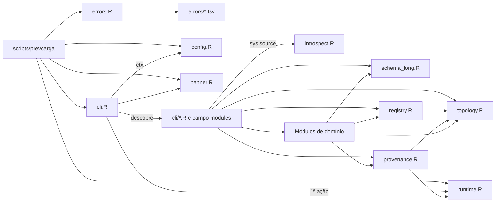

Arquitetura · 2.2

O produto é um conjunto de 29 arquivos R em <code>scripts/lib/</code>, cada um uma biblioteca de funções importável. O shim <code>scripts/prevcarga</code> carrega só cinco deles (erros, runtime, configuração, banner e fachada). Todo o resto entra por verbo: cada arquivo <code>scripts/lib/cli/*.R</code> declara no campo <code>modules</code> a lista de módulos que precisa, e a fachada os carrega depois de fixar o runtime e montar o ctx. Os módulos da fundação definem o contrato; os de domínio o consomem. Essa separação deixa cada processo carregar só o que o comando usa.

## Como um módulo entra no processo

A carga tem duas fases, sempre nesta ordem.

1. **Shim.** `scripts/prevcarga` se localiza pelo argumento `--file=` do Rscript, faz `source()` de `errors.R` e `runtime.R` a partir do próprio diretório, resolve a raiz de instalação com `prevcarga_install_root()` e então carrega `config.R`, `banner.R` e `cli.R` a partir dessa raiz. Em seguida delega a `prevcarga_main()`. O shim não conhece nenhum verbo.
2. **Verbo.** `prevcarga_verbs_discover()` lê os arquivos de `scripts/lib/cli/`. Cada um define um único objeto `prevcarga_verb_*` com `name`, `usage`, `options`, `handler`, `owner`, `exempt` e `modules`. Em `.prevcarga_run_verb`, a fachada chama o runtime (salvo nos verbos isentos), monta o ctx com `prevcarga_ctx()` e só então faz `sys.source()` de cada arquivo listado em `modules`, na ordem declarada, no ambiente global. Depois chama o handler.

O cabeçalho da maioria dos arquivos declara numa linha `Requer ...` os módulos que precisam estar carregados antes (`banner.R`, `errors.R` e `features.R` não têm essa linha). Nenhum módulo de domínio faz `source()` de outro. Fora da fachada há só duas cargas. A primeira é `prevcarga_worker_init` de `training.R`: com `--jobs` maior que 1, o treino e o backtest abrem workers PSOCK, e cada worker, um R novo, carrega uma lista fixa de módulos (a do treino ou a da orquestração) e fixa o runtime. A segunda é o loader de plugins de `registry.R`, que carrega o `R/` de cada plugin, e o do motor encadeado quando há, em ambiente isolado.

Há 20 verbos com arquivo em `scripts/lib/cli/`. A lista `prevcarga_verbs_planned` em `cli.R` registra 13 verbos com o dono de cada um; um verbo planejado sem arquivo vira o stub `todo.not_implemented`. Os 13 têm arquivo, então nenhum stub dispara. A mecânica completa está em [Fachada da CLI e ciclo de um comando](/arquitetura/fachada-cli) e em [Barrel por descoberta](/arquitetura/barrel-descoberta).

## Módulos da fundação e seus consumidores

A fundação é o contrato que os módulos de domínio herdam: classes de erro e códigos de saída, ctx, runtime fixado, topologia, schema LONG, identidade content-addressed e registro de plugins. O dono de cada módulo segue a tabela de donos de `scripts/lib/README.md`; os consumidores foram conferidos nos campos `modules` dos verbos e nas linhas `Requer` dos módulos.

| Módulo | O que define | Quem carrega | Consumidores | Página |
|---|---|---|---|---|
| `errors.R` + `errors/*.tsv` | `prevcarga_abort`, `prevcarga_warn`, envelope de erro, tabela de exit 0–15 e precedência; cada módulo é dono do seu `.tsv` | shim | todos os módulos; `scripts/tools/export_error_catalog.R` gera o catálogo | [Erros e códigos de saída](/arquitetura/erros-exit) |
| `runtime.R` | fixa TZ, locale e BLAS de 1 thread no processo; `runtime_id`, `bundle_id`, checagem de plataforma do `doctor` | shim | `cli.R` (primeira ação de todo verbo não isento), `introspect.R`, `provenance.R` (carimbo do run-manifest), `forecast.R` (`bundle_id`) | [Runtime](/arquitetura/runtime) |
| `config.R` | `prevcarga_ctx()`: flag, depois `config.yaml`, depois default; `run_id` | shim | `cli.R`, `introspect.R`, `validation.R`, `forecast.R`, `release_pack.R` | [Configuração e ctx](/arquitetura/configuracao-ctx) |
| `banner.R` | banner ASCII: nome, curva de carga de um dia com eixo de 0h a 24h, identidade e versão | shim | `cli.R` (ajuda, versão, chamada sem verbo e `doctor`; só com stdout em terminal, nunca com `--format json`) | [Fachada da CLI](/arquitetura/fachada-cli) |
| `cli.R` + `cli/*.R` | descoberta de verbos, usage docopt gerado, despacho runtime-first, `prevcarga_emit()`; cada verbo é dono do seu arquivo | shim | ponto de entrada de todo comando | [Fachada da CLI](/arquitetura/fachada-cli) |
| `introspect.R` | construtores e renderizadores de `doctor`, `status`, `models`, `areas` e `describe` | verbos | `cli/doctor.R`, `cli/status.R`, `cli/models.R`, `cli/areas.R`, `cli/describe.R` | [Diagnóstico e introspecção](/execucao/diagnostico) |
| `topology.R` | `prevcarga_topology()`, `prevcarga_members()`, `prevcarga_model_spec()` sobre `config/topology.yaml` e `models/*/run.yaml` | verbos | 16 dos 20 verbos; `registry.R`, `provenance.R`, `dates.R`, `validation.R`, fachadas, combina, reconcile, orquestração | [Topologia e contrato por modelo](/arquitetura/topologia-run-yaml) |
| `schema_long.R` | `prevcarga_schema_long`: nome, ordem e tipo das 8 colunas; único par `interval_end` e `interval_start` | verbos | `evaluation.R`, `combination.R`, `build_long_output.R`, `reconcile.R`, `exports.R`, `verify_repro.R` | [Schema LONG](/arquitetura/schema-long) |
| `provenance.R` | `prevcarga_version_hash()` (`v_` mais 16 hex sobre 8 chaves), run-manifest, `prevcarga_freeze()` e `prevcarga_thaw()` | verbos | `training.R`, `combination.R`, `reconcile.R`, `cache.R`, `exports.R`, `forecast.R`, `verify_repro.R`, despachante de plugins | [Proveniência e estado](/arquitetura/proveniencia-estado) |
| `registry.R` | contrato Tier A, loader e despachantes de plugin, registry local e ciclo de vida | verbos | `training.R`, `inference.R`, `combination.R`, `reconcile.R`, `orchestrate.R`, `backtest.R`, `release_pack.R`, `cli/registry.R` | [Registry de artefatos](/arquitetura/registry) |

Dois números ajudam a ler a tabela. `topology.R` aparece em 16 verbos: só `doctor`, `status`, `export` e `verificar` não o carregam. `provenance.R` aparece em 17: só `doctor`, `status` e `export` ficam sem ele.

### O registry tem camadas

`registry.R` é a fronteira de contrato e reúne, no mesmo arquivo, as camadas que dependem dela. Assim o contrato e quem o usa ficam lado a lado. As seções estão marcadas no código.

| Camada | Funções de entrada |
|---|---|
| Fronteira Tier A, estado só em memória da sessão | `prevcarga_register`, `prevcarga_registry`, `prevcarga_registry_reset` |
| Loader de plugins em ambiente isolado | `prevcarga_plugin_load`, `prevcarga_plugin_descriptor`, `prevcarga_plugin_data_lags` |
| Contrato de freeze e thaw do plugin | `prevcarga_plugin_stamp`, `prevcarga_plugin_scan_pure`, `prevcarga_plugin_freeze_bytes`, `prevcarga_plugin_thaw` |
| Despachantes de estágio | `prevcarga_plugin_train`, `prevcarga_plugin_infer`, `prevcarga_plugin_forecast` |
| Núcleo do registry local no layout do repositório online | resolução de versão e carga de artefato |
| Ciclo de vida e leitura | promote, rollback, pin, unpin, gc, ls e show, despachados pelo verbo `registry` |

O despachante é o único ponto que desloca a hora de modelagem e que reamostra o painel para o plugin. Isso está em [Fundação de plugins](/arquitetura/fundacao-plugins) e em [Despachante de plugin](/arquitetura/despachante).

<Figura id="FIG-A01" titulo="Mapa de módulos: carga e dependência da fundação" natureza="Estrutura" fontes={['scripts/prevcarga', 'scripts/lib/cli.R', 'scripts/lib/README.md', 'scripts/lib/registry.R', 'scripts/lib/provenance.R']} adrs={['ADR-0022', 'ADR-0040']}>

</Figura>

A seta vai de quem carrega ou depende para o que é carregado ou usado. Todo módulo depende de `errors.R`, mas essas setas foram omitidas: ele é carregado pelo shim antes de qualquer outro, e nenhum verbo o lista em `modules`.

## Módulos de domínio

Cada módulo de domínio é dono de uma etapa e declara no cabeçalho o que requer. A coluna "Verbos que carregam" vem dos campos `modules` de `scripts/lib/cli/*.R`.

| Módulo | Responsabilidade em uma linha | Verbos que carregam | Página dona |
|---|---|---|---|
| `deck_reader.R` | leitor único do deck: só ele abre o `manifest.json` e chama `arrow::open_dataset`; deriva o `available_until` do próprio dado | 13 verbos | [Leitor único do deck](/arquitetura/leitor-deck) |
| `dates.R` | os três cortes: origem O, corte de treino pela classe de split e `last_data_day`, corte de insumo derivado do dado | 11 verbos | [Os três cortes de data](/metodologia/tres-cortes) |
| `validation.R` | `prevcarga_validate_deck()`: veredito acumulativo do deck antes de qualquer cálculo | 9 verbos | [Validação do deck](/arquitetura/validacao-deck) |
| `evaluation.R` | fonte única de métrica (WMAPE, MAPE, MAE, RMSE, BIAS, pico), baselines, `score`, `check-coherence` e o leitor único do LONG em disco | `score`, `check-coherence`, `combine`, `reconcile`, `forecast`, `backtest`, `verificar` | [Avaliação](/metodologia/avaliacao) |
| `combination.R` | núcleo da combina: projeção no simplex, FISTA, máscara de treino por mês de origem, produtores e congelamento dos pesos | `combine`, `forecast`, `backtest` | [Combinação convexa](/metodologia/combina) |
| `features.R` | dono único dos transforms de grade (`to_hourly`, `to_semihourly`, `to_model_frame`, `to_display_frame`, `prevcarga_delivery_grid`) e da fachada de feature engineering `prevcarga_build_features` | 9 verbos | [Tempo: rótulo, fusos e ajuste de hora](/metodologia/tempo-rotulo-fusos) |
| `training.R` | fachada de treino de uma célula modelo × variante × área × origem, até o artefato `v_` no registry | `train-models`, `plan`, `forecast`, `backtest` | [Despachante e fachadas](/arquitetura/despachante) |
| `inference.R` | fachada de inferência de uma célula; lê o spec do artefato e nunca escreve no registry | `infer-model`, `features`, `forecast`, `backtest` | [Despachante e fachadas](/arquitetura/despachante) |
| `build_long_output.R` | conversor único e puro da entrega do membro para o painel LONG de 8 colunas | `forecast`, `backtest` | [Schema LONG](/arquitetura/schema-long) |
| `reconcile.R` | Bottom-Up por `interval_end` e perfil k-hat por `interval_start`, com o perfil como artefato do registry | `reconcile`, `forecast`, `backtest` | [Reconciliação](/metodologia/reconciliacao) |
| `exports.R` | cópia de bytes do scratch para a chave imutável de entrega, com `manifest.json` | `export`, `forecast`, `release-pack`, `verificar` | [Entrega e export imutável](/arquitetura/entrega-export) |
| `reporting.R` | primitivas HTML e SVG; relatório diagnóstico do `forecast --report` e relatório do `backtest --report` | `forecast`, `backtest` | [Rodada diária](/execucao/rodada-diaria) |
| `forecast.R` | rodada diária de uma origem O: validação do deck, plano, infer, LONG, combina, reconcile, chave e export; só compõe | `forecast` | [Rodada diária](/execucao/rodada-diaria) |
| `orchestrate.R` | matriz membro × folha × origem × corte, ledger local por presença, lock e despacho com `--jobs` | `plan`, `backtest` | [Backtest e plano](/execucao/backtest) |
| `cache.R` | cache content-addressed local, com a chave pelo hash de `provenance.R` e o corte por classe de split | `plan`, `backtest` | [Cache content-addressed](/arquitetura/cache) |
| `backtest.R` | MAP de uma célula por vez com o código de produção e REDUCE com combina por mês, reconcile por origem e avaliação | `backtest` | [Backtest](/metodologia/backtest) |
| `release_pack.R` | montagem local e atômica do pacote no layout do repositório online; nunca fala rede | `release-pack` | [Distribuição](/arquitetura/distribuicao) |
| `verify_repro.R` | verificação de reprodutibilidade de duas entregas em 4 fases: integridade, identidade, pareamento e valores por trilho | `verificar` | [Verificar uma entrega](/execucao/verificar) |

:::note Um ponto que a tabela não mostra
`features.R` não depende de plugin nenhum, mas `to_model_frame` e `to_display_frame` só são chamados pelo despachante, com o deslocamento declarado no descriptor.
:::

### O que um módulo de domínio não faz

Os cabeçalhos repetem as mesmas proibições.

- Nenhum lê variável de ambiente nem o relógio da máquina. O único `Sys.getenv` e `Sys.setenv` do pacote é o de `runtime.R`; a data-hora de parede só entra pelo `run_id` de `config.R`. O cronômetro por passo da rodada é injetado pelo verbo `forecast` no ctx, e `forecast.R` não lê relógio.
- Nenhum abre o deck por conta própria: o deck só é lido por `deck_reader.R`, e o LONG em disco só por `prevcarga_read_long` de `evaluation.R`.
- As fachadas, a combina, o reconcile e a orquestração não calculam corte de treino: `train_origin` e `last_data_day` vêm de `dates.R`.
- Nenhum faz aritmética de hora de modelagem. O par `interval_end` e `interval_start` do LONG mora só em `schema_long.R`, e o deslocamento de modelagem só no despachante.

## Fora de scripts/lib

Três lugares completam o mapa e são consumidos pelos módulos acima, sem ser carregados pelo shim.

| Lugar | O que contém | Quem usa | Página |
|---|---|---|---|
| `models/*/` | um plugin por modelo, com `run.yaml` e `R/`; `models/_dessem-engine/` é o motor comum da família DESSEM | `prevcarga_plugin_load` de `registry.R`, chamado pelas fachadas e pela orquestração | [Fundação de plugins](/arquitetura/fundacao-plugins) |
| `scripts/lib/errors/*.tsv` | 43 catálogos de `error.id`, um por dono (módulo, plugin, verbo ou ferramenta); `core.tsv` traz os ids da fundação | `prevcarga_errors_load()` de `errors.R`; `install/error-catalog.tsv` é gerado, não versionado | [Erros e códigos de saída](/arquitetura/erros-exit) |
| `scripts/tools/` | ferramentas de mantenedor, como a montagem do bundle e a geração do catálogo de erros | release, nunca a rodada | [Distribuição](/arquitetura/distribuicao) |

Para acrescentar um verbo ou um `error.id` sem editar lista central, veja [Barrel por descoberta](/arquitetura/barrel-descoberta).
