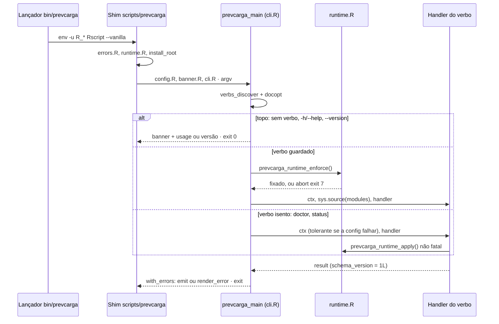

<span className="pc-overline">Arquitetura · 2.3</span>

<p className="pc-lead">A CLI é uma fachada fina. O shim `scripts/prevcarga` não conhece nenhum verbo: ele carrega a fundação e delega a `prevcarga_main`, em `scripts/lib/cli.R`. A função descobre os verbos na pasta `scripts/lib/cli/`, monta a gramática docopt, decide entre três ramos (topo, verbo guardado, verbo isento), roda o handler sob um único tratador de erros e emite o resultado uma vez, em texto ASCII ou num envelope JSON. Todo comando termina num código de saída da tabela do ADR-0040.</p>

## O shim scripts/prevcarga

O shim é um script Rscript de 25 linhas e só despacha. O cabeçalho diz a regra: nenhum verbo entra por ele, e ele não é editado para adicionar verbo.

A sequência é fixa:

1. Localiza o próprio caminho pelo argumento `--file=` que o Rscript passa. Sem esse argumento, escreve em stderr uma mensagem no formato de erro da CLI e sai com exit 7 (classe `runtime`).
2. Define `options(prevcarga.lib = ...)` com a pasta `lib/` ao lado do script.
3. Carrega `errors.R` e `runtime.R` dessa pasta.
4. Resolve a raiz da instalação com `prevcarga_install_root()` (em `runtime.R`): a raiz é dois níveis acima do script e tem de conter `scripts/lib/runtime.R`; senão, levanta `runtime.install_root_unresolved`. Essa condição nasce fora de `prevcarga_main` e do tratador único, então não sai no formato de quatro linhas: o R imprime `Error: [prevcarga/runtime] ...` e o processo termina com o status de erro padrão do Rscript (1), não com o exit 7 da classe.
5. Carrega `config.R`, `banner.R` e `cli.R` relativos a essa raiz.
6. Chama `quit(status = prevcarga_main(commandArgs(TRUE), root = root))`.

O corpo está protegido por `identical(environment(), globalenv())`. Assim o shim pode ser carregado com `sys.source` sem disparar `quit`.

Antes do shim vem o lançador da instalação. No Linux, `install/prevcarga` (copiado para `<R>/bin/prevcarga`) acha a raiz pelo próprio caminho, lê o ponteiro `current` e executa o Rscript do bundle com `--vanilla`, depois de descartar as variáveis herdadas que poriam uma biblioteca de fora no `.libPaths()` (`R_HOME`, `R_LIBS`, `R_LIBS_USER`, `R_LIBS_SITE`, `R_PROFILE_USER`, `R_ENVIRON_USER`). O lançador não define nenhuma variável: TZ, locale e BLAS são fixados dentro do processo pelo `runtime.R`. No Windows, `install/prevcarga.cmd` faz o mesmo, limpando as mesmas seis variáveis só no processo. Sem `current` ou sem a versão apontada, os dois lançadores saem com exit 6 (classe `bundle`) antes de chegar ao R. A instalação está na página [Distribuição](/arquitetura/distribuicao).

## prevcarga_main e os três ramos

`prevcarga_main(argv, verbs, root, runtime, handlers)` é a única função que decide o destino de um comando. Os argumentos `verbs`, `runtime` e `handlers` têm default de produção (`prevcarga_verbs_discover()`, `prevcarga_runtime_enforce`, nenhum) e existem para que se injetem outros verbos e outro runtime sem mudar a função.

<Figura id="FIG-A02" titulo="Do comando ao código de saída" natureza="Fluxo" fontes={['install/prevcarga', 'scripts/prevcarga', 'scripts/lib/cli.R', 'scripts/lib/runtime.R', 'scripts/lib/errors.R', 'docs/estado/cli.md', 'docs/estado/install.md']} adrs={['ADR-0040', 'ADR-0022']}>



</Figura>

### Antes dos ramos: descoberta e parse

`prevcarga_verbs_discover()` lista `scripts/lib/cli/*.R` em ordem `sort(method = "radix")` e carrega cada arquivo num ambiente próprio. O resultado é uma tabela com `verb`, `owner`, `exempt`, `usage` e as colunas-lista `modules`, `options`, `scoped` e `handler`. Um arquivo malformado (sem objeto, com nome divergente, handler que não é função, usage ausente) é bug do pacote e vira `generic.unexpected`, exit 1.

Além da tabela, `cli.R` define `prevcarga_verbs_planned`, um mapa verbo → dono para verbos ainda sem arquivo. Um verbo planejado sem arquivo vira stub: aparece na gramática e, se chamado, aborta com `todo.not_implemented` (exit 1, `where` = `<verbo> -> <dono>`). Na versão documentada todos os verbos planejados têm arquivo em `scripts/lib/cli/`, então nenhum stub está ativo. O mecanismo existe para que um verbo seja reservado na gramática antes de ter handler.

Com a tabela, `prevcarga_main` gera o texto de uso (`prevcarga_usage`) e faz o parse com `docopt::docopt(..., help = FALSE)`. A saída do docopt é capturada para não sujar o stdout.

### Os três ramos

| Ramo | Quando | Runtime | ctx | Saída |
|---|---|---|---|---|
| Topo | `argv` vazio; `-h` ou `--help` em qualquer posição; `--version` como 1º token; parse válido sem verbo | não roda | `prevcarga_ctx` sem verbo; se ele falhar, ctx tolerante | banner (salvo em `--format json`) e usage ou `prevcarga <versão>` em stdout; exit 0 |
| Verbo guardado | todo verbo com `exempt = FALSE` | `prevcarga_runtime_enforce()` é a 1ª ação do corpo | `prevcarga_ctx(args, root, verb)`; erro de config aborta | resultado do handler |
| Verbo isento | `exempt = TRUE`: hoje só `doctor` e `status` | o enforce não roda; o handler chama `prevcarga_runtime_apply()`, que não aborta | ctx normal; se `prevcarga_ctx` falhar, ctx tolerante com `ctx$config_error` | diagnóstico do ambiente; o exit vem do resultado |

Três consequências práticas:

- `prevcarga forecast --help` não mostra uma ajuda do `forecast`: o `--help` leva ao ramo de topo e imprime o usage global, que já lista a linha de cada verbo e todas as flags.
- Num verbo guardado, se o runtime não conseguir fixar TZ, locale ou as threads, o comando sai com exit 7 antes de o ctx existir e de o handler correr. Em texto, o stdout fica vazio. Como ainda não há ctx, o formato do erro vem só do `argv` (`--format=json` ou `--format json`), nunca do `config.yaml`. O que o runtime fixa está em [Runtime](/arquitetura/runtime).
- `doctor` e `status` existem para diagnosticar um ambiente quebrado, inclusive um `config.yaml` inválido. O ctx tolerante usa defaults e flags, sem ler o arquivo, e guarda a falha original em `ctx$config_error` para o `doctor` reportar.

A lista de isenção é fechada: um verbo é isento só pelo campo `exempt = TRUE` do seu registro. O ADR-0022 acrescenta que um comando numérico nunca é isento.

:::note ADR-0022 e o código
O ADR-0022 define a ordem de dispatch e a lista de isenção. O enforce fixa os valores dentro do processo e só aborta se não conseguir fixá-los; `doctor` e `status` chamam `prevcarga_runtime_apply()`. O texto local do ADR-0022 descreve um enforce que aborta quando o ambiente de entrada está sujo e um `doctor` que chama `prevcarga_runtime_check()`. Onde os dois diferem, a página segue o código.
:::

### O corpo de um verbo guardado

Dentro de `.prevcarga_run_verb`, depois do enforce, a ordem é:

1. `prevcarga_ctx(args, root, verb)`: flags, depois `config.yaml`, depois default (ver [Configuração e contexto](/arquitetura/configuracao-ctx)).
2. Escolhe o handler (o do registro, ou um injetado em `handlers`). Handler ausente = stub, `todo.not_implemented`.
3. Carrega com `sys.source` cada arquivo de `modules`, relativo a `<raiz>/scripts/lib`, no ambiente global. É assim que um verbo traz só os módulos de que precisa.
4. Chama o handler com `(ctx, args)` se ele declara dois ou mais argumentos (ou `...`), senão com `(ctx)`.

Antes de `.prevcarga_run_verb`, e portanto antes do enforce, `.prevcarga_check_scoped` confere as flags de escopo (ver abaixo). Avisos classificados (`prevcarga_warning`) levantados no corpo são capturados por `withCallingHandlers`, silenciados e guardados para a emissão.

## Contrato do verbo e do handler

Cada verbo é um arquivo `scripts/lib/cli/<verbo>.R` que define exatamente um objeto `prevcarga_verb_<verbo>` (hífen do nome vira sublinhado: `train-models` define `prevcarga_verb_train_models`). O campo `name` tem de ser igual ao nome do arquivo.

| Campo | Tipo | Papel |
|---|---|---|
| `name` | texto | nome do verbo; igual ao nome do arquivo |
| `usage` | texto | linha de uso docopt, ex. `prevcarga doctor` |
| `options` | vetor de texto | linhas do bloco Options próprias do verbo |
| `scoped` | vetor de texto | flags que só valem neste verbo (opcional) |
| `handler` | função | `function(ctx, args)` ou `function(ctx)` |
| `owner` | texto | épico ou ticket dono |
| `exempt` | lógico | `TRUE` só para `doctor` e `status` |
| `modules` | vetor de texto | arquivos de `scripts/lib` carregados antes do handler |

O exemplo mais curto é o `doctor`:

```r title="scripts/lib/cli/doctor.R"
prevcarga_verb_doctor <- list(
  name    = "doctor",
  usage   = "prevcarga doctor",
  options = character(),
  handler = function(ctx, args) prevcarga_doctor_extend(cmd_doctor(ctx, args), ctx),
  owner   = "M1",
  exempt  = TRUE,
  modules = "introspect.R"
)
```

O handler devolve uma lista com `schema_version = 1L` e os campos do verbo. Ele não imprime nada. Dois atributos opcionais no resultado mudam a emissão:

| Atributo | Efeito |
|---|---|
| `attr(result, "exit_code")` | vira o código de saída do processo e o `exit_code` do envelope (o `doctor` usa para devolver um código diferente de zero, pela classe dos itens em FAIL, sem abortar) |
| `attr(result, "run_id")` | substitui o `run_id` do ctx por um identificador determinístico do verbo |

Sem `run_id` do verbo, o envelope leva o `run_id` do ctx, formado pelo instante UTC e pelo PID do processo (`prevcarga_run_id()` em `config.R`).

Para a saída em texto, a fachada procura uma função `prevcarga_render_<verbo>(result)` (hífen vira sublinhado). Se existir, ela dá as linhas; senão, a fachada imprime o resultado de forma genérica. Em qualquer caso as linhas passam por conversão para ASCII.

Adicionar um verbo é criar um arquivo novo nessa pasta. Ninguém edita `cli.R` nem o shim (ver [Barrel por descoberta](/arquitetura/barrel-descoberta)).

## Gramática docopt e flags

`prevcarga_usage(verbs)` monta o texto do docopt a partir da tabela descoberta:

- uma linha `Usage` por verbo, com `[options]` acrescentado quando falta;
- três linhas de topo: `prevcarga (-h | --help) [options]`, `prevcarga --version [options]` e `prevcarga [options]`;
- o bloco `Options` com as flags globais e, depois, as `options` de todos os verbos.

### Flags globais

| Flag | Significado |
|---|---|
| `--origin=<data>` | forecast-origin `YYYY-MM-DD`; único flag de data humano |
| `--data=<dir>` | diretório do store de dados (deck) |
| `--state=<dir>` | diretório de estado |
| `--config=<arquivo>` | arquivo `config.yaml` |
| `--load-label=<l>` | rótulo da carga: `end` ou `start` |
| `--weather-cutoff=<w>` | corte do tempo: `available_until` ou `origin_midnight_utc` |
| `--format=<fmt>` | saída: `text` ou `json` |
| `--color=<c>` | cor: `auto`, `always` ou `never` |
| `--model=<m>` | seletor de modelo |
| `--debug` | mostra o traceback em erro |
| `-h --help` | mostra a ajuda |
| `--version` | mostra a versão |

Nenhuma flag tem `[default:]` no docopt. O default mora em `config.R`, na precedência flags > `config.yaml` > default. Se o docopt carregasse defaults, uma flag ausente seria indistinguível de uma flag passada com o valor padrão e o `config.yaml` nunca seria lido.

### Uso inválido

Verbo desconhecido, flag desconhecida ou posicional fora da gramática aborta com `config.usage` (exit 8). A fachada percorre o `argv` para achar o primeiro token rejeitado e o coloca em `where`; se não achar um, `where` leva o `argv` inteiro:

<Terminal title="prevcarga — bash" lines={[{type:'cmd',text:'prevcarga verbo-x'},{type:'err',text:'prevcarga: erro [config] (exit 8)'},{type:'err',text:'o que: uso invalido da linha de comando'},{type:'err',text:'onde: verbo-x'},{type:'err',text:'como corrigir: rode prevcarga --help para ver a sintaxe'}]} />

### Flags de escopo

O bloco `Options` do docopt é um só para todos os verbos, então o docopt aceitaria, por exemplo, `--break-lock` num `forecast`. O campo `scoped` do registro restringe cada flag aos verbos que a declaram. `.prevcarga_check_scoped` percorre os outros verbos: se uma flag que outro verbo declara em `scoped` aparece no comando, e o verbo atual não a declara também, o comando aborta com `config.usage` (exit 8) e `where` = a flag. A dica "`<flag>` so vale em `<verbo>`" vai em `details.hint` do envelope JSON; a linha "como corrigir" do texto mostra a dica do catálogo. Isso vale também para uma flag que aparece na linha de uso de outro verbo: `prevcarga forecast --corte=10:00` passa pelo parse do docopt e é recusado por essa checagem, com `where` = `--corte`.

| Verbo | Flags de escopo |
|---|---|
| `backtest` | `--corte`, `--protocol`, `--dplus`, `--report`, `--report-format`, `--resume`, `--keep-going`, `--break-lock` |
| `plan` | `--corte`, `--protocol`, `--dplus` |
| `forecast` | `--niveis`, `--incluir-membros`, `--report`, `--report-format` |
| `export` | `--scratch`, `--niveis`, `--incluir-membros` |
| `train-models` | `--horizon`, `--exogena` |
| `reconcile` | `--khat-window`, `--eval`, `--leaves-dir`, `--khat-version` |
| `verificar` | `--saida`, `--referencia`, `--oficial`, `--trilho`, `--alvo`, `--limiares`, `--sem-membros`, `--tol` |
| `release-pack` | `--what`, `--published`, `--release`, `--bundles`, `--latest` |

Uma flag declarada em dois verbos vale nos dois: `--corte` serve a `backtest` e `plan`; `--niveis` serve a `forecast` e `export`. A referência completa de cada verbo está em [Referência da CLI](/execucao/referencia-cli).

## Saída: texto ASCII ou envelope JSON

`prevcarga_emit` é a única função que escreve o resultado de um verbo, e só `prevcarga_main` a chama. Handler nenhum imprime. O formato vem de `ctx$format` (`--format`, depois `config.yaml`, depois `text`).

| | `--format text` | `--format json` |
|---|---|---|
| Sucesso | banner (só no `doctor`), linhas do render em stdout | um único documento JSON em stdout |
| Avisos | uma linha por aviso em stderr: `prevcarga: aviso [<id>] <mensagem>` | no array `warnings` do envelope; stderr vazio |
| Erro | quatro linhas em stderr (mais uma linha de aviso por erro acumulado); stdout vazio | o mesmo envelope em stdout, com `ok = false` e o objeto `error` |
| Exit | o código da classe | o mesmo código, repetido em `exit_code` |

### Texto

O erro em texto tem sempre quatro linhas, montadas por `prevcarga_render_error_text` a partir do catálogo de erros. Se o verbo acumulou outros erros, cada um vem depois numa linha `prevcarga: aviso [<id>] <mensagem>`:

```text title="scripts/lib/errors.R"
prevcarga: erro [<classe>] (exit <n>)
o que: <mensagem do catálogo>
onde: <where, ou ->
como corrigir: <dica do catálogo>
```

Toda saída de terminal é ASCII puro, sem acento: as linhas do render e do erro passam por `iconv(..., to = "ASCII", sub = "?")`, e o loader do catálogo `scripts/lib/errors/*.tsv` recusa byte acima de 127 nas colunas `id`, `message` e `hint`.

### Envelope JSON

O envelope tem oito chaves, montadas por `prevcarga_envelope` (ADR-0040):

| Chave | Conteúdo |
|---|---|
| `ok` | `true` só se o exit for 0 |
| `verb` | o verbo; `null` se o erro aconteceu antes de identificá-lo |
| `exit_code` | o mesmo código de saída do processo |
| `error` | `null` no sucesso; no erro, `class`, `id`, `message`, `where`, `hint`, `details` |
| `warnings` | lista de avisos, cada um com `id`, `message` e, quando o aviso traz, `type` |
| `result` | o resultado do handler; num erro, o `result` opcional que a condição carrega (ex. os achados do `check-coherence`) |
| `run_id` | identificador da execução |
| `version` | versão instalada, de `config/VERSION` |

Num verbo que devolve `attr(result, "exit_code")` diferente de zero sem abortar, como o `doctor` com ambiente quebrado, o envelope sai com `ok = false`, `error = null` e o resultado completo em `result`.

Num erro, `warnings` leva os demais erros que o verbo acumulou com `prevcarga_collect_errors` (o de maior precedência vira `error`); os avisos do corpo não são repetidos.

Um erro que acontece antes de o ctx existir (parse inválido, por exemplo) ainda respeita o formato: a fachada procura `--format=json` ou `--format json` direto no `argv`.

### O tratador único e o --debug

O corpo inteiro de `prevcarga_main` roda dentro de `prevcarga_with_errors`:

- condição classificada (`prevcarga_abort`) sai com o exit da sua classe;
- qualquer outro erro do R vira `generic.unexpected`, exit 1, com a mensagem original em `details.original`;
- com `--debug`, a pilha de chamadas do erro, classificado ou não, vai para stderr. Sem `--debug`, nunca.

A tabela de classes e a precedência entre elas estão em [Contrato de erros e códigos de saída](/arquitetura/erros-exit).

## Banner

`scripts/lib/banner.R` desenha um banner ASCII de oito linhas: o nome, uma curva de carga diária de 6 × 48 caracteres (uma coluna por meia hora, perfil fixo e decorativo, que não lê deck nem relógio) e a linha `versao <versão>`.

`prevcarga_banner_wanted(ctx, verb)` decide quando ele aparece:

| Situação | Banner |
|---|---|
| sem verbo, `--help`, `--version` | sim |
| `doctor` | sim |
| qualquer outro verbo, inclusive `status` | não |
| `--format json` | nunca |
| erro | nunca (o erro sai pelo tratador, sem passar pelo banner) |

A cor vem só de `--color` (ou do `config.yaml`), nunca de variável de ambiente. `always` pinta, `never` não pinta, `auto` pinta só se o stdout for um terminal e o sistema não for Windows. A cor (ANSI ciano) se aplica só às linhas da curva.
