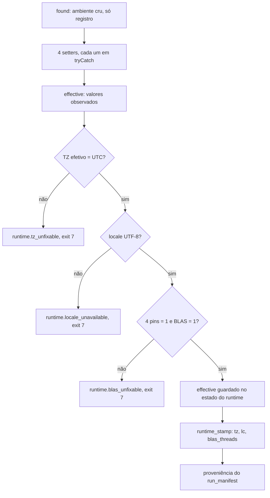

<span className="pc-overline">Arquitetura · 2.4</span>

<p className="pc-lead">Todo comando da CLI começa por <code>scripts/lib/runtime.R</code>. Ele fixa dentro do processo R o fuso (<code>TZ=UTC</code>), o locale (<code>LC_CTYPE</code> UTF-8, <code>LC_COLLATE</code> e <code>LC_NUMERIC</code> em <code>C</code>), os quatro pins de thread em 1 e o BLAS com 1 thread. O que vem do shell é só registrado: um shell sujo nunca aborta por si. O comando só sai com exit 7 (classe <code>runtime</code>) se a fixação falhar. É também o único arquivo do pacote que toca variável de ambiente, e o mesmo arquivo guarda o contrato do <code>RUNTIME.json</code> do bundle.</p>

O motivo é o mesmo do princípio 2 da arquitetura: a configuração do produto vem de flags, `config.yaml` e defaults, nunca do ambiente. Fuso, ordenação de texto, separador decimal e número de threads mudam bytes de saída. Por isso eles não podem depender de quem abriu o terminal. A convenção de datas que se apoia nesse fuso fixo está em [Tempo, rótulo da carga e fusos](/metodologia/tempo-rotulo-fusos).

## O que é fixado

`prevcarga_runtime_setters()` devolve quatro setters. Cada um altera o processo e devolve o valor efetivo: fuso, pins e BLAS são relidos depois da fixação; o de locale devolve o nome do candidato que `Sys.setlocale` aceitou.

| Item | Setter | Valor fixado | Como o efetivo é medido |
|---|---|---|---|
| Fuso | `tz` | `Sys.setenv(TZ = "UTC")` | `lubridate::hour(.POSIXct(0))` precisa dar 0 |
| Locale | `locale` | `LC_CTYPE` no primeiro candidato aceito; `LC_COLLATE` e `LC_NUMERIC` em `C` | o nome do locale precisa conter `utf-8` ou `utf8` |
| Pins de thread | `pins` | `OMP_NUM_THREADS`, `OPENBLAS_NUM_THREADS`, `MKL_NUM_THREADS` e `VECLIB_MAXIMUM_THREADS` em `1` | releitura das quatro variáveis |
| BLAS | `blas` | com `RhpcBLASctl`: `blas_set_num_threads(1L)` e `omp_set_num_threads(1L)` | `RhpcBLASctl::blas_get_num_procs()` precisa dar 1 |

Os candidatos de locale dependem do sistema:

| Sistema | Candidatos, em ordem |
|---|---|
| Linux (qualquer sistema fora do Windows) | `C.UTF-8` |
| Windows | `.UTF-8`, `English_United States.utf8` |

Sem `RhpcBLASctl`, só o BLAS de referência do R (`Rblas`/`libRblas`, detectado por `La_library()`) conta como 1 thread. Qualquer outro BLAS sem o pacote dá pool indefinido, e o enforce aborta. `RhpcBLASctl` está no `renv.lock` e é pacote obrigatório no `doctor`.

Os pins são variáveis de processo de propósito: workers PSOCK do orquestrador herdam o ambiente do pai. Mesmo assim, cada worker roda o próprio enforce na inicialização (`prevcarga_worker_init` em `scripts/lib/training.R`). Se o runtime não fixa num worker, nenhuma célula roda e todas saem como `failed`, com o erro que o worker devolveu (por exemplo `runtime.tz_unfixable`) ou `runtime.worker_unfixable` quando o worker não devolve um id.

### Quando aborta

`prevcarga_runtime_enforce` roda os quatro setters, cada um protegido por `tryCatch` (um setter que falha devolve `NA`, nunca interrompe os outros). Depois confere o efetivo nesta ordem, e o primeiro problema decide:

| Ordem | Condição | Erro | `where` |
|---|---|---|---|
| 1 | fuso efetivo diferente de `UTC` | `runtime.tz_unfixable` | `TZ` |
| 2 | locale efetivo sem UTF-8 | `runtime.locale_unavailable` | `LC_CTYPE` |
| 3 | algum pin diferente de `1` ou pool BLAS diferente de 1 | `runtime.blas_unfixable` | `BLAS` |

Os três são da classe `runtime` (exit 7, a primeira na precedência de `scripts/lib/errors.R`) e levam em `details` o par `found` e `effective`. A mesma classe cobre `runtime.install_root_unresolved`, quando a raiz da instalação não sai do `--file=` do Rscript. Ver [Contrato de erros e códigos de saída](/arquitetura/erros-exit).

<Figura id="FIG-A03" titulo="Runtime: encontrado e efetivo" natureza="Fluxo" fontes={['scripts/lib/runtime.R', 'docs/estado/runtime.md']} adrs={['ADR-0022', 'ADR-0037']}>



</Figura>

## `enforce`, `check`, `apply` e `stamp`

O arquivo só define funções; nada roda ao ser carregado. Quatro funções públicas cobrem os usos:

| Função | Altera o processo | Pode abortar | Quem usa |
|---|---|---|---|
| `prevcarga_runtime_enforce(setters)` | sim | sim, exit 7 | todo verbo guardado, workers PSOCK, ferramentas de `scripts/tools/` |
| `prevcarga_runtime_apply(strict = FALSE, setters)` | sim | não; com `strict = TRUE` vira `enforce` | `doctor` e `status` |
| `prevcarga_runtime_check()` | não | não | nenhum verbo |
| `prevcarga_runtime_stamp()` | não | só como erro interno | `scripts/lib/provenance.R` |

`enforce` e `apply` devolvem `found` (o ambiente cru) e `effective` (o que ficou valendo). `apply` e `check` devolvem também `ok` e a lista `offenders`, com os nomes que falharam (`TZ`, os quatro pins, `LC_CTYPE`, `LC_COLLATE`, `LC_NUMERIC`, `BLAS`).

`check` apenas observa. Ele não roda setter nenhum, então num processo em que os pins nunca foram definidos eles aparecem como ofensores. Por isso `doctor` e `status` usam `apply`: fixam o que dá, reportam o que não deu e não abortam.

`stamp` lê o `effective` guardado pela última chamada de `enforce` ou `apply` e devolve `tz`, `lc` e `blas_threads`. A proveniência grava esses três campos no `run_manifest.json`. Chamado antes de qualquer fixação, `stamp` aborta com `generic.unexpected`: carimbar um ambiente não fixado é bug, não condição de uso. Ver [Proveniência, identidade e layout do estado](/arquitetura/proveniencia-estado).

### Onde cada um entra no ciclo de um comando

1. O shim `scripts/prevcarga` acha o próprio caminho pelo `--file=` e carrega `errors.R` e `runtime.R`. Se não houver um `--file=` único, ele mesmo escreve o erro e sai com 7, antes de existir o catálogo de erros.
2. `prevcarga_install_root()` resolve a raiz da instalação pelo `--file=` (aceita barra invertida), nunca por variável de ambiente.
3. `prevcarga_main` descobre os verbos. Para um verbo guardado, a primeira ação do corpo é `runtime()`, que por padrão é `prevcarga_runtime_enforce` (`.prevcarga_run_verb` em `scripts/lib/cli.R`). Só depois o `ctx` é montado e o handler roda.
4. Os verbos isentos declaram `exempt = TRUE` no próprio registro em `scripts/lib/cli/`. São só `doctor` e `status`. Eles pulam o enforce e chamam `apply` no corpo.
5. Ajuda, `--version` e chamada sem verbo não passam por nenhum dos dois.

O ciclo completo está em [Fachada da CLI e ciclo de um comando](/arquitetura/fachada-cli).

:::note ADR-0022 e ADR-0037
O texto do ADR-0022 descreve um enforce que aborta quando o ambiente de entrada está sujo e um `doctor` que chama `check()`. O código segue o ADR-0037: fixa por cima do shell sujo e só aborta se não conseguir fixar; `doctor` e `status` chamam `apply`. Onde os textos divergem, vale o código. Do ADR-0022 vale a ordem: o enforce roda antes do corpo de todo comando guardado, e a lista de isentos é fechada.
:::

```bash title="Diagnóstico do ambiente"
prevcarga doctor
```

O `doctor` mostra uma linha por item com o valor encontrado e o efetivo: `TZ`, `locale`, os quatro pins e `pool BLAS`. Uma linha de runtime em FAIL faz o `doctor` sair com 7. Ver [Diagnóstico e introspecção](/execucao/diagnostico).

## O único `Sys.getenv` do pacote

O pacote não lê variável de ambiente como configuração. A única leitura existe só para registro: `.prevcarga_runtime_found()` lê `TZ`, `LC_ALL`, `LANG` e os quatro pins, junto com o locale corrente e o pool BLAS. Esse é o `found` que aparece no `doctor` e nos `details` dos erros. Os únicos `Sys.setenv` são os dos setters de fuso e de pins, no mesmo arquivo.

Em `scripts/prevcarga`, `scripts/lib/*.R` e `scripts/lib/cli/*.R`, `Sys.getenv`, `Sys.setenv` e `Sys.unsetenv` só aparecem em `scripts/lib/runtime.R`, e dentro dele há uma única linha com `Sys.getenv`, a de `.prevcarga_runtime_found`. Nenhum nome `PREVCARGA_*` aparece no código, nos catálogos de erro, em `config/*.yaml` nem nos `models/*/run.yaml`.

### Variáveis de ambiente fora do pacote

O lançador do bundle toca o ambiente sem contrariar a regra, porque está fora do código do pacote. O `install/prevcarga` remove `R_HOME`, `R_LIBS`, `R_LIBS_USER`, `R_LIBS_SITE`, `R_PROFILE_USER` e `R_ENVIRON_USER` com `env -u` e chama o Rscript do bundle com `--vanilla`. Ele não define nada; só impede que uma library de fora entre no `.libPaths()`. Ver [Distribuição: bundle, instaladores e repositório online](/arquitetura/distribuicao).

## Contrato do `RUNTIME.json` do bundle

O mesmo `runtime.R` é a fonte única do formato do `RUNTIME.json`, usado no build (`scripts/tools/bundle_manifest.R`), no instalador e no `doctor`. Nenhuma dessas funções lê ambiente. O bundle em si está em [Distribuição: bundle, instaladores e repositório online](/arquitetura/distribuicao).

O build grava estes campos:

| Campo | Conteúdo |
|---|---|
| `version` | versão do bundle |
| `platform` | `linux-x86_64` ou `windows-x86_64` |
| `r_version` | versão do R do build; precisa ser a mesma do `renv.lock` |
| `renv_lock_hash` | sha256 do `renv.lock` do bundle |
| `code_commit` | commit do código |
| `apt_snapshot` | snapshot apt; `null` quando não informado |
| `compilados` | lista de `pacote`, `versao`, `motivo` dos pacotes compilados do fonte |
| `built_at` | campo lateral, recebido de quem chama o build (`null` quando não informado); fica fora do `runtime_id` |
| `files` | `path` e `sha256` de todo arquivo sob a raiz do bundle, exceto o próprio `RUNTIME.json` |

### Forma canônica e `runtime_id`

`prevcarga_runtime_json_canonical(x, with_built_at)` gera os bytes:

1. remove `built_at`, a não ser que `with_built_at = TRUE` (a forma gravada no arquivo);
2. ordena `files` por `path` em radix;
3. ordena recursivamente as chaves de toda lista nomeada em radix (listas sem nome mantêm a ordem);
4. serializa com `jsonlite::toJSON` (`auto_unbox = TRUE`, `null = "null"`, `digits = NA`);
5. troca CRLF por LF, termina com uma quebra de linha e codifica em UTF-8.

`prevcarga_runtime_id(path)` é o sha256 da forma canônica sem `built_at`. Sem o arquivo, devolve `NULL`: é uma árvore de desenvolvimento, não um bundle. Como o relógio não entra no id, dois builds do mesmo commit que geram os mesmos bytes de arquivo dão o mesmo `runtime_id`; um pacote compilado do fonte leva a data de compilação e quebra isso, por isso é declarado em `compilados`.

### Validação e identidade do código

| Função | O que faz | Falha |
|---|---|---|
| `prevcarga_runtime_validate(root, strict)` | recalcula o sha256 de todo `files[]` sob a raiz do bundle e lista os divergentes ou ausentes, em radix | com `strict = TRUE`, `bundle.manifest_mismatch` (exit 6), com `details.paths` |
| `prevcarga_bundle_id(root)` | com `RUNTIME.json` na raiz ou um nível acima, devolve o `runtime_id`; sem ele, o sha256 das linhas `path` e `sha256` da mesma seleção de código que vai para o `code/` do bundle | |
| `prevcarga_bundle_require(pkgs)` | aborta no primeiro pacote ausente | `bundle.package_missing` (exit 6) |

Na árvore de desenvolvimento, `validate` devolve `ok = FALSE` com o divergente `RUNTIME.json`. O `install/install.sh` chama `validate` com `strict = TRUE` usando o Rscript do próprio stage. O `doctor` usa a forma não estrita na linha `bundle.integridade`. O `bundle_id` entra no `run_manifest.json` de cada entrega do `forecast`.

<Pendente titulo="Pendente · prevcarga_bundle_require">A função existe, mas não é chamada pelo verbo <code>forecast</code>. Um pacote ausente no bundle não é detectado por ela durante a rodada.</Pendente>
