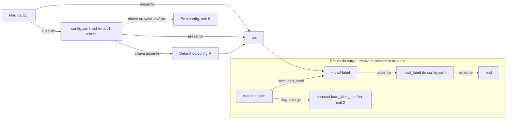

Arquitetura · 2.5

O PrevCarga não lê variável de ambiente, para que a configuração de um comando não dependa do shell em que ele roda. Toda configuração de um comando vem de três fontes, nesta ordem: a flag da CLI, o arquivo <code>config.yaml</code> e o default declarado em <code>scripts/lib/config.R</code>. A função <code>prevcarga_ctx</code> resolve essa precedência uma vez, valida tudo contra o schema v1 estrito e entrega aos módulos uma lista única, o ctx. A exceção é o rótulo da carga: o ctx guarda a flag e o valor do arquivo separados, e o leitor do deck decide, com o <code>manifest.json</code> do deck acima de ambos.

## Precedência e schema v1

### A regra geral

Para cada campo, `config.R` aplica a mesma escolha (`.prevcarga_pick`): se a flag foi passada, ela vence; senão vale o valor do `config.yaml`; senão vale o default do schema. O docopt não carrega default nenhum: o bloco de opções globais da CLI só declara as flags, e o default mora no `config.R` (ADR-0037).

<Figura id="FIG-A04" titulo="Precedência de configuração" natureza="Fluxo" fontes={['scripts/lib/config.R', 'scripts/lib/deck_reader.R', 'config/config.yaml', 'docs/estado/config.md']} adrs={['ADR-0037', 'ADR-0035']}>

</Figura>

### Qual config.yaml é lido

Com `--config`, vale só o arquivo indicado. Sem a flag, `prevcarga_ctx` procura o arquivo em dois lugares e para no primeiro que existir. Se nenhum existir, o ctx sai só com os defaults, sem erro.

| Ordem | Caminho | Quando se aplica |
|---|---|---|
| 1 | o arquivo passado em `--config=<arquivo>` | sempre que a flag é usada; arquivo ausente aborta com `config.bad_type` |
| 2 | `<root>/config.yaml` | árvore de desenvolvimento (`<root>` é a raiz do código) |
| 3 | `<R>/config.yaml` | instalação do usuário: o código mora em `<R>/versions/<v>/code` e `prevcarga_install_dir` sobe até `<R>` |

Na instalação, o `config.yaml` de `<R>` é escrito pelo instalador (`install.sh` e `install.ps1`). Num upgrade ele preserva as chaves que já existem e regrava só `data_dir` e `state_dir` (acrescentando `schema_version: 1` se faltar). O detalhe operacional está em [Instalação, atualização e remoção](/execucao/instalacao) e em [Configuração](/execucao/configuracao).

### O schema v1

`prevcarga_config_load` lê o YAML sem avaliar expressões e confere cada chave contra `.prevcarga_config_schema`. O schema é fechado: estas são as únicas chaves aceitas.

| Chave | Tipo | Valores | Default | Flag que a sobrepõe |
|---|---|---|---|---|
| `schema_version` | inteiro | só `1`; obrigatória no arquivo | `1` | nenhuma |
| `data_dir` | texto não vazio | caminho do deck | nenhum | `--data` |
| `state_dir` | texto não vazio | caminho do estado | `<root>/.state` | `--state` |
| `load_label` | enum | `end`, `start` | nenhum | `--load-label` (ver abaixo) |
| `weather_issue_cutoff` | enum | `available_until`, `origin_midnight_utc` | `available_until` | `--weather-cutoff` |
| `color` | enum | `auto`, `always`, `never` | `auto` | `--color` |
| `format` | enum | `text`, `json` | `text` | `--format` |
| `backtest.corte_default` | texto | `HH:00` ou `HH:30` | `08:00` | `--corte` (só em `backtest` e `plan`) |

`backtest` é um mapa aninhado e só aceita a subchave `corte_default`. A regra do clima previsto (`weather_issue_cutoff`) é a do ADR-0024; a página [Os três cortes de data](/metodologia/tres-cortes) explica o efeito de cada valor.

### O que aborta

Toda falha de configuração é da classe `config` e sai com exit 8. Não há lista parcial: a primeira violação aborta o comando antes de qualquer leitura de dado.

| Situação | Código |
|---|---|
| chave fora do schema (inclusive `backtest.<x>`) | `config.unknown_key`, com `where` igual à chave |
| tipo errado, `schema_version` ausente ou diferente de `1`, `corte_default` fora da grade de 30 min, YAML inválido, raiz que não é mapa, arquivo ausente | `config.bad_type` |
| valor fora do enum de `load_label`, `weather_issue_cutoff`, `color` ou `format` | `config.bad_load_label`, `config.bad_weather_cutoff`, `config.bad_color`, `config.bad_format` |
| `--origin` mal formado | `config.bad_origin` |
| flag que não pertence ao verbo, ou linha de comando que o docopt não reconhece | `config.usage` |

Os enums são conferidos ao carregar o arquivo e de novo ao montar o ctx: `weather_issue_cutoff`, `color` e `format` são reconferidos já com a flag aplicada, e `--load-label` é conferido à parte. Assim uma flag inválida falha com o mesmo código de um valor inválido no arquivo. O contrato completo de erros está em [Contrato de erros e códigos de saída](/arquitetura/erros-exit).

:::note Verbos tolerantes
`doctor` e `status` são verbos isentos. Se o `config.yaml` estiver quebrado, eles não abortam: montam um ctx só com flags e defaults e guardam a falha original em `ctx$config_error`, para poder relatá-la. O mesmo vale para `--help` e `--version` no topo.
:::

## Campos do ctx

`prevcarga_ctx(args, root, verb)` devolve uma lista com estes campos. Todo módulo recebe o ctx; nenhum relê flag, arquivo ou ambiente.

| Campo | Origem | Observação |
|---|---|---|
| `root` | fachada da CLI | raiz do código em execução |
| `install_root` | `prevcarga_install_dir(root)` | `<R>` numa instalação; `NULL` fora do layout `versions/<v>/code` |
| `config_path` | busca do `config.yaml` | caminho normalizado do arquivo lido, ou `NULL` |
| `data_dir` | `--data` > `data_dir` | sem default; caminho normalizado |
| `state_dir` | `--state` > `state_dir` > `<root>/.state` | só resolvido, nunca criado aqui |
| `origin` | `--origin` | `Date`, ou `from`/`to` em `backtest` e `plan`, ou `NULL` |
| `load_label_flag` | `--load-label` | validado, não aplicado |
| `load_label_config` | `load_label` do arquivo | validado, não aplicado |
| `weather_issue_cutoff` | `--weather-cutoff` > arquivo > `available_until` | |
| `format` | `--format` > arquivo > `text` | |
| `color` | `--color` > arquivo > `auto` | |
| `debug` | `--debug` | mostra o traceback em erro inesperado |
| `backtest` | `backtest.corte_default` | lista com `corte_default` |
| `version` | `config/VERSION` | `unknown` se o arquivo não existe |
| `run_id` | `prevcarga_run_id()` | identificador do envelope; ver abaixo |
| `verb` | fachada da CLI | verbo em execução |

O seletor `--model` também é flag global, mas `prevcarga_ctx` não o inclui: o verbo que o usa lê o argumento diretamente.

### `--origin` estrito

`prevcarga_parse_origin` aceita só `YYYY-MM-DD`, conferido por expressão regular e depois por `lubridate::ymd`. Data impossível, como `2025-02-30`, também aborta com `config.bad_origin`. A forma de faixa `A..B` só vale nos verbos `backtest` e `plan`, e exige `A` menor ou igual a `B`; em qualquer outro verbo ela é recusada com o mesmo código. Sem `--origin`, o ctx leva `NULL` e o verbo decide. `--origin` é o único flag humano de data; os cortes de treino e intradiário são derivados, nunca configurados (ver [Os três cortes de data](/metodologia/tres-cortes)).

### `state_dir` resolvido, nunca criado

`config.R` não cria diretório. `data_dir` e `state_dir` passam por `normalizePath` com `mustWork = FALSE` e barra `/` também no Windows, o que só fixa a forma do caminho. Quem precisa do estado cria o que precisar no seu próprio módulo. Para os verbos que leem o deck, `prevcarga_require_data_dir` aborta com `config.data_dir_missing` (exit 8) quando `data_dir` não foi resolvido.

:::info Default de state_dir numa instalação
O default `<root>/.state` só aparece na árvore de desenvolvimento. Numa instalação, o instalador grava `state_dir` explicitamente no `config.yaml` de `<R>` (por padrão, `<R>/state`), e esse valor vence o default.
:::

### `run_id` do envelope

`prevcarga_run_id()` gera o identificador da execução a partir do instante em UTC e do número do processo, no formato `20261103T120000Z-12345`. Ele vai no envelope de saída (`--format=json`), tanto no sucesso quanto no erro. Se o verbo declara um `run_id` determinístico no seu resultado (hash da chave), a fachada troca o do ctx por ele antes de emitir. O projeto usa `run_id` em mais de um sentido; a separação está em [Proveniência, identidade e layout do estado](/arquitetura/proveniencia-estado).

## A precedência especial do load_label

O rótulo da carga diz se cada leitura do deck marca o fim (`end`) ou o início (`start`) do intervalo de 30 min. É uma propriedade do deck, não da rodada. Por isso a ordem dele é diferente da regra geral, e quem a aplica é o leitor único do deck, não o `config.R` (ADR-0035).

`prevcarga_resolve_load_label(ctx, manifest)` decide nesta ordem:

1. Se o `manifest.json` do deck declara `load_label`, vale o manifest.
2. Senão, vale `--load-label`, se passado.
3. Senão, vale `load_label` do `config.yaml`.
4. Senão, vale `end`.

O resultado sai com a fonte (`manifest`, `flag`, `config` ou `default`), que o leitor grava como atributo `load_label_source` no painel de carga.

Só a flag pode contradizer o manifest. Se o manifest declara um valor e `--load-label` traz outro, o comando aborta com `contract.load_label_conflict` (classe `contract`, exit 2). Já um `load_label` no `config.yaml` diferente do manifest não aborta nem gera aviso: o manifest vence.

O efeito do rótulo sobre o dado (o deslocamento de −30 min quando `end`) está em [Tempo, rótulo da carga e fusos](/metodologia/tempo-rotulo-fusos) e em [Leitor único do deck](/arquitetura/leitor-deck).

<Pendente titulo="Pendente · manifest do store real">
O store de dados em uso não traz `manifest.json`. O repositório versiona o modelo `config/deck-manifest.store.json`, que declara `load_label: start`, fuso `Etc/GMT+3` e atraso de publicação de 6 horas. `docs/estado/deck_reader.md` registra que esses valores ainda aguardam confirmação.
</Pendente>
