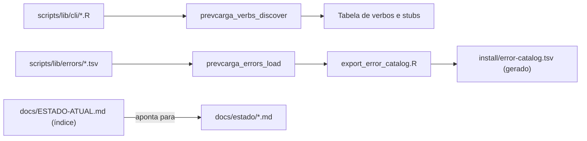

<span className="pc-overline">Arquitetura · 2.6</span>

<p className="pc-lead">R não tem barrel de módulos. No PrevCarga, toda coleção que vários módulos alimentam é uma pasta: cada dono cria o seu arquivo, e um loader determinístico lê a pasta com `list.files` e ordena com `method = "radix"`. Ninguém edita uma lista central para entrar. Três coleções seguem a regra: verbos da CLI, catálogo de erros e documentos de estado. O que é derivado delas, como `install/error-catalog.tsv`, é gerado e não versionado.</p>

## A regra e o loader determinístico

O princípio 6 do `CLAUDE.md` diz: barrel por descoberta, nunca lista central editada por todos. A motivação é de processo. Uma lista central que todo módulo precisa tocar vira ponto de conflito de merge e de esquecimento: o módulo existe, mas não foi registrado. Com a pasta, existir é estar registrado.

Todo loader segue o mesmo padrão:

1. Lista a pasta com `list.files(dir, pattern = ...)`, filtrando pela extensão da coleção (`\\.R$` ou `\\.tsv$`).
2. Ordena pelo nome do arquivo com `order(..., method = "radix")` ou `sort(..., method = "radix")`.
3. Carrega cada arquivo e valida o contrato dele. Arquivo fora do contrato é bug do pacote e aborta, nunca é ignorado em silêncio.
4. Devolve um objeto único (tabela de verbos, catálogo) em ordem determinística.

A ordenação radix do R compara bytes, como o locale C, e não depende do locale da sessão. O runtime reforça isso: `scripts/lib/runtime.R` fixa `LC_COLLATE` e `LC_NUMERIC` em `C` antes do handler de todo verbo não isento ([Runtime](/arquitetura/runtime)). O resultado é a mesma ordem em Linux e Windows, em qualquer máquina.

<Figura id="FIG-A05" titulo="Barrel por descoberta: pastas e loaders" natureza="Estrutura" fontes={['CLAUDE.md', 'scripts/lib/cli.R', 'scripts/lib/errors.R', 'scripts/tools/export_error_catalog.R']} adrs={['ADR-0040']}>



</Figura>

Os loaders aparecem em destaque. O único artefato derivado é `install/error-catalog.tsv`. O índice de estado não tem loader em código: é uma convenção de documentação, descrita adiante.

| Coleção | Pasta | Loader | Contrato de cada arquivo | Saída |
|---|---|---|---|---|
| Verbos da CLI | `scripts/lib/cli/<verbo>.R` | `prevcarga_verbs_discover` (`cli.R`) | Um objeto `prevcarga_verb_<verbo>` com `name` igual ao nome do arquivo, `usage` e `handler` | Tabela de verbos, usage docopt, dispatch |
| Catálogo de erros | `scripts/lib/errors/<modulo>.tsv` | `prevcarga_errors_load` (`errors.R`) | Colunas `id`, `class`, `message`, `hint`; ASCII; id único | Catálogo em memória e `install/error-catalog.tsv` |
| Estado | `docs/estado/<modulo>.md` | Nenhum (convenção) | Um arquivo por módulo ou épico | Índice `docs/ESTADO-ATUAL.md` aponta para eles |

## Verbos da CLI

Um verbo entra na gramática da CLI quando alguém cria `scripts/lib/cli/<verbo>.R`. Nem o shim `scripts/prevcarga` nem `cli.R` são editados. Hoje a pasta tem 20 arquivos. O registro mais simples é o do verbo `areas`:

```r title="scripts/lib/cli/areas.R"
prevcarga_verb_areas <- list(
  name    = "areas",
  usage   = "prevcarga areas",
  options = character(),
  handler = function(ctx, args) cmd_areas(ctx, args),
  owner   = "M1",
  exempt  = FALSE,
  modules = c("topology.R", "provenance.R", "introspect.R")
)
```

| Campo | Papel |
|---|---|
| `name` | Nome do verbo; tem de ser igual ao nome do arquivo sem `.R` |
| `usage` | Linha de usage docopt; obrigatória e não vazia |
| `options` | Linhas de flags próprias, somadas ao bloco Options |
| `scoped` | Flags que só esse verbo aceita; em outro verbo viram erro de uso |
| `handler` | Função chamada com `ctx` (e `args`, se aceitar dois argumentos) |
| `owner` | Dono do verbo |
| `exempt` | `TRUE` dispensa o runtime antes do handler e tolera ctx inválido (hoje `doctor` e `status`) |
| `modules` | Arquivos de `scripts/lib/` carregados só quando o verbo roda |

`.prevcarga_load_verb_file` carrega cada arquivo num ambiente próprio e exige exatamente um objeto com prefixo `prevcarga_verb_`. Nome divergente do arquivo, `handler` que não é função ou `usage` ausente param a CLI com mensagem de bug do pacote. Depois do carregamento, a tabela é reordenada por verbo em radix, e dela saem o usage docopt (`prevcarga_usage`) e o dispatch ([Fachada da CLI](/arquitetura/fachada-cli)).

### Os stubs e o `todo.not_implemented`

`cli.R` guarda uma lista de verbos planejados, `prevcarga_verbs_planned`, que mapeia verbo para dono. Ela permite que a CLI reconheça um verbo da gramática antes de o arquivo dele existir. Todo verbo planejado sem arquivo na pasta vira um stub, com usage `prevcarga <verbo> [<args>...]` e sem handler. Ao ser chamado, o stub aborta com `todo.not_implemented` (classe `generic`, exit 1), com `onde` no formato `<verbo> -> <dono>`.

Hoje os 13 verbos planejados têm arquivo em `scripts/lib/cli/`, então nenhum stub é gerado.

:::note Lista planejada não é registro
`prevcarga_verbs_planned` só cria stubs. Um verbo novo não precisa aparecer nela: basta o arquivo em `scripts/lib/cli/`.
:::

## Catálogo de erros

Cada módulo declara os seus `error.id` num arquivo próprio, `scripts/lib/errors/<modulo>.tsv`. São 43 arquivos hoje. `errors.R` só lê a pasta: declarar um id novo nunca exige editar esse arquivo ([Contrato de erros](/arquitetura/erros-exit)).

```text title="scripts/lib/errors/dates.tsv (trecho)"
id	class	message	hint
contract.split_unknown	contract	classe de split desconhecida no run.yaml	use split origin_agnostic ou origin_scoped no run.yaml do modelo
```

`prevcarga_errors_load` lê os TSV em ordem radix e valida a união:

| Verificação | Regra | Erro |
|---|---|---|
| Colunas | `id`, `class`, `message`, `hint` presentes | `contract.error_catalog_schema` |
| Bytes | `id`, `message` e `hint` em ASCII puro | `contract.error_catalog_schema` |
| Formato do id | Prefixo e nome separados por ponto, regex `^[a-z]+\.[a-z_]+$` | `contract.error_catalog_schema` |
| Classe | Uma das classes da tabela de exit, exceto `ok` | `contract.error_catalog_schema` |
| Unicidade | Cada id aparece uma única vez na união dos arquivos | `contract.error_catalog_dup` |

Os dois erros do próprio loader não podem depender do catálogo que ainda está sendo lido. Por isso `errors.R` tem uma tabela interna mínima, com `contract.error_catalog_dup`, `contract.error_catalog_schema` e `generic.unknown_error_id`. Ambos os erros de catálogo são da classe `contract` (exit 2).

### O catálogo gerado

Os utilitários de shell e PowerShell (`install.sh`, `install.ps1`, `prevcarga-sync.sh`, `prevcarga-sync.ps1`) precisam do catálogo sem carregar R. Para eles existe `install/error-catalog.tsv`, gerado por `scripts/tools/export_error_catalog.R`:

```bash
Rscript --vanilla scripts/tools/export_error_catalog.R --out install/error-catalog.tsv
```

- Colunas `id`, `class`, `exit_code`, `message` e `hint`, com `exit_code` tirado da tabela de classes.
- Linhas ordenadas por id em radix; TAB, fim de linha LF, UTF-8 sem BOM.
- Sem `--out`, o destino padrão é `install/error-catalog.tsv` na raiz do repositório.

O arquivo não é versionado: `.gitignore` traz `/install/error-catalog.tsv`. O build do bundle roda o tool no stage (`build_bundle_linux.sh` e `build_bundle_windows.ps1`), e o catálogo viaja dentro de `code/install/` ([Distribuição](/arquitetura/distribuicao)).

## Estado

O estado durável segue a mesma regra, aplicada a documentos. Cada módulo ou épico tem o seu `docs/estado/<modulo>.md`, criado no fechamento do módulo e atualizado na hora em que um fato muda (write-through). São 62 arquivos hoje.

`docs/ESTADO-ATUAL.md` é o índice. Ele aponta para os arquivos de módulo e guarda só as decisões transversais. Aqui não há loader em código: a descoberta é humana, pela pasta.

## O site segue a regra

Este site aplica o mesmo princípio. As três sidebars (Metodologia, Arquitetura e Execução) são geradas pelo Docusaurus a partir das pastas `docs/metodologia/`, `docs/arquitetura/` e `docs/execucao/` dentro de `website/`. A ordem vem do `sidebar_position` e do prefixo numérico de cada arquivo, e o rótulo vem do `sidebar_label` no frontmatter. Uma página nova entra na navegação quando o arquivo é criado, sem editar uma lista central.

A saída gerada também não é versionada, pelo mesmo motivo do catálogo de erros: `.gitignore` exclui `website/node_modules/`, `website/build/`, `website/.docusaurus/` e `website/.cache-loader/`.
