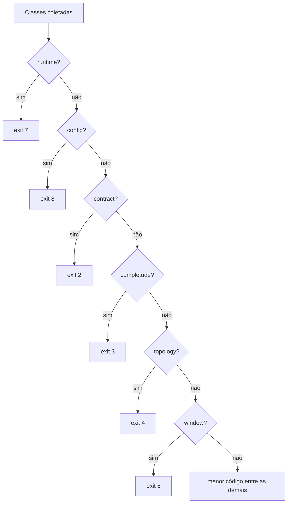

<span className="pc-overline">Arquitetura · 2.7</span>

<p className="pc-lead">Todo erro do PrevCarga tem um id estável (<code>classe.motivo</code>), uma classe e um código de saída fixo pela classe. A tabela classe → código mora só em <code>scripts/lib/errors.R</code>, vai de 0 a 15 e só cresce no fim. Quando várias classes falham juntas, uma precedência única decide o código. O erro sai em texto ASCII no stderr ou como um único JSON no stdout, com o mesmo código nos dois formatos. Cada módulo declara os seus ids num TSV próprio em <code>scripts/lib/errors/</code>; ninguém edita a lista de outro.</p>

Esta página é a dona da tabela 0–15. O guia de operador, com o que fazer diante de cada erro, está em [Erros e solução de problemas](/execucao/erros-troubleshooting).

## Tabela única 0–15

A tabela é o vetor nomeado `prevcarga_exit_codes` de `scripts/lib/errors.R`, e segue nome a nome o valor do ADR-0040.

```r title="scripts/lib/errors.R"
prevcarga_exit_codes <- c(ok = 0L, generic = 1L, contract = 2L, completude = 3L, topology = 4L,
  window = 5L, bundle = 6L, runtime = 7L, config = 8L, integrity = 9L, network = 10L,
  coherence = 11L, repro = 12L, state = 13L, partial = 14L, honesty = 15L)
```

| Exit | Classe | O que significa | Exemplos de id no catálogo |
|---|---|---|---|
| 0 | `ok` | Comando concluído | — |
| 1 | `generic` | Erro não classificado | `generic.unexpected`, `todo.not_implemented`, `generic.unknown_error_id` |
| 2 | `contract` | Contrato ou formato violado: schema, tipo, fuso, `run.yaml`, topologia malformada, registry | `contract.run_yaml_bad_value`, `contract.topology_unknown_key`, `contract.error_catalog_dup` |
| 3 | `completude` | Falta de dado, temporal (slots, dias) ou estrutural (nó exigido ausente) | `completude.node_missing`, `completude.leaf_missing`, `plugin.completude` |
| 4 | `topology` | Área, modelo ou escopo fora da topologia | `topology.area_undeclared`, `topology.model_undeclared` |
| 5 | `window` | Histórico curto para treino ou inferência | `window.history_short`, `window.window_train_deficit` |
| 6 | `bundle` | Pacote, plataforma ou manifest do bundle | `bundle.package_missing`, `bundle.platform_mismatch`, `install.preflight_failed` |
| 7 | `runtime` | O processo não conseguiu fixar o ambiente determinístico | `runtime.tz_unfixable`, `runtime.blas_unfixable` |
| 8 | `config` | `config.yaml` ou flag inválida, inclusive erro de uso do docopt | `config.usage`, `config.bad_format`, `config.bad_origin` |
| 9 | `integrity` | sha256 divergente, artefato corrompido, conflito de conteúdo | `integrity.freeze_sha_mismatch`, `install.sha_mismatch` |
| 10 | `network` | Falha de download ou upload | `sync.network`, `install.download_failed` |
| 11 | `coherence` | Entrega incoerente no `check-coherence` | `coherence.sin_sum`, `coherence.khat`, `coherence.alignment` |
| 12 | `repro` | Reprodução reprovada ou desvio de determinismo | `repro.key_mismatch`, `plugin.rng` |
| 13 | `state` | Artefato, versão ou estado ausente; lock ocupado; nada a entregar | `state.artifact_missing`, `state.lock_held`, `state.nothing_to_deliver` |
| 14 | `partial` | Execução parcial: parte foi entregue, parte falhou | `partial.report_failed`, `partial.backtest_delivery` |
| 15 | `honesty` | Vazamento detectado em tempo de execução | `honesty.leak`, `honesty.khat_after_origin` |

Três regras seguem da tabela:

1. **Só cresce no fim.** Uma classe nova recebe o próximo número; nenhum código existente é renumerado, porque a automação ramifica pelo número.
2. **O código vem da classe, não do prefixo do id.** A coluna `class` do TSV decide. `plugin.window` é da classe `window` (exit 5); `lgbm.integrity` é `integrity` (exit 9). O prefixo do id é só o espaço de nomes do módulo.
3. **Ids de reserva.** Oito classes têm um id `<classe>.unclassified` em `core.tsv` (`completude`, `topology`, `window`, `network`, `coherence`, `repro`, `partial` e `honesty`), para existirem no catálogo da fundação antes de algum módulo declarar ids próprios.

O exit 1 cobre dois casos. Um erro R comum (um `stop()` sem classificação) é capturado pelo handler de topo e vira `generic.unexpected`, com a mensagem original em `details.original`. Um verbo declarado sem handler sai com `todo.not_implemented`.

O shim `scripts/prevcarga` tem um único erro fora do catálogo: se não acha o próprio caminho (`--file=`), escreve as quatro linhas do formato texto à mão e sai com exit 7, porque nesse ponto o `errors.R` ainda não foi carregado.

:::note ADRs da tabela
O ADR-0020 local (`docs/adr/0020-taxonomia-exit-code-cli.md`) define os códigos 0–7 e a regra "nunca renumerar". O ADR-0027, uma emenda ao ADR-0020, define as classes 8–15, e o ADR-0040 consolida a tabela inteira. A tabela vigente é a do código acima.
:::

<Pendente titulo="Pendente · ADR-0027 e ADR-0040">
No SpecForge, o ADR-0027 e o ADR-0040 estão com status proposed; o ADR-0020 local está marcado como aceito e cobre só 0–7. O registro de ADRs ainda não foi reconciliado. O código segue a tabela 0–15.
</Pendente>

## Precedência entre classes

Alguns verbos acumulam defeitos antes de decidir, em vez de parar no primeiro: o `validate-deck`, o `check-coherence` e o `doctor`. Quando há defeitos de várias classes, um único código tem de sair, e ele não pode depender da ordem em que os defeitos foram achados. Quem decide é `prevcarga_exit_precedence(classes)`:

1. Se alguma classe da cabeça estiver presente, vence a primeira na ordem fixa `runtime`, `config`, `contract`, `completude`, `topology`, `window`.
2. Se nenhuma estiver, vence a de menor código entre as demais.
3. Uma classe fora da tabela é bug do pacote e para a execução.

A cabeça põe o ambiente e a configuração antes do dado. Um processo que não fixou o runtime (7) ou que recebeu flag inválida (8) não produz veredito confiável sobre o deck, então esses códigos vencem um `contract` (2) mesmo sendo números maiores. Fora da cabeça, vale a ordem numérica; `generic` (1) vence `integrity` (9), por exemplo.

<Figura id="FIG-A06" titulo="Precedência de exit com várias classes" natureza="Fluxo" fontes={['scripts/lib/errors.R']} adrs={['ADR-0040', 'ADR-0027']}>



</Figura>

Por exemplo, `runtime`, `config` e `contract` dão `runtime` (7), e `integrity` com `coherence` dá `integrity` (9), em qualquer ordem de leitura. Uma regra ingênua por ordem de emissão não serviria: invertida a lista, ela escolheria outra classe.

### Quem usa a precedência

A função é a fonte única; nenhum módulo tem lista própria de prioridade.

| Chamador | Como acumula | Como sai |
|---|---|---|
| `prevcarga_collect_errors()` (`errors.R`) | `add(id, where, details)` guarda condições; `has()` diz se há alguma | `finish()` aborta com a condição vencedora (a primeira da classe que vence) e põe as demais em `details.other_errors` |
| `validate-deck` (`validation.R`, `cli/validate-deck.R`) | findings com `level` e `class`; avisos não reprovam | aborta com o id do primeiro erro da classe dominante; `details.items` leva todos os findings |
| `check-coherence` (`evaluation.R`, `cli/check-coherence.R`) | findings ordenados por checagem, origem, instante e área | aborta com o id da classe dona; os findings vão em `result` do envelope de falha |
| `doctor` (`introspect.R`, `runtime.R`) | linhas `PASS`, `WARN`, `FAIL` e `N/A`; cada grupo com `FAIL` contribui uma classe (`runtime`, `bundle`, `config` e as das checagens de plataforma) | não aborta: devolve o resultado com o código no atributo `exit_code` |

No caso do `doctor`, o comando imprime o diagnóstico completo e ainda sai com código diferente de zero. No JSON, isso aparece como `ok: false`, `error: null` e o `exit_code` da precedência.

## Formato texto e JSON

O formato é escolhido por `--format` (flag) ou `format` no `config.yaml`, com `text` como default; outro valor dá `config.bad_format`. O código de saída é o mesmo nos dois formatos. Quem imprime é só a fachada, em `prevcarga_main` (`scripts/lib/cli.R`); módulos e handlers não escrevem erro no terminal.

### Canais

| Situação | `--format text` | `--format json` |
|---|---|---|
| Sucesso | resultado no stdout; avisos no stderr | um único JSON no stdout |
| Erro | quatro linhas no stderr, seguidas das linhas de aviso; o stdout fica vazio, salvo o relatório que o `validate-deck` e o `check-coherence` imprimem antes de abortar | um único JSON no stdout, stderr vazio |
| Erro com `--debug` | a pilha de chamadas no stderr | idem; é o único caso em que o stderr do JSON tem conteúdo |

Sem `--debug`, nenhum traceback sai, em nenhum formato: o stderr fica vazio sem a flag e mostra a chamada que falhou com ela.

### Texto

Toda saída de terminal é ASCII puro, sem acento, para renderizar igual no bash, no cmd e no PowerShell 5.1. A fachada ainda passa as linhas por `iconv` para ASCII antes de escrever. O erro tem sempre quatro linhas. Quando o erro saiu de `prevcarga_collect_errors()`, cada erro acumulado que não venceu (`details.other_errors`) vira uma linha de aviso depois delas.

```text title="formato de prevcarga_render_error (texto)"
prevcarga: erro [<classe>] (exit <n>)
o que: <message do catálogo>
onde: <where, ou - quando ausente>
como corrigir: <hint do catálogo>
prevcarga: aviso [<id>] <message do catálogo>
```

`o que` e `como corrigir` vêm do catálogo pelo id; `onde` vem do módulo que abortou (um arquivo, uma área, uma flag). O mesmo formato de aviso é usado para os avisos emitidos com `prevcarga_warn` numa execução bem-sucedida.

### JSON

O envelope é montado por `prevcarga_envelope` e tem sempre as mesmas oito chaves, no sucesso e no erro. Campos sem valor saem como `null`; o resultado do verbo vai em `result`.

```json title="esquema do envelope de falha (valores ilustrativos)"
{
  "ok": false,
  "verb": null,
  "exit_code": 8,
  "error": {
    "class": "config",
    "id": "config.usage",
    "message": "uso invalido da linha de comando",
    "where": "<onde>",
    "hint": "rode prevcarga --help para ver a sintaxe",
    "details": null
  },
  "warnings": [],
  "result": null,
  "run_id": "<run_id>",
  "version": "<versao>"
}
```

| Chave | Sucesso | Erro |
|---|---|---|
| `ok` | `true` quando o código é 0 | `false` |
| `exit_code` | 0, ou o atributo `exit_code` do resultado | o código da classe do erro |
| `error` | `null` | `class`, `id`, `message`, `where`, `hint`, `details` |
| `warnings` | avisos de `prevcarga_warn`, cada um com `id` e `message` (e `type`, quando o aviso o declara, como no `score`) | os erros de `details.other_errors` que não venceram, cada um com `id` e `message`; vazio quando o erro não veio do coletor |
| `result` | o resultado do verbo | `null`, salvo quando o módulo anexa um (o `check-coherence` anexa os findings) |

A automação deve ramificar por `exit_code` e por `error.id`. A `message` é texto para gente e pode mudar.

O envelope é o mesmo em todos os verbos da [fachada da CLI](/arquitetura/fachada-cli): com `--format json` sai um único JSON com as oito chaves, com o mesmo exit do modo texto, stderr vazio no JSON e stdout vazio no erro em texto.

:::info Instalador Linux
O `install.sh` lê o mesmo catálogo gerado (`error-catalog.tsv` ao lado do script, colunas lidas pelo nome do cabeçalho), com um texto embutido de reserva para os seus ids `install.*` quando o arquivo não está lá, e escreve o mesmo texto de quatro linhas no stderr. A tabela dele cobre só as classes que pode emitir: `bundle` 6, `config` 8, `integrity` 9 e `network` 10; qualquer outra classe vira 1. O JSON de erro do `install.sh` é mais curto que o da CLI: traz `ok`, `exit_code` e `error`, sem `verb`, `warnings`, `result`, `run_id` e `version`.
:::

## Como um módulo declara erros

`errors.R` tem só a máquina: a tabela, a precedência, o loader, a condição, o render e o handler. Os ids moram num catálogo distribuído, uma pasta lida por descoberta (ver [Barrel por descoberta](/arquitetura/barrel-descoberta)). No commit de referência desta página, a pasta tem 43 arquivos e 334 ids.

### Passos

1. Crie `scripts/lib/errors/<modulo>.tsv`. Não edite o TSV de outro módulo nem o `errors.R`.
2. Escreva o cabeçalho `id`, `class`, `message`, `hint`, separados por TAB, com fim de linha LF e só ASCII.
3. Uma linha por id. O id segue `^[a-z]+\.[a-z_]+$`; a classe é uma das 15 classes de erro da tabela (não pode ser `ok`); o hint diz como corrigir.
4. No código, aborte com `prevcarga_abort("<id>", where = ..., details = ...)`. Para aviso, `prevcarga_warn("<id>", ...)`. O argumento opcional `result` de `prevcarga_abort` leva dados ao `result` do envelope de falha.
5. Se o módulo acumula defeitos, use `prevcarga_collect_errors()` ou um veredito sobre `prevcarga_exit_precedence()`. Não escreva prioridade própria.

```text title="scripts/lib/errors/report.tsv"
id	class	message	hint
partial.report_failed	partial	entrega publicada, mas o relatorio falhou	a entrega foi publicada; rode de novo com --report para refazer o relatorio
```

Os avisos também têm classe da tabela: `warning.combina_nonstationary` é `contract`, `warning.lock_broken` é `state`. Num aviso, a classe não muda o código de saída.

:::note Código e ADR divergem
O ADR-0040 diz que avisos são declarados com classe `ok`. O loader recusa `ok` (aceita só as classes 1–15), e todos os avisos do catálogo usam uma classe de erro. Vale o código.
:::

### O que o loader garante

`prevcarga_errors_load()` lê `scripts/lib/errors/*.tsv` em ordem radix pelo nome do arquivo, junta tudo e devolve o catálogo ordenado por id. Ele aborta com `contract.error_catalog_schema` (exit 2) quando falta coluna, quando há byte acima de 127 em `id`, `message` ou `hint`, quando um id não segue o padrão ou quando a classe não existe. Aborta com `contract.error_catalog_dup` quando o mesmo id aparece em dois arquivos, e o `details` nomeia os arquivos.

Esses dois ids, mais `generic.unknown_error_id`, ficam também numa tabela interna mínima do `errors.R`, para o loader conseguir abortar antes de o catálogo existir. Um `prevcarga_abort` com id que não está no catálogo vira `generic.unknown_error_id` (exit 1): é bug do pacote, não erro do operador.

### Catálogo gerado

`scripts/tools/export_error_catalog.R` gera `install/error-catalog.tsv`: a união dos TSV ordenada por id, com a coluna `exit_code` acrescentada, em UTF-8 sem BOM e com LF. O arquivo é gerado no empacotamento do bundle (`scripts/tools/build_bundle_linux.sh`), nunca versionado nem editado à mão; o `.gitignore` o exclui.
