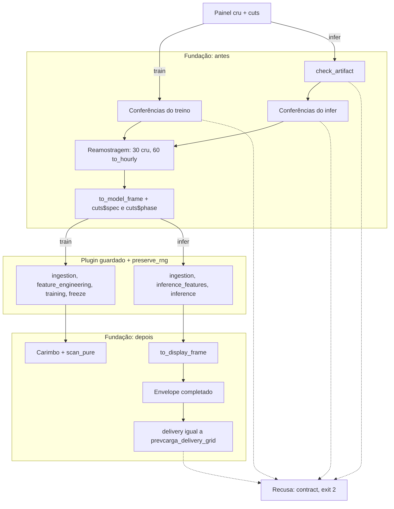

Arquitetura · 2.10

Nenhum plugin é chamado diretamente. Entre o painel lido do deck e os estágios do modelo há um único despachante, em <code>scripts/lib/registry.R</code>, que confere os insumos antes, reamostra e desloca a hora pelo descriptor, roda os estágios sob uma guarda de efeitos e confere a saída depois, contra a grade de entrega. As conferências não cortam nem preenchem dado: se algo passou do corte, o despachante aborta. Em volta dele, duas fachadas montam uma célula modelo × variante × área × origem: <code>training.R</code> resolve o spec efetivo, a identidade e o reuso do artefato; <code>inference.R</code> tira os parâmetros só do artefato congelado e lê o painel com o <code>available_until</code> global do deck.

## Três despachantes: train, infer e forecast

O despachante tem três pontos de entrada públicos. Todos compõem os estágios na ordem do blueprint e não têm nenhum desvio por nome de modelo.

| Função | Recebe | Faz | Devolve |
|---|---|---|---|
| `prevcarga_plugin_train(plugin, panel, cuts, spec, ctx)` | painel de treino, cortes, spec efetivo | `ingestion` → `feature_engineering` → `training` → `freeze` do descriptor | artefato carimbado (`prevcarga_plugin_artifact`) |
| `prevcarga_plugin_infer(plugin, artifact, panel, cuts, ctx)` | artefato carimbado, painel de infer, cortes | `ingestion` → `inference_features` → `inference` | envelope conferido |
| `prevcarga_plugin_forecast(plugin, panel, cuts, spec, ctx)` | painel de infer, cortes, spec | train sobre a fatia de treino, depois infer sobre o painel inteiro | envelope conferido |

Os formals de cada estágio são fixos e conferidos no carregamento do plugin (`prevcarga_plugin_signatures`): `ingestion(panel, cuts)`, `feature_engineering(frame, params)`, `training(features, params, seed)`, `inference_features(frame, payload)`, `inference(payload, inf_features, cuts)`, `freeze(model)` e `thaw(payload)`.

### O forecast é composição, não estágio

O `backtest.R` fala em "forecast acoplado" para a classe `origin_scoped`. No código, esse acoplamento é a composição de train e infer em memória. O descriptor de um plugin que declara o modo `forecast` precisa ter o estágio `forecast` (o loader recusa a falta), mas o despachante nunca o chama. `prevcarga_plugin_forecast`:

1. confere o modo: `forecast` precisa estar no `modes` do `run.yaml`, no `modes_implemented` do descriptor, e o split precisa ser `origin_scoped` (senão `plugin.mode_unavailable`);
2. confere o painel inteiro como painel de infer;
3. treina sobre `.prevcarga_plugin_train_slice(panel, cuts)`, que mantém a carga por `interval_start` e o clima observado por `valid_time` com dia até `cuts$last_data_day`; clima previsto e feriados ficam intocados. O corte vem de `cuts`, nunca é calculado ali;
4. infere com o artefato recém-treinado sobre o painel inteiro.

Declaram o modo `forecast` os três plugins `origin_scoped`: holt-winters, dessem-linear e dessem-regdin. Quem usa esse despachante é o protocolo de backtest `retrain_harness` (`backtest.R`). A rodada diária não passa por ele: para um membro `origin_scoped`, `forecast.R` procura o artefato da origem O no registry e, se não houver, chama a fachada de treino uma vez e depois a fachada de inferência. Para um membro `origin_agnostic`, a rodada só lê o artefato e, se ele faltar, aborta com `state.artifact_missing` (exit 13) em vez de treinar.

## Conferências feitas antes

Antes de qualquer estágio, o despachante confere o painel. As conferências só conferem: nunca cortam linha, nunca preenchem lacuna. Uma divergência aborta com a classe `contract` (exit 2), nomeando o intervalo, a emissão ou a coluna.

| Código | Quando | O que confere |
|---|---|---|
| `plugin.mode_unavailable` | train, infer, forecast | o modo está no `run.yaml` e no descriptor; forecast só em `origin_scoped` |
| `plugin.cuts_mismatch` | train, infer | no train, `cuts$last_data_day` igual a O − 1 − `data_lag_days` do descriptor; no infer com clima previsto, `weather_issue_limit` presente |
| `plugin.train_beyond_cut` | train | nenhum dia de `load$interval_start` nem de `weather_observed$valid_time` depois de `last_data_day` |
| `plugin.raw_timestamp` | train, infer | nenhuma coluna `timestamp` ou `load_label` no painel (só o leitor converte rótulo) e coluna de tempo com o fuso de `cuts$tz` |
| `plugin.missing_column` | train, infer | cada token `data.<dataset>.<coluna>` dos `requires` dos estágios existe no painel |
| `plugin.artifact_mismatch` | infer | carimbo do artefato contra descriptor, spec e cortes (ver abaixo) |
| `plugin.infer_beyond_cut` | infer | nenhum `load$interval_end` depois de `available_until` |
| `plugin.weather_beyond_limit` | infer | `issue_time` do clima previsto até `weather_issue_limit`; `valid_time` do observado até `available_until` |

No treino, o clima previsto não é conferido contra o corte: plugins com `weather_forecast_in_train` treinam com emissões passadas. No infer, `weather_issue_limit` vem de `cuts` ou, na falta, de `panel$attrs`; se não houver nenhum dos dois, a recusa é `plugin.cuts_mismatch`.

A conferência do artefato (`prevcarga_plugin_check_artifact`) roda antes da conferência do painel de infer. Ela exige a classe `prevcarga_plugin_artifact` e carimbo igual em `model_id`, `contract_version`, `granularity_min` e `split`; em `origin_scoped`, também o mesmo `origin_day`; e `train_origin` do carimbo não posterior ao `train_origin` desta origem. O despachante não descongela nada: o `payload` do artefato vai direto aos estágios de infer.

## Entrada dos estágios

Um único ponto monta o que os estágios recebem, `.prevcarga_plugin_stage_input` (passos 1 a 3); os passos 4 e 5 seguem no próprio despachante, nesta ordem. Ele roda em train e em infer; no forecast, uma vez em cada.

1. **Reamostragem** (`.prevcarga_plugin_resample`). Com `granularity_min` 30, o painel segue cru. Com 60, a carga passa por `to_hourly` (`features.R`): a hora é a média dos intervalos H:00 e H:30, agrupados por `interval_start`, e a hora incompleta some. O clima só é reamostrado quando o descriptor declara `weather_resample: hourly`; com `raw`, segue com as leituras de 30 min. Outra granularidade recusa com `features.bad_granularity`. O campo `weather_resample` é obrigatório quando o plugin suporta 60 min e recusado quando ele só suporta 30 (`registry.weather_resample`).
2. **Deslocamento de modelagem** (`.prevcarga_plugin_to_model`). `to_model_frame` subtrai o `model_time_offset_min` do descriptor de `interval_start` e `interval_end` da carga e de `cuts$available_until`. Clima, dias e feriados não mudam. Offset 0 é identidade.
3. **Canal de spec e fase**. Os `cuts` entregues aos estágios ganham `cuts$spec` (o spec efetivo do despacho) e `cuts$phase` (`"train"` ou `"infer"`). As conferências, o carimbo e o `cuts` do chamador ficam sem esses campos.
4. **Estágios do plugin**, sob a guarda de efeitos.
5. **Volta à hora de exibição**. No infer, a coluna `interval_end` da entrega passa por `to_display_frame` com o mesmo offset, antes da conferência do envelope. Carimbo e envelope ficam no frame de exibição.

Os descriptors declaram:

| Plugin | `granularity_min` | `weather_resample` | `model_time_offset_min` | split |
|---|---|---|---|---|
| random-forest | 60 | `raw` | 0 | `origin_agnostic` |
| lgbm | 30 | não se aplica | 0 | `origin_agnostic` |
| holt-winters | 30 | não se aplica | 0 | `origin_scoped` |
| dessem-linear | 60 | `hourly` | 60 | `origin_scoped` |
| dessem-regdin | 60 | `hourly` | 60 | `origin_scoped` |

O rótulo da carga (−30 min quando o deck declara `load_label: end`) não é do despachante: é aplicado uma vez pelo leitor do deck. O despachante é o único lugar do repositório que chama `to_hourly`, `to_model_frame` e `to_display_frame` sobre o painel de um plugin; nem as fachadas nem os plugins reamostram ou fazem aritmética de hora.

<Figura id="FIG-A07" titulo="Despachante de plugin (train e infer)" natureza="Fluxo" fontes={['scripts/lib/registry.R', 'scripts/lib/features.R', 'docs/estado/plugin_dispatch.md']} adrs={['ADR-0023', 'ADR-0012', 'ADR-0019']}>

</Figura>

## Envelope e grade de entrega

O estágio `inference` devolve só uma lista com `area`, `values`, `delivery` e, opcionalmente, `meta`. Qualquer outro campo é recusado. O despachante completa o resto do envelope (`prevcarga_envelope_fields`):

| Campo | Origem |
|---|---|
| `model_id`, `layout` | descriptor (`native_layout`) |
| `variant`, `weather_issue_cutoff` | carimbo do artefato |
| `origin_day`, `available_until` | `cuts` (frame de exibição) |
| `granularity_min` | spec |
| `area`, `values`, `delivery` | plugin |
| `meta` | plugin, com `rng_deviation` do descriptor copiado pelo despachante |

`.prevcarga_plugin_check_envelope` confere depois, e qualquer falha sai como `plugin.output_misaligned` (exit 2):

- o conjunto de campos é exatamente o do envelope, sem extra, sem falta e sem duplicata;
- nenhum nome proibido aparece em nível nenhum, nem dentro de listas: `forecast_origin`, `lead`, `d_plus`, `y_true` e `target_datetime`. Esses nomes são colunas do schema LONG, montado fora do plugin;
- `layout` igual ao `native_layout` do descriptor, `granularity_min` igual ao do spec, `available_until` igual ao de `cuts` e, quando `cuts` traz `weather_issue_cutoff`, o mesmo valor;
- `delivery` é uma tabela com exatamente as colunas `interval_end` e `y_pred`; `interval_end` é `identical` à grade e `y_pred` é numérico e finito em todos os pontos. A mensagem nomeia a primeira posição divergente.

A grade vem de `prevcarga_delivery_grid(cuts, delivery_days)` (`features.R`): os `interval_end` de 30 em 30 min, de `available_until` + 30 min até 00:00 do dia O + `delivery_days`, no fuso de `cuts$tz`, sem o próprio `available_until`. Com `delivery_days` 9 a entrega vai até o fim do dia O+8; com 2, do LGBM, até o fim de O+1. `available_until` fora da grade de 30 min, fuso diferente de `cuts$tz` ou `delivery_days` não inteiro positivo recusam com `features.bad_delivery_args`.

## Efeitos colaterais e RNG

Os estágios rodam dentro de `.prevcarga_plugin_guarded`, o único ponto do repositório onde a fundação toca `globalenv()`.

1. Antes, tira uma foto dos símbolos de `globalenv()`, do `search()` e do estado do gerador (`.Random.seed`).
2. Roda os estágios dentro de `prevcarga_preserve_rng`, que restaura `.Random.seed` ao sair, inclusive em erro. O gerador do processo fica como estava.
3. Se apareceu símbolo novo no ambiente global ou pacote novo no `search()`, aborta com `plugin.global_side_effect` (exit 2). Na saída, o símbolo é removido e o pacote é desanexado.
4. Se o gerador andou e o descriptor não declara `uses_rng: TRUE`, aborta com `plugin.rng`, de classe `repro` (exit 12).

O despachante não chama `set.seed`. A semente chega ao estágio `training` como argumento, `spec$seed`, vinda do `run.yaml`. No treino, o artefato carimbado ainda passa por `prevcarga_plugin_scan_pure`, que recusa com `plugin.impure_artifact` ambiente, ponteiro externo, closure fora de namespace, `POSIXct` não autorizado, caminho absoluto e campo com nome de relógio ou host (`trained_at`, `created_at`, `timestamp`, `hostname` e afins).

## Fachada de treino

`prevcarga_train(member, area, origin, ctx, force)` (`training.R`) treina uma célula. Ela não soma nem subtrai dias de corte: todo corte vem de `dates.R`.

1. **Plugin e spec efetivo.** Carrega o plugin, reconfere as assinaturas e monta o spec efetivo por `prevcarga_model_spec`: o `run.yaml` do modelo mais os overrides de `ctx$spec_overrides` e a variante do membro, gravada na chave que o descriptor declara em `variant_param`. Os parâmetros são conferidos contra o `params_schema` do descriptor.
2. **Cortes.** `prevcarga_resolve_cuts` com o `data_lag_days` do descriptor e `prevcarga_train_cut` com o spec efetivo dão `train_origin` e `last_data_day` pela classe de split (ADR-0023): `origin_agnostic` usa `train_origin` = O − 1 − H; `origin_scoped` usa `train_origin` = O; em ambos, `last_data_day` = O − 1 − `data_lag_days`. Linha de corte com `data_lag_days` diferente do descriptor recusa com `contract.cut_mismatch` (exit 2).
3. **Painel.** Lê pelo leitor único a janela que o plugin confere: em `origin_agnostic`, de `train_origin` − `history_days.train` até `last_data_day`; em `origin_scoped`, `history_days.train` dias até `last_data_day`. Carga e clima observado são recortados nessa janela. Plugin com `weather_forecast_in_train` recebe todas as emissões até `weather_issue_limit`, por `prevcarga_read_forecast_vintages`. Menos dias distintos de carga do que a janela pede recusa com `window.history_short` (exit 5), antes de qualquer escrita. O painel vai cru ao despachante.
4. **Identidade.** `prevcarga_train_fingerprint` preenche as oito chaves de `provenance.R`: `model_id`, `data_fingerprint` (sha256 do conteúdo do painel já recortado, sem os atributos), `cutoff` (`origin` em `origin_scoped`; `train_origin` e `last_data_day` em `origin_agnostic`), `feature_config` (spec efetivo e variante), `code_commit`, `renv_lock_hash`, `load_label` e `load_tz`. A versão é `v_` mais os 16 primeiros hexadecimais do sha256 desse fingerprint canônico. `available_until` nunca entra.
5. **Reuso.** Se a pasta `v_<hash>` já existe na chave da célula e não há `force`, a fachada devolve `status = "reused"` sem chamar o plugin e sem tocar a pasta.
6. **Treino e publicação.** Senão, chama `prevcarga_plugin_train`, embrulha o resultado em `prevcarga_train_artifact` (`model_id`, `variant`, `area`, `split`, `spec_efetivo`, cortes, `load_label`, `timezone`, `weather_issue_cutoff`, `fit` e o contrato dos estágios; `origin` só em `origin_scoped`), publica no registry e promove a `latest`. Devolve uma linha com `status = "trained"`.

## Fachada de inferência

`prevcarga_infer_cell(member, area, origin, ctx, ...)` (`inference.R`) infere uma célula. Ela nunca chama a fachada de treino nem o despachante de treino, e nunca escreve no registry.

1. **Artefato.** Resolve a versão pela chave da célula (`latest`, `--artifact-version` ou `--pin`) e carrega o artefato com conferência de integridade pelo `SHA256SUMS` (falha sai como `integrity.artifact_hash`, exit 9); no backtest, o artefato chega em memória, do cache. A variante do artefato tem de ser a do membro (`contract.variant_mismatch`).
2. **Parâmetros 100% do artefato.** O spec usado é `artifact$spec_efetivo`, nunca o `run.yaml` atual nem uma flag. Um spec passado e diferente do congelado recusa com `contract.infer_spec_divergent`; artefato sem `spec_efetivo` ou `fit`, com `contract.artifact_spec_missing`. A janela do painel é `history_days$infer` do artefato.
3. **Cortes e convenções.** Os cortes saem de `dates.R` com o spec do artefato. Antes de ler o painel, a fachada confere `load_label`, fuso, `weather_issue_cutoff` (só quando o descriptor declara clima previsto no treino) e `origin` (só em `origin_scoped`) contra o efetivo, e confere que o artefato não viu dado além do teto desta origem. `available_until` não é conferido: o mesmo artefato serve todas as rodadas de O.
4. **Mínimo global de `available_until`.** O painel é lido com todas as áreas do deck e só depois a fachada seleciona a área pedida. Assim vale o `available_until` global, o mínimo entre as áreas, e a área com carga mais longa não vê nada além dele. Sobra de carga depois do corte recusa com `contract.panel_beyond_cut`; a fachada não corta.
5. **Despacho e alinhamento.** Chama `prevcarga_plugin_infer` com o painel cru e confere de novo a entrega contra `prevcarga_delivery_grid` (`contract.output_misaligned`), como defesa em profundidade: o despachante já recusou antes com `plugin.output_misaligned`.

As recusas `contract.*` desta fachada são de classe `contract` (exit 2). A saída da célula traz `target_datetime` e `y_pred` com a identificação da célula; o LONG de 8 colunas é montado depois, fora desta fachada.

<Pendente titulo="Pendente · canal de spec e fase (F1)">
O canal <code>cuts$spec</code> e <code>cuts$phase</code> é interino: os estágios mantêm formals fixos e leem o spec e a fase de dentro de <code>cuts</code>. Do mesmo modo, <code>prevcarga_plugin_infer</code> não recebe <code>spec</code> e usa <code>plugin$spec</code>, que a fachada de inferência substitui pelo spec do artefato antes da chamada. O desenho definitivo do canal de spec e cortes no despachante (F1) é uma decisão em aberto, adiada para depois da implementação.
</Pendente>

<Pendente titulo="Pendente · ADR-0024">
As fachadas entregam aos plugins com clima previsto no treino todas as emissões até <code>weather_issue_limit</code>, e cada plugin monta a própria safra. Uma regra de corte do clima por plugin, em vez da regra global, depende de decisão no ADR-0024, ainda aberta.
</Pendente>

Para a origem dos cortes, ver [os três cortes de data](/metodologia/tres-cortes); para o descriptor e o loader, a [fundação de plugins](/arquitetura/fundacao-plugins); e, para onde o artefato é guardado, o [registry de artefatos](/arquitetura/registry).
