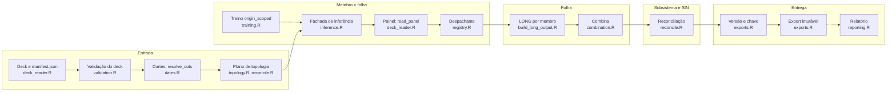

Arquitetura · 2.11

A rodada diária é uma única função, `prevcarga_forecast`, em `scripts/lib/forecast.R`. Ela não calcula nada: chama, numa ordem fixa, o leitor do deck, a validação do deck, os cortes, o plano de topologia, as fachadas de treino e de inferência, o conversor LONG, a combina, a reconciliação, a chave imutável, o export e, se pedido, o relatório. Cada etapa tem um módulo dono. O rótulo de hora é tocado uma vez na entrada e uma vez na saída. Tudo acontece em disco local: rede só existe nos utilitários de instalação, de sincronização e de envio, fora do pacote R.

Esta página é a âncora da arquitetura. Ela mostra quem faz o quê e em que ordem. Os pontos de falha de cada passo, com os códigos de saída, estão na página [Rodada diária](/execucao/rodada-diaria).

## O pipeline

<Figura id="FIG-A08" titulo="Pipeline de dados ponta a ponta" natureza="Fluxo" fontes={['scripts/lib/forecast.R', 'scripts/lib/deck_reader.R', 'scripts/lib/validation.R', 'scripts/lib/dates.R', 'scripts/lib/topology.R', 'scripts/lib/training.R', 'scripts/lib/inference.R', 'scripts/lib/registry.R', 'scripts/lib/build_long_output.R', 'scripts/lib/combination.R', 'scripts/lib/reconcile.R', 'scripts/lib/exports.R', 'scripts/lib/reporting.R', 'docs/estado/forecast.md', 'docs/estado/m6-forecast.md', 'docs/estado/deck_reader.md', 'docs/estado/export.md']} adrs={['ADR-0023', 'ADR-0032', 'ADR-0035']}>

</Figura>

As setas tracejadas são passos condicionais. O treino só roda para um membro `origin_scoped` sem artefato da origem O. O relatório só roda com `--report`.

| Etapa | Módulo dono | Função chamada por `forecast.R` | O que sai |
|---|---|---|---|
| Leitura do deck | `deck_reader.R` | `prevcarga_deck_manifest`, `prevcarga_read_load` (via cortes e painel) | séries no fuso da carga, com `interval_start` |
| Validação do deck | `validation.R` | `prevcarga_validate_deck` | veredito com findings; reprovado vira o erro da classe dominante |
| Cortes | `dates.R` | `prevcarga_resolve_origin`, `prevcarga_resolve_cuts` | origem O, `available_until` (mínimo entre áreas), fuso, rótulo, regra e lag do clima, corte de treino por modelo |
| Plano de topologia | `topology.R`, `reconcile.R` | `prevcarga_topology`, `prevcarga_members`, `prevcarga_reconcile_plan` | folhas cobertas, folhas soltas, subsistemas fechados, SIN fechado |
| Treino (condicional) | `training.R` | `prevcarga_train` | artefato da origem O no registry |
| Inferência | `inference.R` | `prevcarga_infer_cell` | entrega semi-horária do membro, com a versão do artefato |
| Painel | `deck_reader.R` | `prevcarga_read_panel` (chamado pela fachada) | carga, clima observado e clima previsto já cortados, e o calendário de feriados |
| Despachante | `registry.R` | `prevcarga_plugin_infer` (chamado pela fachada) | entrega do plugin conferida contra a grade |
| LONG | `build_long_output.R`, `evaluation.R` | `prevcarga_build_long`, `prevcarga_assert_long` | LONG de 8 colunas por membro e folha |
| Combina | `combination.R` | `prevcarga_build_panel`, `prevcarga_combina_apply` | LONG combinado por folha, com os pesos congelados |
| Reconciliação | `reconcile.R` | `prevcarga_reconcile_apply` | LONG por subsistema e SIN, perfis k-hat usados |
| Versão e chave | `exports.R` | `prevcarga_forecast_versao`, `prevcarga_export_key` | `versao` de 12 hex e a chave `forecasts/...` |
| Scratch e identidade | `forecast.R`, `reconcile.R`, `provenance.R` | `prevcarga_reconcile_write`, `prevcarga_write_run_manifest` | parquets, `run.json` e `run_manifest.json` no scratch |
| Export | `exports.R` | `prevcarga_export` | diretório imutável da entrega |
| Relatório (opcional) | `reporting.R` | `prevcarga_report` | `report.html` ou `report.pdf` fora de `forecasts/` |

### Entrada

O deck chega como parquets Hive mais um `manifest.json`. O `deck_reader.R` é o único leitor desse manifest e o único chamador de `arrow::open_dataset`. Ele aplica o fuso declarado e resolve o rótulo da carga. O detalhe está em [Leitor único do deck](/arquitetura/leitor-deck).

A origem vem do argumento da função, do `--origin` da CLI ou, sem os dois, do dia do último intervalo de carga do deck. Nenhum relógio é consultado. A validação do deck roda antes de qualquer inferência (ver [Validação do deck](/arquitetura/validacao-deck)). Com `skip_validate`, só a validação é pulada: os cortes continuam vindo do leitor.

Os cortes saem de `prevcarga_resolve_cuts`. O `available_until` é derivado da própria carga: o fim do último intervalo contíguo desde O 00:00, por área, com o mínimo global. A rodada aceita `available_until` igual a O 00:00 (rodada das 00h) e qualquer corte dentro de O. Dia O completo é recusado ainda na validação do deck. Os três cortes estão em [Os três cortes de data](/metodologia/tres-cortes).

O plano de topologia lista as folhas pedidas (todas, sem `--area`) e pergunta a `prevcarga_reconcile_plan` quais subsistemas elas fecham. Folha fora da topologia aborta aqui, antes do infer.

### Membro × folha

Para cada linha de `prevcarga_members()` e cada folha, `forecast.R` chama a fachada de inferência. A classe de split do modelo decide se há treino na rodada:

| Classe de split | O que a rodada faz |
|---|---|
| `origin_agnostic` | só lê o artefato do registry; sem artefato, aborta e nunca treina |
| `origin_scoped` | procura no registry uma versão cujo `run_manifest.json` tenha `origin` igual a O; sem ela, chama `prevcarga_train` uma vez e usa a versão nova |

A fachada de inferência lê o painel pelo leitor único e passa ao despachante. O despachante aplica o deslocamento de modelagem do descriptor, roda os estágios do plugin e confere a entrega contra a grade. Os detalhes estão em [Despachante de plugin](/arquitetura/despachante).

### Folha

A entrega de cada membro vira LONG em `prevcarga_build_long`, com a faixa de entrega do membro (`delivery_days` do descriptor). O `prevcarga_assert_long` confere o schema e anexa o `interval_start` uma vez. A proveniência de cada membro é montada em memória, e `prevcarga_assert_members_aligned` recusa membro desalinhado. Depois `prevcarga_build_panel` monta o painel e `prevcarga_combina_apply` aplica os pesos congelados de `<state_dir>/artifacts/combina/<folha>/`. A combina nunca re-fita na rodada. Por lead só combinam os membros que cobrem o lead. O método está em [Combinação convexa](/metodologia/combina).

### Subsistema e SIN

A reconciliação recebe só as folhas cobertas e roda uma vez, em memória, com o perfil k-hat ajustado na origem O de cada subsistema fechado (o `latest`, se for dele; senão a versão da célula com essa origem). A política é `khat_origin == O` sempre. Folhas soltas nunca passam por ela. O perfil é treinado fora da rodada, pelo verbo `reconcile --mode train`. O método está em [Reconciliação hierárquica](/metodologia/reconciliacao).

### Entrega

A `versao` é um hash de 12 hex sobre: versão do pacote, versão do artefato e hash do `y_pred` entregue de cada membro × folha, versão dos pesos da combina por folha, versão do k-hat por subsistema, hash da topologia efetiva, `load_label` e regra de clima. A chave é `forecasts/<AAAA-MM-DD>/<AAAAMMDDTHHMM>/<versao>`: data da origem e data e hora do `available_until` no fuso da carga.

O scratch `<state_dir>/scratch/<run_id>/` é recriado sempre. Recebe os parquets de subsistema e SIN (pelo escritor do reconcile), as folhas e os membros pedidos, o `run.json` com a lista `arquivos[]` e o `run_manifest.json` com a identidade da rodada. O `prevcarga_export` copia os bytes do scratch para a chave, por staging `.tmp-<run_id>` e `file.rename`. Mesma chave com os mesmos bytes é no-op; qualquer diferença é conflito. O relatório roda depois do commit da entrega, grava em `<state_dir>/reports/` e nunca altera `forecasts/`. Os detalhes estão em [Entrega e export imutável](/arquitetura/entrega-export).

<Pendente titulo="Pendente · chave e conjunto de arquivos">
A `versao` não inclui `--niveis` nem `--incluir-membros`. Rodar de novo a mesma chave com outro conjunto de arquivos dá `export.key_conflict`. A solução (incluir esses flags na versão ou aceitar superconjunto no export) não foi decidida.
</Pendente>

## forecast.R só compõe

O cabeçalho de `forecast.R` fixa a regra: nenhum cálculo de k-hat, bottom-up ou SIN, de pesos, de corte de treino nem de hora mora ali. Cada passo é uma função de outro módulo. A rodada diária é uma única origem O; quem itera origens é o backtest.

O tempo de cada passo existe só para o requisito de 30 minutos. O relógio é injetado pela fachada (`ctx$step_clock`, em `scripts/lib/cli/forecast.R`) e o tempo sai só no `result` do envelope, nunca na entrega nem no `run_manifest.json`. Sem relógio injetado, não há campo de tempo.

### A ordem invariante

1. Conferir `niveis` (`sin`, `subsistemas` ou `tudo`), antes de qualquer trabalho.
2. Validação do deck e cortes. Dia O completo é recusado aqui.
3. Plano de topologia.
4. Inferência por membro × folha, com treino só para `origin_scoped` sem artefato de O.
5. LONG por membro e combina por folha.
6. Reconciliação, uma vez, em memória.
7. Versão e chave imutável.
8. Scratch, `run.json` e `run_manifest.json`.
9. Export.
10. Relatório, se pedido.

A ordem tem duas consequências. Erro de entrada para antes de qualquer inferência. Erro da reconciliação sobe antes de a rodada criar o scratch ou o diretório de entrega, então uma rodada que falha ali não grava nada em `forecasts/` nem em `scratch/`. Uma falha do relatório acontece depois do commit: a entrega fica intacta e a rodada termina em `partial.report_failed`.

## Regra de borda do rótulo

O rótulo de hora é operado uma vez na entrada e uma vez na saída. Entre as bordas, todo módulo trabalha em `interval_start`.

| Borda | Onde | O que faz |
|---|---|---|
| Entrada | `deck_reader.R` | resolve o `load_label` (manifest, depois `--load-label`, depois `config.yaml`, depois `end`); com `end`, `interval_start` é o carimbo menos 30 minutos; com `start`, é o próprio carimbo; `interval_end` é `interval_start` mais 30 minutos |
| Saída | `build_long_output.R` com `schema_long.R` | `target_datetime` do LONG é sempre `interval_end`, escrito só por `prevcarga_long_target_datetime` |

O par de bordas do LONG mora em `schema_long.R`: `prevcarga_long_interval_start` na leitura e `prevcarga_long_target_datetime` na escrita. O `build_long_output.R` declara que não faz ±30 minutos fora delas. A convenção de saída é fixa e não depende do rótulo do deck.

O deslocamento de modelagem é outra coisa. O offset declarado no descriptor (60 minutos no DESSEM, 0 nos demais) é aplicado e desfeito só pelo despachante, com `to_model_frame` e `to_display_frame` de `features.R`. A entrega sai do despachante já na grade de exibição. Nenhum plugin, motor ou adapter faz aritmética de hora. O assunto está em [Tempo: rótulo da carga, fusos e ajuste de hora](/metodologia/tempo-rotulo-fusos).

Pelo efeito: um deck com `load_label: end` e o mesmo deck com `start` e carimbos deslocados entregam os mesmos parquets em folhas, subsistemas e SIN.

:::note Rótulo declarado e versão
O `load_label` declarado entra no `manifest.json` da entrega, no `run_manifest.json` e na `versao`. Por isso esses dois decks geram chaves diferentes, com os mesmos parquets.
:::

## Fronteira local-only

O pacote R lê e escreve só o disco local. Nenhum módulo de `scripts/lib/` nem verbo de `scripts/lib/cli/` contém URL `http(s)://`. O deck chega em `data_dir`; artefatos, scratch, entregas e relatórios ficam em `state_dir`.

A rede existe só em utilitários fora do pacote:

| Utilitário | Sentido | O que faz |
|---|---|---|
| `install/install.sh`, `install/install.ps1` | leitura HTTP(S) | baixam e conferem o bundle no bootstrap e na atualização |
| `install/prevcarga-sync.sh`, `install/prevcarga-sync.ps1` | leitura HTTP(S), sem credencial | trazem artefatos (para o registry local) e inferências oficiais (para `forecasts/` do `state_dir`) do repositório online, em duas fases, com sha256 conferido antes do commit |
| `scripts/tools/upload` | escrita, ferramenta de dev, fora do bundle | é o único arquivo do repo que fala com o serviço de armazenamento (cliente `aws`); envia o diretório montado por `release-pack` |

O `prevcarga-sync` copia para o registry local no mesmo layout que o registry próprio usa. Por isso a rodada não distingue um artefato oficial sincronizado de um treinado na máquina. O uso está em [Sincronizar com os artefatos online](/execucao/sync) e a distribuição em [Distribuição](/arquitetura/distribuicao).

<Pendente titulo="Pendente · ADR-0039">
O endereço do repositório online de artefatos está marcado `[TBD: ADR-0039]`. O default de `--release-base` do `prevcarga-sync` é provisório, e o `upload` exige o destino por `--bucket`. O instalador não depende dele: baixa das GitHub Releases.
</Pendente>

:::info Orquestração em nuvem fora do escopo: ADR-0016
O miolo (CLI e pacote) nunca fala S3. `paws` e `aws` não são dependências, e o fan-out em AWS Batch está fora de escopo. Assim a rodada depende só do disco local, onde quer que rode. Se houver orquestração em nuvem, ela é um script externo que sincroniza o disco, chama a CLI e sincroniza de volta. O ADR-0016 (modo inferido do prefixo `s3://`, wrapper do `aws` com retry, fan-out em Batch e barreira map→reduce) não é alvo do produto: `docs/adr/README.md` o registra como referência histórica desde 2026-10-10.
:::
