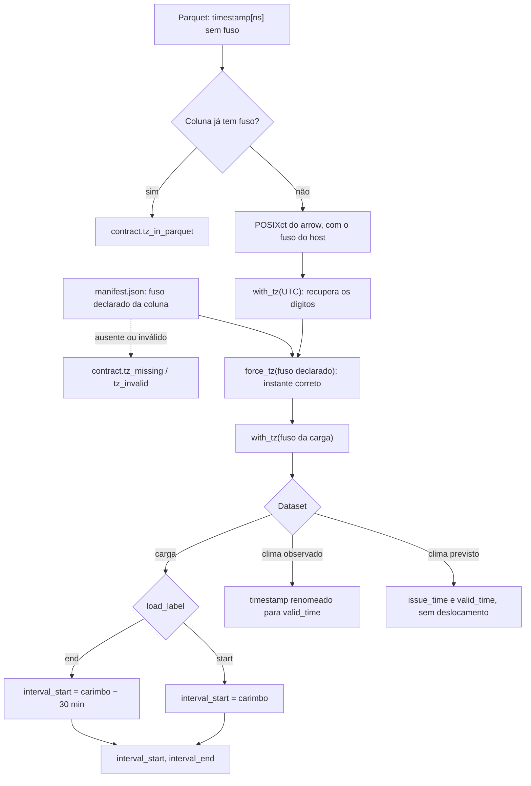

<span className="pc-overline">Arquitetura · 2.12</span>

<p className="pc-lead">Todo dado do deck entra no sistema por um único arquivo: <code>scripts/lib/deck_reader.R</code>. Ele é o único que lê o <code>manifest.json</code> e o único que chama <code>arrow::open_dataset</code>. Valida o manifest num schema v1 fechado, converte cada coluna de data-hora uma única vez para o fuso da carga, aplica o rótulo da carga, deriva o corte intradiário <code>available_until</code> do próprio dado e devolve tabelas já cortadas, com a proveniência em atributos. Nenhum outro módulo faz aritmética de fuso ou de rótulo sobre o dado bruto.</p>

## Por que um leitor único

Entre os arquivos `.R` da raiz de `scripts/lib`, nenhum outro além do `deck_reader.R` contém `open_dataset` ou lê um `manifest.json`. A única exceção é `verify_repro.R`, que lê o `manifest.json` da entrega do forecast, não o do deck. O leitor também não usa `Sys.getenv`, `Sys.time`, `Sys.Date`, `as.POSIXct`, `strptime` nem `as.Date`: datas só por lubridate, com fuso explícito.

| Datasets do deck | Caminho relativo ao `data_dir` | Nome no manifest e na sonda |
|---|---|---|
| Carga verificada | `load/` | `load` |
| Clima observado | `weather/observed/` | `weather_observed` |
| Clima previsto | `weather/forecast/` | `weather_forecast` |
| Feriados | `auxiliary/holidays/` | `holidays` |

Todos são Hive particionados por `area_code=` e `year=`. O leitor abre o dataset com `area_code` como texto e `year` como inteiro, e filtra as partições com `arrow::Scanner` e `Expression`, sem verbos dplyr. Dataset ausente aborta com `contract.dataset_missing` (`where` é o nome do dataset). O `data_dir` vem do ctx (`--data` ou `data_dir` no `config.yaml`); sem ele, `config.data_dir_missing`. O contrato de cada dataset está em [Dados de entrada](/metodologia/dados-de-entrada).

## O manifest.json: schema v1 fechado

O `manifest.json` mora na raiz do `data_dir` e declara as propriedades do deck que o dado não carrega sozinho: o rótulo da carga, o fuso de cada coluna de data-hora e o atraso de publicação do clima previsto. `prevcarga_deck_manifest(data_dir)` o lê e valida. O produto nunca escreve nele.

### Chaves aceitas

| Chave | Valor | Obrigatória | Falha |
|---|---|---|---|
| `schema_version` | `1` | sim | outro valor: `contract.manifest_invalid` |
| `load_label` | `end` ou `start` | não | outro valor: `contract.manifest_invalid` |
| `timezone.load` | nome IANA | sempre | `contract.tz_missing`, `contract.tz_invalid` |
| `timezone.weather_observed` | nome IANA | se o dataset existe ou o fuso foi declarado | idem |
| `timezone.weather_forecast.valid_time` | nome IANA | se o dataset existe ou o mapa foi declarado | idem |
| `timezone.weather_forecast.issue_time` | nome IANA | idem | idem |
| `timezone.holidays` | nome IANA | não; validado se declarado | idem |
| `timezone.dst_periods` | nome IANA | não; validado se declarado | idem |
| `weather_forecast_publication_lag_hours` | inteiro maior ou igual a 0 (horas) | se o deck tem clima previsto | ausente: `contract.weather_lag_missing`; inválido: `contract.manifest_invalid` |

O schema é fechado em três níveis: na raiz, dentro de `timezone` e dentro de `timezone.weather_forecast`. Qualquer chave fora da lista aborta com `contract.manifest_unknown_key`, e o `where` aponta a chave (`timezone.<k>` ou `timezone.weather_forecast.<k>` nos níveis aninhados). Não há chave de corte: o corte intradiário é derivado do dado, nunca declarado.

### Regras de validação

1. Arquivo ausente: `contract.manifest_missing`. JSON malformado ou raiz que não é um objeto com chaves nomeadas: `contract.manifest_invalid`, ambos com `where = manifest.json`.
2. Nenhum fuso tem default. Um fuso exigido e ausente dá `contract.tz_missing`; um nome fora de `OlsonNames()` dá `contract.tz_invalid`. O `where` diz a coluna, por exemplo `load.timestamp` ou `weather_forecast.issue_time`.
3. O fuso da carga é sempre obrigatório, porque é o fuso de saída de todas as tabelas do leitor.
4. O atraso de publicação é obrigatório quando o deck tem clima previsto (o diretório `weather/forecast/` existe ou o mapa `timezone.weather_forecast` foi declarado). Sem clima previsto, a chave é opcional, mas validada se presente. Valor negativo, não inteiro, texto ou vetor dá `contract.manifest_invalid` com `where = manifest.json:weather_forecast_publication_lag_hours`. Não há default nem variável de ambiente.

Todos esses erros são da classe `contract` e saem com exit 2. O catálogo está em `scripts/lib/errors/deck_reader.tsv`.

### O manifest do store

O template versionado do store é `config/deck-manifest.store.json`:

```json title="config/deck-manifest.store.json"
{
  "schema_version": 1,
  "load_label": "start",
  "timezone": {
    "load": "Etc/GMT+3",
    "weather_observed": "Etc/GMT+3",
    "weather_forecast": { "valid_time": "Etc/GMT+3", "issue_time": "UTC" },
    "holidays": "Etc/GMT+3"
  },
  "weather_forecast_publication_lag_hours": 6
}
```

`Etc/GMT+3` é o fuso fixo de −03:00, sem horário de verão (no padrão IANA, o sinal do `Etc/GMT` é invertido). O utilitário de desenvolvimento `scripts/tools/write_store_manifest.R --target <copia>` grava esse template numa cópia ou overlay do store: valida pelo próprio leitor, não faz nada se o manifest existente for idêntico e aborta com `contract.manifest_exists_different` se for diferente.

<Pendente titulo="Pendente · manifest do store real">O store real em <code>data/</code> ainda não tem <code>manifest.json</code>, e o leitor aborta com <code>contract.manifest_missing</code> até ele ser gravado. Os valores do template estão registrados como "a confirmar" em <code>docs/estado/deck_reader.md</code>.</Pendente>

:::note O documento de referência está atrás do código
O `docs/reference/DECK-CANONICO.md` ainda não lista `weather_forecast_publication_lag_hours` nem `timezone.dst_periods`, e diz que flag ou `config.yaml` em conflito com o manifest dão erro. No código, o atraso de publicação é obrigatório quando há clima previsto e só a flag `--load-label` entra no conflito. Esta página segue o `deck_reader.R`.
:::

## Rótulo da carga e precedência

Com rótulo de fim de intervalo, o carimbo `09:30` significa o intervalo 09:00–09:30. O leitor resolve qual rótulo o deck usa com `prevcarga_resolve_load_label(ctx, manifest)`, nesta ordem:

| Ordem | Fonte | `load_label_source` |
|---|---|---|
| 1 | `load_label` do `manifest.json` | `manifest` |
| 2 | flag `--load-label` | `flag` |
| 3 | `load_label` do `config.yaml` | `config` |
| 4 | `end` | `default` |

Se o manifest declara o rótulo e a flag diz outro, o leitor aborta com `contract.load_label_conflict`: o deck sabe como foi gravado, e a flag não pode contradizê-lo. O `config.yaml` não entra no conflito, porque o manifest vem antes. A precedência geral do ctx está em [Configuração e contexto (ctx)](/arquitetura/configuracao-ctx).

Com `end`, o leitor desloca o carimbo em −30 min para obter `interval_start`; com `start`, usa o carimbo como está. Em ambos, `interval_end = interval_start + 30 min`. Esse é o único lugar do sistema que opera o rótulo na entrada. O deslocamento de modelagem do DESSEM é outra coisa e mora no despachante; ver [Tempo: rótulo da carga, fusos e ajuste de hora](/metodologia/tempo-rotulo-fusos).

## Pipeline de fuso

O store guarda as colunas de data-hora como `timestamp[ns]` sem fuso: são dígitos de relógio, e o fuso de cada coluna está no manifest. Ao ler um parquet desses, o arrow devolve um POSIXct cujo instante é o dos dígitos lidos como UTC, mas rotulado com o fuso da sessão R do host. Por isso uma inspeção ingênua mostra os horários deslocados. A função interna `.prevcarga_apply_tz` desfaz isso em três passos, sem depender do fuso nem do locale da sessão.

<Figura id="FIG-A09" titulo="Conversão de tempo no leitor único" natureza="Fluxo" fontes={['scripts/lib/deck_reader.R', 'docs/estado/deck_reader.md', 'config/deck-manifest.store.json']} adrs={['ADR-0037', 'ADR-0035']}>



</Figura>

Os passos, no código:

```r title="scripts/lib/deck_reader.R"
.prevcarga_apply_tz <- function(x, declared, tz_load) {
  digits <- lubridate::with_tz(x, tzone = "UTC")
  lubridate::with_tz(lubridate::force_tz(digits, tzone = declared), tzone = tz_load)
}
```

1. `with_tz(x, "UTC")` só troca o rótulo do POSIXct: como o instante do arrow é o dos dígitos lidos como UTC, isso devolve os dígitos originais.
2. `force_tz(digits, declarado)` mantém os dígitos e fixa o fuso declarado no manifest para aquela coluna. Com isso, o instante está correto.
3. `with_tz(..., fuso da carga)` expressa esse instante no fuso da carga, que é o fuso de saída de todo o leitor. No store, isso converte o `issue_time` (UTC) para −03:00.

Antes de converter, `.prevcarga_check_naive` confere o schema do dataset: se a coluna de data-hora já tem fuso no parquet, o leitor aborta com `contract.tz_in_parquet` (`where` = `dataset.coluna`). O store tem de ser ingênuo, e o fuso só existe no manifest.

O que cada dataset recebe depois da conversão:

| Dataset | Colunas convertidas | Deslocamento | Saída |
|---|---|---|---|
| Carga | `timestamp` | −30 min com `end`; nenhum com `start` | `interval_start`, `interval_end`; a coluna `timestamp` some |
| Clima observado | `timestamp` | nenhum (exógena instantânea) | renomeada para `valid_time` logo após o fuso; nenhum consumidor vê `timestamp` |
| Clima previsto | `issue_time`, `valid_time` | nenhum | as duas colunas, no fuso da carga |
| Feriados | nenhuma | nenhum | `date` como data civil (`Date`), sem fuso |

## Corte intradiário derivado do dado

Quando o chamador passa a origem O, o leitor deriva o corte intradiário do próprio dado de carga, sem relógio, manifest nem flag. O método está em [Os três cortes de data](/metodologia/tres-cortes); aqui fica o que o leitor faz.

1. Lê a carga numa janela de derivação que vai de `min(from, O−1)` a `max(to, O)`, ou seja, sempre inclui a véspera e o dia O.
2. Se houver `truncate_at`, remove os intervalos com `interval_end` posterior a ele. É o mesmo que um deck fisicamente truncado; o backtest usa isso.
3. Sem nenhuma linha, aborta com `completude.no_load` (exit 3).
4. Por área, `prevcarga_available_until` acha o `interval_end` do último intervalo contíguo desde `O 00:00`. Sem intervalo no dia O, o corte é `O 00:00` (a rodada das 0h); com os 48 intervalos, `O+1 00:00`.
5. Se houver um buraco no dia O antes do último intervalo presente, aborta com `completude.origin_day_gap` (`where = area:HH:MM`). O corte nunca encurta por causa do buraco.
6. O corte global é o mínimo entre as áreas. Se as áreas divergem, o leitor emite o aviso `warning.available_until_spread`, com o corte de cada área no `where`.

A partir daí, a carga sai só com `interval_end` até `available_until` e o clima observado só com `valid_time` até `available_until`.

### Limite de emissão do clima previsto

O clima previsto não é cortado por `valid_time`, e sim por emissão. `prevcarga_weather_issue_limit(rule, origin, available_until, tz_load, lag_hours)` é o único lugar com essa aritmética; `dates.R`, o treino e a inferência herdam o limite pronto. A regra vem de `ctx$weather_issue_cutoff` (`--weather-cutoff` ou `weather_issue_cutoff` no `config.yaml`, ADR-0024).

| Regra | Limite de `issue_time` | Atraso efetivo registrado |
|---|---|---|
| `available_until` (default) | `available_until` − `weather_forecast_publication_lag_hours`, no fuso da carga | o do manifest |
| `origin_midnight_utc` | `O 00:00 UTC`, expresso no fuso da carga | 0 |

`origin_midnight_utc` não usa o atraso. Regra fora dessas duas aborta com `config.bad_weather_cutoff`.

Com o limite pronto, `prevcarga_freshest_issue` fica, por `(area_code, valid_time)`, com a emissão mais fresca cujo `issue_time` não passa do limite. A escolha é por `valid_time`, não por emissão inteira: uma emissão que começa depois de `00:00` do dia O não apaga as primeiras horas do dia, que vêm da emissão anterior. Nenhuma emissão posterior ao limite entra.

Um exemplo com atraso de 6 h e uma emissão diária às 00Z: na rodada das 0h, `available_until = O 00:00` local, que é `O 03Z`; o limite é `O−1 21Z`, e entra a emissão 00Z de O−1. A partir de `O 03:00` local (`O 06Z`), o limite alcança `O 00Z`, com fronteira inclusiva, e entra a emissão 00Z de O.

## API de leitura

| Função | Lê | Corte aplicado | Usada por |
|---|---|---|---|
| `prevcarga_deck_manifest(data_dir)` | `manifest.json` | nenhum | o próprio leitor; `dates.R` (atraso de publicação para a tabela de cortes), `validation.R`, `forecast.R`, `orchestrate.R`, `evaluation.R`, `introspect.R` |
| `prevcarga_read_load(ctx, areas, from, to, origin, truncate_at)` | `load/` | com `origin`: `interval_end` até `available_until` | `dates.R`, `validation.R`, `reconcile.R`, `evaluation.R`, `backtest.R`, o painel |
| `prevcarga_read_weather(ctx, kind, areas, from, to, select, origin, truncate_at)` | `weather/observed/` ou `weather/forecast/` | com `origin`: observado até `available_until`; previsto pela emissão mais fresca permitida | `validation.R`, o painel |
| `prevcarga_read_forecast_vintages(ctx, areas, from, to, limit)` | `weather/forecast/` | todas as emissões com `issue_time` até `limit` | `training.R`, `inference.R` |
| `prevcarga_read_holidays(ctx, areas, from, to)` | `auxiliary/holidays/` | nenhum: calendário conhecido de antemão | o painel |
| `prevcarga_read_holiday_codes(ctx, areas)` | `auxiliary/holidays/` | nenhum; não exige manifest | `validation.R` |
| `prevcarga_last_load_day(ctx, areas)` | `load/`, só a partição `year` mais alta não vazia | nenhum | `dates.R`, para o default de `--origin` |
| `prevcarga_deck_probe(data_dir)` | metadados dos quatro datasets | nenhum; não coleta linhas | `validation.R` (validação do deck) |
| `prevcarga_read_panel(ctx, origin, areas, horizon_days, history_days, truncate_at)` | os quatro datasets | os de cada leitor, com o mesmo `truncate_at` | `training.R`, `inference.R` |

### Detalhes por função

- **`prevcarga_read_load`**: devolve um data.table chaveado por `(area_code, interval_start)` com `interval_start`, `interval_end` e `load_mwh`. A janela `from`/`to` é em dias civis no fuso da carga, de `from 00:00` até antes de `to + 1 00:00`. Sem `origin`, não deriva corte (só aplica `truncate_at`, se houver). Atributos: `load_label`, `load_label_source`, `tz` e, com `origin`, também `available_until`, `available_until_by_area`, `available_until_spread` e `origin`.
- **`prevcarga_read_weather`**: `kind = "observed"` lê `timestamp`, `temperature`, `heat_index` e `rh`; `kind = "forecast"` lê `issue_time`, `valid_time`, `temperature` e `heat_index`. Só as colunas presentes no schema entram, e `select` restringe a lista. A janela é sobre `valid_time`. No previsto, a emissão mais fresca é escolhida antes do recorte de `valid_time`. Com `origin`, o previsto ganha os atributos `weather_issue_cutoff`, `weather_issue_cutoff_source`, `weather_issue_limit`, `weather_publication_lag_hours` e `freshest_issue_by_area`.
- **`prevcarga_read_forecast_vintages`**: é o insumo dos plugins que montam a própria safra por origem e lead (descriptor `weather_forecast_in_train`). Lê o previsto sem origem e filtra `issue_time` até o `limit` recebido, que é o `weather_issue_limit` já calculado.
- **`prevcarga_read_holidays`**: colunas `area_code`, `date`, `holiday_type_id`, `prevcarga_code` e `simplified_code`, chaveadas por `(area_code, date)`. Sem `from` nem `to`, devolve todo o calendário da área. Não filtra nem corrige códigos: um `simplified_code = -1` sai como está, e o finding é da validação do deck.
- **`prevcarga_last_load_day`**: devolve o dia, no fuso da carga, do último `interval_start` presente. Percorre as partições `year` da mais alta para a mais baixa e para na primeira com linhas. Nunca consulta o relógio. Sem carga, `completude.no_load`.
- **`prevcarga_deck_probe`**: por dataset, devolve `present`, `files`, `hive_ok`, `columns`, `types`, `tz_in_parquet` e `unreadable`. Lê só o schema de cada arquivo parquet, sem coletar linhas. `hive_ok` exige que todo arquivo esteja sob `area_code=` e `year=`. É a base das checagens de contrato da [validação do deck](/arquitetura/validacao-deck).

## O painel do leitor

`prevcarga_read_panel` é a porta de entrada do treino e da inferência. Recebe a origem já resolvida (o leitor não depende de `dates.R`) e, antes de ler qualquer coisa, confere as áreas contra as folhas de `config/topology.yaml` (ou de `ctx$topology_path`). Área fora da topologia aborta com `topology.area_undeclared` (exit 4, `where` = a área).

Depois chama os leitores com a mesma origem e o mesmo `truncate_at`, de modo que carga, observado e previsto derivam o mesmo `available_until`.

| Elemento | Janela | Conteúdo |
|---|---|---|
| `load` | `O − history_days` a O | carga cortada em `available_until` |
| `weather_observed` | `O − history_days` a O | observado até `available_until` |
| `weather_forecast` | O a `O + horizon_days` | por `valid_time`, a emissão mais fresca permitida |
| `holidays` | sem janela | o calendário inteiro de cada área |
| `attrs` | — | proveniência da leitura, descrita abaixo |

Os feriados vêm sem janela de propósito: uma feature como dias desde o último feriado precisa enxergar o feriado anterior ao início do histórico, e uma janela o cortaria.

### Atributos do painel

`pc_panel_attrs` copia os atributos dos leitores sem recalcular nada. Se o `tz` ou o `available_until` do observado ou do previsto divergirem dos da carga, aborta com `contract.constraint_violated` (`where = panel.tz` ou `panel.available_until`).

| Atributo | Origem | Significado |
|---|---|---|
| `origin` | chamador | a origem O da leitura |
| `available_until` | carga | corte intradiário global (mínimo entre as áreas) |
| `available_until_by_area` | carga | por área: `area_code`, `until`, `gap` |
| `load_label` | carga | `end` ou `start` |
| `load_label_source` | carga | `manifest`, `flag`, `config` ou `default` |
| `tz` | carga | fuso da carga, fuso de saída de todas as tabelas |
| `weather_issue_cutoff` | previsto | regra usada: `available_until` ou `origin_midnight_utc` |
| `weather_issue_limit` | previsto | limite de `issue_time` calculado pela regra |
| `weather_publication_lag_hours` | previsto | atraso efetivo: o do manifest, ou 0 em `origin_midnight_utc` |

O painel não sabe qual série de clima pertence a cada área do modelo: esse mapeamento é do plugin. Para os plugins com `weather_forecast_in_train`, `training.R` e `inference.R` trocam o `weather_forecast` do painel pelas safras de `prevcarga_read_forecast_vintages`, com o mesmo limite de emissão; ver [Despachante de plugin e fachadas de treino e inferência](/arquitetura/despachante).

## Erros do leitor

| Id | Classe e exit | Quando |
|---|---|---|
| `contract.manifest_missing` | contract, 2 | sem `manifest.json` na raiz do `data_dir` |
| `contract.manifest_invalid` | contract, 2 | JSON malformado ou valor fora do schema v1 |
| `contract.manifest_unknown_key` | contract, 2 | chave fora do schema fechado |
| `contract.tz_missing` | contract, 2 | fuso exigido ausente |
| `contract.tz_invalid` | contract, 2 | fuso fora de `OlsonNames()` |
| `contract.tz_in_parquet` | contract, 2 | coluna de data-hora do parquet já tem fuso |
| `contract.load_label_conflict` | contract, 2 | `--load-label` contradiz o manifest |
| `contract.dataset_missing` | contract, 2 | dataset pedido ausente no deck |
| `contract.weather_lag_missing` | contract, 2 | deck com clima previsto sem atraso de publicação |
| `contract.constraint_violated` | contract, 2 | atributos divergentes entre os leitores do painel |
| `completude.no_load` | completude, 3 | nenhuma linha de carga no recorte |
| `completude.origin_day_gap` | completude, 3 | buraco no dia O antes do último intervalo presente |
| `warning.available_until_spread` | aviso, não aborta (classe `completude` no catálogo) | áreas com `available_until` diferentes |
| `topology.area_undeclared` | topology, 4 | área do painel fora da topologia |

Os catálogos estão em `scripts/lib/errors/deck_reader.tsv`, `scripts/lib/errors/deck_cut.tsv` e `scripts/lib/errors/topology.tsv`; o contrato geral está em [Contrato de erros e códigos de saída](/arquitetura/erros-exit).
