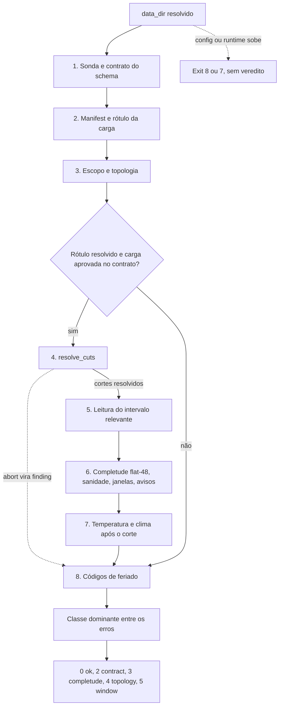

Arquitetura · 2.13

A validação do deck roda antes de qualquer cálculo; na rodada <code>forecast</code>, é o passo 1. A função <code>prevcarga_validate_deck</code>, em <code>scripts/lib/validation.R</code>, nunca para no primeiro defeito: percorre todas as checagens numa ordem fixa, transforma cada defeito num finding classificado e só no fim decide o veredito. A classe dominante entre os erros define o código de saída (2 contract, 3 completude, 4 topology, 5 window); avisos são registrados mas não reprovam. A validação é somente leitura sobre o deck e não depende de modelo, salvo pelo contrato que cada membro declara: janelas de histórico e horizonte no <code>run.yaml</code> e <code>data_lag_days</code> no descriptor do plugin.

## Onde a validação roda

A mesma função serve a três chamadores. Nenhum deles tem lista própria de classes ou de exits: todos mapeiam o veredito pela precedência única de `scripts/lib/errors.R`.

| Chamador | Arquivo | Escopo | Como pular |
|---|---|---|---|
| Verbo `validate-deck` | `scripts/lib/cli/validate-deck.R` | todos os membros e as áreas do deck declaradas na topologia, ou o recorte de `--area` e `--model` | não se aplica |
| Rodada `forecast` | `scripts/lib/forecast.R` | todos os membros da topologia | `--skip-validate` |
| Verbo `score` | `scripts/lib/cli/score.R` | o modelo e a área pedidos | `--skip-validate` |

`--skip-validate` pula só a validação. Na rodada, os cortes (`available_until`, regra do clima, fuso) continuam vindo do leitor por `prevcarga_resolve_cuts`, com ou sem validação. Depois da validação a rodada ainda recusa um dia O já completo no deck (`completude.forecast_origin_day_complete`, exit 3), mas essa recusa é da rodada, não da validação. O passo a passo do operador está em [Validar o deck antes de rodar](/execucao/validar-deck).

## Veredito acumulativo e ordem das checagens

### O princípio

Cada checagem devolve findings para um coletor que preserva a ordem de inserção. Os aborts classificados que o leitor do deck e o `dates.R` levantam são capturados por `.prevcarga_capture` e viram findings da sua própria classe. Um erro não classificado durante a leitura dos datasets (por exemplo, do arrow) vira `contract.parquet_unreadable`. Entre os aborts classificados, só duas classes escapam do coletor e sobem direto: `config` e `runtime`, que são erro de uso ou de ambiente, não defeito do deck. Por isso, sem diretório de dados (nem `--data` nem `data_dir` no `config.yaml`), a validação sai com `config.data_dir_missing` (exit 8) antes de olhar qualquer arquivo.

Um dataset reprovado no contrato sai das checagens seguintes. Isso evita cascata: uma carga com coluna faltando gera um finding de schema, não centenas de dias incompletos.

<Figura id="FIG-A10" titulo="Veredito acumulativo do validate-deck" natureza="Fluxo" fontes={['scripts/lib/validation.R', 'scripts/lib/errors.R', 'docs/estado/validation.md', 'docs/estado/validate_deck.md']} adrs={['ADR-0040']}>

</Figura>

### As fases em ordem

1. **Sonda e contrato.** `prevcarga_deck_probe` lê só metadados dos quatro datasets (`load`, `weather/observed`, `weather/forecast`, `auxiliary/holidays`), sem coletar linhas. `.prevcarga_check_contract` compara o que a sonda viu com o contrato canônico, guardado como dado em `.prevcarga_deck_spec`: dataset presente, layout Hive `area_code=`/`year=`, arquivos legíveis, colunas obrigatórias, tipo arrow de cada coluna e timestamp sem fuso no parquet.
2. **Manifest e rótulo.** `prevcarga_deck_manifest` lê o `manifest.json` (schema v1 fechado) e `prevcarga_resolve_load_label` resolve o rótulo da carga. As duas chamadas são capturadas: manifest ausente, inválido, com chave desconhecida ou sem fuso vira finding `contract`, e a validação segue.
3. **Escopo e topologia.** `.prevcarga_check_scope` lê `config/topology.yaml` e a lista de membros. Toda área presente no deck que a topologia não declara gera `topology.area_undeclared`. Com `--area`, uma área fora da topologia gera `topology.scope_undeclared`, e um subsistema se expande para as suas folhas mais ele mesmo. Com `--model`, um modelo que não é membro gera o mesmo `scope_undeclared`.
4. **Cortes.** Só quando o rótulo foi resolvido e a carga passou no contrato, `prevcarga_resolve_cuts` calcula a origem, o `available_until` e a tabela de cortes por membro. Os aborts desse passo viram findings: buraco no dia da origem (`completude.origin_day_gap`), carga ausente no recorte (`completude.no_load`), `split` ou granularidade inválidos no `run.yaml` e `data_lag_days` inválido no descriptor. Áreas com `available_until` diferentes geram o aviso `available_until_spread`. O detalhe dos cortes está em [Os três cortes de data](/metodologia/tres-cortes).
5. **Leitura enxuta.** A carga é lida só no intervalo relevante, que termina em O−1 (D−1) e começa no menor início entre as janelas de treino e de inferência dos membros do escopo (`.prevcarga_relevant_from`).
6. **Carga.** Sobre essa leitura rodam, nesta ordem, a completude flat-48, a sanidade (grade de 30 min, duplicata, carga não positiva), as janelas por membro e os avisos heurísticos.
7. **Clima.** A temperatura observada é checada de início do intervalo até O; a prevista, de O até O mais o maior horizonte entre os membros. Uma segunda leitura do clima previsto do dia O alimenta o aviso de emissão após o limite.
8. **Feriados.** Os códigos de feriado são lidos por `prevcarga_read_holiday_codes`, que não depende do manifest nem da origem. Por isso o finding `code_negative` acumula mesmo num deck sem `manifest.json`.

Se o manifest falhou, as fases 4 a 7 não rodam e os campos que dependem delas voltam `NULL` no resultado. A validação nunca supõe um fuso default nem encurta o `available_until` para o início de um buraco.

### A precedência

`.prevcarga_verdict` olha só os findings com `level == "error"`. Sem nenhum, o veredito é `ok`. Com erros, a classe dominante vem de `prevcarga_exit_precedence`, que tem a ordem fixa `runtime`, `config`, `contract`, `completude`, `topology`, `window`. Um deck com um intervalo de carga zero e um histórico curto sai com exit 2, não 5: o `load_nonpositive` (contract) encobre o déficit de janela no código de saída, mas os dois continuam na lista de findings. Um defeito de contrato que reprova o dataset inteiro, como uma coluna obrigatória ausente, é diferente: ele tira a carga das checagens seguintes e o déficit de janela nem chega a ser calculado.

O verbo e a rodada fazem a mesma coisa com o veredito reprovado: levantam `prevcarga_abort` com o id do primeiro erro da classe dominante (por exemplo `contract.load_nonpositive`), com a lista completa de findings em `details`. Quem fixa o exit e o envelope é o handler de topo da fachada, descrito em [Contrato de erros e códigos de saída](/arquitetura/erros-exit).

## Classes e findings

### A forma de um finding

Cada finding é uma linha de `data.table` com sete colunas.

| Coluna | Conteúdo |
|---|---|
| `area` | área do defeito, ou `*` quando ele é do dataset inteiro |
| `dataset` | `load`, `weather_observed`, `weather_forecast`, `holidays`, `manifest` ou `scope` |
| `what` | sufixo do `error.id`, como `day_incomplete` |
| `detail` | texto curto, como `2025-03-10: 46/48` ou `4 linhas; primeiro: ...` |
| `class` | classe do catálogo |
| `level` | `error` ou `warning` |
| `where` | o local do defeito: o dataset, o arquivo relativo ao `data_dir`, `dataset.coluna`, a área ou o modelo, ou a chave do `run.yaml` do membro |

As linhas de mesmo tipo são agregadas por área: um `load_nonpositive` diz quantas linhas falharam e qual foi a primeira, em vez de uma linha por intervalo. As exceções são `day_incomplete`, com um finding por área e dia, as janelas, com um finding por membro e área, e `code_negative`, com um finding por coluna e área.

### contract (exit 2)

| `what` | O que reprova | Fase |
|---|---|---|
| `dataset_missing` | diretório do dataset ausente | sonda |
| `hive_layout` | arquivo fora de `dataset/area_code=A/year=AAAA/arquivo.parquet` | sonda |
| `parquet_unreadable` | parquet que o arrow não abre | sonda ou leitura |
| `schema_missing` | coluna obrigatória ausente | sonda |
| `type_mismatch` | tipo arrow diferente do contrato | sonda |
| `tz_in_parquet` | timestamp gravado com fuso (o store deve ser ingênuo) | sonda |
| `manifest_missing`, `manifest_invalid`, `manifest_unknown_key` | `manifest.json` ausente, malformado ou com chave fora do schema v1 | manifest |
| `tz_missing`, `tz_invalid` | fuso obrigatório ausente ou fora de `OlsonNames()` | manifest |
| `weather_lag_missing` | deck com clima previsto sem `weather_forecast_publication_lag_hours` | manifest |
| `load_label_conflict` | `--load-label` contradiz o `load_label` do manifest | rótulo |
| `split_unknown`, `granularity_invalid`, `data_lag_invalid` | contrato do membro inválido ao montar os cortes | cortes |
| `grid_off` | intervalo de carga fora da grade de 30 min | carga |
| `duplicate_interval` | mais de uma linha por área e `interval_start` | carga |
| `load_nonpositive` | carga menor ou igual a zero | carga |
| `temperature_out_of_range` | temperatura fora de −10 a 50 °C | clima |
| `code_negative` | `holiday_type_id`, `prevcarga_code` ou `simplified_code` negativo | feriados |

O contrato de tipos fica no próprio código, em `.prevcarga_deck_spec`: `timestamp` sem fuso para as datas-hora, `double` para carga e temperatura, `date32` para a data do feriado e `int64` para os códigos. As colunas `heat_index` e `rh` são opcionais; um tipo errado nelas gera o finding mas não tira o dataset das checagens seguintes.

### completude (exit 3)

| `what` | O que reprova |
|---|---|
| `day_incomplete` | dia do intervalo relevante sem os 48 intervalos de 30 min |
| `origin_day_gap` | buraco no dia O antes do último intervalo de carga presente |
| `no_load` | nenhuma linha de carga no recorte pedido |

A grade é flat-48: um dia tem 48 intervalos, contados por `interval_start` no fuso da carga (`prevcarga_day_complete`), sem exceção de horário de verão. Um dia com 46 ou 47 intervalos é buraco. Um intervalo vale quando começa em `:00` ou `:30`, tem segundo zero e carga não ausente; duplicatas contam uma vez. O sistema não preenche buraco nem substitui carga ausente por zero, então um deck com NA ou zero reprova.

A contagem de cada área começa no primeiro dia em que ela tem carga, ou no início do intervalo relevante, o que vier depois. Os dias anteriores ao começo do deck não são buraco: são déficit de janela, cobrado pela classe `window`. Uma lacuna até O−1 é reprovada; a ausência de carga depois do corte e no horizonte é o esperado.

### topology (exit 4)

| `what` | O que reprova |
|---|---|
| `area_undeclared` | área presente no deck e ausente de `config/topology.yaml` |
| `scope_undeclared` | `--area` ou `--model` fora da topologia ou da lista de membros |

As áreas declaradas são as folhas, os subsistemas e a área de perdas de cada subsistema. A fonte é a mesma de todo o sistema, descrita em [Topologia e contrato por modelo](/arquitetura/topologia-run-yaml).

### window (exit 5)

| `what` | Janela | Termina em |
|---|---|---|
| `window_train_deficit` | `history_days.train` do membro | `last_data_day` do membro |
| `window_infer_deficit` | `history_days.infer` do membro | O−1 |

A janela de treino termina no `last_data_day` de cada membro: O−1 em geral, O−3 no LightGBM, pelo `data_lag_days` do descriptor (ADR-0023). Os lags chegam ao verbo por `prevcarga_plugin_data_lags` (`registry.R`), que carrega cada plugin e lê o seu descriptor; um membro sem plugin fica com o lag `default`. Os tamanhos de janela vêm do `run.yaml` de cada modelo, sem literal no `validation.R`. Há um finding por membro, área e tipo, e o `where` aponta para a chave do `run.yaml` que a define, como `models/holt-winters/run.yaml:history_days.train`.

### Avisos

Avisos têm `level = "warning"` e nunca mudam o veredito. Com o veredito `ok`, o verbo levanta um `prevcarga_warn` por tipo de aviso: no texto ele vai para o stderr, no JSON para o campo `warnings` do envelope. Com o veredito reprovado, os avisos ficam só na lista de findings.

| `what` | Regra | Constante |
|---|---|---|
| `outlier` | intervalo fora de 1,5 IQR e com `abs(z) > 3` ao mesmo tempo | `prevcarga_iqr_k`, `prevcarga_z_max` |
| `flatline` | carga idêntica por 6 ou mais intervalos seguidos | `prevcarga_flatline_min_slots` |
| `climate_after_cut` | emissão de clima do dia O depois de `weather_issue_limit` | regra `weather_issue_cutoff` |
| `available_until_spread` | áreas com `available_until` diferentes; o corte global é o mínimo | leitor da carga (`deck_reader.R`) |

O `climate_after_cut` não reprova porque o leitor já exclui a emissão tardia do painel. Ele só avisa que o deck tem informação que a rodada não vai usar.

### O que a validação não checa

A validação não tem faixa de MW por subsistema nem exige monotonicidade de nada. O que não é defeito do deck fica no pipeline de cada modelo, na ingestão, na engenharia de atributos ou na inferência: completar o clima previsto, os valores substitutos de cada família, o pré-processamento próprio de cada modelo. Esse recorte está em [Dados de entrada](/metodologia/dados-de-entrada).

:::note Limite conhecido da sonda
A sonda lê o schema do primeiro parquet legível de cada dataset. Uma coluna ausente só em outras partições não é vista pelo contrato e só aparece, se aparecer, na leitura.
:::

### Onde os ids moram

O catálogo é distribuído, sem lista central (barrel por descoberta). `scripts/lib/errors/validation.tsv` declara os 15 ids próprios da validação do deck. Os demais vêm dos módulos donos: `deck_reader.tsv` (manifest, fuso, rótulo, `dataset_missing`, `tz_in_parquet`), `deck_cut.tsv` (`origin_day_gap`, `no_load`, `available_until_spread`), `dates.tsv` (contrato do membro e `schema_missing`) e `topology.tsv` (`area_undeclared`).

## Saída do verbo

O verbo é fino: `prevcarga_build_validate_deck` chama a validação e monta o `result` do envelope, e `cmd_validate_deck` decide entre texto e JSON.

<Terminal title="prevcarga — bash" lines={[{type:'cmd',text:'prevcarga validate-deck --data ./deck --origin 2026-10-01'},{type:'cmd',text:'prevcarga validate-deck --data ./deck --area=SECO --format json'}]} />

| Formato | Saída limpa | Saída reprovada |
|---|---|---|
| texto | cabeçalho, tabela de cortes por membro, tabela de findings (erros primeiro), `OK` | as mesmas linhas com `FALHA` e a classe no stdout; depois a linha de erro da fachada no stderr |
| JSON | `result` completo no envelope | envelope de erro; a lista de findings vai em `error.details.items` |

O cabeçalho do texto traz a origem e a sua fonte, a hora do `available_until`, o rótulo da carga e a sua fonte, a regra do clima e os 12 primeiros caracteres do `data_hash`. O `result` do JSON leva `schema_version`, `ok`, `class`, `forecast_origin`, `origin_source`, `available_until` e o seu valor por área, `load_label` e a fonte, `weather_issue_cutoff` e `weather_issue_limit`, `timezone`, `data_hash`, `scope` (as áreas e os modelos efetivamente checados), `cuts` e `findings`. As datas-hora saem como `AAAA-MM-DD HH:MM` no fuso da carga.

:::info Findings no veredito reprovado
O `prevcarga_abort` do verbo não leva o `result`. No veredito reprovado, o envelope JSON não traz `result.findings`; os findings estão em `error.details.items`, com a contagem de erros em `error.details.findings`.
:::

## data_hash: identidade do deck

O `data_hash` é a impressão digital do deck. `prevcarga_data_hash`, em `scripts/lib/provenance.R`, monta um texto com uma linha por elemento e devolve o sha256 dele.

1. Lista todos os `.parquet` de `load`, `weather/observed`, `weather/forecast` e `auxiliary/holidays`, com o caminho Hive relativo ao `data_dir`.
2. Ordena os caminhos por radix, o que torna o resultado independente de locale e da ordem de listagem.
3. Gera uma linha `caminho` tab `sha256 do arquivo` para cada parquet.
4. Acrescenta `load_label` tab o rótulo efetivo.
5. Acrescenta `timezone.chave` tab o fuso IANA, para cada fuso do manifest, também em ordem radix.
6. Acrescenta `weather_forecast_publication_lag_hours` tab o atraso, quando o manifest o declara.

Sem nenhum parquet, a função aborta com `contract.dataset_missing`. O hash não depende de modelo: não muda com `--model`. Muda com um único byte de qualquer parquet, com o rótulo efetivo da carga, com o fuso do manifest e com o atraso de publicação do clima declarado nele. Copiar o deck para outro caminho não o muda, porque só entram caminhos relativos.

O verbo só calcula o `data_hash` quando o manifest foi lido e o rótulo resolvido; senão o campo volta `NULL`. A mesma receita alimenta o `run_manifest` da rodada (`forecast.R`), a avaliação do `score` (`evaluation.R`) e a orquestração (`orchestrate.R`); na rodada e na orquestração, um `ctx$data_hash` já calculado tem prioridade. O uso do hash na identidade da rodada está em [Proveniência, identidade e layout do estado](/arquitetura/proveniencia-estado).

<Pendente titulo="Pendente · receita do data_hash sem ADR">
A receita do `data_hash` (quais arquivos entram, a ordem, os campos do manifest e o rótulo) é hoje um default de trabalho fixado pela implementação em `provenance.R`. Ela ainda não tem ADR próprio que a congele.
</Pendente>
