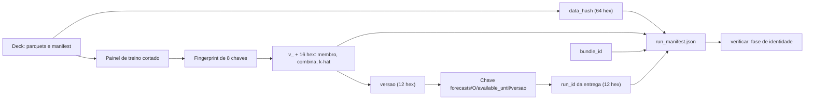
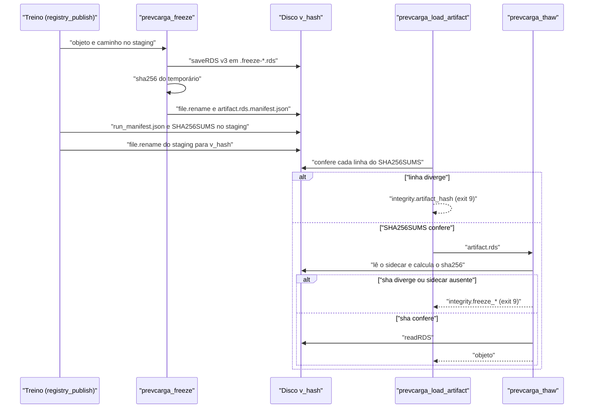

<span className="pc-overline">Arquitetura · 2.15</span>

<p className="pc-lead">Artefatos, entregas e backtests do PrevCarga têm identidade calculada do conteúdo, nunca do relógio. Um artefato treinado se chama <code>v_</code> mais 16 hex do sha256 de um fingerprint de exatamente 8 chaves; uma entrega se chama pela <code>versao</code> de 12 hex dos insumos que a compõem; o <code>run_manifest.json</code> separa as chaves que definem a rodada dos campos laterais. Arquivos congelados levam um sidecar com sha256, conferido antes de qualquer leitura. Tudo isso mora sob um único <code>state_dir</code>, com escritores e leitores definidos para cada ramo.</p>

O contrato está em `scripts/lib/provenance.R`. Treino (`training.R`), combina (`combination.R`), k-hat (`reconcile.R`), cache (`cache.R`), backtest (`orchestrate.R`) e entrega (`exports.R`) usam a mesma função de hash, `prevcarga_version_hash`. A versão nunca vem de `format(Sys.time())`: mesmos insumos dão a mesma identidade, em qualquer máquina e a qualquer hora.

## Fingerprint de 8 chaves e a versão `v_`

`prevcarga_version_hash(fingerprint)` aceita uma lista nomeada com exatamente estas chaves:

| Chave | O que guarda no treino de um membro (`prevcarga_train_fingerprint`) |
|---|---|
| `model_id` | o `mdir` do modelo |
| `data_fingerprint` | sha256 do conteúdo do painel de treino já cortado (carga, clima observado, clima previsto, feriados) |
| `cutoff` | os cortes de treino efetivos, pela classe de split (ver abaixo) |
| `feature_config` | o spec efetivo do `run.yaml` (`name`, `split`, `granularity_min`, `horizon_days`, `history_days`, `seed`, `params`) e a variante `exogena` |
| `code_commit` | `prevcarga_code_commit(root)`, ou o valor injetado em `ctx$code_commit` |
| `renv_lock_hash` | sha256 do `renv.lock`, ou o valor injetado em `ctx$renv_lock_hash` |
| `load_label` | o rótulo efetivo da carga (`end` ou `start`) |
| `load_tz` | o fuso IANA da carga |

A função recusa qualquer desvio desse conjunto, sempre com erro da classe `contract` (exit 2):

| Situação | Erro |
|---|---|
| chave ausente | `contract.fingerprint_missing_key` |
| chave a mais | `contract.fingerprint_extra_key` |
| campo lateral (`trained_at`, `package_version`, `run_id`) dentro do fingerprint | `contract.fingerprint_lateral` |
| fingerprint sem nomes, ou lista com algum nome vazio em qualquer nível | `contract.fingerprint_partially_named` |

### Canonicalização

Antes do hash, o fingerprint vira um JSON canônico:

1. Listas nomeadas são ordenadas pelo nome com `sort(method = "radix")`, em todos os níveis. A ordem em que o chamador montou a lista não muda o hash.
2. `POSIXct` vira ISO-8601 sempre em UTC; `Date` vira ISO-8601; `factor` vira texto.
3. `NULL` e `NA` viram `null`.
4. O JSON sai de `jsonlite::toJSON` com `auto_unbox = TRUE` e `digits = NA` (precisão total).

A versão é `v_` seguida dos 16 primeiros hex do sha256 desse texto. `model_id` e `feature_config` com a `exogena` separam membros que compartilham o resto da identidade, como `RGD_MED` e `LIN_MED` (ADR-0021).

`prevcarga_code_commit(root)` é a única leitura de `git` no pacote, documentada como exceção de desenvolvimento. Devolve o hash de 40 hex do `HEAD`, com sufixo `-dirty` quando `git status --porcelain` não está vazio, ou `unknown` quando não há repositório.

### O cutoff pela classe de split

O campo `cutoff` não é a origem da rodada. Ele leva os cortes de treino que a classe de split do modelo define em `dates.R` (`prevcarga_train_cut`, ADR-0023):

| Classe | `train_origin` | `cutoff` no fingerprint |
|---|---|---|
| `origin_agnostic` | O − 1 − H (H = `horizon_days`) | `train_origin` e `last_data_day` |
| `origin_scoped` | O | só a `origin` |

`available_until` não é campo do fingerprint do artefato, e o painel de carga e clima observado é cortado em `last_data_day`, não no corte intradiário. O clima previsto do painel, porém, entra no `data_fingerprint`: num membro que treina com clima previsto (`weather_forecast_in_train`), as safras lidas seguem o limite de emissão do clima, que depende do corte. O cálculo dos cortes está em [Os três cortes de data](/metodologia/tres-cortes).

Se a pasta da versão já existe no registry, `prevcarga_train` devolve a célula com status `reused` e não treina de novo, salvo com `train-models --force`. Mesmos insumos, mesma versão.

<Figura id="FIG-A11" titulo="Linhagem de identidade: do deck à entrega" natureza="Fluxo" fontes={['scripts/lib/provenance.R', 'scripts/lib/training.R', 'scripts/lib/exports.R', 'scripts/lib/forecast.R', 'scripts/lib/verify_repro.R', 'docs/estado/provenance.md', 'docs/estado/validate_deck.md', 'docs/estado/export.md', 'docs/estado/verificar.md']} adrs={['ADR-0023', 'ADR-0011']}>



</Figura>

O `data_hash` do deck e o `data_fingerprint` do treino são hashes diferentes. O primeiro identifica o deck inteiro e vai para o `run_manifest.json` da entrega. O segundo identifica só o painel que um membro viu no treino e entra no fingerprint do artefato.

## `run_manifest.json`: identidade e campos laterais

`prevcarga_run_manifest(...)` monta o manifesto de uma execução. `prevcarga_write_run_manifest(m, dir)` grava `<dir>/run_manifest.json` de forma atômica (arquivo temporário no mesmo diretório e `file.rename`), em JSON canônico. `prevcarga_read_run_manifest(dir)` lê de volta.

| Chave | Natureza | Validação ou origem |
|---|---|---|
| `data_hash` | identidade | 64 hex |
| `origin` | identidade | `Date` |
| `available_until` | identidade | `POSIXct` ou ausente |
| `load_label` | identidade | `end` ou `start` |
| `load_tz` | identidade | nome IANA válido |
| `weather_issue_cutoff` | identidade | `available_until` ou `origin_midnight_utc` |
| `split` | identidade | `origin_agnostic` ou `origin_scoped` |
| `delivery_days` | identidade | inteiro (um membro) ou lista por sigla (rodada) |
| `member_set_hash` | identidade | `prevcarga_member_set_hash` dos membros |
| `model_versions` | identidade | lista nomeada de `v_` + 16 hex |
| `seeds` | identidade | lista nomeada de inteiros |
| `code_commit`, `renv_lock_hash` | identidade | calculados da raiz; treino e forecast podem sobrepor com o valor injetado |
| `bundle_id` | identidade | 64 hex ou ausente |
| `platform`, `blas_threads`, `tz`, `lc` | carimbo do ambiente | `R.version$platform` e `prevcarga_runtime_stamp()` |
| `trained_at`, `package_version`, `run_id` | lateral | opcionais, fora de qualquer hash |

O construtor aceita campos extras por `...`, mas nenhum deles pode reusar um nome reservado da tabela: isso dá `contract.run_manifest_forbidden_key`. Valor fora do formato dá `contract.run_manifest_bad_value`. As duas condições saem com exit 2.

A rodada não tem `cutoff`. A origem não é um corte de treino: o corte é de cada modelo e vive no fingerprint do artefato. Um corte único na rodada vazaria horizonte. Por isso `cutoff` é nome reservado, e quem tentar acrescentá-lo é recusado.

### Onde o manifesto é gravado

| Onde | Quem grava | Particularidades |
|---|---|---|
| `artifacts/<mdir>/[<exogena>/]<area>/v_<hash>/run_manifest.json` | `prevcarga_train` via `prevcarga_registry_publish` | `data_hash` recebe o `data_fingerprint` do painel; `available_until` é removido; o fingerprint inteiro vai como campo extra `fingerprint` |
| raiz da entrega e do scratch | `forecast` (`.forecast_run_manifest`) | `data_hash` = `prevcarga_data_hash` do deck; `model_versions` com chaves `<sigla>/<folha>`, `combina/<folha>` e `khat/<ss>`; `split`, `delivery_days` e `seeds` por sigla; campo extra `versao` |

Os pesos da combina guardam o manifesto dentro do próprio `weights.rds` (campo `meta`), sem arquivo separado. O `run_manifest.json` do perfil k-hat, em `artifacts/reconcile/<ss>/v_<hash>/`, é uma lista própria do reconcile e não passa por `prevcarga_run_manifest`.

O manifesto da entrega não leva relógio. Duas rodadas com os mesmos insumos produzem o mesmo arquivo, e o `export` o copia em bytes para a entrega, fora de `arquivos[]`. O `verificar` lê dele `data_hash`, `bundle_id` e `model_versions` na fase de identidade: valor diferente ou nulo dá `contract.identity_mismatch` (exit 2). O resto do fluxo de conferência está em [Verificar uma entrega](/execucao/verificar).

## freeze/thaw: integridade com sidecar sha256

`prevcarga_freeze(obj, path)` grava um objeto R e o sidecar que permite conferi-lo depois:

1. `saveRDS(obj, tmp, version = 3)` num arquivo temporário `.freeze-*.rds` no mesmo diretório do destino. O formato é binário, com os números em IEEE-754.
2. Calcula o sha256 do arquivo temporário.
3. Faz `file.rename` para o caminho final.
4. Grava `<path>.manifest.json` de forma atômica, com `sha256`, `class`, `nrows` (tabela) ou `length` (outro objeto) e `format_version` 1.

`prevcarga_thaw(path)` confere o sha256 do arquivo contra o sidecar antes de chamar `readRDS`. Nenhum byte é desserializado se a conferência falhar.

| Falha no thaw | Erro (classe `integrity`, exit 9) |
|---|---|
| arquivo ausente | `integrity.freeze_file_missing` |
| sidecar ausente | `integrity.freeze_manifest_missing` |
| sha256 diferente ou sidecar ilegível | `integrity.freeze_sha_mismatch` |

No registry há uma segunda camada. `prevcarga_registry_publish` congela `artifact.rds`, grava o `run_manifest.json` e depois o `SHA256SUMS` da pasta inteira, que cobre também o sidecar. `prevcarga_load_artifact` confere cada linha do `SHA256SUMS` antes do thaw; divergência dá `integrity.artifact_hash` (exit 9). O ciclo do registry está em [Registry de artefatos](/arquitetura/registry).

<Figura id="FIG-A15" titulo="freeze/thaw com conferência de integridade" natureza="Fluxo" fontes={['scripts/lib/provenance.R', 'scripts/lib/registry.R', 'docs/estado/provenance.md']} adrs={['ADR-0011']}>



</Figura>

:::warning Integridade não é autenticidade
O sha256 do sidecar e o `SHA256SUMS` detectam arquivo corrompido ou editado sem cuidado. Eles não provam quem gravou o arquivo: não há assinatura. Quem reescrever o arquivo e o sidecar de forma coerente passa na conferência.
:::

### `member_set_hash`

`prevcarga_member_set_hash(members)` é a definição única do hash do conjunto de membros. Ele é o sha256 completo (64 hex) do JSON canônico das linhas `(sigla, mdir, exogena)`, na ordem declarada na topologia. A lista de linhas não tem nome, então a ordem dos membros conta. `exogena` ausente vira `null`. O hash entra no `run_manifest.json` e no `feature_config` do fingerprint dos pesos da combina.

## Identificadores

Cada identificador tem um único cálculo. Três deles se chamam `run_id` e significam coisas diferentes.

| Identificador | Formato | Como é calculado | Onde aparece |
|---|---|---|---|
| `run_id` do envelope | `AAAAMMDDTHHMMSSZ-<pid>` | `prevcarga_run_id()` em `config.R`: relógio UTC e PID, lido uma vez por comando | envelope JSON do comando; prefixo de data dá o `gerado_em` do `manifest.json` e o `ts` do `failures.jsonl` |
| `run_id` da entrega | 12 hex | sha256 do caminho relativo da chave da entrega (`prevcarga_export_key`) | nome do scratch `scratch/<run_id>/`, staging `.tmp-<run_id>`, campo lateral do `run_manifest.json` |
| `run_id` do backtest | `v_` + 16 hex | `prevcarga_version_hash` sobre janela de origens, cortes, membros (sigla, mdir, exogena, split, protocolo), folhas, regra e atraso do clima, rótulo e fuso da carga, versão do código e `renv.lock`; o deck não entra (`data_fingerprint` fixo em `deck-agnostic`) | `backtest/<run_id>/`; com `--resume`, um `plan.json` com outro `run_id` dá `contract.plan_run_id_mismatch` |
| `versao` | 12 hex | `prevcarga_forecast_versao`: as 8 chaves remapeadas para a entrega (abaixo), sem o `v_` | último segmento da chave `forecasts/<O>/<AAAAMMDDTHHMM>/<versao>` |
| `cache_key` | `v_` + 16 hex | `prevcarga_cache_key`: `prevcarga_version_hash` da identidade da célula, com o corte pela classe | `cache/<kind>/<hh>/<key>/`, `hh` = os dois hex depois de `v_`; coluna `cache_key` do plano |
| `runtime_id` | 64 hex | `prevcarga_runtime_id`: sha256 do `RUNTIME.json` canônico sem `built_at` | `doctor`, linha `bundle.versao` |
| `bundle_id` | 64 hex | `prevcarga_bundle_id`: o `runtime_id` com bundle instalado; na árvore de desenvolvimento, sha256 das linhas `<caminho>\t<sha256>` do mesmo recorte do `code/` do bundle | `run_manifest.json` |
| `data_hash` | 64 hex | `prevcarga_data_hash` (abaixo) | `validate-deck`, `run_manifest.json` |

Quando um verbo declara um `run_id` determinístico no seu `result`, a fachada o usa no lugar do `run_id` do envelope. Hoje só o `reconcile --mode apply` faz isso, com 16 hex do sha256 da sua própria chave.

:::note Dois sentidos de `runtime_id`
O `run.json` do scratch e o `manifest.json` da entrega também têm um campo `runtime_id`, mas com outro formato: `R<versão do R>-<plataforma>`. O `run_manifest.json` não tem esse campo, então o `verificar` compara o `runtime_id` do `manifest.json`. A diferença ali é só aviso (`repro.runtime_id_differs`); a comparação de valores continua.
:::

### A `versao` da entrega

`prevcarga_forecast_versao(parts)` reusa o contrato de 8 chaves com os insumos da entrega:

| Chave | Valor na entrega |
|---|---|
| `model_id` | `"forecast"` |
| `data_fingerprint` | versão do perfil k-hat por subsistema |
| `cutoff` | `weather_issue_cutoff` |
| `feature_config` | membros por sigla e folha (`<v_ do artefato>:<sha256 do y_pred entregue>`), versões dos pesos da combina, hash da topologia |
| `code_commit` | versão do pacote (`config/VERSION`) |
| `renv_lock_hash` | `"n/a"` |
| `load_label` | rótulo efetivo da carga |
| `load_tz` | `null` |

Mudar a regra do clima ou o rótulo da carga muda a `versao` e, com ela, a chave. As duas entregas ficam preservadas. A chave é imutável: mesmos bytes são no-op e qualquer diferença dá `export.key_conflict` (exit 9). O detalhe está em [Entrega e export imutável](/arquitetura/entrega-export).

<Pendente titulo="Pendente · code_commit da versao">
`code_commit` recebe a versão do pacote, não o commit git. Dois builds com a mesma versão e código diferente geram a mesma `versao`. O estado do export registra isso como decisão a revisitar.
</Pendente>

### `data_hash`: identidade do deck

`prevcarga_data_hash(data_dir, manifest, load_label)` não depende de modelo. É o sha256 de um texto com uma linha por item:

1. `<caminho Hive relativo ao data_dir>\t<sha256 do arquivo>` para todo parquet de `load`, `weather/observed`, `weather/forecast` e `auxiliary/holidays`, em ordem radix (não depende de locale, ordem de listagem ou cópia);
2. `load_label\t<rótulo efetivo>`;
3. `timezone.<chave>\t<IANA>` para cada fuso do manifest do deck;
4. `weather_forecast_publication_lag_hours\t<h>`, quando o manifest declara o atraso.

Sem nenhum parquet, a função aborta com `contract.dataset_missing`. O `validate-deck` mostra o hash quando consegue ler o manifest ([Validação do deck](/arquitetura/validacao-deck)).

<Pendente titulo="Pendente · receita do data_hash">
A receita do `data_hash` é um default de trabalho. Ainda não há ADR que a fixe.
</Pendente>

## O `state_dir`: quem escreve e quem lê

O `state_dir` vem de `--state`, depois de `state_dir` no `config.yaml`, depois do default `<root>/.state` (`prevcarga_ctx` em `config.R`). O `prevcarga-sync` resolve o seu próprio default: `--state`, depois `state_dir` do `config.yaml` da instalação, senão `<R>/state` quando esse `config.yaml` existe; sem ele, exige `--state`.

```text title="state_dir"
<state_dir>/
  artifacts/      registry local, no layout do prefixo artifacts/ do repositório online
    <mdir>/[<exogena>/]<area>/   latest.txt, v_<hash>/ (artifact.rds, sidecar, run_manifest.json, SHA256SUMS)
    combina/<area>/              latest.txt, v_<hash>/ (weights.rds, sidecar)
    reconcile/<ss>/              latest.txt, v_<hash>/ (perfil k-hat)
  cache/          cache content-addressed: <kind>/<hh>/<key>/ e _quarantine/
  backtest/       <run_id>/ plan.json, members/, ledger/, run.lock/, saídas do REDUCE
  scratch/        <run_id>/ da rodada e do reconcile; features/<m>/<a>/
  forecasts/      <AAAA-MM-DD>/<AAAAMMDDTHHMM>/<versao>/ entregas imutáveis
  reports/        <AAAA-MM-DD>/<AAAAMMDDTHHMM>/<versao>/ relatório da rodada
```

```mermaid
flowchart LR
  TR["train-models, combine train, reconcile train"] --> A["artifacts/"]
  SY["prevcarga-sync"] --> A
  SY --> F["forecasts/"]
  A --> FC["forecast"]
  FC --> SC["scratch/"]
  FC --> F
  FC --> R["reports/"]
  SC --> EX["export"]
  EX --> F
  BT["backtest"] --> C["cache/"]
  C --> BT
  BT --> B["backtest/"]
  F --> VF["verificar"]
  F --> RP["release-pack"]
  A --> RP
  class A,C,B,SC,F,R fundacao
  class TR,SY,FC,EX,BT,VF,RP plugin
```

<Figura id="FIG-A12" titulo="state_dir: verbo escritor, ramo e verbo leitor" natureza="Estrutura" fontes={['scripts/lib/config.R', 'scripts/lib/forecast.R', 'scripts/lib/exports.R', 'scripts/lib/orchestrate.R', 'scripts/lib/cache.R', 'scripts/lib/registry.R', 'docs/estado/m7-orquestracao.md', 'docs/estado/m6-forecast.md', 'docs/estado/cache.md', 'docs/estado/registry_core.md']} adrs={['ADR-0039', 'ADR-0030']}>



</Figura>

| Ramo | Quem escreve | Quem lê |
|---|---|---|
| `artifacts/` | `train-models`; `combine --mode train`; `reconcile --mode train`; `forecast`, quando um membro `origin_scoped` não tem artefato da origem O; `prevcarga-sync --what artifacts`; `registry` (ponteiros e `gc`) | `forecast`, `infer-model`, `release-pack --what artifacts`, `doctor` |
| `cache/` | `backtest` | `backtest` |
| `backtest/<run_id>/` | `backtest` (o `plan` só calcula, não grava) | `backtest --resume` |
| `scratch/` | `forecast`, `reconcile --mode apply`, `features` | `export --scratch` |
| `forecasts/` | `forecast` (pelo export), `export`, `prevcarga-sync --what forecasts` | `verificar`, `release-pack --what forecasts` |
| `reports/` | `forecast --report`, depois do commit da entrega | o operador |

Três regras valem para todos os ramos:

1. **Publicação atômica.** As versões `v_<hash>/`, os ponteiros `latest.txt`, as entregas, as entradas do cache, as células e o `plan.json` do backtest e os manifestos são gravados num arquivo ou pasta temporária irmã, no mesmo diretório, e publicados com `file.rename`. Uma falha não deixa versão parcial no destino. Fogem dessa regra os registros só de acréscimo (`.history`, `ledger/failures.jsonl`) e o scratch, que é apagado e regravado no lugar.
2. **O backtest não toca o registry de produção.** O artefato do backtest vive só em `cache/artifact/`; o MAP nunca abre `artifacts/` e o REDUCE nunca promove.
3. **O pacote não fala rede.** Só o `prevcarga-sync` grava oficiais vindos do repositório online, e eles ficam no mesmo layout dos artefatos locais, sem conversão ([Sincronizar com os artefatos online](/execucao/sync)).

O scratch `scratch/<run_id>/` da rodada é recriado a cada `forecast` e nunca é consultado como entrega. A entrega é sempre a pasta sob `forecasts/`. Layout de cada célula do registry: [Registry de artefatos](/arquitetura/registry). Chaves e quarentena do cache: [Cache content-addressed](/arquitetura/cache).
