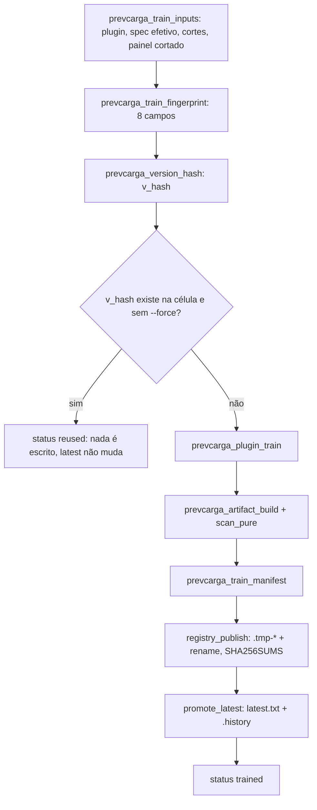
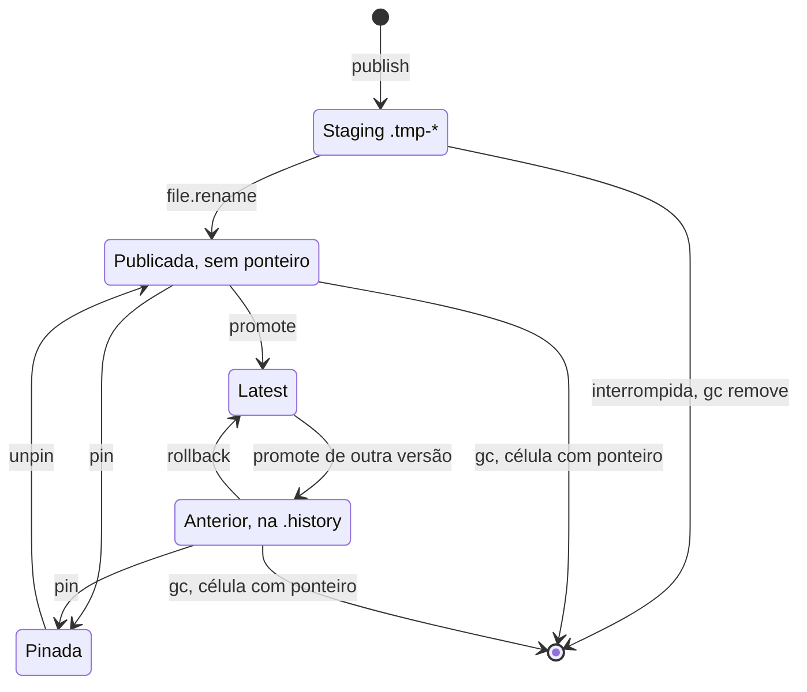

<span className="pc-overline">Arquitetura · 2.16</span>

<p className="pc-lead">O registry é uma árvore de diretórios sob <code>&lt;state_dir&gt;/artifacts</code>, com o mesmo layout do prefixo <code>artifacts/</code> do repositório online. Cada célula (membro × área, ou a folha da combina, ou o subsistema do Reconcile) guarda versões imutáveis <code>v_&lt;hash&gt;/</code> e um ponteiro de uma linha, <code>latest.txt</code>. A versão é o hash do conteúdo dos insumos: mesmos insumos, mesma versão, e o treino é reaproveitado. Publicar e promover são atômicos (staging irmão e <code>file.rename</code>), a carga confere o <code>SHA256SUMS</code> antes de descongelar, e o ciclo de vida (promote, rollback, pin, gc) só mexe em ponteiros. O pacote não fala rede: os artefatos oficiais chegam pelo <code>prevcarga-sync</code> nesse mesmo layout e são tratados como os próprios.</p>

O único dono do registry é `scripts/lib/registry.R`. O núcleo (chave, resolução de versão, publicação, carga e promoção) e o ciclo de vida (promote, rollback, pin, unpin, gc, ls, show) moram no fim desse arquivo. O verbo `prevcarga registry` (`scripts/lib/cli/registry.R`) é fachada fina: lê de `registry.R` a lista de subcomandos e o usage, e despacha tudo por `prevcarga_registry_run`.

## Layout de uma célula

A raiz é `prevcarga_registry_root(ctx)`, que devolve `<state_dir>/artifacts` normalizado. A chave de uma célula vem de `prevcarga_registry_key(member, area, ctx)`: os segmentos são o `mdir` do membro, o segmento de variante e a área. O segmento de variante entra se e somente se `member$exogena` não for vazio. A decisão é só pelo membro declarado em `config/topology.yaml`, nunca pelo nome do modelo.

```text title="<state_dir>/artifacts/ (igual ao prefixo artifacts/ do repositório online)"
<state_dir>/artifacts/
├── random-forest/SP/                  membro sem variante (exogena: null)
├── dessem-linear/MED/SP/              membro com variante (exogena: MED)
│   ├── latest.txt                     ponteiro: 1 linha, v_<hash> corrente
│   ├── .pin                           só local: versões pinadas, uma por linha
│   ├── .history                       só local: uma linha por promoção
│   ├── .tmp-*                         só local: staging de algum escritor
│   └── v_<hash>/                      versão imutável
│       ├── artifact.rds               objeto congelado (saveRDS v3)
│       ├── artifact.rds.manifest.json sidecar do freeze, com o sha256 do .rds
│       ├── run_manifest.json          proveniência do treino (inclui o fingerprint)
│       └── SHA256SUMS                 sha256 de todos os arquivos acima
├── combina/<folha>/                   pesos da combina por folha
│   ├── latest.txt
│   └── v_<hash>/
│       ├── weights.rds
│       └── weights.rds.manifest.json
└── reconcile/<ss>/                    perfil k-hat por subsistema
    ├── latest.txt
    └── v_<hash>/                      artifact.rds, sidecar, run_manifest.json, SHA256SUMS
```

| Entrada | Quem escreve | Sai para o repositório online | Observação |
|---|---|---|---|
| `v_<hash>/` | publicação (treino, combina, Reconcile) ou `prevcarga-sync` | sim | Imutável; nunca se edita um arquivo dentro dela |
| `latest.txt` | `prevcarga_registry_promote_latest`, `prevcarga-sync`, combina | sim | Uma linha; tempfile irmão e rename, sem symlink |
| `.pin` | `registry pin` / `unpin` | não | Várias linhas; reescrito por tempfile e rename; vazio remove o arquivo |
| `.history` | `prevcarga_registry_promote_latest` | não | Uma linha acrescentada a cada promoção; base do rollback |
| `.tmp-*` | qualquer escritor (staging) | não | Órfão por interrupção; coletado pelo `registry gc` |

A versão tem o formato `v_` seguido de 16 dígitos hexadecimais minúsculos: `prevcarga_version_hash` (`scripts/lib/provenance.R`) toma os 16 primeiros caracteres do sha256 do JSON canônico do fingerprint. Os leitores do registry aceitam `^v_[0-9a-f]+$`; fora desse formato, `contract.version_malformed` (exit 2). Texto do registry é UTF-8 com LF.

### Contenção na raiz

Todo caminho que o registry lê ou escreve passa por `prevcarga_registry_contain`: o caminho normalizado tem de ser a raiz ou estar abaixo dela, senão `contract.path_outside_root` (exit 2). O `normalizePath` do R não colapsa `..` em caminho inexistente, por isso `.prevcarga_reg_norm` faz o colapso lexical depois de resolver os links que existem. Um `state_dir` ausente no ctx cai no mesmo erro.

### combina e reconcile

As duas pastas não são membros, mas seguem o layout de célula.

- `reconcile/<ss>/`: o perfil k-hat de cada subsistema (`scripts/lib/reconcile.R`) usa a chave `prevcarga_registry_key` com `mdir = "reconcile"` e sem variante. Publicar, resolver, carregar e promover passam pelas funções do núcleo (`prevcarga_registry_publish`, `prevcarga_resolve_version`, `prevcarga_load_artifact`, `prevcarga_registry_promote_latest`); só o que é específico do k-hat (schema do perfil, `khat_origin`, política de uso) mora no `reconcile.R`. O `run_manifest.json` da versão traz `produto = "reconcile"` e `khat_origin`.
- `combina/<folha>/`: os pesos da combina (`scripts/lib/combination.R`) vivem em `<state_dir>/artifacts/combina`, o mesmo diretório que `forecast` e `combine` usam por default. A combina tem escritor próprio com o mesmo padrão: versão content-addressed, staging `.tmp-*` irmão, `file.rename` e `latest.txt` gravado por último. A versão local guarda `weights.rds` e o sidecar do freeze; a integridade na leitura vem do `prevcarga_thaw`, que confere o sha256 do sidecar antes do `readRDS`. O `release-pack` gera o `SHA256SUMS` de uma versão que não traz um e mantém byte a byte o que já existe.

O `ls` e o `gc` do registry percorrem também `combina/` e `reconcile/`. O `registry` aceita como `<model>` a sigla do membro (resolve a variante) ou um segmento de pasta do registry, como o `mdir` de um membro sem variante, `combina` ou `reconcile`.

## Publicar, carregar e promover

| Função | O que faz | Erro |
|---|---|---|
| `prevcarga_registry_publish(artifact, manifest, key, version, force, ctx)` | Grava `v_<hash>/` num staging `.tmp-<rand>/` irmão e o move com `file.rename`. Se a versão já existe e `force` é falso, não escreve e devolve `reused = TRUE` | `contract.version_malformed` (2); `state.promote_failed` (13) |
| `prevcarga_load_artifact(key, version, ctx)` | Confere cada linha do `SHA256SUMS` e só então descongela `artifact.rds` | `integrity.artifact_hash`, `integrity.freeze_sha_mismatch` (9); `state.artifact_missing` (13) |
| `prevcarga_registry_promote_latest(key, version, ctx)` | Reescreve `latest.txt` por tempfile `.tmp-latest-*` e rename; acrescenta uma linha a `.history` | `state.promote_failed` (13) |
| `prevcarga_resolve_version(key, mode, version, ctx)` | Resolve `latest` (1ª linha de `latest.txt`), `version` (a dada) ou `pin` (última linha de `.pin`); nunca devolve vazio | `state.artifact_missing`, `state.pin_missing` (13); `contract.version_malformed` (2) |

### Publicação atômica

1. Valida o formato da versão e a contenção da chave.
2. Se `v_<hash>/` já existe e não há `force`, devolve a versão existente sem tocar no disco.
3. Cria o staging `.tmp-<rand>/` dentro da célula, no mesmo volume do destino.
4. No staging: `prevcarga_freeze` grava `artifact.rds` e o sidecar `artifact.rds.manifest.json`; `prevcarga_write_run_manifest` grava `run_manifest.json`; `.prevcarga_reg_sums_write` grava o `SHA256SUMS`.
5. `file.rename` do staging para `v_<hash>/`. Qualquer falha antes disso apaga o staging.

O `SHA256SUMS` tem uma linha `<sha256>  <arquivo>` por arquivo da pasta, exceto ele mesmo, em ordem radix e com LF. O sidecar do freeze é parte da versão e entra na soma.

Com `force`, o antigo só sai depois de o novo entrar: a versão existente é movida para `.tmp-old-*`, o staging vira `v_<hash>/` e só então o antigo é apagado. Se o segundo rename falha, o antigo volta ao lugar e a função aborta com `state.promote_failed`.

### Carga com conferência

`prevcarga_load_artifact` recusa o artefato antes de qualquer `readRDS` quando:

- o `SHA256SUMS` não existe ou alguma linha não tem a forma `<64 hex>  <arquivo>`;
- um arquivo listado tem barra no nome, não existe ou tem sha256 diferente do declarado.

Em todos os casos o erro é `integrity.artifact_hash` (exit 9); na divergência de um arquivo, os detalhes trazem o arquivo, o hash esperado e o obtido. Depois da soma, o `prevcarga_thaw` ainda confere o sha256 do sidecar contra o `.rds` (`integrity.freeze_sha_mismatch`, exit 9). A inferência (`scripts/lib/inference.R`) resolve a versão por `--artifact-version`, por `--pin` ou pelo `latest` e sempre carrega por `prevcarga_load_artifact`.

### Promoção

O `latest.txt` nunca é escrito diretamente: o novo conteúdo vai para um tempfile `.tmp-latest-*` na célula e substitui o ponteiro por `file.rename`. Se o rename falha, o `latest.txt` anterior continua intacto e o tempfile fica para o `registry gc`, como numa interrupção real. Só depois do rename a versão é acrescentada a `.history`.

## A fachada de treino reusa pelo conteúdo

`prevcarga_train(member, area, origin, ctx, force)` (`scripts/lib/training.R`) treina uma célula e compõe o registry sem calcular corte nem hora. A identidade da versão é calculada antes de qualquer treino, a partir dos insumos já cortados.

<Figura id="FIG-A13" titulo="Do treino ao latest: publicação por conteúdo" natureza="Fluxo" fontes={['scripts/lib/training.R', 'scripts/lib/registry.R', 'docs/estado/registry_core.md']} adrs={['ADR-0030', 'ADR-0039']}>



</Figura>

O fingerprint tem os oito campos do contrato de `provenance.R`:

| Campo | Conteúdo |
|---|---|
| `model_id` | `mdir` do membro |
| `data_fingerprint` | sha256 do conteúdo do painel já cortado (carga, clima observado, clima previsto, feriados); os atributos do painel, com o `available_until` do deck, ficam de fora |
| `cutoff` | cortes efetivos pela classe de split: `origin_scoped` só a origem; `origin_agnostic` `train_origin` e `last_data_day` |
| `feature_config` | spec efetivo (`name`, `split`, `granularity_min`, `horizon_days`, `history_days`, `seed`, `params`) e a variante |
| `code_commit` | commit do código (injetado no ctx ou calculado) |
| `renv_lock_hash` | hash do `renv.lock` (injetado no ctx ou calculado) |
| `load_label` | rótulo da carga efetivo |
| `load_tz` | fuso da carga |

Campos laterais (`trained_at`, `run_id`, versão do pacote) vão só para o `run_manifest.json` e não mudam a versão. A origem em si só entra no fingerprint de um modelo `origin_scoped`, que por isso tem uma versão por origem; o de um `origin_agnostic` leva só `train_origin` e `last_data_day`. Mesmos insumos dão a mesma `v_<hash>`, e a célula não é retreinada.

A linha devolvida por célula traz `status`: `reused` (a versão já existia), `trained` (publicada e promovida) ou `planned` (no `train-models --dry-run`, que calcula cortes e versão-alvo sem gravar nada). O reuso não move o `latest.txt`. A flag `--force` do `train-models` retreina mesmo com a versão presente; a publicação então substitui a pasta pelo caminho atômico descrito acima.

## Ciclo de vida: promote, rollback, pin e gc

```text
prevcarga registry (ls|show|promote|rollback|pin|unpin|gc) [<model>] [<area>] [<version>] [--dry-run]
```

<Figura id="FIG-A14" titulo="Ciclo de vida de uma versão no registry" natureza="Estrutura" fontes={['scripts/lib/registry.R', 'docs/estado/registry_lifecycle.md']} adrs={['ADR-0030']}>



</Figura>

O diagrama mostra uma versão de célula com ponteiro. Uma versão `latest` também pode estar pinada; o pin não move o `latest.txt`, só protege a versão do `gc`. A guarda do k-hat, descrita abaixo, bloqueia as transições para `Latest` que voltariam no tempo.

| Subcomando | Efeito | Recusa |
|---|---|---|
| `ls` | Lista as células sob o escopo: chave relativa, `latest`, versões pinadas e versões presentes. Só leitura | — |
| `show` | Campos do `run_manifest.json` de uma versão (default: o `latest`): `model_id`, cortes, `load_label`, fuso, `weather_issue_cutoff`, `code_commit`. Só leitura | `state.cell_missing`, `state.artifact_missing` (13) |
| `promote` | Valida que a versão existe, aplica a guarda do k-hat e delega a `prevcarga_registry_promote_latest` | `state.cell_missing`, `state.artifact_missing`, `state.registry_khat_backward` (13) |
| `rollback` | Volta à versão anterior distinta mais recente da `.history` que ainda existe em disco, pelo mesmo caminho do `promote` (inclusive a guarda do k-hat) | `state.cell_missing`, `state.registry_no_previous`, `state.registry_khat_backward` (13) |
| `pin` / `unpin` | Acrescenta ou retira a versão do `.pin`; o `pin` exige que `v_<hash>/` exista | `state.pin_missing` (13); `contract.version_malformed` (2) no `pin` |
| `gc [--dry-run]` | Poda local das versões órfãs e de todo `.tmp-*` | — |

Uma célula inexistente dá `state.cell_missing` (exit 13). Uma falha de rename em `promote`, `rollback`, `pin` ou `unpin` dá `state.promote_failed` (exit 13); o `latest.txt` nunca fica vazio e o tempfile que sobrou é do `gc`.

### O gc

`prevcarga_registry_gc` percorre `<state_dir>/artifacts` (ou só o `<model>` dado) sem seguir links. Um link é detectado sem API de link: é a entrada cujo caminho resolvido difere do pai resolvido mais o nome, o que cobre também a junction do Windows. A varredura nunca desce em `v_*/` nem em `.tmp-*/`.

1. Toda entrada `^[.]tmp-` (arquivo ou diretório, em qualquer nível) é removida: é staging de algum escritor do registry, da combina, do k-hat ou do `prevcarga-sync`.
2. Em cada célula com `latest.txt` não vazio ou `.pin` com alguma versão, uma `v_<hash>/` que não é o `latest` nem está pinada é removida.
3. Uma célula sem ponteiro (sem `latest.txt` com conteúdo e sem versão no `.pin`) não tem versão podada: não há referência a preservar, e as versões ficam listadas com o motivo `no_pointer`.
4. Todo alvo passa por `prevcarga_registry_contain` antes do `unlink`.

O retorno é `removed` (caminhos relativos), `kept` (tabela `key`, `version`, `reason`, com `latest`, `pinned` ou `no_pointer`) e `dry_run`. Com `--dry-run` nada é apagado. O `gc` é higiene local: não há lock entre processos e ele nunca toca o repositório online.

### O k-hat só anda para frente

O `latest` de uma célula de `reconcile/` só avança. A guarda olha o `run_manifest.json` das versões com `produto = "reconcile"` e compara o `khat_origin` da versão-alvo com o do `latest` atual.

- No treino do Reconcile, `prevcarga_khat_advance_latest` publica a versão com `khat_origin` menor mas não move o ponteiro, e emite o aviso `reconcile.khat_not_promoted`.
- No verbo `registry`, `promote` e `rollback` para um `khat_origin` menor abortam com `state.registry_khat_backward` (exit 13).
- O `pin` não move o `latest` e não passa pela guarda.

A guarda do ponteiro não substitui a política de uso. A rodada só consome um perfil com `khat_origin == O`: posterior a O é `honesty.khat_after_origin`, anterior é `state.khat_missing`. Um promote ou rollback manual não contorna essa regra. A política está na página do [Reconcile](/metodologia/reconciliacao).

:::note Decisões de base
O padrão "ponteiro `latest` de uma linha mais diretórios `v_*` imutáveis" vem do ADR-0011 (`docs/adr/0011-ciclo-artefato-registry.md`). A versão é content-addressed (hash do fingerprint), para que a identidade de um artefato dependa só dos insumos e o reuso seja automático. A classe do modelo é o `split` declarado no `run.yaml`, e o layout segue o repositório online, para que um artefato oficial e um próprio sejam indistinguíveis (ADR-0030, ADR-0039). O pacote não fala rede: o I/O de nuvem fica no `prevcarga-sync`. Os textos locais do ADR-0011 e do ADR-0016 descrevem versão por carimbo de data (`v_YYYYMMDD_HHMMSS`), um campo `protocol` no manifest e I/O de nuvem dentro do pacote; nesses pontos valem o ADR-0030 e o ADR-0039.
:::

## Artefatos oficiais sincronizados

O pacote não baixa nada. Os artefatos oficiais chegam pelo utilitário `prevcarga-sync --what artifacts` (`install/prevcarga-sync.sh` e `install/prevcarga-sync.ps1`), que grava em `<state_dir>/artifacts` o mesmo layout do registry: `<mdir>/[<exogena>/]<folha>/`, `combina/<folha>/` e `reconcile/<ss>/`.

- O conjunto oficial vem da CLI instalada ao lado (`prevcarga models` e `prevcarga areas`); o repositório online nunca é listado.
- Cada prefixo baixa o `latest.txt`, o `SHA256SUMS` da versão e cada arquivo listado para um staging `.tmp-*` do registry, conferindo o sha256 de cada um.
- Só com tudo conferido o sync move cada `v_<hash>/` para o destino e, por último, regrava o `latest.txt` local por tempfile e rename. Uma falha na primeira fase deixa o `state_dir` como estava.
- Uma versão que já existe localmente é conferida contra o remoto; se diverge, `sync.sha_mismatch` (exit 9), sem tocar no disco.

Não há conversão nem marca de origem. Uma célula sincronizada não tem `.pin` nem `.history`, e o resto do sistema não distingue: o `ls` a lista como qualquer outra, a inferência a carrega por `prevcarga_load_artifact` com a mesma conferência de `SHA256SUMS`, e a rodada escolhe a versão de um membro `origin_scoped` pelo `origin` do `run_manifest.json`, seja ela própria ou oficial. No sentido inverso, o `release-pack` copia só a versão apontada pelo `latest.txt` de cada célula; `.pin`, `.history` e `.tmp-*` nunca saem.

<Pendente titulo="Pendente · ADR-0039">
O endereço default do repositório online usado pelo <code>prevcarga-sync</code> está marcado como <code>[TBD: ADR-0039]</code> em <code>install/prevcarga-sync.sh</code>. O layout do prefixo <code>artifacts/</code> é o deste registry; o endereço definitivo ainda não foi decidido.
</Pendente>

Para o uso do verbo no dia a dia, veja [Ciclo de vida dos artefatos](/execucao/artefatos). Para o resto do `state_dir`, veja [Proveniência, identidade e layout do estado](/arquitetura/proveniencia-estado).
