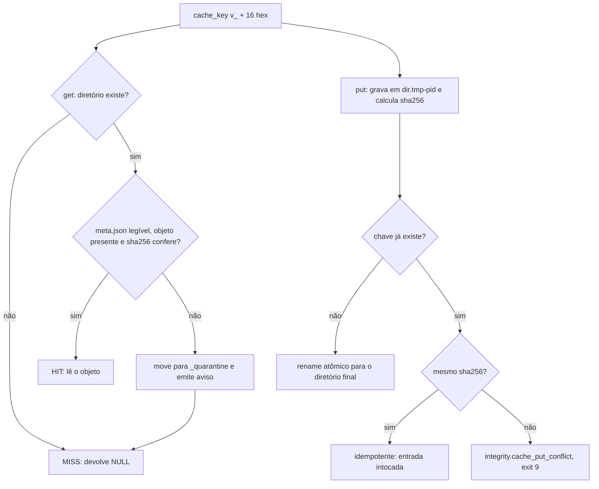

<span className="pc-overline">Arquitetura · 2.17</span>

<p className="pc-lead">O cache do PrevCarga é local e content-addressed: cada entrada mora num diretório cujo nome é o hash da sua identidade. A chave é o hash de versão do `provenance.R` (`v_` seguido de 16 hex) sobre a identidade de 8 chaves, para que cache e proveniência descrevam um artefato pela mesma identidade. O que muda por kind é o corte que entra na identidade: features e LONG de membro levam sempre o corte intradiário `available_until`; o artefato treinado nunca o leva, e só depende dos cortes de treino da sua classe de split. A escrita é atômica e idempotente; a leitura confere o sha256 e move para a quarentena o que não confere.</p>

## Layout e formato

O módulo é `scripts/lib/cache.R`. A raiz é `<state_dir>/cache/`, sempre derivada de `ctx$state_dir`, sem variável de ambiente, sem relógio e sem rede. Cada entrada ocupa um diretório:

```text title="state_dir/cache"
cache/
  <kind>/<hh>/<key>/
    object.rds | object.parquet
    meta.json
  _quarantine/<kind>/<key>/
```

`hh` são os dois primeiros hex depois de `v_`, o que espalha as entradas em subpastas. A chave tem de casar `^v_[0-9a-f]{16}$`; fora disso, `contract.cache_key`.

### Os quatro kinds

| Kind | O que guarda | Corte na identidade |
|---|---|---|
| `features` | Matriz de features de um membro | `origin`, `available_until` |
| `artifact` | Artefato treinado de um membro | pela classe de split (ver abaixo); nunca `available_until` |
| `member_long` | Saída LONG de um membro numa origem e num corte | `origin`, `available_until` |
| `khat` | Fator k-hat da reconciliação | `subsistema`, `origin`, `window_days` |

Kind fora dessa lista aborta com `contract.cache_kind`.

### Objeto e `meta.json`

| Arquivo | Conteúdo |
|---|---|
| `object.parquet` | Usado quando o objeto é um `data.table` (`arrow::write_parquet`) |
| `object.rds` | Qualquer outro objeto, por `saveRDS` versão 3 sem compressão, para bytes determinísticos |
| `meta.json` | `key`, `kind`, `identity` (canonizada), `lateral` (canonizado), `sha256` do objeto e `format` (o nome do arquivo do objeto) |

Os campos laterais (`platform`, `bundle_id`, `trained_at`, `host`) vão só no `meta.json`. Eles nunca entram no hash: a identidade tem exatamente as 8 chaves, e o `prevcarga_version_hash` recusa chave extra (`contract.fingerprint_extra_key`) e os laterais `trained_at`, `package_version` e `run_id` no fingerprint (`contract.fingerprint_lateral`).

<Pendente titulo="Pendente · atributos no parquet">O parquet não preserva atributos de `data.table` (registrado como interino em `docs/estado/cache.md`). Quem precisar dos atributos guarda o objeto dentro de uma lista, que vai para `object.rds`.</Pendente>

### Quem usa o cache

No código de produção, o consumidor do store é o backtest (`scripts/lib/backtest.R`). Ele chama `prevcarga_cache_get` e `prevcarga_cache_put` no kind `artifact` nos protocolos `fixed` e `daily`: as células que resolvem para a mesma chave reaproveitam o artefato, e ele só é treinado no MISS. O protocolo `retrain_harness` usa o `forecast` acoplado do plugin e não passa pelo cache. O kind `member_long` é usado pelo `prevcarga_plan` (`scripts/lib/orchestrate.R`) para calcular a chave esperada de cada célula. Essa chave é gravada no `.key` ao lado do `long.parquet` da célula e serve de ledger para o `--resume`. Os contadores `hit`, `miss` e `corrupt` entram no resumo do backtest.

:::note Kinds sem chamador
`features` e `khat` existem no contrato de chave, mas não há chamador de `prevcarga_cache_get` ou `prevcarga_cache_put` nesses kinds no código de produção. A coleta de lixo do cache fica fora do pacote.
:::

O ciclo de vida dos artefatos de produção não passa por aqui. Ele é do registry, em `<state_dir>/artifacts/`. O backtest grava só em `cache/` e `backtest/` e nunca abre o registry. Ver [Registry de artefatos](/arquitetura/registry) e [Backtest](/metodologia/backtest).

## Chave que depende da classe de split

A chave é `prevcarga_cache_key(...)`, que monta a identidade com `prevcarga_cache_identity(...)` e aplica `prevcarga_version_hash`. O hash é o sha256 do JSON canônico da identidade, truncado em 16 hex. A canonização ordena as listas nomeadas em todos os níveis, escreve `Date` e `POSIXct` em ISO-8601 (POSIXct sempre em UTC) e troca `NULL` e `NA` por `null`.

### As 8 chaves

A identidade é a mesma de 8 chaves do `provenance.R`. Chave ausente ou extra aborta.

| Chave | Valor no cache |
|---|---|
| `model_id` | `mdir` do membro |
| `data_fingerprint` | fingerprint dos dados |
| `cutoff` | o corte do kind (ver a tabela seguinte) |
| `feature_config` | `kind`, `exogena`, `split`, `feature_config`, `model_versions`, `seed` e `weather` |
| `code_commit` | `code_version` |
| `renv_lock_hash` | hash do `renv.lock` |
| `load_label` | rótulo da carga (`start` ou `end`) |
| `load_tz` | fuso declarado pelo deck |

A `exogena` dentro de `feature_config` separa membros que compartilham o mesmo `mdir`, como `LIN_MED` e `LIN_MAX`. `member_label` sem `mdir` ou sem `exogena` aborta com `contract.cache_member_label`. Quando o membro não tem variante, a `exogena` é `NA`.

### O corte por kind

| Kind | Classe de split | `cutoff` |
|---|---|---|
| `features`, `member_long` | qualquer | `origin`, `available_until` |
| `artifact` | `origin_agnostic` | `split`, `train_origin`, `last_data_day` |
| `artifact` | `origin_scoped` | `split`, `train_origin` |
| `khat` | qualquer | `subsistema`, `origin`, `window_days` |

O `split` vem do `run.yaml` do modelo e o cache nunca assume default: sem `split` válido, `contract.cache_split`. Campo de corte ausente ou do tipo errado para o kind aborta com `contract.cache_identity`.

Duas consequências seguem desta tabela.

1. O artefato nunca leva `available_until`. Num backtest com `--corte=09:00,09:30`, as duas células de um mesmo membro, área e origem resolvem para a mesma chave de artefato. O sweep de corte intradiário não re-treina.
2. No `origin_agnostic`, o `last_data_day` entra na chave: com o mesmo `train_origin`, um `last_data_day` diferente dá outra chave. Esse dia vem do `data_lag_days` do descriptor (no LGBM, O−3). No `origin_scoped`, `train_origin = O`: cada nova origem é um novo artefato.

`train_origin` e `last_data_day` chegam prontos da linha do membro de `prevcarga_resolve_cuts` (`dates.R`). O cache nunca calcula corte e nunca lê o descriptor. Ver [Os três cortes de data](/metodologia/tres-cortes).

### Clima previsto na chave

O `feature_config` leva um campo `weather` com a regra efetiva `weather_issue_cutoff` (`available_until` ou `origin_midnight_utc`) e o limite `weather_issue_limit` (POSIXct calculado fora do cache, pelo leitor ou pelo `dates.R`).

| Kind | `weather` |
|---|---|
| `features`, `member_long` | sempre a regra e o limite; ausente ou inválido é `contract.cache_identity` |
| `artifact` | a regra e o limite só quando o descriptor do membro declara `weather_forecast_in_train`; senão, lista vazia |
| `khat` | lista vazia |

Assim a regra do clima não muda a chave do artefato de um membro que não usa previsão no treino. O cache só registra o limite; quem filtra a emissão é o leitor.

## put, get e quarentena

<Figura id="FIG-A16" titulo="Cache: get e put com quarentena" natureza="Fluxo" fontes={['scripts/lib/cache.R', 'docs/estado/cache.md']} adrs={['ADR-0023']}>



</Figura>

### put

`prevcarga_cache_put(ctx, key, kind, object, identity, lateral)` segue estes passos.

1. Grava o objeto em `<dir>.tmp-<pid>` e calcula o sha256 do arquivo.
2. Se o diretório final já existe e o `meta.json` dele tem o mesmo sha256, retorna sem tocar nada: a escrita é idempotente.
3. Se o diretório existe com sha256 diferente, ou com `meta.json` ilegível, aborta com `integrity.cache_put_conflict` (exit 9). A entrada original fica intocada. O catálogo diz que isso indica entrada não determinística e manda investigar a semente.
4. Senão, grava o `meta.json` no temporário e publica o diretório inteiro com `file.rename`. Se o rename falha, o mesmo `integrity.cache_put_conflict`.

O temporário é apagado ao sair da função em qualquer caso. O argumento `lateral` tem padrão `list()` e é preenchido por quem chama; o cache nunca lê relógio. O backtest chama sem laterais.

### get

`prevcarga_cache_get(ctx, key, kind)` devolve o objeto ou `NULL`.

1. Diretório ausente: conta um `miss` e devolve `NULL`.
2. `meta.json` ilegível, arquivo do objeto ausente ou sha256 divergente: move a entrada para `cache/_quarantine/<kind>/<key>/`, emite o aviso `warning.cache_corrupt_quarantined`, conta `corrupt` e `miss`, e devolve `NULL`. Quem chama recomputa, como num MISS comum.
3. Senão: conta um `hit` e lê o objeto (`readRDS` ou `arrow::read_parquet`, convertido em `data.table`).

O aviso não interrompe o comando. A cópia corrompida fica na quarentena para inspeção; uma quarentena anterior com a mesma chave é substituída.

### Contadores

`prevcarga_cache_stats(ctx)` devolve `list(hit, miss, corrupt)`. Os contadores ficam em memória no processo, separados por `state_dir` normalizado.

## Códigos de erro

Os ids moram no catálogo distribuído `scripts/lib/errors/cache.tsv`. A classe define o código de saída (ver [Contrato de erros e códigos de saída](/arquitetura/erros-exit)).

| Id | Classe | Exit | Quando |
|---|---|---|---|
| `contract.cache_kind` | contract | 2 | kind fora dos quatro |
| `contract.cache_key` | contract | 2 | chave fora do formato `v_` e 16 hex |
| `contract.cache_member_label` | contract | 2 | `member_label` sem `mdir` ou `exogena` |
| `contract.cache_split` | contract | 2 | `split` ausente ou fora de `origin_agnostic` e `origin_scoped` |
| `contract.cache_identity` | contract | 2 | campo de identidade ausente ou inválido para o kind |
| `integrity.cache_put_conflict` | integrity | 9 | chave existente com sha256 diferente, ou falha no rename |
| `warning.cache_corrupt_quarantined` | integrity, como aviso | não sai | entrada corrompida movida para a quarentena |
