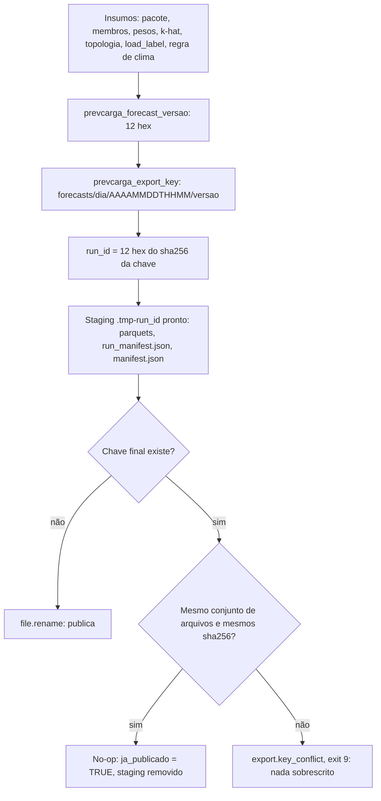

<span className="pc-overline">Arquitetura · 2.18</span>

<p className="pc-lead">A entrega de uma rodada é um diretório imutável em <code>forecasts/&lt;AAAA-MM-DD&gt;/&lt;AAAAMMDDTHHMM&gt;/&lt;versao&gt;/</code> sob o <code>state_dir</code>. O export não calcula nada: copia os bytes que o forecast gravou no scratch, confere cada sha256 contra o <code>run.json</code>, monta tudo num staging no mesmo volume e publica com um único <code>file.rename</code>. A chave é derivada dos insumos da rodada. Se ela já existe com os mesmos bytes, o export é um no-op. Se existe com qualquer diferença, ele recusa com <code>export.key_conflict</code> (exit 9) e nada é sobrescrito.</p>

O módulo é `scripts/lib/exports.R`. A rodada diária chama `prevcarga_export` como último passo antes do relatório (ver [Rodada diária](/execucao/rodada-diaria)). O verbo `export` expõe a mesma função sobre um scratch já existente, como superfície de depuração.

## Layout da entrega por nível

O forecast grava primeiro o scratch `<state_dir>/scratch/<run_id>/`, recriado a cada rodada, com os parquets, o `run.json` e o `run_manifest.json`. O export escolhe o que entregar a partir do `run.json` e do nível pedido, e copia para a chave final.

```text title="state_dir/forecasts/AAAA-MM-DD/AAAAMMDDTHHMM/versao/"
forecasts/
  2026-01-15/                     data da origem O
    20260115T0900/                available_until no fuso da carga, sem ':'
      <versao>/                   12 hex de prevcarga_forecast_versao
        SIN.parquet               só quando o SIN fecha (sin_closed)
        subsistemas/<ss>.parquet  subsistemas fechados (niveis subsistemas ou tudo)
        folhas/<a>.parquet        folhas soltas: sempre; folhas cobertas: só com niveis tudo
        membros/<m>/<a>.parquet   só com --incluir-membros
        manifest.json             metadados e arquivos[]; único campo não determinístico: gerado_em
        run_manifest.json         identidade da rodada (lida pelo verificar); fora de arquivos[]
```

### Níveis-teto

`--niveis` é um teto, não uma lista. Os três valores aceitos estão em `prevcarga_export_niveis`; qualquer outro aborta `config.usage` (exit 8) antes de qualquer trabalho.

| Nível | SIN | Subsistemas fechados | Folhas soltas | Folhas cobertas | Membros |
|---|---|---|---|---|---|
| `sin` | sim, se fecha | não | sim | não | só com `--incluir-membros` |
| `subsistemas` (padrão) | sim, se fecha | sim | sim | não | só com `--incluir-membros` |
| `tudo` | sim, se fecha | sim | sim | sim | só com `--incluir-membros` |

A folha solta (a que não fecha nenhum subsistema) é sempre entregue: ela não passa pela reconciliação e não existe em outro nível (ver [Reconciliação](/metodologia/reconciliacao)). Os conjuntos `closed`, `stray`, `covered` e `sin_closed` vêm do plano do reconcile, gravados no `run.json`.

### Quando um arquivo falta

`.export_select` monta a tabela `(rel, nivel, area)` e cruza com o disco e com `arquivos[]` do `run.json`:

- arquivo ausente no scratch ou não registrado em `arquivos[]`: aviso `completude.export_file_missing` e o arquivo é omitido. Nunca some em silêncio.
- nada a entregar no nível pedido: `state.nothing_to_deliver` (exit 13), antes de criar qualquer diretório.

O export não abre parquet. O número de `linhas` de cada arquivo vem do registro em `arquivos[]`, gravado pelo forecast. Assim o leitor único do deck é o único módulo que lê parquet de entrada (ver [Leitor único do deck](/arquitetura/leitor-deck)).

### O manifest.json

`.export_manifest` escreve as chaves em ordem fixa. Os campos da rodada são copiados do `run.json`; o k-hat nunca é recalculado.

| Campo | Origem |
|---|---|
| `produto` | constante `prevcarga-forecast` |
| `origem`, `available_until`, `available_until_por_area`, `timezone` | `run.json` |
| `load_label`, `weather_issue_cutoff` | `run.json` (o rótulo declarado e a regra de clima efetiva) |
| `khat` | lista de `ss`, `versao`, `khat_origin` por subsistema, do `run.json` |
| `versao`, `version`, `runtime_id` | `run.json` (12 hex da chave, versão do pacote, R e plataforma) |
| `niveis` | nível pedido no export |
| `schema_long` | as 8 colunas e seus tipos, de `prevcarga_schema_long` (ver [Schema LONG](/arquitetura/schema-long)) |
| `gerado_em` | `ctx$generated_at`, derivado do carimbo do `run_id` da fachada |
| `arquivos` | `path`, `nivel`, `area`, `linhas`, `sha256` de cada arquivo entregue, em ordem radix |

O JSON sai em UTF-8, indentação 2, LF final, gravado em modo binário (`.export_write_json`): os mesmos bytes em Linux e Windows. O `manifest.json` não entra na própria lista `arquivos[]` nem em hash nenhum. O módulo não lê relógio: `gerado_em` é o único campo que muda entre duas rodadas idênticas.

O `run_manifest.json` (data_hash do deck, bundle_id, versões dos artefatos usados) é escrito pelo forecast no scratch e copiado em bytes para a raiz da entrega quando existe. Como o `manifest.json`, fica fora de `arquivos[]` e fora da comparação da chave. O `verificar` exclui os dois da conferência de integridade e lê a identidade do `run_manifest.json` (ver [Verificar uma entrega](/execucao/verificar)).

## Chave e versão de 12 hex

A chave tem três partes, todas ASCII, separadas por `/`, sem `:`.

| Parte | Função | Conteúdo |
|---|---|---|
| dia | `prevcarga_export_key` | data da origem O, `AAAA-MM-DD` |
| corte | `prevcarga_export_key` | `available_until` convertido com `lubridate::with_tz` para o fuso da carga, `AAAAMMDDTHHMM` |
| versão | `prevcarga_forecast_versao` | 12 hex do hash dos insumos da rodada |

O caminho final é conferido contra a expressão `^forecasts/[0-9]{4}-[0-9]{2}-[0-9]{2}/[0-9]{8}T[0-9]{4}/[0-9a-f]{12,64}$`; fora dela, `config.usage`. O `run_id` é o prefixo de 12 hex do sha256 da própria chave: nunca PID nem relógio. É esse `run_id` que nomeia o scratch e o staging.

### O que entra na versão

`prevcarga_forecast_versao` reaproveita `prevcarga_version_hash` (`provenance.R`), que exige exatamente as 8 chaves do fingerprint e devolve `v_` seguido de 16 hex. O export corta para 12 hex e tira o `v_`. Os insumos da entrega são mapeados nas 8 chaves assim:

| Chave do fingerprint | O que o forecast passa (`.forecast_versao_parts`) |
|---|---|
| `model_id` | constante `forecast` |
| `code_commit` | versão do pacote (`ctx$version`) |
| `data_fingerprint` | versão do perfil k-hat por subsistema |
| `feature_config` | membros (por sigla e folha, `versão do artefato:sha256 dos valores de y_pred entregues`), versão dos pesos da combina e sha256 do JSON canônico de `subsystems`, `order` e `khat_range_default` da topologia |
| `cutoff` | regra de clima (`weather_issue_cutoff`; sem ela, a string constante `available_until`) |
| `load_label` | rótulo declarado da carga |
| `renv_lock_hash` | constante `n/a` |
| `load_tz` | nulo |

Faltando um insumo, aborta `contract.fingerprint_missing_key` (exit 2). Membros e subsistemas são ordenados por nome antes do hash: a ordem de entrada não muda a versão. Um k-hat vazio é aceito (entrega só de folhas soltas).

Consequências diretas do desenho:

- meia hora a mais de carga muda o `available_until` e cria outra chave; a anterior fica intacta.
- outra regra de clima ou outro `load_label` declarado muda a versão; as duas entregas são preservadas.
- o sha256 do `y_pred` entra por membro: o mesmo artefato com deck ou clima novo, no mesmo `available_until`, vira outra versão em vez de conflito.

:::note code_commit é a versão do pacote
O campo `code_commit` do fingerprint recebe a versão do pacote, não o commit git. Essa parte da `versao` não distingue dois builds com a mesma versão de pacote e código diferente. O commit git, quando a fachada o tem, vai só para o `run.json` e o `run_manifest.json`.
:::

### Publicar, no-op ou conflito

`.export_key_check` roda com o staging já pronto, antes do `file.rename`, e nunca altera a chave final.

<Figura id="FIG-A17" titulo="Decisão do export diante da chave" natureza="Fluxo" fontes={['scripts/lib/exports.R', 'scripts/lib/forecast.R', 'docs/estado/export.md', 'docs/estado/forecast.md']} adrs={['ADR-0040']}>



</Figura>

A comparação ignora `manifest.json` e `run_manifest.json`: uma reexecução idêntica cai no no-op mesmo com outro `gerado_em`, e preserva os bytes e o manifest originais. Qualquer outra diferença dispara o conflito, inclusive um arquivo adulterado ou um arquivo a mais na chave publicada. O `details$path` do erro é o primeiro caminho divergente em ordem radix.

| Situação | Resultado | Exit |
|---|---|---|
| chave ausente | publica por `file.rename` | 0 |
| mesma chave, mesmo conjunto de arquivos, mesmos sha256 | no-op, `ja_publicado = TRUE` | 0 |
| mesma chave, qualquer diferença | `export.key_conflict` (classe `integrity`) | 9 |

## Cópia de bytes e atomicidade

O export só copia. Ele nunca recalcula k-hat, nunca soma folhas, nunca reserializa parquet: o sha256 entregue é o da fonte. Os passos de `prevcarga_export`:

1. valida `niveis` e a existência do scratch; lê o `run.json` (ausente ou ilegível: `state.nothing_to_deliver`, exit 13).
2. seleciona os arquivos pelo nível (`.export_select`).
3. recalcula o sha256 de cada fonte e compara com `arquivos[]` do `run.json`; divergência aborta `integrity.copy_failed` (exit 9).
4. cria o staging `.tmp-<run_id>` ao lado do diretório final, no mesmo volume, e copia os parquets com `file.copy(overwrite = FALSE)`.
5. copia o `run_manifest.json`, se existir, e escreve o `manifest.json`.
6. confere a chave (seção anterior) e, se for publicar, faz o `file.rename` do staging para a chave final.

Criado o staging, toda saída que não seja o rename (falha de cópia, conflito de chave ou no-op) o remove por um `on.exit`. Falha ao criar o staging, ao copiar ou no rename sobe `integrity.copy_failed`, exit 9: a chave aparece inteira ou não aparece. O módulo não usa S3, HTTP nem symlink.

| Erro | Classe | Exit | Quando |
|---|---|---|---|
| `state.nothing_to_deliver` | state | 13 | scratch ausente, `run.json` ausente ou ilegível, ou nada a entregar no nível |
| `integrity.copy_failed` | integrity | 9 | sha256 da fonte difere do `run.json`, cópia, staging ou rename falhou |
| `export.key_conflict` | integrity | 9 | chave publicada com conteúdo diferente |
| `completude.export_file_missing` | completude | aviso | arquivo ausente ou não registrado; omitido |

Os ids moram em `scripts/lib/errors/export.tsv` e `scripts/lib/errors/export_key.tsv`; a classe define o exit pela tabela única de `errors.R` (ver [Contrato de erros](/arquitetura/erros-exit)).

### O verbo export

```text
prevcarga export --scratch=<dir> [--niveis=<n>] [--incluir-membros]
```

O verbo é um passthrough fino para `prevcarga_export`. Ele serve para depurar a entrega de um scratch já gravado, sem refazer a rodada.

- a chave é reconstruída do `run.json` do scratch (`origem`, `available_until`, `versao`, `timezone`), nunca de flag. O mesmo scratch entrega na mesma chave que o forecast usou. `--origin` é ignorado.
- `run.json` sem esses campos: `state.nothing_to_deliver` (exit 13). Sem `--scratch`: `config.usage` (exit 8).
- `--scratch`, `--niveis` e `--incluir-membros` são flags de escopo: `--scratch` vale só em `export`; `--niveis` e `--incluir-membros` valem em `export` e `forecast`; em outro verbo dão `config.usage`.
- `gerado_em` sai do carimbo UTC do `run_id` da fachada (relógio lido uma vez em `config.R`); o `exports.R` não lê relógio.
- o verbo não regenera nada: um arquivo que o forecast não gravou no scratch (por exemplo, folhas cobertas de uma rodada feita sem `--niveis=tudo`) é omitido com aviso.

<Terminal title="prevcarga — bash" lines={[{type:'cmd',text:'prevcarga export --scratch=<state_dir>/scratch/<run_id> --niveis=tudo --format=json'}]} />

Em texto, o verbo lista o nível, o diretório de saída e cada arquivo com `linhas` e `sha256`. Em JSON, o resultado traz também `ja_publicado`.

## Pendente: níveis e membros fora da versão

<Pendente titulo="Pendente · export.key_conflict com --niveis">
A `versao` não inclui o conjunto de arquivos. A mesma rodada entregue com outro `--niveis` ou com `--incluir-membros` cai na mesma chave com outro conteúdo e recebe `export.key_conflict` (exit 9). As saídas registradas em `docs/estado/forecast.md` são incluir `niveis` e `incluir_membros` na versão, ou o export aceitar um superconjunto e publicar só os arquivos que faltam. A decisão ainda não foi tomada.
</Pendente>

<Pendente titulo="Pendente · code_commit da versão">
O uso da versão do pacote no lugar do commit git no fingerprint está marcado como decisão a revisitar em `docs/estado/export.md`.
</Pendente>

Para o layout do estado e a identidade da rodada, ver [Proveniência, identidade e layout do estado](/arquitetura/proveniencia-estado).
