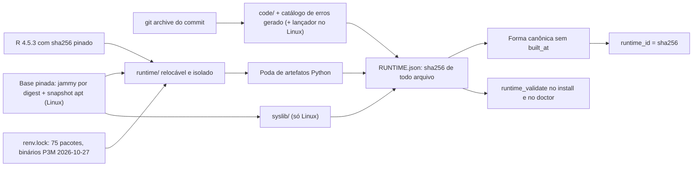

Arquitetura · 2.19

O PrevCarga chega ao operador como um bundle fechado: R 4.5.3, a library do <code>renv.lock</code> (75 pacotes) e o código de produto num só arquivo por plataforma, <code>linux-x86_64</code> (<code>.tar.zst</code>) ou <code>windows-x86_64</code> (<code>.zip</code>). Cada bundle carrega um <code>RUNTIME.json</code> com o sha256 de todo arquivo, e o sha256 da forma canônica desse manifesto é o <code>runtime_id</code>. Os instaladores <code>install.sh</code> e <code>install.ps1</code> instalam sem admin, conferem o hash antes de extrair e validam o manifesto antes de trocar a versão corrente. Cada release é publicada nas GitHub Releases de <code>onsbr/prevcarga</code>, de onde os instaladores baixam o bundle; artefatos oficiais e entregas vão para um repositório online de leitura anônima, em chaves imutáveis, e só o <code>latest.txt</code> muda. O pacote R nunca fala rede: quem fala são os instaladores, o <code>prevcarga-sync</code> e a ferramenta de dev <code>scripts/tools/upload</code>.

## Peças e fronteiras

A distribuição separa o que roda no host do operador do que só existe na máquina de desenvolvimento.

| Peça | Onde roda | Entra no bundle | Papel |
|---|---|---|---|
| `scripts/tools/build_bundle_linux.sh` | dev, Linux | não | gera o bundle `linux-x86_64` num container jammy pinado |
| `scripts/tools/build_bundle_windows.ps1` | dev, host Windows de build | não | gera o bundle `windows-x86_64` |
| `scripts/tools/bundle_manifest.R` | dev | não | `code-tree`, `write` (grava o `RUNTIME.json`), `restore-windows`, `zip`, `validate` |
| `scripts/tools/bundle_gates.R` | dev | não | checagens de higiene do build: Python-free, rede/env e portabilidade |
| `scripts/tools/upload` | dev, Linux | não | único arquivo do repo que fala com o serviço de armazenamento |
| `prevcarga release-pack` | Linux e Windows | sim (verbo da CLI) | monta localmente o layout do repositório online, sem rede |
| `install/install.sh`, `install/install.ps1` | host do operador | não | instalação, rollback e remoção |
| `install/prevcarga`, `install/prevcarga.cmd` | host do operador | Linux: `prevcarga` em `code/install/`; Windows: o instalador procura `code\install\prevcarga.cmd` e, na falta, usa o que está ao lado do `install.ps1` | lançador fino copiado para `bin/` da instalação |
| `install/prevcarga-sync.sh`, `.ps1`, `.cmd` | host do operador | Linux: em `code/install/`; Windows: ao lado do instalador | leitura HTTP(S) do repositório online para o registry local |

### O que entra no `code/` do bundle

A seleção é de `pc_code_tree` (`scripts/tools/bundle_manifest.R`). `prevcarga_bundle_id` (`scripts/lib/runtime.R`) usa a mesma seleção numa árvore de dev, sem `RUNTIME.json`: o id é o sha256 das linhas caminho e sha256 dos arquivos selecionados, então o mesmo código dá o mesmo id e qualquer byte de código o muda. Num bundle instalado, o `bundle_id` é o próprio `runtime_id`.

| Entra | Fica de fora |
|---|---|
| `scripts/` | `scripts/tools/` e `scripts/data-prep/` |
| `models/` | `models/*/models/` (artefatos treinados) |
| `config/` | qualquer caminho com `tests/` |
| `renv.lock` | qualquer `*.md` |
| `LICENSE` e `NOTICE` (Apache-2.0, ONS) |  |

Os builds acrescentam ao `code/` o catálogo de erros gerado, `install/error-catalog.tsv`, por `export_error_catalog.R --out`. Esse arquivo nunca é versionado nem editado à mão (ver [Barrel por descoberta](/arquitetura/barrel-descoberta)). No Linux, o build também copia o lançador `install/prevcarga` e o `install/prevcarga-sync.sh` para `code/install/`.

### Dependências admissíveis

O bundle só leva o que o `renv.lock` declara. O motor de PDF dos relatórios é `grDevices::pdf`, da base R (`scripts/lib/reporting.R`), e o `renv.lock` não traz Plotly, pagedown, chromote nem rmarkdown. Reporting não acrescenta binário ao bundle. Essa é a emenda do ADR-0033 ao ADR-0017.

<Pendente titulo="Pendente · ADR-0033">O ADR-0033 registra a escolha de <code>grDevices::pdf</code> como recomendação a ratificar, e o encoding das fontes base para acentos no PDF segue como TBD no próprio ADR.</Pendente>

:::info Fora do escopo da V1
O ADR-0016 descreve uma orquestração com I/O em nuvem: modo inferido do prefixo `s3://`, cliente `aws` no runner e fan-out em lote. A V1 não segue esse desenho. O pacote R não fala com nenhum serviço de armazenamento, e a checagem de build `pc_bundle_net_grep` reprova `s3://`, `aws s3`, `download.file` e afins no código do bundle. O empacotamento segue o ADR-0017 (bundle relocável no repositório online com instalador bootstrap), emendado pelo ADR-0033 na lista de dependências admissíveis.
:::

## Reprodutibilidade e isolamento do runtime

### Entradas pinadas

| Entrada | Linux | Windows |
|---|---|---|
| Base | container `ubuntu:22.04` por digest `sha256:5ec03bb3…` | host Windows de build, PowerShell 5.1 ou 7, sem admin |
| Pacotes do sistema | apt de `snapshot.ubuntu.com`, snapshot `20261027T000000Z` | não se aplica |
| R 4.5.3 | `.deb` do Posit (`cdn.posit.co/r/ubuntu-2204`), sha256 pinado | `R-4.5.3-win.exe` de `cloud.r-project.org/bin/windows/base/old/4.5.3/`, sha256 pinado |
| Pacotes R | binários P3M jammy, snapshot `2026-10-27` | binários CRAN Windows do mesmo snapshot P3M; o sha256 de cada zip está em `scripts/tools/windows_binaries.tsv` |
| Código | `git archive` de uma revisão; árvore suja é recusada | idem |
| Relógio | `SOURCE_DATE_EPOCH` do commit | idem |

No Linux o build roda com `MAKEFLAGS=-j1` e sem python3 no container. O tarball sai com `tar --sort=name`, `mtime` fixo no epoch do commit e dono numérico 0, comprimido por `zstd -19 -T1`. No Windows, `pc_zip_reproducible` ordena os caminhos, fixa o `mtime` de todo arquivo no epoch e empacota com `zip::zip(mode = "mirror")`, sem depender de `zip.exe`.

Os 75 pacotes do lock têm binário na versão exata, por isso `compilados` é esperado vazio nas duas plataformas. Um pacote compilado do fonte carrega a data da compilação e quebraria a reprodutibilidade, então ele é declarado no manifesto.

### Layout do bundle

| Plataforma | Raiz `prevcarga/` |
|---|---|
| `linux-x86_64` | `runtime/` (R_HOME, library em `runtime/lib/R/library`), `syslib/`, `code/`, `RUNTIME.json` |
| `windows-x86_64` | `runtime/R/` (R_HOME, library em `runtime/R/library`), `code/`, `RUNTIME.json` |

No Linux:

- **Relocável.** O `bin/R` do Posit tem R_HOME fixo. O build o reescreve para calcular o R_HOME do próprio caminho e troca `runtime/bin/R` e `runtime/bin/Rscript` por wrappers.
- **Isolado.** O `etc/Renviron` do bundle fixa `R_LIBS_USER` e `R_LIBS_SITE` vazios, e `.libPaths()` fica só com a library do bundle.
- **`syslib/`.** O fecho `ldd` do R e de todo `.so` da library, menos a glibc core (libc, libm, libpthread, libdl, librt e a mesma família). Entra no `etc/ldpaths` por caminho relativo, depois de `R_HOME/lib` e antes das bibliotecas do host. Por isso o host precisa de glibc 2.35 ou mais nova, a do jammy.
- **Python-free.** `prune_python_artifacts` remove do `runtime/` os arquivos de pacotes R que casam com a checagem Python-free, como `docopt/spec/docopt.py`. Nenhum deles é usado em execução.

O lançador instalado também é hermético à library herdada do shell. `install/prevcarga` faz `exec env -u R_HOME -u R_LIBS -u R_LIBS_USER -u R_LIBS_SITE -u R_PROFILE_USER -u R_ENVIRON_USER` antes do `Rscript --vanilla`. O `prevcarga.cmd` limpa as mesmas seis variáveis com `set "X="`, só no processo. Nenhum dos dois define variável nova.

### `RUNTIME.json` e `runtime_id`

A fonte única do contrato é `scripts/lib/runtime.R`, a mesma que o `doctor` usa. O build grava o manifesto por `bundle_manifest.R write` (`pc_runtime_json_write`).

| Campo | Conteúdo |
|---|---|
| `version` | versão do release |
| `platform` | `linux-x86_64` ou `windows-x86_64` |
| `r_version` | versão do R do build; a gravação aborta se ela difere do `R.Version` do `renv.lock` |
| `renv_lock_hash` | sha256 do `code/renv.lock` |
| `code_commit` | commit de onde saiu o `code/` |
| `apt_snapshot` | snapshot do apt (Linux); `null` no Windows |
| `compilados` | pacotes compilados do fonte, com versão e motivo; esperado vazio |
| `built_at` | data do build derivada do commit; campo lateral, fora do id |
| `files` | `path` e `sha256` de todo arquivo da raiz, exceto o próprio `RUNTIME.json` |

`prevcarga_runtime_json_canonical` ordena as chaves recursivamente, ordena `files` por `path` em radix, remove `built_at` e termina em LF. `prevcarga_runtime_id` é o sha256 dessa forma canônica. Sem `RUNTIME.json` (árvore de dev), ele devolve `NULL`. Como `built_at` vem do commit e fica fora do id, dois builds do mesmo commit dão o mesmo `runtime_id`. Uma linha alterada num arquivo de `scripts/lib` muda o id.

`prevcarga_runtime_validate(root, strict)` recalcula o sha256 de todo `files[]`. Com `strict = TRUE`, qualquer divergência aborta com `bundle.manifest_mismatch` (exit 6) e lista os caminhos em `details.paths`. O instalador a chama sobre o stage antes de trocar a versão corrente. O `doctor` a chama sobre o bundle instalado, na linha `bundle.integridade`. O contrato do lado do runtime está em [Runtime](/arquitetura/runtime).

<Figura id="FIG-A18" titulo="Anatomia do bundle e o runtime_id" natureza="Fluxo" fontes={['docs/estado/m8-bundle.md', 'docs/estado/m8-bundle-windows.md']} adrs={['ADR-0036', 'ADR-0038']}>

</Figura>

## R 4.5.3 e o `renv.lock`

O bundle roda R 4.5.3 com um `renv.lock` próprio, distinto do lock do sistema de referência (R 4.2.3, snapshot de 2023-04-21). A decisão é do ADR-0036 e se apoia na medição do spike `scripts/tools/spike_r453.R`.

### O spike

O spike é ferramenta de dev, só Linux, fora do bundle. Ele executa o sistema de referência, sem alterá-lo, em R 4.2.3 e em R 4.5.3, na mesma origem (2024-06-01), na área SECO e com o mesmo deck. Depois compara o `y_pred` por modelo. A impressão digital da árvore de referência é conferida antes e depois, e uma alteração aborta a rodada. O veredito usa tolerância relativa de 0,001 (`spike_verdict`, `tol = 1e-3`).

| Braço | O que mudou | Resultado |
|---|---|---|
| Estrito | mesmo `renv.lock` do sistema de referência, em R 4.5.3 | não compila: os pacotes de 2023 falham com os headers do R 4.5 e os cinco modelos saem `compile_failed` |
| Relock | mesmos nomes de pacote, versões do snapshot de 2026-10-27, em R 4.5.3 | os cinco modelos rodam |

Medição do braço relock (`docs/estado/m1-spike-r453.md`):

| Modelo | n | max_abs | max_rel | sha256 igual |
|---|---|---|---|---|
| random-forest | 432 | 0 | 0 | sim |
| lgbm | 79 | 0 | 0 | sim |
| holt-winters | 384 | 0 | 0 | sim |
| dessem-linear | 463 | 7,3e−9 | 2,2e−13 | não |
| dessem-regdin | 463 | 0,416 | 1,3e−5 | não |

O braço relock muda o R e os pacotes juntos. O Δ não é atribuível só ao R.

### O lock adotado

O `renv.lock` declara R 4.5.3, o repositório `https://packagemanager.posit.co/cran/2026-10-27` e 75 pacotes. Eles são o fecho de dependências (Depends, Imports, LinkingTo) das raízes de runtime, entre elas data.table, lubridate, arrow, jsonlite, digest, yaml, docopt, RhpcBLASctl, randomForest, forecast, lightgbm, WeightSVM, e1071 e fable. Pacotes recomendados vêm com o próprio R. Pacotes só de teste e o próprio renv ficam fora.

Dos pacotes comuns com o sistema de referência, 60 têm versão diferente, cada um com motivo e ADR. RF, LGBM e HW dão a mesma previsão nas duas versões. O dessem-regdin pode divergir do sistema de referência até max_rel 1,3e−5, atribuído às versões de WeightSVM (1.7-16 no lock, 1.7-11 na referência), e1071 (1.7-17 e 1.7-13) e fable (0.5.0 e 0.3.3).

## Layout do repositório online

O layout é montado localmente por `prevcarga release-pack` (`scripts/lib/release_pack.R`), sem rede e igual em Linux e Windows, e enviado por `scripts/tools/upload`.

| Árvore | Conteúdo |
|---|---|
| `releases/` | por versão: os dois bundles, `RUNTIME-linux-x86_64.json`, `RUNTIME-windows-x86_64.json` e `SHA256SUMS`; `releases/latest.txt` com a versão corrente. É o conteúdo de cada GitHub Release (abaixo) |
| `artifacts/` | `artifacts/<modelo>/[<variante>/]<area>/v_<hash>/`, `artifacts/combina/<area>/v_<hash>/`, `artifacts/reconcile/<ss>/v_<hash>/`, cada célula com seu `latest.txt` |
| `forecasts/` | `forecasts/<AAAA-MM-DD>/<AAAAMMDDTHHMM>/<versao>/`, cópia byte a byte das entregas da origem; `forecasts/<O>/latest.txt` lista as chaves |

### Chaves imutáveis e Object Lock

1. Toda chave versionada é imutável. `upload` confere cada chave com `head-object` e recusa sobrescrever uma que já existe (`upload.key_exists`, exit 9) antes de enviar qualquer objeto.
2. As chaves versionadas sobem com `--object-lock-mode COMPLIANCE`.
3. O `latest.txt` é a única chave mutável. Sobe por último e sem trava.
4. O `SHA256SUMS` da raiz do diretório montado é só conferência local e não sobe.
5. `release-pack` recusa, já na montagem, chaves que constam em `--published` (a saída de `upload --list`): motivo `chave_publicada`.

Cada `v_<hash>/`, cada chave de `forecasts/` e cada `releases/<v>/` levam o seu `SHA256SUMS`, no formato do `sha256sum -c`. Os instaladores e o `prevcarga-sync` conferem o hash de cada arquivo antes de usá-lo e nunca listam o repositório online: seguem os `latest.txt`.

### O que nunca vai para o repositório online

`release-pack` aplica uma allowlist por `--what` e uma lista de conteúdo proibido. Toda recusa acumula em `result.recusados` e sai num único erro de integridade (exit 9).

| Motivo | O que pega |
|---|---|
| `fora_da_allowlist` | qualquer arquivo fora da allowlist do `--what`, inclusive deck, dados e `config.yaml` soltos |
| `proibido` | dentro de uma árvore permitida: `config.yaml`, `credentials`, `*.pem`, `*.key`, `.aws/`, `.env`, parquet de entrada do deck (`load*`, `weather_observed*`, `weather_forecast*`) e `auxiliary/` |
| `deck_manifest` | `manifest.json` de deck dentro de uma chave de forecast |

Dos artefatos, só sai a versão apontada pelo `latest.txt` de cada célula do registry local. `.history`, `.pin` e `.tmp-*` são só locais. Para `artifacts`, o conjunto oficial tem de estar completo: toda folha precisa da sua combina e todo subsistema da sua reconciliação, senão sai `state.official_set_incomplete` (exit 13).

### Releases no GitHub

O instalador não lê o repositório online. O default de `--release-base` do `install.sh` e do `install.ps1` é `https://github.com/onsbr/prevcarga`, e cada versão é uma release de tag `v<v>` com os assets de `releases/<v>/` mais o `latest.txt`, o `install.sh` e o `install.ps1`. A versão mais recente sai do redirect `<base>/releases/latest/download/latest.txt`, e o bundle de `<base>/releases/download/v<v>/`. Uma base que não seja exatamente `https://github.com/<org>/<repo>` usa o layout do repositório online (`<base>/releases/<v>/`), o que mantém espelhos e testes locais.

A release é montada por `.github/workflows/release.yml` a cada tag `v*`. Os dois bundles são gerados em runners do GitHub, Linux pelo `build_bundle_linux.sh` e Windows pelo `build_bundle_windows.ps1`. Cada um é instalado pelo próprio instalador e passa por `--version` e `doctor` antes de seguir. O último job confere os sha256, monta o `SHA256SUMS` dos dois e publica a release com os bundles, os `RUNTIME-<plataforma>.json`, o `latest.txt` e os instaladores.

<Pendente titulo="Pendente · ADR-0039">O nome do repositório online não está decidido. Ele só existe como <code>--bucket</code> do <code>upload</code>, e o default de <code>--release-base</code> do <code>prevcarga-sync</code> (<code>https://prevcarga.s3.amazonaws.com</code>) é provisório. A retenção do Object Lock (<code>--object-lock-retain-until-date</code>) também depende da política do repositório online.</Pendente>

## Contrato de erros dos utilitários

Os utilitários de shell (`install.sh`, `install.ps1`, `prevcarga-sync.sh`, `prevcarga-sync.ps1` e `upload`) seguem o mesmo contrato da CLI (ADR-0040). Os ids vêm do catálogo distribuído em `scripts/lib/errors/*.tsv`. Os utilitários leem o `error-catalog.tsv` gerado pelo nome das colunas (`id`, `class`, `exit_code`, `message`, `hint`) e têm um fallback embutido com o mesmo texto.

| Classe | Exit | Ids dos utilitários |
|---|---|---|
| `bundle` | 6 | `install.preflight_failed`, `install.manifest_invalid`, `install.io_failed`, `sync.io_failed`; do runtime: `bundle.manifest_mismatch`, `bundle.package_missing`, `bundle.platform_mismatch` |
| `config` | 8 | `install.usage`, `install.no_previous_version`, `install.state_inside_versions`, `sync.usage`, `upload.usage` |
| `integrity` | 9 | `install.sha_missing`, `install.sha_mismatch`, `sync.sha_mismatch`, `upload.key_exists` |
| `network` | 10 | `install.download_failed`, `sync.network`, `upload.network` |

Formas de saída:

- Com `--format json`: um único documento JSON em stdout, stderr vazio. Na falha, `ok: false`, `exit_code` igual ao código de saída e `error` com `id`, `class`, `message`, `hint`, `where` e `details`.
- Em texto: ASCII puro, erro em stderr com a primeira linha `prevcarga: erro [<classe>] (exit <n>)`.

Os ids não têm dígito, porque o loader de `scripts/lib/errors.R` só aceita `^[a-z]+\.[a-z_]+$`. Por isso é `install.sha_mismatch`, e não `sha256_mismatch`. A taxonomia completa está em [Contrato de erros e códigos de saída](/arquitetura/erros-exit).

## Portabilidade Linux e Windows

O mesmo código de produto roda nas duas plataformas, nativo no Windows (PowerShell, sem WSL2; ADR-0038). A checagem de build `pc_bundle_portability_grep` (`scripts/tools/bundle_gates.R`) varre `scripts/prevcarga`, `scripts/**/*.R` e `models/**/*.R` do `code/` e reprova:

| Proibido | Por quê |
|---|---|
| `mclapply`, `mcparallel` | fork não existe no Windows |
| `Sys.symlink`, `file.symlink` | symlink exige privilégio no Windows |
| `system("bash`, `system2("bash`, `/bin/sh` | não há shell Unix no host Windows |
| caminhos literais `/tmp/`, `/opt/` | não existem no Windows |

Linhas inteiras de comentário não contam, porque são prosa. O `code/` real tem zero ocorrências.

Como cada ponto resolve a portabilidade:

- **Paralelismo só por PSOCK.** `train-models --jobs` e o orquestrador do backtest usam `parallel::makePSOCKcluster` (`scripts/lib/training.R`, `scripts/lib/orchestrate.R`). Cada worker é um R novo, igual nas duas plataformas.
- **Ponteiros por arquivo.** A versão corrente é o arquivo `current` (uma linha com a versão), e não um symlink. No Linux ele é trocado por tempfile e `mv -f`. No Windows a troca usa tempfile e `[IO.File]::Replace`, nunca symlink nem junction. O `previous` e os `latest.txt` do registry e do repositório online seguem a mesma regra.
- **Instaladores espelhados.** `install.ps1` repete o layout, a ordem de invariantes, os ids e os exits do `install.sh`. As diferenças são deliberadas: zip no lugar de tar.zst, `runtime\R\bin\Rscript.exe`, PATH em `HKCU\Environment` (nunca HKLM), raiz default `%LOCALAPPDATA%\prevcarga` e saída em bytes ASCII independente de code page.
- **Lançador sem blocos.** `prevcarga.cmd` usa `goto` em vez de `if (...)`, porque um caminho com `(x86)` quebraria o parser do cmd dentro de um bloco.

O detalhe operacional da instalação está em [Instalação, atualização e remoção](/execucao/instalacao), e o da sincronização em [Sincronizar com os artefatos online](/execucao/sync).

<Pendente titulo="Pendente · Windows">O build <code>build_bundle_windows.ps1</code> roda no CI (<code>windows-2022</code>), e a instalação, a atualização, o rollback, o PATH em HKCU, a extração da library e o <code>doctor</code> já foram confirmados no CI e numa máquina Windows. Falta comparar o <code>runtime_id</code> de dois builds reais.</Pendente>
