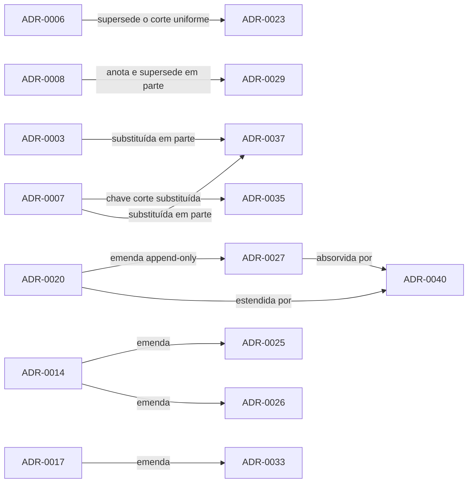

Arquitetura · 2.21

As decisões de arquitetura do PrevCarga vivem em duas fontes que ainda não concordam. A pasta <code>docs/adr/</code> do repositório tem 22 ADRs (0001 a 0022), todas marcadas "Aceito". O SpecForge tem 40 ADRs (0001 a 0040), todas "proposed". Esta página indexa as 40, mostra o status em cada fonte sem escolher um, aponta a página do site que explica cada tema e mostra como as decisões se emendam e se superam.

## Onde as ADRs vivem

| Fonte | Faixa | Status registrado | Formato |
|---|---|---|---|
| `docs/adr/*.md` no repositório | ADR-0001 a ADR-0022 | Todas "Aceito" | Leve: contexto, decisão, consequências, alternativas, evidência |
| SpecForge, projeto da spec "Modular CLI" | ADR-0001 a ADR-0040 | Todas "proposed" | MADR 4.0 |

As ADRs 0023 a 0040 existem só no SpecForge. As 22 primeiras existem nas duas fontes, e em 11 delas o título local difere do título no SpecForge; a tabela abaixo marca a divergência na coluna "Título local".

O `docs/adr/README.md` declara que uma ADR aceita é imutável e que mudança de decisão gera uma ADR nova que a supersede. No SpecForge, só uma ADR "proposed" é editável e a transição de status (aceitar, rejeitar, superseder) é feita por pessoa, na aplicação web. Nenhuma das 40 passou por essa transição.

<Pendente titulo="Pendente · fonte e status oficial das ADRs">
Ainda não foi decidido qual fonte o site trata como oficial, nem qual status ele mostra. As opções em aberto são exportar as 40 ADRs do SpecForge para o site como snapshot versionado, manter esta página só como índice que aponta para o SpecForge, ou aceitar primeiro as ADRs no SpecForge e depois exportar. Enquanto isso, o status oficial depende da aceitação no SpecForge, e esta página mostra os dois status lado a lado, sem resolver a diferença. A mesma decisão define contra qual fonte o verificador de fontes do site valida a lista <code>adrs</code> do frontmatter das páginas.
</Pendente>

## Índice das 40 ADRs

A coluna "Decisão" resume o título vigente no SpecForge. "Título local" diz se o cabeçalho em `docs/adr/` é igual ao do SpecForge, difere dele ou não existe. A coluna "Página" aponta a página do site onde o tema é explicado.

| ADR | Decisão | `docs/adr/` | SpecForge | Título local | Página |
|---|---|---|---|---|---|
| ADR-0001 | Topologia da árvore SIN e decomposição MAP por modelo, área e origem, e REDUCE por combina e reconciliação | Aceito | proposed | igual | [Topologia](/arquitetura/topologia-run-yaml) |
| ADR-0002 | Grade semi-horária de 48 intervalos com rótulo `interval_end`, formato LONG de 8 colunas e re-ancoragem em O | Aceito | proposed | difere | [Schema LONG](/arquitetura/schema-long) |
| ADR-0003 | Convenção temporal naive-BRT e contrato de ambiente de runtime | Aceito | proposed | igual | [Tempo](/metodologia/tempo-rotulo-fusos) |
| ADR-0004 | Store canônico em parquet Hive `area_code=` e `year=`, um arquivo por partição | Aceito | proposed | igual | [Dados de entrada](/metodologia/dados-de-entrada) |
| ADR-0005 | Contrato de entrada por modelo, falha por origem com erro classificado, validação na fronteira | Aceito | proposed | igual | [Validação do deck](/arquitetura/validacao-deck) |
| ADR-0006 | Backtest honesto: o harness só trunca o tempo; corte de treino O−1−H | Aceito | proposed | igual | [Backtest](/metodologia/backtest) |
| ADR-0007 | Corte intradiário vindo do dado, como instante semi-horário, filtrado por `issue_time` | Aceito | proposed | igual | [Três cortes](/metodologia/tres-cortes) |
| ADR-0008 | Honestidade e determinismo como invariante do método, fixado no processo | Aceito | proposed | difere | [Determinismo](/metodologia/determinismo) |
| ADR-0009 | Arquitetura modular: módulo = função R importável; unidade = área, origem e modo; contrato em `run.yaml` e descriptor | Aceito | proposed | difere | [Princípios](/arquitetura/principios) |
| ADR-0010 | Contrato de features verificado na montagem (fail-loud); registry único Tier A | Aceito | proposed | difere | [Fundação de plugins](/arquitetura/fundacao-plugins) |
| ADR-0011 | Ciclo de artefato: artefato congelado, registry `latest.txt` e `v_hash` no filesystem, split por classe | Aceito | proposed | difere | [Registry](/arquitetura/registry) |
| ADR-0012 | Motor DESSEM é código nosso, com motor único | Aceito | proposed | difere | [Família DESSEM](/metodologia/dessem-estrutura) |
| ADR-0013 | Combina: média convexa dos membros com intercepto, pesos por mês de origem, lead e corte, fallback EQW | Aceito | proposed | difere | [Combina](/metodologia/combina) |
| ADR-0014 | Combina: treino sem vazamento de horizonte | Aceito | proposed | igual | [Combina](/metodologia/combina) |
| ADR-0015 | Reconciliação Bottom-Up × k-hat multiplicativo; SIN = Σ subsistemas | Aceito | proposed | igual | [Reconciliação](/metodologia/reconciliacao) |
| ADR-0016 | Produto local-only: o pacote e a CLI nunca falam S3 nem HTTP | Aceito | proposed | difere | [Distribuição](/arquitetura/distribuicao) |
| ADR-0017 | Produto fechado: runtime R relocável no repositório online, instalador bootstrap, entrega byte-copy, verificar por tolerância | Aceito | proposed | difere | [Distribuição](/arquitetura/distribuicao) |
| ADR-0018 | Runtime R-only, com leitor de carga R único | Aceito | proposed | difere | [Princípios](/arquitetura/principios) |
| ADR-0019 | Alinhamento temperatura e carga como invariante de dado; transforms compartilhados | Aceito | proposed | difere | [Tempo](/metodologia/tempo-rotulo-fusos) |
| ADR-0020 | Taxonomia de exit-code da CLI por classe de erro | Aceito | proposed | igual | [Erros e exit](/arquitetura/erros-exit) |
| ADR-0021 | Config por modelo em `run.yaml` enxuto, com override por CLI | Aceito | proposed | igual | [Topologia](/arquitetura/topologia-run-yaml) |
| ADR-0022 | Dispatch do runtime-guard no processo: enforce primeiro e lista de isenção | Aceito | proposed | igual | [Fachada da CLI](/arquitetura/fachada-cli) |
| ADR-0023 | Corte de treino por classe de split: `origin_agnostic` O−1−H, `origin_scoped` 1 re-treino por dia | não existe | proposed | não existe | [Três cortes](/metodologia/tres-cortes) |
| ADR-0024 | Regra configurável do clima previsto: `issue_time` até `available_until` ou 00:00 UTC do dia O | não existe | proposed | não existe | [Três cortes](/metodologia/tres-cortes) |
| ADR-0025 | Qualidade da combina reportada no holdout real | não existe | proposed | não existe | [Combina](/metodologia/combina) |
| ADR-0026 | Combina: solver FISTA em R base, eixo mês de origem e corte do treino por lead, corte e mês | não existe | proposed | não existe | [Combina](/metodologia/combina) |
| ADR-0027 | Emenda append-only da taxonomia de exit-code: classes novas e precedência | não existe | proposed | não existe | [Erros e exit](/arquitetura/erros-exit) |
| ADR-0028 | Contrato de métrica único e faixa de aceite do k-hat em `config/topology.yaml` | não existe | proposed | não existe | [Avaliação](/metodologia/avaliacao) |
| ADR-0029 | Verificação da honestidade no processo, por saída | não existe | proposed | não existe | [Determinismo](/metodologia/determinismo) |
| ADR-0030 | Registry, cache e store: variante, promote atômico, gc local, rollback e chave de cache por classe | não existe | proposed | não existe | [Registry](/arquitetura/registry) |
| ADR-0031 | `features.R` com transforms de grade e FE-fachada de dispatch; motor DESSEM único | não existe | proposed | não existe | [Fundação de plugins](/arquitetura/fundacao-plugins) |
| ADR-0032 | Painel LONG e `run.yaml`: conversor de folha, `forecast_origin` texto ISO, `delivery_days`, infer read-only | não existe | proposed | não existe | [Schema LONG](/arquitetura/schema-long) |
| ADR-0033 | Motor R para PDF admissível no bundle e transporte dos reports | não existe | proposed | não existe | [Distribuição](/arquitetura/distribuicao) |
| ADR-0034 | Ato de corte da migração a partir do sistema de referência | não existe | proposed | não existe | — |
| ADR-0035 | Rótulo da carga explícito (`load_label`), colunas `interval_start` e `interval_end`, declarado no manifest | não existe | proposed | não existe | [Tempo](/metodologia/tempo-rotulo-fusos) |
| ADR-0036 | Runtime R 4.5.3 com `renv.lock` novo | não existe | proposed | não existe | [Distribuição](/arquitetura/distribuicao) |
| ADR-0037 | Fuso declarado no manifest do deck, config em YAML, CLI sem variáveis de ambiente | não existe | proposed | não existe | [Configuração e ctx](/arquitetura/configuracao-ctx) |
| ADR-0038 | Instalador e bundle nativos em Linux e Windows (PowerShell), sem WSL2 obrigatório | não existe | proposed | não existe | [Instalação](/execucao/instalacao) |
| ADR-0039 | Bucket S3 de leitura pública por HTTPS, integridade por sha256 e objetos imutáveis | não existe | proposed | não existe | [Sincronizar](/execucao/sync) |
| ADR-0040 | Contrato de saída de erros: tabela única de exit-codes 0–15, texto ASCII, esquema JSON único | não existe | proposed | não existe | [Erros e exit](/arquitetura/erros-exit) |

:::note Títulos locais defasados
Nas ADRs marcadas "difere", o cabeçalho do arquivo de `docs/adr/` traz o título de uma versão anterior da decisão. Exemplos: o título do ADR-0012 local fala em motor DESSEM vendorizado, e o do SpecForge diz que o motor é código nosso; o título do ADR-0016 local descreve a orquestração AWS Batch, e o do SpecForge a trata como referência de um produto local-only. Nesses dois arquivos, a decisão vigente está no corpo, na seção "Decisão (resolvida)". O site segue o código; quando a ADR local diverge, a página do tema explica o comportamento do sistema.
:::

Algumas ADRs ainda carregam marcadores de decisão aberta, citados nas páginas do tema. Exemplo: o nome do repositório online do ADR-0039 (ver [Distribuição](/arquitetura/distribuicao)).

## Cadeia de emendas e supersessões

O SpecForge não registra a supersessão num campo estruturado: nenhuma das 40 ADRs traz `supersedesIds` preenchido, porque esse campo só aceita ADRs aceitas e as ADRs superadas estão "proposed". A relação está escrita no texto de cada ADR (título, decisão, opções consideradas ou seção "More Information"). A figura mostra as relações de supersessão, emenda e substituição parcial; a seta vai da decisão mais antiga para a que a altera.

<Figura id="FIG-A20" titulo="Cadeia de emendas e supersessões das ADRs" natureza="Estrutura" fontes={['docs/adr/README.md']} adrs={['ADR-0003', 'ADR-0006', 'ADR-0007', 'ADR-0008', 'ADR-0014', 'ADR-0017', 'ADR-0020', 'ADR-0023', 'ADR-0025', 'ADR-0026', 'ADR-0027', 'ADR-0029', 'ADR-0033', 'ADR-0035', 'ADR-0037', 'ADR-0040']}>

</Figura>

Os nós destacados são as ADRs que existem só no SpecForge. Além dessas, há relações mais fracas, em que a ADR nova refina, clarifica ou anota a anterior sem a superar:

| ADR nova | Relação | ADR anterior | O que muda |
|---|---|---|---|
| ADR-0021 | refina, sem superseder | ADR-0009 | Fixa o `run.yaml` como contrato declarativo, em vez do `job.json` |
| ADR-0030 | refina | ADR-0011 | Acrescenta a camada de cache e o store de backtest |
| ADR-0031 | clarifica | ADR-0009 | A FE-fachada é dispatch puro; não há FE compartilhada |
| ADR-0026 | clarifica | ADR-0013 | "Mês-alvo" deve ser lido como mês de origem |
| ADR-0024 | clarifica | ADR-0007 | Regra configurável para o corte do clima previsto |
| ADR-0028 | anota | ADR-0015, ADR-0001 | Faixa de aceite do k-hat, sem clamp; perdas e faixa num só lugar |
| ADR-0032 | emenda | ADR-0002, ADR-0021 | Escopo do conversor "único" para o LONG; spec efetivo e infer read-only |
| ADR-0035 | refina | ADR-0019 | O ±1h do DESSEM fica só nos transforms; rótulo da carga declarado |

O ajuste de hora é o caso em que três ADRs se somam em vez de se substituir. O ADR-0012 define o motor DESSEM como código nosso, o ADR-0019 põe o alinhamento entre temperatura e carga nos transforms compartilhados, e o ADR-0035 fixa o rótulo da carga no leitor. A página [Tempo: rótulo da carga, fusos e ajuste de hora](/metodologia/tempo-rotulo-fusos) explica o resultado.

O ADR-0016 registra o fan-out em AWS Batch como referência. O produto não implementa esse fan-out; a distribuição do produto está em [Distribuição](/arquitetura/distribuicao).
