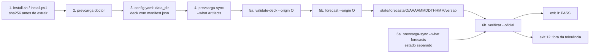

<span className="pc-overline">Execução · 3.1</span>

<p className="pc-lead">Seis passos levam uma máquina limpa a uma entrega verificada: instalar o bundle sem administrador, conferir o ambiente com `prevcarga doctor`, apontar o deck, sincronizar os artefatos oficiais do repositório online, rodar `validate-deck` e `forecast` para uma origem O e, por fim, comparar a entrega local com a inferência oficial da mesma chave com `verificar --oficial`. O produto não lê variáveis de ambiente: tudo é flag, `config.yaml` ou default.</p>

## Pré-requisitos

O bundle traz o próprio R (4.5.3) e todas as bibliotecas. Não é preciso R instalado nem administrador em nenhuma das duas plataformas. WSL2 não é requisito (ADR-0038).

| Item | Linux (`install.sh`) | Windows (`install.ps1`) |
|---|---|---|
| Sistema | x86_64, glibc ≥ 2.35; musl é recusado | Windows 64-bit |
| Shell | POSIX `sh` | Windows PowerShell 5.1 ou pwsh 7, com `-ExecutionPolicy Bypass` |
| Ferramentas | `tar`, `zstd`, `sha256sum`, `awk` e `curl` ou `wget` | nenhuma além do PowerShell |
| Espaço | não conferido pelo preflight | ≥ 2 GiB livres no volume da raiz (unidade com letra; caminho UNC não é conferido) |
| Raiz padrão `<R>` | `~/.local/share/prevcarga` | `%LOCALAPPDATA%\prevcarga` |
| PATH | opcional, com `--add-to-path` (bloco no `~/.profile`) | sempre, só em `HKCU` |
| Bundle | `prevcarga-<v>-linux-x86_64.tar.zst` | `prevcarga-<v>-windows-x86_64.zip` |

O preflight recusa a plataforma com `install.preflight_failed` (exit 6). `--skip-platform-check` (`-SkipPlatformCheck` no Windows) transforma a recusa em aviso.

Além da máquina, o operador precisa de um deck canônico num diretório local: carga verificada, clima previsto e observado, feriados e um `manifest.json` na raiz. O contrato está em [Dados de entrada](/metodologia/dados-de-entrada).

## Os seis passos

<Figura id="FIG-E01" titulo="Do zero à entrega verificada" natureza="Fluxo" fontes={['install/install.sh', 'install/install.ps1', 'install/prevcarga-sync.sh', 'scripts/lib/cli/doctor.R', 'scripts/lib/cli/validate-deck.R', 'scripts/lib/cli/forecast.R', 'scripts/lib/exports.R', 'scripts/lib/verify_repro.R', 'docs/reference/MANUAL-USUARIO.md', 'docs/estado/install.md', 'docs/estado/sync.md', 'docs/estado/m8-e2e-bundle.md']} adrs={['ADR-0038', 'ADR-0039', 'ADR-0040']}>



</Figura>

### 1. Instalar

O instalador baixa o bundle e o `SHA256SUMS` de `<release-base>/releases/<v>/`. Sem `--version`, ou com `--version latest`, lê a versão de `releases/latest.txt`. O sha256 é obrigatório e conferido antes de qualquer extração. Depois de extrair num diretório de stage, o instalador valida todo arquivo listado no `RUNTIME.json` do bundle com o próprio Rscript do stage e só então troca o ponteiro `current`.

<Terminal title="prevcarga — bash" lines={[
  {type:'cmd', text:'curl -fsSL https://github.com/onsbr/prevcarga/releases/latest/download/install.sh | sh -s -- --add-to-path'},
  {type:'dim', text:'# ou, com um bundle já baixado:'},
  {type:'cmd', text:'sh install.sh --bundle ./prevcarga-<v>-linux-x86_64.tar.zst --sha256 <h>'}
]} />

<Terminal title="prevcarga — PowerShell" lines={[
  {type:'cmd', text:"[Net.ServicePointManager]::SecurityProtocol = 'Tls12'; iwr -useb https://github.com/onsbr/prevcarga/releases/latest/download/install.ps1 -OutFile $env:TEMP\\install.ps1; powershell -NoProfile -ExecutionPolicy Bypass -File $env:TEMP\\install.ps1"},
  {type:'dim', text:'# ou, com um bundle já baixado:'},
  {type:'cmd', text:'powershell -NoProfile -ExecutionPolicy Bypass -File install.ps1 -Bundle .\\prevcarga-<v>-windows-x86_64.zip -Sha256 <h>'}
]} />

Ao fim, o instalador grava `<R>/config.yaml` (schema v1) com `state_dir` (padrão `<R>/state`), copia o lançador para `<R>/bin/` e roda `prevcarga doctor --format json`, cujo resultado vem no campo `result.doctor` da saída JSON. O lançador (`prevcarga` no Linux, `prevcarga.cmd` no Windows) descarta as variáveis que poriam uma biblioteca de fora na frente da do bundle (`R_HOME`, `R_LIBS`, `R_LIBS_USER`, `R_LIBS_SITE`, `R_PROFILE_USER`, `R_ENVIRON_USER`) e executa o Rscript do bundle com `--vanilla`. O instalador também copia o `prevcarga-sync` para `<R>/bin/`.

Os erros mais comuns deste passo:

| Situação | error.id | Exit |
|---|---|---|
| argumento desconhecido ou combinação inválida | `install.usage` | 8 |
| sem sha256 (nem `--sha256`, nem `SHA256SUMS` ao lado) | `install.sha_missing` | 9 |
| sha256 divergente | `install.sha_mismatch` | 9 |
| plataforma fora dos pré-requisitos | `install.preflight_failed` | 6 |
| `RUNTIME.json` do bundle não confere | `install.manifest_invalid` | 6 |
| falha ao baixar | `install.download_failed` | 10 |

Atualização, rollback e remoção estão em [Instalação, atualização e remoção](/execucao/instalacao).

O instalador baixa o bundle das GitHub Releases de `https://github.com/onsbr/prevcarga`. Os artefatos oficiais vêm do repositório online pelo `prevcarga-sync`.

### 2. Conferir o ambiente

<Terminal title="prevcarga — bash" lines={[
  {type:'cmd', text:'prevcarga doctor'}
]} />

O `doctor` lista uma linha por checagem, com `PASS`, `WARN`, `FAIL` ou `N/A`: o runtime fixado no processo (fuso, locale, as quatro variáveis de thread e o pool do BLAS), a versão do R, os pacotes, o `config.yaml` e o diretório de dados. As linhas `bundle.plataforma` (inclui glibc ≥ 2.35 no Linux), `bundle.r_version`, `bundle.integridade` (todo arquivo do `RUNTIME.json`), `bundle.versao`, `bundle.current`, `artefatos.presenca` e `artefatos.sha` sempre aparecem, mas só são avaliadas num bundle instalado; fora dele saem `N/A`. Falha de bundle sai com exit 6; artefato apontado por `latest.txt` e ausente, com 13; `SHA256SUMS` local divergente, com 9. Antes do passo 4 o estado ainda não tem artefatos. Os detalhes estão em [Diagnóstico e introspecção](/execucao/diagnostico).

### 3. Apontar o deck

A CLI acha o deck pela chave `data_dir` do `config.yaml` ou pela flag global `--data=<dir>`, que tem precedência. Sem nenhum dos dois, todo verbo que lê dados sai com `config.data_dir_missing` (exit 8). O jeito mais simples é passar `--data` ao instalador, que grava a chave; também dá para editar `<R>/config.yaml`:

```yaml title="<R>/config.yaml"
schema_version: 1
format: text
color: auto
data_dir: '/caminho/do/deck'
state_dir: '/home/operador/.local/share/prevcarga/state'
```

Chave desconhecida no `config.yaml` aborta com exit 8. O deck precisa de um `manifest.json` na raiz, com `schema_version: 1` e o mapa `timezone` (o fuso de cada fonte, ADR-0037). Sem o arquivo, a leitura sai com `contract.manifest_missing`. O `load_label` do manifest é opcional. A precedência é manifest, depois `--load-label`, depois `config.yaml`, depois `end`; uma flag que contradiga o manifest aborta com `contract.load_label_conflict`. As chaves e os outros ajustes estão em [Configuração](/execucao/configuracao).

<Pendente titulo="Pendente · manifest do store real">
O store de dados ainda não tem `manifest.json`. O repositório traz um modelo, `config/deck-manifest.store.json` (`load_label: start`, fuso `Etc/GMT+3`, `issue_time` em UTC, atraso de publicação do clima previsto de 6 h), e o utilitário de desenvolvimento `scripts/tools/write_store_manifest.R --target <dir>` grava esse manifest num diretório. Os valores do modelo ainda estão a confirmar.
</Pendente>

### 4. Sincronizar os artefatos oficiais

<Pendente titulo="Em breve">
O repositório online de artefatos ainda não está no ar. Até lá, os modelos, os pesos da combina e os perfis k-hat são produzidos na própria máquina, como descrito em [Ciclo de vida dos artefatos](/execucao/artefatos).
</Pendente>

Os modelos `origin_agnostic` não treinam na rodada: o `forecast` só lê o artefato e, se ele faltar, sai com `state.artifact_missing` (exit 13). A combina e a reconciliação também precisam dos pesos e do perfil k-hat publicados. O perfil k-hat usado tem de ser o ajustado na própria origem O: um perfil de origem anterior aborta com `state.khat_missing` (exit 13). O `prevcarga-sync` traz esse conjunto do repositório online para o estado local.

<Terminal title="prevcarga — bash" lines={[
  {type:'cmd', text:'prevcarga-sync --what artifacts'}
]} />

No Windows o utilitário é `prevcarga-sync.ps1` (ou o shim `prevcarga-sync.cmd`), com os mesmos parâmetros em `-Pascal` (`-What artifacts`). Sem `--state`, o destino é o `state_dir` do `config.yaml`. O conjunto oficial vem do próprio CLI instalado (`prevcarga models` e `prevcarga areas`); o repositório online nunca é listado. O sync só lê HTTP(S), sem credencial, e trabalha em duas fases: baixa tudo para um staging conferindo o sha256 de cada arquivo e só então publica no estado. Uma falha de hash ou de rede nessa primeira fase deixa o estado byte a byte como estava. Rodar de novo não escreve nada. Os filtros e o protocolo estão em [Sincronizar com os artefatos online](/execucao/sync).

### 5. Validar o deck e rodar a rodada

<Terminal title="prevcarga — bash" lines={[
  {type:'cmd', text:'prevcarga validate-deck --origin 2026-10-15'},
  {type:'cmd', text:'prevcarga forecast --origin 2026-10-15'}
]} />

O `validate-deck` é a validação prévia do deck: confere o manifest, o rótulo, a topologia, os cortes, a completude, a sanidade e as janelas, e acumula os achados num veredito. Reprovado, sai com o exit da classe dominante (2 contrato, 3 completude, 4 topologia, 5 janela). Como ler os achados está em [Validar o deck antes de rodar](/execucao/validar-deck).

O `forecast` é a rodada diária, uma origem por chamada. Ele roda a mesma validação do deck antes de tudo (a menos de `--skip-validate`), infere cada membro, treina dentro da rodada os modelos `origin_scoped` que ainda não têm artefato da origem O, combina, reconcilia e exporta. `--origin` é o único flag de data; sem ele, a origem é o último dia de carga do deck. O corte intradiário (`available_until`) sai do próprio dado de carga e o corte de treino de cada modelo sai do descriptor, como em [Os três cortes de data](/metodologia/tres-cortes). Nenhum desses dois cortes é flag: um flag de corte é recusado pelo docopt com `config.usage` (exit 8). A única regra de corte que o operador escolhe é a do clima previsto, pela flag global `--weather-cutoff` ou pela chave `weather_issue_cutoff` (default `available_until`, ADR-0024).

A entrega fica em `<state_dir>/forecasts/<AAAA-MM-DD>/<AAAAMMDDTHHMM>/<versao>/`, onde a data é a origem, o segundo segmento é o `available_until` no fuso do deck e a `versao` é um hash do que entrou na rodada. Ela traz os parquets LONG, o `manifest.json` com o sha256 de cada arquivo e o `run_manifest.json` com a identidade da rodada (`data_hash`, `bundle_id`, `model_versions`). Na saída em texto, a linha `saida:` mostra esse caminho. Os demais flags (`--area`, `--subsistema`, `--niveis`, `--incluir-membros`, `--report`) estão em [Rodada diária](/execucao/rodada-diaria).

### 6. Verificar contra a inferência oficial

A inferência oficial da mesma origem é baixada para um estado separado, para não se misturar com a entrega local. Depois, `verificar --oficial` acha a chave oficial pelo `run_manifest.json` da entrega local e compara as duas.

<Terminal title="prevcarga — bash" lines={[
  {type:'cmd', text:'prevcarga-sync --what forecasts --origin 2026-10-15 --state /caminho/estado-oficial'},
  {type:'cmd', text:'prevcarga verificar --saida=<state_dir>/forecasts/2026-10-15/<AAAAMMDDTHHMM>/<versao> --oficial --state=/caminho/estado-oficial'}
]} />

O `verificar` passa por quatro fases estritas, e cada uma aborta antes da seguinte: integridade (sha256 de todo arquivo listado), identidade (`data_hash`, `bundle_id`, `model_versions`), pareamento dos arquivos e valores. O trilho padrão sai da plataforma registrada nos dois `run_manifest.json`: na mesma plataforma, a tolerância é de `1e-5` em valor absoluto; entre plataformas, de 0,1% do valor de referência (piso de `1e-5` quando a referência é zero).

| Resultado | Exit | Significado |
|---|---|---|
| PASS | 0 | a entrega local reproduz a oficial dentro do trilho |
| `repro.value_out_of_tol` ou `repro.key_mismatch` | 12 | valor fora da tolerância ou chave sem par |
| `state.official_forecast_missing` | 13 | não há inferência oficial para a chave da entrega; um deck diferente do oficial muda o `data_hash` e a `versao`, e a chave não casa |
| `integrity.manifest_sha` | 9 | arquivo da entrega divergente do `manifest.json` |
| `contract.identity_mismatch` ou `contract.pairing` | 2 | identidade ou conjunto de arquivos diferentes |

O resto do verbo (`--referencia`, `--trilho`, `--alvo`, `--sem-membros`) está em [Verificar uma entrega](/execucao/verificar).

## O roteiro no Windows

<Pendente titulo="Pendente · Windows em validação">
A instalação, a atualização e o `doctor` no Windows já foram confirmados numa máquina Windows. Ainda faltam o `prevcarga-sync.ps1` e a comparação de uma entrega Windows com a oficial pelo trilho `entre-plataformas`; se algo divergir nesses dois, consulte [Diagnóstico e introspecção](/execucao/diagnostico).
</Pendente>
