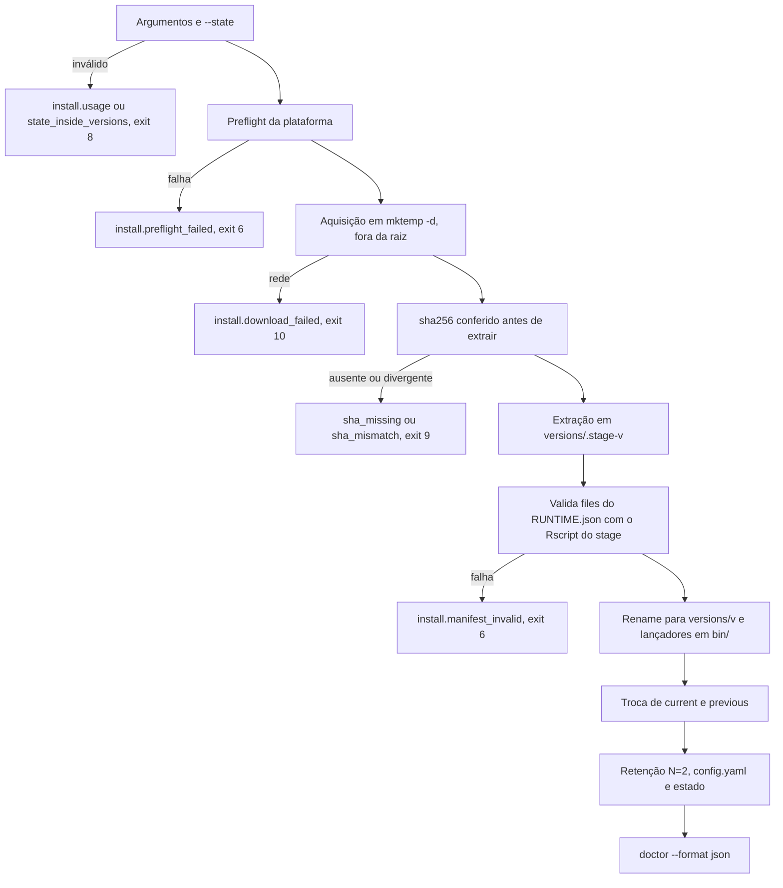
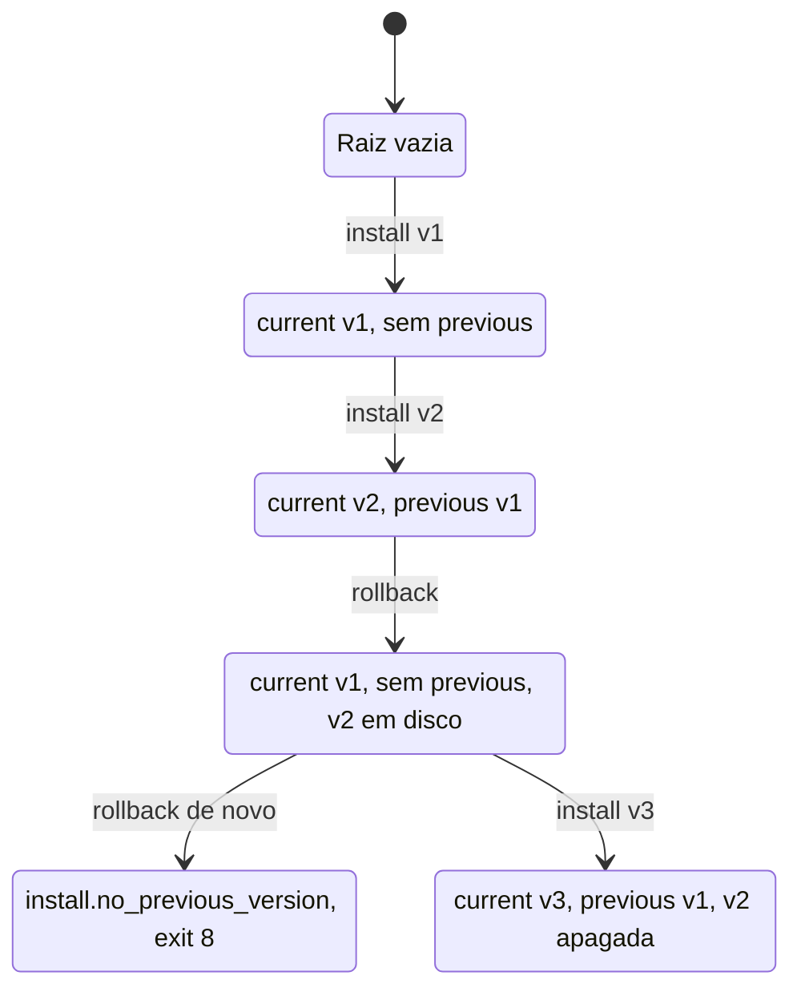
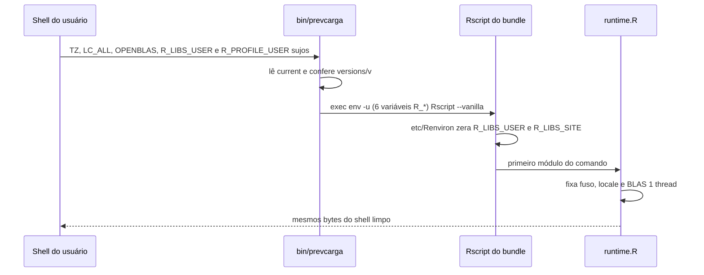

<span className="pc-overline">Execução · 3.2</span>

<p className="pc-lead">O prevcarga é distribuído como um bundle fechado por plataforma, com o R 4.5.3 e todos os pacotes R dentro. O instalador (<code>install.sh</code> no Linux, <code>install.ps1</code> no Windows) roda sem administrador, confere o sha256 antes de extrair, valida cada arquivo do bundle antes de ativar e troca de versão por um ponteiro de uma linha, <code>current</code>. Ficam retidas duas versões, a atual e a anterior, o que permite um rollback. O diretório de estado nunca é tocado por upgrade, rollback ou desinstalação; só <code>--purge</code> o remove.</p>

## Bundle zero-dep por plataforma

Cada release tem um bundle por plataforma. O host não precisa de R instalado: o R que roda é o do bundle.

| Plataforma | Arquivo | Runtime dentro do bundle | Raiz padrão `<R>` |
|---|---|---|---|
| Linux x86_64 | `prevcarga-<v>-linux-x86_64.tar.zst` | `runtime/bin/Rscript` (wrapper relocável) | `~/.local/share/prevcarga` |
| Windows 64-bit | `prevcarga-<v>-windows-x86_64.zip` | `runtime\R\bin\Rscript.exe` | `%LOCALAPPDATA%\prevcarga` |

Além de `runtime/`, `code/` e `RUNTIME.json`, o bundle Linux traz `syslib/`, as bibliotecas de sistema de que o R depende, menos o núcleo da glibc. Por isso o host precisa de glibc 2.35 ou mais nova. O bundle Windows não tem `syslib`.

Os dois bundles isolam a library: o `etc/Renviron` do R empacotado fixa `R_LIBS_USER=` e `R_LIBS_SITE=` vazios, e o `.libPaths()` fica só com a library do bundle. O `RUNTIME.json` lista o sha256 de todo arquivo do bundle (`files[]`); o instalador o usa para validar a cópia extraída.

A raiz padrão só existe quando `--root` (ou `-Root`) não é passado. No Linux, o `$HOME` só é lido para os defaults (a raiz e o perfil `~/.profile`) e para a recusa do `--purge`; nenhuma variável de ambiente configura o instalador. No Windows, ele vem de `[Environment]::GetFolderPath('LocalApplicationData')`; o `install.ps1` não lê `$env:`. A raiz não pode ser `/` nem a raiz de um disco (`install.usage`, exit 8).

Sem `--bundle`, o instalador baixa o bundle e o `SHA256SUMS` das GitHub Releases de `https://github.com/onsbr/prevcarga`, o `--release-base` padrão. Cada versão é a release de tag `v<v>`, e os arquivos saem de `<release-base>/releases/download/v<v>/`. Com `--version latest` (ou sem `--version`), ele lê antes a versão no `latest.txt` da release mais recente, em `<release-base>/releases/latest/download/latest.txt`, uma linha.

O layout é escolhido pela própria base:

| `--release-base` | Versão mais recente | Bundle e `SHA256SUMS` |
|---|---|---|
| `https://github.com/<org>/<repo>` (o padrão) | `<base>/releases/latest/download/latest.txt` | `<base>/releases/download/v<v>/` |
| qualquer outra (um espelho ou repositório próprio) | `<base>/releases/latest.txt` | `<base>/releases/<v>/` |

O `install.sh` e o `install.ps1` também estão anexados a cada release, para baixar o instalador do mesmo lugar. Os artefatos oficiais e as entregas não vêm daqui: o `prevcarga-sync` continua lendo o repositório online. Ver [Distribuição: bundle, instaladores e repositório online](/arquitetura/distribuicao).

## Preflight e pré-requisitos

Antes de baixar ou extrair qualquer coisa, o instalador confere a plataforma. Uma falha sai como `install.preflight_failed` (classe `bundle`, exit 6), com a lista do que faltou em `details`.

| Item | Linux (`install.sh`) | Windows (`install.ps1`) |
|---|---|---|
| Arquitetura | `uname -m` igual a `x86_64` | SO de 64 bits |
| Biblioteca C | glibc 2.35 ou mais nova (`getconf GNU_LIBC_VERSION`); musl é recusada | não se aplica |
| Ferramentas | `zstd`, `tar`, `sha256sum` e `awk` no `PATH` | PowerShell 5.1 ou mais novo |
| Cliente HTTPS | `curl` ou `wget`, só quando não há `--bundle` | não é checado; o download usa `Invoke-WebRequest` com TLS 1.2 |
| Espaço livre | não é checado | 2 GiB (2.147.483.648 bytes) no volume de `-Root`; caminho UNC não é checado |

`--skip-platform-check` (ou `-SkipPlatformCheck`) transforma a falha em aviso, `preflight ignorado`, e a instalação continua. No modo `--format json` o aviso vai para a lista `warnings` do JSON de saída (dentro de `result` no `install.sh`, no nível de cima no `install.ps1`).

## Linux: install.sh

O `install.sh` é POSIX sh e só recebe argumentos; nenhuma variável de ambiente configura o instalador.

| Flag | Efeito |
|---|---|
| `--version <v>` ou `latest` | Versão a instalar. Sem a flag, vale `latest`. Com `--bundle`, a versão sai do nome do arquivo se a flag faltar. |
| `--release-base <url>` | Base do download. Exclusiva com `--bundle`. Pelo `curl`, só HTTPS. |
| `--bundle <arq>` | Instala de um arquivo local, sem rede. |
| `--sha256 <h>` | sha256 esperado do `--bundle`. Sem ele, o instalador procura um `SHA256SUMS` ao lado do arquivo. Só vale com `--bundle`. |
| `--root <dir>` | Raiz `<R>` da instalação. |
| `--data <dir>` | Grava `data_dir` no `config.yaml` da instalação. |
| `--state <dir>` | Grava `state_dir` (default `<R>/state`). Recusado se estiver dentro de `<R>/versions`. |
| `--skip-platform-check` | Preflight vira aviso. |
| `--add-to-path` | Acrescenta `<R>/bin` ao `PATH` num bloco marcado do perfil. |
| `--profile <arq>` | Perfil usado por `--add-to-path` e pelo uninstall (default `~/.profile`). |
| `--format text` ou `json` | Saída em texto ou um único JSON em stdout. |
| `--rollback` | Volta para a versão anterior. |
| `--uninstall --yes [--purge]` | Remove a instalação; `--purge` remove também o estado. |
| `-h`, `--help` | Imprime o uso e sai com 0. |

As flags de valor aceitam `--flag valor` e `--flag=valor`. Combinações inválidas saem como `install.usage` (exit 8): `--rollback` com `--uninstall`, `--purge` ou `--yes` sem `--uninstall`, `--sha256` sem `--bundle`, `--bundle` com `--release-base`, valor vazio ou ausente.

<Terminal title="prevcarga — bash" lines={[
  {type:'dim',text:'# das GitHub Releases, a versão mais recente'},
  {type:'cmd',text:'sh install.sh --version latest'},
  {type:'dim',text:'# de um arquivo local, com o hash informado'},
  {type:'cmd',text:'sh install.sh --bundle prevcarga-<v>-linux-x86_64.tar.zst --sha256 <hash>'},
  {type:'dim',text:'# com dados e estado fora da raiz, e PATH no ~/.profile'},
  {type:'cmd',text:'sh install.sh --version latest --data /srv/deck --state /srv/prevcarga-state --add-to-path'}
]} />

Em texto, o sucesso imprime uma linha em stdout, `prevcarga: instalado <v> em <R> (bin: <R>/bin/prevcarga)`. Avisos saem em stderr com o prefixo `prevcarga: aviso:`.

### A ordem garantida

A instalação segue uma ordem fixa. Até a conferência do sha256, a raiz `<R>` fica byte a byte igual; até a validação do `RUNTIME.json`, o ponteiro `current` não muda.

1. Argumentos e `--state`. Argumento desconhecido sai como `install.usage`; `--state` dentro de `<R>/versions` sai como `install.state_inside_versions`. Ambos exit 8, antes de qualquer escrita.
2. Preflight da plataforma (exit 6, ou aviso com `--skip-platform-check`).
3. Aquisição num `mktemp -d` fora de `<R>`: download do bundle e do `SHA256SUMS`, ou o `--bundle` local. Falha de download sai como `install.download_failed` (exit 10); um `--bundle` inexistente sai como `install.usage` (exit 8).
4. Conferência do sha256 antes de extrair. Sem hash, `install.sha_missing`; hash diferente, `install.sha_mismatch`. Ambos exit 9.
5. Extração em `<R>/versions/.stage-<v>/`. Um `trap` apaga o stage e o diretório temporário em qualquer saída.
6. Validação de todo `files[]` do `RUNTIME.json` com o Rscript do próprio stage (`prevcarga_runtime_validate(strict = TRUE)`). Bundle incompleto ou divergente sai como `install.manifest_invalid` (exit 6), com `current` intacto.
7. Rename do stage para `versions/<v>/` e cópia para `<R>/bin/` do lançador `prevcarga`, do `prevcarga-sync` e do `error-catalog.tsv` gerado. Se nem o bundle nem a pasta do `install.sh` trazem o `prevcarga-sync`, sai um aviso e a instalação segue.
8. Troca atômica de `current` e gravação de `previous`.
9. Retenção N=2: as outras versões de `versions/` são apagadas.
10. `config.yaml` da instalação, criação do diretório de estado e, com `--add-to-path`, o bloco no perfil.
11. `<R>/bin/prevcarga doctor --format json`, devolvido em `result.doctor` no modo JSON. Se o doctor não devolve JSON, o campo fica `null` e a instalação termina com 0.

<Figura id="FIG-E02" titulo="Ordem e invariantes do instalador" natureza="Fluxo" fontes={['install/install.sh', 'docs/estado/install.md']} adrs={['ADR-0038', 'ADR-0040']}>



</Figura>

:::note Validação do stage
A linha que valida o stage chama o Rscript do bundle com `env -u R_HOME` e `--vanilla`. Ela não limpa as outras variáveis `R_LIBS*` que o lançador limpa; a limpeza completa é do lançador instalado (ver os lançadores herméticos, abaixo).
:::

## Windows: install.ps1

O `install.ps1` espelha o `install.sh`: mesmo layout, mesma ordem, mesmos `error.id` e mesmos códigos de saída. Roda em Windows PowerShell 5.1 e em pwsh 7, sem administrador.

<Terminal title="prevcarga — PowerShell" lines={[
  {type:'cmd',text:'powershell -NoProfile -ExecutionPolicy Bypass -File install.ps1 -Version latest'},
  {type:'cmd',text:'powershell -NoProfile -ExecutionPolicy Bypass -File install.ps1 -Bundle prevcarga-<v>-windows-x86_64.zip -Sha256 <hash>'}
]} />

Os parâmetros são `-Version`, `-ReleaseBase`, `-Bundle`, `-Sha256`, `-Root`, `-Data`, `-State`, `-SkipPlatformCheck`, `-Format`, `-Rollback`, `-Uninstall`, `-Yes`, `-Purge` e `-Help`. A grafia do Linux (`--bundle`, `--sha256`, `--root`, `--release-base`, `--skip-platform-check`...) também é aceita: o script a captura em `ValueFromRemainingArguments` e trata ali argumento desconhecido e valor ausente como `install.usage` (exit 8). Um `-Format` fora de `text` e `json` sai igual. Não há `--add-to-path` nem `--profile`: no Windows o `PATH` é sempre ajustado.

| Aspecto | Como o `install.ps1` faz |
|---|---|
| Download | `Invoke-WebRequest -UseBasicParsing`, com TLS 1.2 forçado |
| Hash | `Get-FileHash -Algorithm SHA256`, comparado em minúsculas, antes do `Expand-Archive` |
| Extração | O zip tem a pasta `prevcarga/` no topo; o stage `versions\.stage-<v>` é extraído e o diretório único é movido para `versions\<v>` |
| Validação | `Rscript.exe --vanilla -e` com `prevcarga_runtime_validate(strict = TRUE)`; o código R só usa aspas simples, porque o PS 5.1 estraga aspas duplas em argumentos nativos |
| Troca de ponteiro | Arquivo temporário no mesmo diretório e `[IO.File]::Replace`, ou `[IO.File]::Move` quando o destino não existe; nunca symlink nem junction. Vale para `current`, `previous` e `config.yaml` |
| PATH | Só em `HKCU\Environment\Path`, nunca em HKLM. O valor é lido sem expandir (`DoNotExpandEnvironmentNames`) e regravado como `REG_EXPAND_SZ`. `<R>\bin` entra uma vez (comparação sem caixa e sem a barra final) |
| Aviso à sessão | `WM_SETTINGCHANGE` por `SendMessageTimeout`; uma falha aqui vira o aviso `path_notify_failed` |
| Saída | Bytes ASCII escritos direto no stream, independentes da code page; no JSON, tudo fora de 32 a 126 vira `\uXXXX` |

No modo JSON, o sucesso do `install.ps1` acrescenta `install_root`, `retained` (as versões mantidas) e `path_updated` ao `result`.

<Pendente titulo="Pendente · instalador Windows em validação">O instalador Windows ainda está em validação: o <code>install.ps1</code>, o lançador <code>prevcarga.cmd</code> e o bundle Windows ainda não foram executados num host Windows. O comportamento descrito nesta seção (registro do <code>PATH</code> em HKCU, extração do zip, caminhos longos sob <code>%LOCALAPPDATA%</code> e o <code>doctor</code> no Windows) é o previsto, ainda não confirmado na prática.</Pendente>

## O que aparece na tela

Num terminal, os dois instaladores mostram o banner do PrevCarga com a versão que está sendo instalada, uma linha com o que vai acontecer e seis etapas numeradas: `prevcarga: [1/6]` a `[6/6]`. As etapas são origem do bundle, sha256, extração, validação dos arquivos, ativação e `doctor`, e as mais demoradas vêm com uma linha de explicação. No Windows a extração tem barra de progresso: são milhares de arquivos pequenos, e o antivírus examina cada um. A validação confere o sha256 de cada arquivo do bundle e pode levar alguns minutos. Depois da linha `prevcarga: instalado ...` vêm os próximos passos: abrir um terminal novo para o `PATH` valer, rodar `prevcarga doctor` e apontar o deck, se o `data_dir` ainda não estiver configurado.

Tudo isso sai em stderr, e só quando o stderr é um terminal e o formato é texto. Com `--format json`, ou com a saída redirecionada para um arquivo ou outro programa, o instalador continua imprimindo só a linha final ou o JSON único.

## Layout da raiz e troca de versão

O instalador grava esta árvore em `<R>`. No Windows os separadores são `\` e o lançador é `bin\prevcarga.cmd`.

```text title="Layout da raiz R depois de duas instalações"
<R>/
  current            # 1 linha: a versão ativa (ex.: 0.12.0)
  previous           # 1 linha: a versão que estava em current antes da última instalação
  config.yaml        # config da instalação (schema v1): data_dir, state_dir, format, color
  bin/
    prevcarga        # lançador fino (Windows: prevcarga.cmd)
    prevcarga-sync   # utilitário de leitura do repositório online (Windows: .ps1 e .cmd)
    error-catalog.tsv  # catálogo de erros gerado, lido pelos utilitários
  versions/
    <v>/             # imutável: runtime/, syslib/ (só Linux), code/, RUNTIME.json
    <v-anterior>/    # retida para o rollback
  state/             # default de state_dir; nunca tocado por upgrade, rollback ou uninstall
```

O ponteiro `current` é um arquivo de uma linha trocado por arquivo temporário e `mv -f` (ou `[IO.File]::Replace`), nunca um symlink. O lançador lê essa linha a cada comando, então a troca de versão é só a troca do ponteiro.

A retenção é N=2: depois de uma instalação ficam a versão nova (`current`) e a que estava ativa antes (`previous`). Qualquer outra pasta de `versions/` é apagada. Reinstalar a mesma versão troca o diretório dela (via `versions/.old-<v>`) e preserva o `previous` que já existia.

O `config.yaml` da instalação é reescrito a cada instalação. Num upgrade, as chaves existentes são preservadas; só `data_dir` e `state_dir` são regravadas, com o valor da flag quando ela é passada e com o valor anterior quando não é. Ver [Configuração](/execucao/configuracao).

<Figura id="FIG-E03" titulo="Troca de versão: install, upgrade e rollback" natureza="Estrutura" fontes={['install/install.sh', 'docs/estado/install.md']} adrs={['ADR-0038']}>



</Figura>

O diretório de estado não aparece no diagrama porque nenhuma dessas transições o altera.

## Rollback, upgrade e desinstalação

### Upgrade

Upgrade é uma instalação nova na mesma raiz: `sh install.sh --version <v>` ou `--version latest`. A versão ativa vira `previous` e a nova vira `current`. O estado e as chaves do `config.yaml` continuam.

### Rollback

`install.sh --rollback` (ou `install.ps1 -Rollback`) aponta `current` para a versão de `previous` e apaga `previous`. O rollback vale um nível só. Ele é recusado com `install.no_previous_version` (exit 8), com `current` intacto, quando:

- não existe `previous`;
- `previous` é igual a `current`;
- a pasta de `previous` não existe em `versions/`.

Depois de um rollback, um segundo cai na recusa. Para chegar a outra versão, instale-a de novo com `--version`.

### Desinstalação

`install.sh --uninstall --yes` (ou `install.ps1 -Uninstall -Yes`) remove `versions/`, `bin/`, `current`, `previous` e `config.yaml`. Sem `--yes`, sai `install.usage` (exit 8). Também remove a integração com o `PATH`: no Linux, o bloco `# >>> prevcarga >>>` do perfil; no Windows, a entrada `<R>\bin` de `HKCU\Environment\Path`. Se a raiz ficou vazia, ela é apagada. Se a raiz não existe, o comando termina com 0 e informa que não havia nada a remover.

O diretório de estado é preservado. Com `--purge` (ou `-Purge`), ele também é removido. O alvo é o `--state` passado, ou o `state_dir` do `config.yaml`, ou `<R>/state`. O purge recusa, com `install.usage` (exit 8), um estado vazio, a raiz do sistema (`/` no Linux, a raiz do disco no Windows) e a pasta do usuário (`$HOME` ou `UserProfile`).

:::warning
`--purge` apaga o diretório de estado inteiro: entregas (`forecasts/`), artefatos treinados (`artifacts/`), `cache/` e `backtest/`. Não há rollback depois dele.
:::

<Terminal title="prevcarga — bash" lines={[
  {type:'cmd',text:'sh install.sh --rollback'},
  {type:'cmd',text:'sh install.sh --uninstall --yes'},
  {type:'cmd',text:'sh install.sh --uninstall --yes --purge'}
]} />

## Os lançadores herméticos

O comando `prevcarga` que o operador chama é um lançador fino em `<R>/bin`. Ele não define variável de ambiente; só descarta as herdadas que poriam uma library de fora no `.libPaths()` do R do bundle. Fuso, locale e threads do BLAS são fixados dentro do processo por `runtime.R`, que sobrescreve o shell. Ver [Runtime: determinismo fixado no processo](/arquitetura/runtime).

| Passo | Linux (`bin/prevcarga`, sh) | Windows (`bin\prevcarga.cmd`) |
|---|---|---|
| Achar `<R>` | `readlink -f "$0"`, pasta acima de `bin/` | `%~dp0..` |
| Ler a versão | 1ª linha de `current` | `for /f "usebackq delims="` sobre `current` |
| Conferir o runtime | `versions/<v>/runtime/bin/Rscript` executável | `versions\<v>\runtime\R\bin\Rscript.exe` existe |
| Limpar o ambiente | `exec env -u` de `R_HOME`, `R_LIBS`, `R_LIBS_USER`, `R_LIBS_SITE`, `R_PROFILE_USER`, `R_ENVIRON_USER` | `setlocal` e `set "X="` para as mesmas seis, só neste processo |
| Executar | `Rscript --vanilla versions/<v>/code/scripts/prevcarga "$@"` | `Rscript.exe --vanilla ...\code\scripts\prevcarga %*`, e `& exit /b` propaga o código do R |

O `--vanilla` ignora os arquivos de perfil e de Renviron do usuário, mas não as variáveis herdadas. Por isso o lançador remove as seis. Sem `current`, ou com uma versão que não existe em disco, o lançador sai com `prevcarga: erro [bundle] (exit 6)` em stderr, em ASCII. O `prevcarga.cmd` não usa blocos entre parênteses, porque um caminho como `Program Files (x86)` quebraria o parser do `cmd` dentro deles.

<Figura id="FIG-E04" titulo="Lançador hermético contra shell sujo" natureza="Fluxo" fontes={['install/prevcarga', 'docs/estado/install.md', 'docs/estado/m8-bundle.md']} adrs={['ADR-0038']}>



</Figura>

Na prática, o shell do operador não altera o resultado: com `TZ`, `LC_ALL`, threads do BLAS, `~/.Rprofile` e `R_LIBS*` definidos, os comandos `describe`, `validate-deck`, `--version` e `forecast --origin O` produzem a mesma saída, o mesmo código de saída e os mesmos arquivos de deck e de estado de um shell limpo. Só mudam o `run_id` do envelope JSON e, no forecast, os carimbos de relógio `gerado_em` e `generated_at`.

## Códigos de saída do instalador

O instalador segue o contrato de erros do produto (ADR-0040). Os ids moram em `scripts/lib/errors/install.tsv`. O `install.sh` e o `install.ps1` leem o catálogo gerado (`error-catalog.tsv`, colunas pelo nome do cabeçalho) e têm um fallback embutido com o mesmo texto (no `install.ps1`, alguns hints e a mensagem de `install.state_inside_versions` usam a grafia `-Flag`), usado quando o catálogo ainda não está disponível, como antes da extração.

| Exit | Classe | `error.id` | Quando |
|---|---|---|---|
| 0 | — | — | Instalação, rollback ou desinstalação concluídos; também `--help` |
| 6 | `bundle` | `install.preflight_failed` | Plataforma fora do suportado (ver o preflight) |
| 6 | `bundle` | `install.manifest_invalid` | Extração falhou, bundle incompleto, `RUNTIME.json` divergente ou lançador ausente |
| 6 | `bundle` | `install.io_failed` | Falha de escrita na raiz, no perfil ou no registro |
| 8 | `config` | `install.usage` | Argumento inválido, ausente ou combinação proibida; `--uninstall` sem `--yes`; purge recusado |
| 8 | `config` | `install.state_inside_versions` | `--state` dentro de `<R>/versions` |
| 8 | `config` | `install.no_previous_version` | `--rollback` sem versão anterior retida |
| 9 | `integrity` | `install.sha_missing` | Sem `--sha256` e sem linha no `SHA256SUMS` |
| 9 | `integrity` | `install.sha_mismatch` | sha256 do bundle diferente do esperado |
| 10 | `network` | `install.download_failed` | Falha ao baixar `latest.txt`, o bundle ou o `SHA256SUMS` |
| 130 | — | — | `install.sh` interrompido (INT, TERM ou HUP) |

No `install.ps1`, uma exceção que não passou pelo contrato também sai como `install.io_failed` (exit 6). Os lançadores `prevcarga` e `prevcarga.cmd` usam o exit 6 (`bundle`) para ponteiro `current` ausente ou versão inexistente.

Em texto, o erro vai para stderr em ASCII, com a primeira linha `prevcarga: erro [<classe>] (exit <n>)`, seguida de `o que:`, `onde:` e `como corrigir:`. Com `--format json`, sai um único JSON em stdout, com stderr vazio, no formato `{"ok":false,"exit_code":n,"error":{...}}`, em que `error` traz `id`, `class`, `message`, `hint`, `where` e `details`.

<Terminal title="prevcarga — bash" lines={[
  {type:'cmd',text:'sh install.sh --bundle prevcarga-<v>-linux-x86_64.tar.zst --sha256 <hash-errado>'},
  {type:'err',text:'prevcarga: erro [integrity] (exit 9)'},
  {type:'err',text:'o que: sha256 do bundle nao confere'},
  {type:'err',text:'onde: <caminho do bundle>'},
  {type:'err',text:'como corrigir: baixe o bundle novamente e confira o SHA256SUMS'}
]} />

Ver [Contrato de erros e códigos de saída](/arquitetura/erros-exit) e [Erros e solução de problemas](/execucao/erros-troubleshooting). Depois de instalar, `prevcarga doctor` confere o bundle, a plataforma e a integridade do `RUNTIME.json`; ver [Diagnóstico e introspecção](/execucao/diagnostico).
