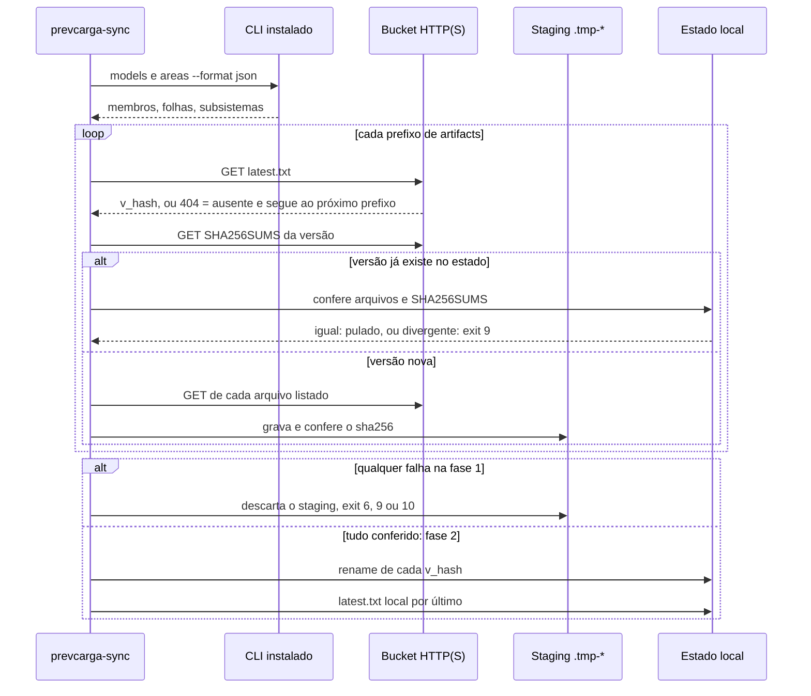

<span className="pc-overline">Execução · 3.5</span>

<p className="pc-lead">O <code>prevcarga-sync</code> copia do repositório online para o estado local os artefatos oficiais (modelos, pesos da combina e perfis k-hat) ou as inferências oficiais de uma origem. Ele roda fora do pacote R, só lê por HTTP(S), não usa credencial nem variável de ambiente e nunca lista o repositório online: o conjunto oficial de artefatos vem do próprio CLI instalado, e as chaves de forecasts vêm do ponteiro publicado da origem. Tudo é baixado e conferido por sha256 num staging antes de qualquer arquivo virar público. Se algo falha antes da promoção, o estado local fica byte a byte como estava.</p>

<Pendente titulo="Em breve">
O repositório online de artefatos ainda não está no ar. Até lá, os modelos, os pesos da combina e os perfis k-hat são produzidos na própria máquina, como descrito em [Ciclo de vida dos artefatos](/execucao/artefatos).
</Pendente>

O pacote R nunca fala com a rede. Do lado de quem executa, os únicos utilitários que fazem isso são o `prevcarga-sync` e os instaladores (`install.sh` e `install.ps1`). O layout do estado que o sync preenche está em [Ciclo de vida dos artefatos](/execucao/artefatos).

## Uso e parâmetros

O utilitário tem duas implementações com a mesma gramática, a mesma semântica, os mesmos ids de erro e os mesmos códigos de saída:

| Plataforma | Arquivo instalado | Origem no repositório | Observação |
|---|---|---|---|
| Linux | `<R>/bin/prevcarga-sync` | `install/prevcarga-sync.sh` | POSIX sh; transporte por `curl`, com `wget` como reserva |
| Windows | `<R>\bin\prevcarga-sync.cmd` e `prevcarga-sync.ps1` | `install/prevcarga-sync.cmd` e `install/prevcarga-sync.ps1` | o `.cmd` é um shim que chama o `.ps1` com `powershell -NoProfile -ExecutionPolicy Bypass` e devolve o exit dele; Windows PowerShell 5.1 e pwsh 7; não precisa de administrador; transporte por `Invoke-WebRequest` |

O `install.sh` copia o utilitário e o catálogo de erros gerado (`<R>/bin/error-catalog.tsv`) para `<R>/bin/`; o `install.ps1` faz o mesmo para `<R>\bin\`. A remoção apaga `bin/` inteiro, e o sync vai junto. Detalhes em [Instalação, atualização e remoção](/execucao/instalacao).

```text title="Gramática (Linux)"
prevcarga-sync --what artifacts|forecasts [--release-base <url>] [--state <dir>]
               [--model <m>]... [--area <a>]... [--origin <AAAA-MM-DD>] [--format text|json]
```

No PowerShell os parâmetros são `-What`, `-ReleaseBase`, `-State`, `-Model`, `-Area`, `-Origin`, `-Format` e `-Help`. A grafia do sh (`--what`, `--release-base` etc.) também é aceita, e as duas aceitam `--nome=valor`.

| Parâmetro | Obrigatório | Valores | Comportamento |
|---|---|---|---|
| `--what` | sim | `artifacts` ou `forecasts` | escolhe o que sincronizar |
| `--release-base` | não | URL `http://` ou `https://` | raiz do repositório online; a barra final é removida; outro esquema é erro de uso |
| `--state` | não | diretório | estado local; sem a flag vale `state_dir` do `<R>/config.yaml`; com o `config.yaml` presente e sem `state_dir`, vale `<R>/state`; sem `config.yaml`, é erro de uso; a raiz (`/` ou `C:`) é recusada |
| `--model` | não | `mdir` de um modelo; repetível ou separado por vírgula | só com `artifacts`; filtra os modelos; a combina e a reconciliação sempre entram |
| `--area` | não | folha ou subsistema; repetível ou separado por vírgula | só com `artifacts`; filtra pelo último segmento do prefixo |
| `--origin` | com `forecasts` | `AAAA-MM-DD` válida | só com `forecasts`; origem O cujas inferências oficiais serão copiadas |
| `--format` | não | `text` (default) ou `json` | também vale para os erros de argumento |
| `-h`, `--help` | não | — | imprime a gramática e sai com 0 |

A ordem de precedência do estado é a mesma do resto do sistema: flag, depois `config.yaml`, depois o default. O utilitário não lê nenhuma variável de ambiente.

<Terminal title="prevcarga-sync — bash" lines={[
  {type:'dim', text:'# artefatos oficiais de todos os modelos, combina e reconciliação'},
  {type:'cmd', text:'prevcarga-sync --what artifacts --release-base https://<repositório online>'},
  {type:'dim', text:'# só um modelo e uma área, com envelope JSON'},
  {type:'cmd', text:'prevcarga-sync --what artifacts --model lgbm --area RJ --format json'},
  {type:'dim', text:'# inferências oficiais de uma origem'},
  {type:'cmd', text:'prevcarga-sync --what forecasts --origin 2026-10-30'}
]} />

No Windows, o equivalente é `prevcarga-sync -What artifacts -ReleaseBase https://<repositório online>`.

### Saída

Em texto, o sucesso é uma linha ASCII no stdout com o número de chaves baixadas e o número de chaves já presentes:

```text
prevcarga-sync: <what>: <n> baixados, <m> ja presentes (estado <dir>)
```

Com `--format json`, a saída é um único documento no stdout e o stderr fica vazio. O envelope segue o contrato do ADR-0040, com `verb` igual a `prevcarga-sync` e `run_id` nulo:

| Campo de `result` | Conteúdo |
|---|---|
| `what` | `artifacts` ou `forecasts` |
| `prefixos` | prefixos considerados nesta execução |
| `baixados` | chaves `.../v_<hash>` (ou `.../<versao>` em forecasts) promovidas nesta execução |
| `pulados` | chaves que já existiam no estado e conferiram com o publicado |
| `latest_trocados` | `latest.txt` locais regravados (só em artifacts) |
| `ausentes` | prefixos sem `latest.txt` publicado (HTTP 404) |

## O que é sincronizado

O sync nunca lista o repositório online. Ele monta a lista de chaves a partir de fontes que já conhece.

### Artefatos (`--what artifacts`)

O conjunto oficial vem do CLI instalado ao lado do utilitário: `prevcarga models --format json` dá os membros (`mdir` e `exogena`) e `prevcarga areas --format json` dá as folhas e a ordem dos subsistemas. Com isso o sync monta os prefixos, no mesmo layout do repositório online e do registry local:

| Grupo | Prefixo | Filtro |
|---|---|---|
| Modelos das duas classes de split | `artifacts/<mdir>/[<exogena>/]<folha>/` | `--model` e `--area` |
| Pesos da combina | `artifacts/combina/<folha>/` | só `--area` |
| Perfis k-hat da reconciliação | `artifacts/reconcile/<subsistema>/` | só `--area` |

A lista é ordenada e sem repetição. Para cada prefixo, o sync lê o `latest.txt` publicado, que aponta uma versão `v_<hash>`, e traz essa versão com o seu `SHA256SUMS`. No fim, o estado tem `<state>/artifacts/...` com a mesma árvore do repositório online e o `latest.txt` local apontando a versão oficial.

Regras dos filtros e dos prefixos:

- Um `--model` ou `--area` que não existe no conjunto oficial é erro de uso (`sync.usage`, exit 8).
- Filtros que, combinados, não selecionam nenhum prefixo também são erro de uso.
- Um prefixo sem `latest.txt` publicado (HTTP 404) não é erro: entra em `result.ausentes`.
- Se nenhum dos prefixos selecionados estiver publicado, o sync sai com `sync.network` (exit 10).
- Se o CLI ao lado não existir ou não devolver o JSON esperado, o sync sai com `sync.io_failed` (exit 6).

### Inferências oficiais (`--what forecasts`)

As chaves vêm do ponteiro `forecasts/<O>/latest.txt` do repositório online, publicado junto com as inferências oficiais da origem. Cada linha é uma chave `<AAAAMMDDTHHMM>/<versao>`, em que a primeira parte é o `available_until` da rodada. O sync copia cada `forecasts/<O>/<AAAAMMDDTHHMM>/<versao>/` para `<state>/forecasts/`, conferida pelo `SHA256SUMS` da chave. Uma linha fora desse formato é recusada como `sync.sha_mismatch`.

Diferente dos artefatos, aqui o ponteiro da origem é obrigatório: sem `forecasts/<O>/latest.txt`, ou com ele vazio, o sync sai com `sync.network`. Nenhum `latest.txt` local é escrito para forecasts. É dessa cópia que o `prevcarga verificar --oficial` tira a referência da mesma chave (origem, `available_until`, versão); ver [Verificar uma entrega](/execucao/verificar).

## Protocolo em duas fases

O sync segue o mesmo protocolo no sh e no ps1. A regra é simples: nada fica visível no estado enquanto houver um objeto não conferido.

<Figura id="FIG-E05" titulo="prevcarga-sync em duas fases" natureza="Fluxo" fontes={['install/prevcarga-sync.sh', 'install/prevcarga-sync.ps1', 'docs/estado/sync.md']} adrs={['ADR-0039', 'ADR-0030']}>



</Figura>

### Fase 1: baixar e conferir

1. Para cada prefixo, o sync baixa o `latest.txt` e lê a primeira linha. Ela tem de ser `v_` seguido de hexadecimal; o contrário é `sync.sha_mismatch`.
2. Baixa o `SHA256SUMS` da versão apontada.
3. Se `<state>/<chave>/` já existe, confere cada arquivo local e o `SHA256SUMS` local contra o remoto. Igual, a chave entra em `pulados`. Diferente, o sync sai com `sync.sha_mismatch` (exit 9) e não sobrescreve nada: uma versão `v_<hash>` local nunca é trocada.
4. Se a chave é nova, cada arquivo listado no `SHA256SUMS` é baixado para um staging único `.tmp-<rand>` dentro de `<state>/artifacts/` ou `<state>/forecasts/`, no mesmo volume do destino. O sha256 de cada arquivo é conferido antes do próximo download.
5. Um caminho absoluto, vazio ou com `..` dentro de um `SHA256SUMS` publicado é recusado como `sync.sha_mismatch`.

### Fase 2: promover

Só com todas as chaves conferidas, cada `v_<hash>` (ou `<versao>`, em forecasts) do staging é renomeado para o destino. Por último, nos artefatos, o `latest.txt` local de cada prefixo é regravado, por arquivo temporário `.tmp-latest-*` e troca atômica, e só se mudou.

O commit em duas fases garante que o estado fica idêntico ao anterior mesmo quando o terceiro prefixo falha depois de dois já baixados. O staging vive no estado, e não em `/tmp`, para que o rename aconteça no mesmo volume.

### Garantias

- Qualquer falha da fase 1 (hash, rede, argumento) deixa `<state>` byte a byte como estava: sem `.tmp-*` e sem `latest.txt` novo.
- Ao sair, por sucesso, erro ou interrupção, o `trap` (sh) ou o `finally` (ps1) remove o staging e os diretórios que a própria execução criou e que ficaram vazios. Um `.tmp-*` que sobre de uma interrupção abrupta sob `<state>/artifacts` é removido pelo `prevcarga registry gc`, que não percorre `<state>/forecasts`.
- A segunda execução com o mesmo repositório online não escreve nada: todas as chaves vão para `pulados` e nenhum `latest.txt` muda.

### Transporte

No Linux, cada objeto é pedido com `curl -s --proto =https,http` e o código HTTP é lido da resposta; sem `curl`, vale o `wget`; sem nenhum dos dois, o sync trata como falha de rede. No Windows, o pedido é por `Invoke-WebRequest`. Com `curl` ou `Invoke-WebRequest`:

| Resposta | Tratamento |
|---|---|
| 200 | objeto recebido |
| 404 | objeto ausente; só é tolerado no `latest.txt` de um prefixo de artefatos |
| qualquer outra (5xx, conexão cortada, DNS, conexão recusada) | `sync.network`, exit 10 |

O caminho do `wget` não distingue o 404: qualquer falha dele, inclusive um `latest.txt` ausente, sai como `sync.network`.

## Erros

Os erros do sync estão em `scripts/lib/errors/sync.tsv`, que entra no catálogo distribuído pelo barrel por descoberta (ver [Contrato de erros e códigos de saída](/arquitetura/erros-exit)). O código de saída vem da classe, pela tabela de `scripts/lib/errors.R`.

| Id | Classe | Exit | Quando |
|---|---|---|---|
| `sync.usage` | `config` | 8 | argumento ausente, inválido ou desconhecido; `--origin` sem `forecasts` ou ausente com `forecasts`; `--model`/`--area` com `forecasts`; filtro que não casa com nada oficial; `--release-base` sem `http(s)`; estado não resolvido |
| `sync.sha_mismatch` | `integrity` | 9 | sha256 de um arquivo diferente do `SHA256SUMS` publicado; versão local divergente; `latest.txt` que não aponta `v_<hash>`; chave ou caminho inválido no material publicado |
| `sync.network` | `network` | 10 | falha de transporte; nenhum prefixo oficial publicado; ponteiro de forecasts ausente ou vazio |
| `sync.io_failed` | `bundle` | 6 | falha de escrita no estado; CLI instalado ao lado ausente ou com enumeração vazia |

O id é `sync.sha_mismatch`, sem dígito, porque o loader do catálogo recusa dígitos nos ids.

Os utilitários leem o `error-catalog.tsv` gerado que fica ao lado deles, pelo nome das colunas. Se o catálogo não estiver lá, usam um texto embutido idêntico ao do TSV. Uma interrupção por sinal no sh sai com 130.

Em texto, o erro vai para o stderr em ASCII puro, com a primeira linha `prevcarga: erro [<classe>] (exit <n>)`. Por exemplo, um `--what` com valor errado:

<Terminal title="prevcarga-sync — bash" lines={[
  {type:'cmd', text:'prevcarga-sync --what tudo'},
  {type:'err', text:'prevcarga: erro [config] (exit 8)'},
  {type:'out', text:'o que: argumento invalido ou ausente do prevcarga-sync'},
  {type:'out', text:'onde: --what'},
  {type:'out', text:'como corrigir: veja prevcarga-sync --help (-Help no PowerShell)'}
]} />

Com `--format json`, o mesmo erro sai como um único JSON no stdout, com `ok` falso, `exit_code` igual ao código de saída e `error` com `id`, `class`, `message`, `hint`, `where` e `details`. O stderr fica vazio.

:::tip O que fazer
- **8**: corrija a chamada; `prevcarga-sync --help` mostra a gramática.
- **9**: baixe de novo. Se persistir, o objeto publicado está corrompido, ou a versão local foi alterada; nada foi gravado.
- **10**: confira `--release-base` e a conexão e repita; nada foi gravado.
- **6**: confira permissões e espaço do estado e se o `prevcarga` instalado está ao lado do `prevcarga-sync`.
:::

O guia geral de erros está em [Erros e solução de problemas](/execucao/erros-troubleshooting).

<Pendente titulo="Pendente · Windows">
O <code>prevcarga-sync</code> do Windows (<code>.ps1</code> e o atalho <code>.cmd</code>) ainda está em validação. A gramática, os códigos de saída e o protocolo são os mesmos do Linux, mas até a validação terminar trate o resultado no Windows com cautela e, em caso de dúvida, confira a entrega com <code>prevcarga verificar</code>.
</Pendente>
