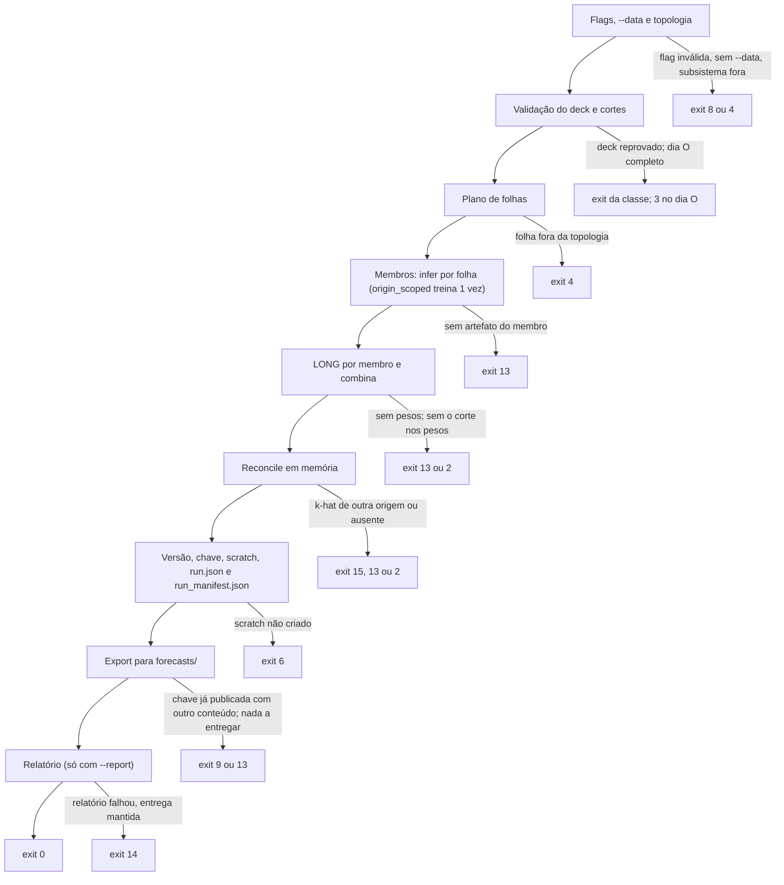

<span className="pc-overline">Execução · 3.8</span>

<p className="pc-lead">A rodada diária é o verbo <code>prevcarga forecast</code>: uma origem O, todos os membros em cada folha, combina com pesos congelados, reconciliação até o SIN e uma entrega imutável em <code>forecasts/</code>. O verbo só compõe módulos e não treina nada que seja <code>origin_agnostic</code>, nem pesos, nem k-hat: esses artefatos têm de existir antes. A ordem dos passos é fixa, e toda falha antes do export encerra a rodada sem deixar entrega parcial.</p>

## Uma origem por rodada

Cada execução de `forecast` atende exatamente uma origem O. Quem itera origens é o [backtest](/execucao/backtest), que reusa o mesmo código.

`--origin` é opcional. A origem é resolvida nesta ordem (`prevcarga_resolve_origin`, em `dates.R`):

1. a flag global `--origin=AAAA-MM-DD`, a única flag de data humana da CLI;
2. sem a flag, o dia, no fuso da carga, do último intervalo de carga presente no deck.

O relógio da máquina nunca entra. Não existe flag de corte no `forecast`: o `available_until` sai do próprio dado de carga, e um `--corte` na linha de comando é recusado pela fachada com `config.usage` (exit 8), porque `--corte` é flag de escopo só do `backtest` e do `plan`.

<Terminal lines={[
  {type: 'cmd', text: 'prevcarga forecast --data=./deck'},
  {type: 'dim', text: '# origem = último dia de carga do deck'},
  {type: 'cmd', text: 'prevcarga forecast --origin=2026-10-01 --data=./deck --report'},
  {type: 'cmd', text: 'prevcarga forecast --origin=2026-10-01 --subsistema=SECO --niveis=tudo --format=json'},
]} />

### Flags do verbo

| Flag | Padrão | Efeito |
|---|---|---|
| `--area=<a>...` | todas as folhas | Restringe às folhas pedidas; folha fora da topologia dá `topology.area_undeclared` (exit 4) |
| `--subsistema=<s>` | — | Expande nas folhas do subsistema pela topologia; `all` = todas as folhas. Exclusiva com `--area` (exit 8) |
| `--niveis=<n>` | `subsistemas` | Teto dos agregados entregues: `sin`, `subsistemas` ou `tudo`. Outro valor dá `config.usage` (exit 8) |
| `--incluir-membros` | desligada | Inclui a previsão de cada membro em cada folha na entrega |
| `--report` | desligada | Gera o relatório diagnóstico depois da entrega |
| `--report-format=<f>` | `html` | `html` ou `pdf`; outro valor dá exit 8 |
| `--skip-validate` | desligada | Pula a validação do deck. Os cortes continuam vindo do leitor |

As flags globais (`--data`, `--state`, `--config`, `--format`, `--weather-cutoff`) valem como em qualquer verbo; ver [Configuração](/execucao/configuracao). Sem `--data` nem `data_dir` no `config.yaml`, o verbo para com `config.data_dir_missing` (exit 8).

## Passos da rodada e onde cada falha encerra

`prevcarga_forecast` (`scripts/lib/forecast.R`) roda os passos sempre na mesma ordem. Cada passo chama a função de outro módulo; nenhum cálculo de corte, peso, k-hat ou hora mora no `forecast.R`.

<Figura id="FIG-E06" titulo="Rodada forecast e onde ela pode falhar" natureza="Fluxo" fontes={['scripts/lib/forecast.R', 'scripts/lib/cli/forecast.R', 'docs/estado/forecast.md', 'docs/estado/m6-forecast.md']} adrs={['ADR-0040']}>



</Figura>

| Passo | O que faz | Falha | Exit |
|---|---|---|---|
| Flags | Valida `--niveis`, `--report-format`, a exclusão `--area`/`--subsistema` e exige o diretório de dados | `config.usage`, `config.data_dir_missing` | 8 |
| Topologia | Expande `--subsistema` em folhas | `topology.area_undeclared` | 4 |
| Validação do deck | `prevcarga_validate_deck` (salvo `--skip-validate`) e `prevcarga_resolve_cuts`. Deck reprovado aborta com o primeiro erro da classe dominante, a mesma regra do [validate-deck](/execucao/validar-deck) | `<classe>.<what>` do achado; `completude.origin_day_gap`; `completude.forecast_origin_day_complete` | o da classe do achado; 3 nos dois de completude |
| Plano | Folhas pedidas e o fechamento por subsistema (`prevcarga_reconcile_plan`): folhas cobertas, folhas soltas, subsistemas fechados e se o SIN fecha | `topology.area_undeclared` | 4 |
| Membros | `prevcarga_infer_cell` por membro e folha; `origin_scoped` sem artefato de O treina antes | `state.artifact_missing` | 13 |
| LONG e combina | `prevcarga_build_long` por membro, alinhamento, painel e `prevcarga_combina_apply` com os pesos congelados | `state.combina_not_trained` (13); `contract.combina_input`, `contract.combina_artifact_mismatch` (2) | 13 ou 2 |
| Reconcile | `prevcarga_reconcile_apply` uma vez, em memória, só nas folhas cobertas | `honesty.khat_after_origin` (15); `state.khat_missing` (13); `contract.*` (2) | 15, 13 ou 2 |
| Chave e scratch | `prevcarga_forecast_versao`, `prevcarga_export_key`, scratch recriado, `run.json` e `run_manifest.json` | `io.out_unwritable` (scratch não criado) | 6 |
| Export | Copia os bytes do scratch para a chave final, por staging e `file.rename` | `export.key_conflict`, `integrity.copy_failed` (9); `state.nothing_to_deliver` (13) | 9 ou 13 |
| Relatório | `prevcarga_report`, fora de `forecasts/` | `partial.report_failed` | 14 |

### O que já está em disco quando a rodada falha

- **Até o reconcile, inclusive**, nada é gravado em `forecasts/` nem em `scratch/`. Um erro do reconcile (15, 13 ou 2) não deixa diretório de entrega.
- A exceção é o registry: um membro `origin_scoped` sem artefato de O treina no passo de membros e grava o artefato antes de qualquer falha posterior. A próxima rodada da mesma origem o reutiliza.
- **No export**, o scratch `<state_dir>/scratch/<run_id>/` já existe. A cópia vai para um staging no mesmo volume e só vira a chave final por `file.rename`; em erro, o staging é removido e nenhuma entrega parcial fica.
- **No relatório**, a entrega já foi publicada e não é desfeita.

Os erros chegam no formato do [contrato de erros](/arquitetura/erros-exit). Exemplo da recusa do dia O completo, impresso em `stderr` no modo texto:

<Terminal lines={[
  {type: 'cmd', text: 'prevcarga forecast --origin=2026-10-01 --data=./deck'},
  {type: 'err', text: 'prevcarga: erro [completude] (exit 3)'},
  {type: 'out', text: 'o que: o dia da origem esta completo no deck (available_until >= O+1 00:00): nao ha corte entregavel da combina'},
  {type: 'out', text: 'onde: 2026-10-01'},
  {type: 'out', text: 'como corrigir: rode com o deck vivo do dia O (ate um corte intradiario ou as 00h) ou trunque o deck em O 00:00 (truncate_at/--corte)'},
]} />

A tabela completa de códigos está em [Erros e solução de problemas](/execucao/erros-troubleshooting).

## Cortes aceitos e a rodada das 00h

O operador não escolhe o corte intradiário. O `available_until` é o fim do último intervalo de carga contíguo do dia O no deck, o mínimo entre as áreas. A regra e a derivação estão em [Os três cortes de data](/metodologia/tres-cortes), com a figura FIG-M05.

Do ponto de vista de quem roda:

| Situação do deck | `available_until` | Resultado |
|---|---|---|
| Nenhuma carga do dia O (rodada das 00h) | O 00:00 | Aceito. Primeira entrega em O 00:30 |
| Carga de O até um horário intradiário | O HH:MM | Aceito. A entrega de `d_plus` = 0 começa no intervalo seguinte |
| Dia O completo, ou `--origin` anterior ao último dia de carga | O+1 00:00 | Recusado na validação do deck, antes de qualquer infer: `completude.forecast_origin_day_complete` (exit 3) |
| Buraco no dia O com carga depois dele | — | Recusado: `completude.origin_day_gap` (exit 3), mesmo com `--skip-validate` |
| Áreas com cortes diferentes | o mínimo | Rodada segue, com o aviso `warning.available_until_spread` |

`--skip-validate` pula só a validação. Os cortes (`available_until`, regra do clima, fuso e `load_label`) vêm sempre do leitor único, por isso um buraco no dia O continua abortando.

O clima previsto segue a regra escolhida por `--weather-cutoff` ou `weather_issue_cutoff` no `config.yaml` (ADR-0024). Na regra padrão, `available_until`, o limite de emissão é o `available_until` menos o atraso de publicação declarado no `manifest.json` do deck (`weather_forecast_publication_lag_hours`). A regra efetiva vai para o `manifest.json` da entrega e entra na `versao`: outra regra gera outra chave, e as duas entregas ficam preservadas.

:::tip Rodada das 00h
Na rodada das 00h o deck termina no intervalo O−1 23:30–24:00, então passe `--origin=O`: sem a flag, a origem resolvida seria O−1, cujo dia está completo, e a rodada seria recusada com exit 3. Os membros DESSEM rodam sem a cabeça de nowcast nesse caso; ver [DESSEM: nowcast e RNG](/metodologia/dessem-nowcast-rng).
:::

## Pré-condições de estado

O `forecast` lê do diretório de estado (`<state_dir>`: `--state`, ou `state_dir` no `config.yaml`, ou `.state` sob a raiz do pacote). Antes de rodar uma origem O, o estado precisa ter:

| Artefato | Quem produz | Onde fica | Sem ele |
|---|---|---|---|
| Artefato de cada membro `origin_agnostic` (RF, LGBM) em cada folha | `prevcarga train-models` ou a sincronização dos artefatos oficiais ([prevcarga-sync](/execucao/sync)) | `<state_dir>/artifacts/<modelo>/<folha>/v_<hash>/` | `state.artifact_missing` (exit 13). O forecast nunca treina esses membros |
| Artefato dos membros `origin_scoped` (HW, RGD_MED, RGD_MAX, LIN_MED, LIN_MAX, LIN_MXMN) | O próprio forecast, se não houver artefato da origem O | `<state_dir>/artifacts/<modelo>/<exogena>/<folha>/v_<hash>/` (sem `<exogena>` no HW) | Treina uma vez por célula, dentro do passo `infer` |
| Pesos da combina de cada folha, com o corte HHMM do `available_until` da rodada | `prevcarga combine --mode=train` | `<state_dir>/artifacts/combina/<folha>/` | `state.combina_not_trained` (exit 13); sem o corte, `contract.combina_input` (exit 2) |
| Perfil k-hat de cada subsistema fechado, ajustado na própria origem O | `prevcarga reconcile --mode=train --origin=O` | `<state_dir>/artifacts/reconcile/<ss>/` | `state.khat_missing` (exit 13) se ausente ou de origem anterior; `honesty.khat_after_origin` (exit 15) se de origem posterior |

A classe de split de cada membro vem do `run.yaml` do modelo (ADR-0023); a lista de membros vem de `config/topology.yaml`. O artefato `origin_scoped` da origem O é achado pelo campo `origin` do `run_manifest.json` de cada versão do registry, do próprio estado ou sincronizado. Um deck novo do mesmo O, com `available_until` maior, reutiliza o mesmo artefato; só o infer muda.

A política do k-hat é `khat_origin == O` sempre (`prevcarga_khat_check_policy`, em `reconcile.R`): o perfil é reajustado a cada origem, sem reuso de perfil de outra origem. Um perfil gravado com outro `load_label` ou outro fuso dá `contract.khat_convention` (exit 2).

A sequência completa, com quem produz cada artefato e as flags de cada verbo, está em [Ciclo de vida dos artefatos](/execucao/artefatos).

## Onde fica a entrega e o que ela contém

A entrega é gravada sob uma chave imutável. A composição da chave e da `versao` está em [Entrega e export imutável](/arquitetura/entrega-export).

```text title="<state_dir>/forecasts/"
forecasts/
  2026-10-01/                  data da origem O
    20261001T0930/             available_until no fuso da carga
      <versao>/                12 hex de prevcarga_forecast_versao
        SIN.parquet            só quando as folhas pedidas fecham o SIN
        subsistemas/<ss>.parquet   com --niveis=subsistemas (padrão) ou tudo
        folhas/<folha>.parquet     folhas soltas sempre; cobertas só com --niveis=tudo
        membros/<sigla>/<folha>.parquet   só com --incluir-membros
        manifest.json          metadados da rodada e arquivos[]
        run_manifest.json      identidade da rodada, lida pelo verificar
```

| Nível de `--niveis` | Entrega |
|---|---|
| `sin` | SIN e folhas soltas |
| `subsistemas` | SIN, subsistemas fechados e folhas soltas |
| `tudo` | Tudo de `subsistemas` mais as folhas cobertas |

Todos os parquets seguem o [schema LONG](/arquitetura/schema-long). O `manifest.json` traz, em ordem fixa, `produto`, `origem`, `available_until`, `available_until_por_area`, `timezone`, `load_label`, `weather_issue_cutoff`, `khat` (`ss`, `versao`, `khat_origin` por subsistema), `versao`, `version`, `runtime_id`, `niveis`, `schema_long`, `gerado_em` e `arquivos` (`path`, `nivel`, `area`, `linhas`, `sha256`). O único campo não determinístico é `gerado_em`, carimbo lido uma vez pela fachada. O `run_manifest.json` fica fora de `arquivos[]` e é o que o [verificar](/execucao/verificar) lê.

Rodar de novo a mesma origem com o mesmo deck dá a mesma chave e os mesmos bytes: o export não faz nada e a saída diz `ja_publicado=sim`. Qualquer diferença nos arquivos entregues sob a mesma chave (outro conjunto de arquivos ou outro sha256) dá `export.key_conflict` (exit 9), e nada é sobrescrito. O `manifest.json` e o `run_manifest.json` ficam fora dessa comparação.

<Pendente titulo="Pendente · chave e --niveis">
`--niveis` e `--incluir-membros` não entram na `versao`. A mesma origem, com o mesmo deck, rodada com outro `--niveis` ou com `--incluir-membros` cai na mesma chave com outro conjunto de arquivos e dá `export.key_conflict` (exit 9). A correção (incluir o conjunto na `versao` ou aceitar superconjunto no export) não foi decidida.
</Pendente>

### A saída do verbo

No modo texto, o verbo imprime linhas ASCII neste formato (`.prevcarga_fc_text`, em `scripts/lib/cli/forecast.R`):

```text title="Formato da saída em texto"
forecast  origem=<O>  available_until=<AAAA-MM-DDTHH:MM>  versao=<versao>
niveis=<n>  folhas=<n cobertas>  isoladas=<n soltas>  ja_publicado=sim|nao
saida: <state_dir>/forecasts/<O>/<AAAAMMDDTHHMM>/<versao>
arquivo <path>  linhas=<n> sha256=<hex>      uma linha por arquivo entregue
relatorio: ok <caminho>                      só com --report
OK
```

Com `--format=json`, o `result` do envelope traz `origem`, `available_until`, `available_until_por_area`, `weather_issue_cutoff`, `versao`, `saida`, `niveis`, `covered`, `stray`, `khat` (com `khat_age_days`), `arquivos`, `cobertura_descartada`, `ja_publicado`, `report` e os campos de tempo descritos abaixo. Os avisos do catálogo (validação do deck, reconcile, export) vão em `warnings` do envelope; no modo texto, saem em `stderr`.

## Relatório

`--report` liga o relatório diagnóstico (`scripts/lib/reporting.R`). Ele roda depois do commit da entrega e nunca a altera.

| Item | Valor |
|---|---|
| Caminho | `<state_dir>/reports/<AAAA-MM-DD>/<AAAAMMDDTHHMM>/<versao>/report.html` ou `report.pdf`, fora de `forecasts/` |
| Formato | `--report-format=html` (padrão) ou `pdf` (base R, sem dependência nova) |
| Blocos | Curva do dia por nível; `available_until` global e por área; pesos dos membros; k-hat do reconcile; diferença contra persistência O−1 e sazonal O−7; proveniência |
| Determinismo | Sem carimbo de hora: o mesmo insumo dá o mesmo arquivo byte a byte |

O relatório só descreve a rodada. Ele não lê a verdade do painel e não emite métrica de acerto. Os pesos mostrados são a média, por membro, dos pesos congelados do corte da rodada. As baselines O−1 e O−7 vêm de `evaluation.R` e usam só carga até O 00:00, que nunca passa do `available_until`.

Se o relatório falhar, a entrega já publicada fica como está e o verbo sai com `partial.report_failed` (exit 14). No modo JSON o `result` completo vem no envelope de erro, com `report.status` = `failed`. No modo texto só a mensagem de erro é impressa:

<Terminal lines={[
  {type: 'cmd', text: 'prevcarga forecast --origin=2026-10-01 --data=./deck --report'},
  {type: 'err', text: 'prevcarga: erro [partial] (exit 14)'},
  {type: 'out', text: 'o que: entrega publicada, mas o relatorio falhou'},
  {type: 'out', text: 'onde: prevcarga_forecast'},
  {type: 'out', text: 'como corrigir: a entrega foi publicada; rode de novo com --report para refazer o relatorio'},
]} />

Rodar de novo com `--report` refaz a rodada inteira: o export encontra a chave já publicada com os mesmos bytes, não grava nada (`ja_publicado`), e o relatório é gerado de novo. O formato PDF é proposto pelo ADR-0033.

## Tempo por passo

A fachada injeta um relógio (`proc.time`) e a rodada mede cada passo. O tempo vai só no `result` do envelope JSON; nunca entra na entrega nem no `run_manifest.json`, que continuam byte-determinísticos.

| Campo | Conteúdo |
|---|---|
| `passos[]` | `{passo, duracao_s}` para `validate-deck`, `infer`, `combina`, `reconcile`, `export` e, com `--report`, `report` |
| `duracao_s` | Soma dos passos, em segundos |
| `jobs` | Sempre 1: o `forecast` não declara `--jobs` |
| `platform`, `runtime_id` | Sistema e arquitetura; versão do R e plataforma |

O que cada passo cobre:

- `validate-deck`: validação e resolução dos cortes;
- `infer`: plano de folhas e infer de todos os membros, inclusive o treino dos `origin_scoped` sem artefato de O;
- `combina`: LONG por membro e combina por folha;
- `reconcile`: a chamada única do reconcile;
- `export`: versão, chave, scratch, `run.json`, `run_manifest.json` e a cópia para `forecasts/`;
- `report`: o relatório.

<Terminal lines={[
  {type: 'cmd', text: 'prevcarga forecast --origin=2026-10-01 --data=./deck --format=json'},
  {type: 'dim', text: '# result.duracao_s e result.passos[] no envelope'},
]} />
