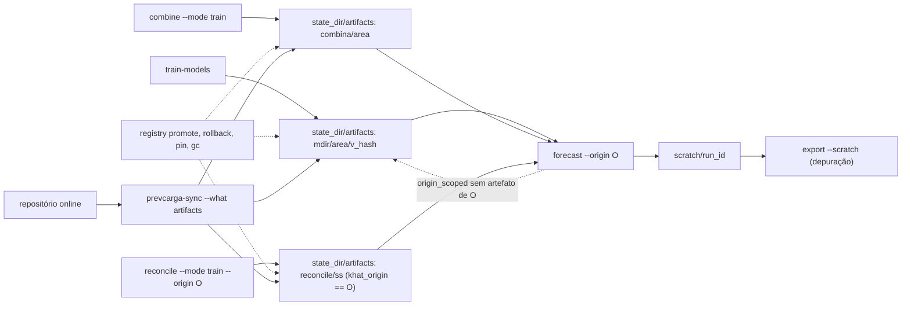

<span className="pc-overline">Execução · 3.9</span>

<p className="pc-lead">A rodada diária só consome artefatos. Ela não treina os membros <code>origin_agnostic</code>, não ajusta os pesos da combina e não ajusta o perfil k-hat. Esses três artefatos são produzidos antes, por <code>train-models</code>, <code>combine --mode train</code> e <code>reconcile --mode train</code>, ou chegam do repositório online pelo <code>prevcarga-sync</code>. Todos moram no mesmo layout do registry, em <code>state_dir/artifacts/</code>, e o verbo <code>registry</code> governa o ponteiro <code>latest.txt</code> de cada célula. A única exceção é o membro <code>origin_scoped</code>: se não há artefato da origem O, a própria rodada o treina uma vez.</p>

Esta página é o roteiro do operador. A semântica do registry está em [Registry de artefatos](/arquitetura/registry), o corte de treino por classe de split em [Os três cortes de data](/metodologia/tres-cortes), e o que a rodada faz com os artefatos em [Rodada diária](/execucao/rodada-diaria).

## Quem produz cada artefato consumido pelo forecast

Cada artefato é uma célula do registry. A célula tem as versões imutáveis `v_<hash>/` e o ponteiro `latest.txt`, de uma linha. Os caminhos abaixo são relativos a `<state_dir>/artifacts/`.

| Artefato | Célula | Quem produz | Frequência | Se faltar na rodada |
|---|---|---|---|---|
| Membro `origin_agnostic` (`random-forest`, `lgbm`) | `<mdir>/<area>/` | `train-models` | antes da rodada; o artefato serve às origens seguintes enquanto o seu `last_data_day` não passar o da origem | `state.artifact_missing` (exit 13); a rodada nunca treina esse membro |
| Membro `origin_scoped` (`holt-winters`, `dessem-linear`, `dessem-regdin`) | `<mdir>/[<exogena>/]<area>/` | `train-models --origin=O` ou a própria rodada | um artefato por origem O | a rodada treina uma vez pela fachada de treino e segue |
| Pesos da combina | `combina/<area>/` | `combine --mode train` | antes da rodada | `state.combina_not_trained` (exit 13) |
| Perfil k-hat | `reconcile/<ss>/` | `reconcile --mode train --origin=O` | um perfil por origem O (`khat_origin == O`) | `state.khat_missing` (exit 13); perfil posterior a O dá `honesty.khat_after_origin` (exit 15) |

A classe de split de cada modelo vem do `split` do seu `models/<mdir>/run.yaml`. O segmento `<exogena>` só existe para o membro que declara variante na topologia: `RGD_MED` vive em `dessem-regdin/MED/<area>/`, `RF` vive em `random-forest/<area>/`.

<Figura id="FIG-E07" titulo="Artefatos: do treino à rodada" natureza="Fluxo" fontes={['docs/estado/m6-forecast.md', 'docs/estado/registry_lifecycle.md', 'docs/estado/sync.md', 'scripts/lib/forecast.R']} adrs={['ADR-0023', 'ADR-0030', 'ADR-0039']}>



</Figura>

O caminho pelo repositório online entrega os mesmos bytes no mesmo layout: o conjunto publicado traz, por célula, a versão apontada pelo `latest.txt`. O `prevcarga-sync` baixa para um staging `.tmp-*` dentro de `<state_dir>/artifacts/`, confere o sha256 de cada arquivo, renomeia as versões para o destino e regrava o `latest.txt` local por último. As células sincronizadas não trazem `.pin` nem `.history`, que são só locais. O passo a passo está em [Sincronizar com os artefatos online](/execucao/sync).

<Pendente titulo="Em breve">O repositório online de artefatos ainda não está no ar. Até lá, use o caminho local: <code>train-models</code>, <code>combine --mode train</code> e <code>reconcile --mode train</code>.</Pendente>

Como o k-hat exige `khat_origin == O`, um perfil sincronizado só serve à rodada da origem em que foi ajustado.

### Preparar uma origem O

1. Treinar os membros `origin_agnostic` (e, se quiser antecipar, os `origin_scoped` da origem O) com `train-models`.
2. Treinar os pesos da combina por área com `combine --mode train`.
3. Ajustar o perfil k-hat de O com `reconcile --mode train --origin=O`.
4. Rodar `forecast --origin=O`.

<Terminal title="prevcarga — bash" lines={[
  {type:'cmd', text:'prevcarga train-models --model=random-forest,lgbm --jobs=4'},
  {type:'cmd', text:'prevcarga combine --mode=train --area=SP --root=./runs'},
  {type:'cmd', text:'prevcarga reconcile --mode=train --origin=2026-10-20'},
  {type:'cmd', text:'prevcarga forecast --origin=2026-10-20'}
]} />

## train-models

Treina o subconjunto pedido de membros por áreas e publica cada célula no registry. A lógica mora em `scripts/lib/training.R`; o verbo é o handler fino de `scripts/lib/cli/train-models.R`.

```text title="scripts/lib/cli/train-models.R (usage)"
prevcarga train-models [--model=<m>] [--area=<a>] [--subsistema=<s>] [--areas=<a,b>]
  [--origin=<data>] [--horizon=<h>] [--exogena=<e>] [--dry-run] [--jobs=<n>] [--force]
```

| Flag | Efeito | Recusa |
|---|---|---|
| `--model` | lista separada por vírgula de `mdir` ou `mdir/exogena` (ex. `dessem-linear/MED`) | nome fora da topologia: `config.unknown_model` (exit 8) |
| `--area`, `--subsistema`, `--areas` | um seletor só; `--subsistema` expande para as folhas-filhas; sem seletor, todas as folhas | mais de um: `contract.area_selector_conflict` (exit 2); área fora da topologia: `topology.area_undeclared` (exit 4) |
| `--exogena` | filtra os membros com essa variante | nenhum membro casa: `config.unknown_model` (exit 8) |
| `--horizon` | override de `horizon_days` do `run.yaml`, inteiro ≥ 1 | valor não numérico ou menor que 1: `config.override_bad_value` (exit 8); em outro verbo: `config.usage` (exit 8) |
| `--origin` | origem O; sem ela, o último dia de carga do deck | |
| `--dry-run` | emite a matriz com cortes e versão-alvo, sem gravar nada | |
| `--jobs` | workers PSOCK, padrão 1 | não inteiro ou menor que 1: `config.bad_type` (exit 8) |
| `--force` | retreina mesmo se a versão `v_<hash>` já existe | |

Os seletores e `--model` são validados antes de qualquer leitura do deck. A matriz é membros × áreas, ordenada por `(model, variant, area)`. Para cada célula, o corte de treino vem de `scripts/lib/dates.R` pela classe de split: `train_origin = O−1−H` no `origin_agnostic` (H é o `horizon_days`) e `train_origin = O` no `origin_scoped`. Se o deck não tem dias de carga suficientes para a janela, a célula aborta com `window.history_short` (exit 5) antes de qualquer escrita.

### Status de cada célula

| Status | Quando | O que acontece no disco |
|---|---|---|
| `planned` | `--dry-run` | nada; o painel é lido como no treino e a versão-alvo é a mesma do treino real |
| `reused` | a versão `v_<hash>` já existe e não há `--force` | nada; o plugin não é chamado e a pasta fica intocada |
| `trained` | versão nova, ou `--force` | publica `v_<hash>/` por staging `.tmp-*` e `file.rename`, depois promove o `latest.txt` e anota o `.history` |

A versão é content-addressed: o hash cobre a identidade do treino (modelo, painel já cortado, cortes, configuração de features, commit, `renv.lock`, `load_label` e fuso). Treinar de novo com os mesmos insumos cai em `reused`. Com `--force`, a versão antiga só sai depois que a nova entrou.

### Paralelismo

Com `--jobs=1` as células rodam em série, na ordem da matriz, e o primeiro erro interrompe; as células anteriores ficam publicadas. Com `--jobs` maior que 1, o verbo abre um cluster `parallel::makePSOCKcluster`, sem fork, para funcionar no Windows nativo. Cada worker é um R novo que carrega a biblioteca e fixa o runtime dentro do processo. Se a inicialização do worker falha, o pai re-levanta o erro original com o seu id de catálogo; um erro sem id vira `runtime.worker_unfixable` (exit 7). Um erro de célula volta ao pai como dado e sai com a classe original; o resultado é reordenado pela chave.

O `result` em `--format json` traz `schema_version`, `dry_run`, `origin`, `available_until`, `load_label`, `weather_issue_cutoff` e `cells[]`, com `model`, `variant`, `area`, `split`, `train_origin`, `last_data_day`, `version`, `status` e `path` por célula.

```bash
prevcarga train-models --dry-run --format=json
prevcarga train-models --model=dessem-linear/MED --subsistema=S --origin=2026-10-20
prevcarga train-models --model=lgbm --area=SP --force
```

## combine --mode train

Ajusta os pesos da combina de uma área e os congela no registry. O verbo valida `--mode` (`config.bad_mode`, exit 8) e a área na topologia (`topology.area_undeclared`, exit 4) antes de qualquer E/S. `--root` é obrigatório (`config.usage`, exit 8).

```text title="scripts/lib/cli/combine.R (usage)"
prevcarga combine --mode=<mode> --area=<a> --root=<dir> [--artifact-dir=<dir>] [--cut=<HHMM>] [--out=<path>] [--origin=<date>]
```

| Flag | Em `train` |
|---|---|
| `--area` | folha ou nó de subsistema da topologia; nó de perda ou área desconhecida é recusado |
| `--root` | raiz dos runs de membro que formam o painel de treino |
| `--artifact-dir` | destino dos pesos; padrão `<state_dir>/artifacts/combina` |
| `--cut` | corte `HHMM` do `available_until` a combinar; recorta o painel |
| `--out`, `--origin` | não usados em `train`; valem para `apply` e `full` |

A rodada sempre lê os pesos em `<state_dir>/artifacts/combina`. Um `--artifact-dir` diferente do padrão produz pesos que o `forecast` não enxerga.

O ajuste roda por célula `(lead, cut, mês de origem)` com `n_min` 24, 500 iterações e `grad_tol` 1e-6; a máscara de treino, que ajusta os pesos de cada mês só com alvos anteriores ao início do mês para não usar informação do horizonte, está em [Combinação convexa](/metodologia/combina). A versão é `v_` seguido de 16 hex, sobre a área, o painel, a configuração do ajuste (`n_min`, iterações, `grad_tol`, cortes), o conjunto de membros, o `load_label`, o fuso, o commit e o `renv.lock`. O verbo grava `combina/<area>/v_<hash>/weights.rds` por staging `.tmp-*` e `file.rename`, e reaponta `combina/<area>/latest.txt` por último. Retreinar com os mesmos insumos não reescreve o `weights.rds`: só reaponta o `latest.txt`.

Uma célula que para no teto de iterações sem estacionariedade não é erro. O verbo emite uma vez `warning.combina_nonstationary` no stderr (no campo `warnings` em JSON) e termina com exit 0.

<Pendente titulo="Pendente · ADR-0026">O <code>grad_tol</code> é absoluto. Em carga real, na escala de 1.000 MW, a parada bate o teto de iterações; a normalização do critério está marcada como <code>[TBD: ADR-0026]</code>.</Pendente>

### Layout do --root

A combina descobre os runs de cada membro declarado na topologia por identidade `(mdir, exogena)`. O disco só localiza o run; o corte vem do `available_until` do `run_manifest.json`, nunca do nome do diretório.

```text title="layout provisório dos runs de membro"
<root>/<mdir>/<area>/<from>_<to>_<run_mode>[_<EXO>][_cHHMM]/
  long.parquet
  run_manifest.json
```

`run_mode` é um de `infer`, `fixed`, `daily` ou `retrain_harness`. Mais de um `run_mode` para a mesma identidade é `contract.combina_run_mode_dup`. Um membro sem runs não é erro: a coluna dele fica fora do painel.

<Pendente titulo="Pendente · layout de run">O layout do <code>--root</code> é provisório e está marcado no código como pendente de um ADR novo de layout de run (<code>[TBD]</code>).</Pendente>

## reconcile --mode train --origin O

Ajusta o perfil k-hat de cada subsistema para uma origem e o publica em `reconcile/<ss>/`. O método está em [Reconciliação hierárquica](/metodologia/reconciliacao).

```text title="scripts/lib/cli/reconcile.R (usage)"
prevcarga reconcile --mode=<mode> [--subsistema=<s>] [--khat-window=<n>] [--eval] [--leaves-dir=<dir>]
  [--out=<path>] [--khat-version=<v>]
```

| Flag | Em `train` |
|---|---|
| `--origin` | origem O; sem ela, o último dia de carga do deck |
| `--subsistema` | um subsistema; padrão, todos |
| `--khat-window` | janela W em dias, inteiro maior que 0; padrão 730 |
| `--eval`, `--leaves-dir`, `--khat-version`, `--out` | só valem com `--mode=apply`; em `train` dão `config.usage` |

A janela é `[O−W, O−1]`, inclusiva nas duas pontas, e a verdade é lida até o `last_data_day` de O. O `result.khat[]` traz por subsistema `ss`, `versao`, `khat_origin`, `window_days`, `n_ratio`, `promovido` e `k_hat_resumo` (mínimo, máximo e número de valores do perfil fora da `khat_range` da topologia).

O `latest.txt` do k-hat só anda para frente. Ajustar uma origem anterior à do `latest` atual publica a versão, mas não a promove: o verbo emite o aviso `reconcile.khat_not_promoted` e devolve `promovido = false`. A rodada não depende do `latest`: ela procura a versão ajustada em O, que é o `latest` quando ele é de O e, senão, outra versão da mesma célula com `khat_origin == O`.

```bash
prevcarga reconcile --mode=train --origin=2026-10-20
prevcarga reconcile --mode=train --origin=2026-10-20 --subsistema=S --khat-window=730
```

## registry

O verbo `registry` despacha um subcomando para as funções de ciclo de vida de `scripts/lib/registry.R`, único dono do ciclo de vida. Os estados de uma versão e as transições estão em [Registry de artefatos](/arquitetura/registry).

```text title="scripts/lib/registry.R (prevcarga_registry_usage)"
prevcarga registry (ls|show|promote|rollback|pin|unpin|gc) [<model>] [<area>] [<version>] [--dry-run]
```

`<model>` aceita a sigla do membro (`RGD_MED` resolve para `dessem-regdin/MED`), o `mdir` ou a pasta do registry (`combina`, `reconcile`). Para `reconcile`, `<area>` é o subsistema. Uma célula inexistente dá `state.cell_missing` (exit 13).

| Subcomando | Argumentos | Efeito | Recusas |
|---|---|---|---|
| `ls` | `[<model>] [<area>]` | lista as células: chave, `latest`, versões pinadas e versões; só leitura | |
| `show` | `<model> <area> [<version>]` | mostra do `run_manifest.json` da versão (padrão, a `latest`) `version`, `model_id`, cortes, `load_label`, `timezone`, `weather_issue_cutoff` e `code_commit`; só leitura | versão inexistente: `state.artifact_missing` (exit 13) |
| `promote` | `<model> <area> <version>` | aponta o `latest.txt` para a versão (tempfile `.tmp-latest-*` e `file.rename`) e anota o `.history` | k-hat para `khat_origin` menor: `state.registry_khat_backward` (exit 13); falha de rename: `state.promote_failed` (exit 13) |
| `rollback` | `<model> <area>` | promove a versão anterior distinta do `.history` que ainda existe em disco | sem anterior: `state.registry_no_previous` (exit 13); k-hat para `khat_origin` menor: `state.registry_khat_backward` (exit 13) |
| `pin` | `<model> <area> <version>` | acrescenta a versão ao `.pin`; não move o `latest` | versão inexistente: `state.pin_missing` (exit 13); formato inválido: `contract.version_malformed` (exit 2) |
| `unpin` | `<model> <area> <version>` | retira a versão do `.pin`; `.pin` vazio é removido | versão não pinada: `state.pin_missing` (exit 13) |
| `gc` | `[<model>] [--dry-run]` | remove as versões órfãs (nem `latest` nem pinadas) e toda entrada `.tmp-*` sob o escopo (`<state_dir>/artifacts` ou a pasta do `<model>`) | |

Regras que o operador sente no uso:

- A rodada lê o `latest`. O pino protege uma versão do `gc` e é a versão que `infer-model --pin` usa.
- O `gc` nunca segue links e nunca toca o repositório online. Uma célula sem `latest.txt` nem `.pin` não tem versões podadas (motivo `no_pointer`). Rode primeiro com `--dry-run`: o resultado lista `removed` e `kept`, com o motivo de cada versão mantida.
- Um `.tmp-*` que sobra de uma promoção interrompida é coletado pelo `gc`; o `latest.txt` nunca fica vazio.
- Promover ou voltar o k-hat não contorna a regra `khat_origin == O`: a rodada continua exigindo o perfil ajustado na sua origem.
- Os pesos da combina reapontam o próprio `latest.txt` sem anotar o `.history`. O `rollback` de uma célula `combina/<area>` só enxerga as promoções feitas pelo `registry promote`.

```bash
prevcarga registry ls random-forest
prevcarga registry show RGD_MED SP
prevcarga registry pin lgbm SP v_0123abcd4567ef89
prevcarga registry rollback combina SP
prevcarga registry gc --dry-run
```

## Verbos de depuração

Estes verbos executam uma etapa isolada da rodada. Nenhum deles grava nem promove artefato no registry, e as saídas vão para o scratch ou para um `--out` explícito, nunca para `forecasts/`, com exceção do `export`, que entrega.

| Verbo | O que faz | Saída |
|---|---|---|
| `infer-model` | infere um modelo × uma área × uma origem com o artefato do registry | stdout; `--out` opcional |
| `features` | materializa a tabela de features de um modelo × uma folha na origem O, sem inferir | `<state_dir>/scratch/features/<m>/<a>/features.parquet` |
| `combine --mode apply` | aplica os pesos congelados do `latest.txt` a um painel de runs, sem reajustar | `--out` (parquet LONG) |
| `combine --mode full` | ajusta e aplica sem gravar artefato | `--out` (parquet LONG) |
| `reconcile --mode apply` | reconcilia um diretório de LONG por folha com o k-hat de O | `<state_dir>/scratch/<run_id>/` ou `--out` |
| `export --scratch` | entrega de novo a partir do scratch de uma rodada | `forecasts/…` |

### infer-model

```text title="scripts/lib/cli/infer-model.R (usage)"
prevcarga infer-model --model=<m> --area=<a> [--variant=<e>] [--artifact-version=<v> | --pin] [--out=<arquivo>]
```

Os parâmetros vêm todos do artefato congelado. O verbo não aceita `--horizon` nem `--exogena`, que só valem em `train-models` (`config.usage`, exit 8). A versão é a `latest` por padrão, a de `--artifact-version` ou a última linha do `.pin` com `--pin`. Para um membro com variante, `--variant` é obrigatória (`contract.variant_required`, exit 2), mesmo com `--artifact-version`, porque a variante faz parte da chave da célula. O `--out` grava um parquet de 7 colunas (`model`, `variant`, `area`, `origin`, `available_until`, `target_datetime`, `y_pred`) por escrita atômica; um diretório ausente ou um caminho dentro de `<state_dir>/artifacts` dá `io.out_unwritable` (exit 6).

```bash
prevcarga infer-model --model=dessem-linear --area=SP --variant=MED --origin=2026-10-20
prevcarga infer-model --model=random-forest --area=RJ --pin --out=./rf_rj.parquet
```

### features

```text title="scripts/lib/cli/features.R (usage)"
prevcarga features --model=<m> --area=<a>
```

`--model` é o `mdir`. O verbo lê o painel e os cortes pelos mesmos passos da inferência, usa a versão `latest` do artefato e grava a tabela por escrita atômica. Modelo ou área fora da topologia dá exit 4 (`topology.model_undeclared`, `topology.area_undeclared`); artefato ausente dá `state.artifact_missing` (exit 13). Para um `mdir` com mais de uma variante, o verbo usa a primeira declarada na topologia.

### combine --mode apply e --mode full

Os dois modos exigem `--out` com diretório existente. O `apply` lê `combina/<area>/latest.txt` e confere o hash do `weights.rds` antes de abri-lo; sem pesos, `state.combina_not_trained` (exit 13). O `full` ajusta sobre o painel inteiro e aplica, sem artefato: `full` equivale a `train` seguido de `apply`. Nos dois, `--origin` restringe só as linhas de saída; uma origem sem linhas dá `config.usage`.

```bash
prevcarga combine --mode=apply --area=SP --root=./runs --out=./sp_comb.parquet --origin=2026-10-20
```

### reconcile --mode apply

`--leaves-dir` aponta um diretório com um parquet LONG por área. Mais de uma área no mesmo arquivo dá `contract.reconcile_input`; uma área fora da topologia dá `topology.area_undeclared`. Se `--origin` difere da `forecast_origin` das folhas, o verbo recusa com `contract.reconcile_input`. `--khat-version` só escolhe entre versões ajustadas em O. `--eval` lê a verdade do deck e acrescenta `y_true` e o WMAPE ao resultado.

A saída padrão é `<state_dir>/scratch/<run_id>/`, com `SIN.parquet` e `subsistemas/<ss>.parquet`. O `run_id` são 16 hex do sha256 da chave canônica (verbo, modo, origem, subsistemas, janela, sha256 das folhas, versões do k-hat e `--eval`), nunca PID nem relógio. Um rerun com os mesmos insumos cai no mesmo diretório e o substitui. Um `--out` não vazio com arquivos fora desse layout dá `io.out_unwritable`.

```bash
prevcarga reconcile --mode=apply --leaves-dir=./folhas --origin=2026-10-20 --eval
```

### export --scratch

```text title="scripts/lib/cli/export.R (usage)"
prevcarga export --scratch=<dir> [--niveis=<n>] [--incluir-membros]
```

O `export` entrega de novo a partir do scratch de uma rodada (`run.json` mais os parquets). A chave de entrega é derivada do `run.json` (origem, `available_until`, versão e fuso), nunca de flag, de modo que o mesmo scratch entrega na mesma chave que o forecast usou. `--niveis` aceita `sin`, `subsistemas` (padrão) ou `tudo`; outro valor dá `config.usage`. Scratch ausente ou `run.json` sem esses campos dá `state.nothing_to_deliver` (exit 13). A mesma chave com os mesmos bytes é no-op; o detalhe está em [Entrega e export imutável](/arquitetura/entrega-export).

<Pendente titulo="Pendente · niveis fora da versão">Nem <code>--niveis</code> nem <code>--incluir-membros</code> entram na versão. Exportar o mesmo scratch na mesma chave com outro conjunto de arquivos dá <code>export.key_conflict</code> (exit 9); o tratamento ainda está em aberto.</Pendente>

```bash
prevcarga export --scratch=./state/scratch/<run_id> --niveis=tudo --incluir-membros
```
