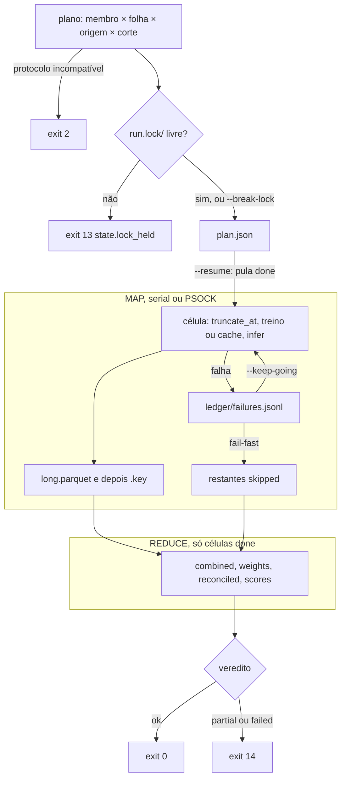

<span className="pc-overline">Execução · 3.10</span>

<p className="pc-lead">O backtest roda a rodada diária em várias origens, uma célula por membro × folha × origem × corte. Antes de gastar CPU, <code>prevcarga plan</code> mostra a matriz sem treinar nem gravar nada. <code>prevcarga backtest</code> executa a mesma matriz sob um lock, grava cada célula concluída no disco e retoma pelo que já está lá (<code>--resume</code>). Depois das células, o REDUCE combina, reconcilia e avalia, e o verbo devolve um veredito: <code>ok</code> (exit 0) ou <code>partial</code>/<code>failed</code> (exit 14).</p>

O método (por que o harness só trunca o tempo, a matriz de compatibilidade e o que não re-treina) está em [Backtest](/metodologia/backtest). Esta página é o passo a passo de operação.

## `plan`: a matriz antes de rodar

`plan` monta a matriz de células e imprime as contagens. Não treina, não infere e não cria arquivo nem diretório. `backtest --dry-run` chama o mesmo handler e devolve a mesma saída.

<Terminal title="prevcarga — bash" lines={[
  {type:'cmd', text:'prevcarga plan --data=./deck --origin=2025-01-01..2025-01-31'},
  {type:'cmd', text:'prevcarga plan --data=./deck --origin=2025-01-01..2025-01-31 --corte=08:00,09:30 --model=lgbm'},
  {type:'cmd', text:'prevcarga backtest --data=./deck --origin=2025-01-01..2025-01-31 --dry-run --format=json'}
]} />

### Flags

| Flag | Valores | Padrão | Erro |
|---|---|---|---|
| `--origin` | uma data `AAAA-MM-DD` ou uma janela `A..B` com A ≤ B | obrigatória | ausente: <Tag>config.origin_range_required</Tag>; malformada ou A maior que B: <Tag>config.bad_origin</Tag> (exit 8) |
| `--corte` | `HH:00` ou `HH:30`, separados por vírgula | `backtest.corte_default` do `config.yaml` (`08:00`) | fora da grade de 30 min: <Tag>config.bad_corte</Tag> (exit 8) |
| `--protocol` | `fixed`, `daily`, `retrain_harness` | `backtest.protocol_default` do `run.yaml` de cada membro | inválido: <Tag>config.bad_protocol</Tag> (exit 8); incompatível com o split: <Tag>contract.protocol_incompatible</Tag> (exit 2) |
| `--model` | diretório do modelo ou `modelo/exógena`, separados por vírgula | todos os membros da topologia | desconhecido: <Tag>config.unknown_model</Tag> (exit 8) |
| `--area` | uma folha ou um subsistema (expande para as folhas-filhas) | todas as folhas | fora da topologia: <Tag>topology.area_undeclared</Tag> (exit 4) |
| `--dplus` | flag | desligada | — |

A janela `A..B` só é aceita em `plan` e `backtest`. Nos demais verbos, `--origin` recebe uma única data, e uma janela é <Tag>config.bad_origin</Tag> (exit 8). A janela é inclusiva nas duas pontas: `2025-01-01..2025-01-31` são 31 origens.

`plan` exige o deck (`--data` ou `data_dir` do `config.yaml`). Ele lê o manifest para o fuso e o rótulo da carga e calcula a identidade do deck, que entra na chave de cada célula. Esse cálculo faz o sha256 de todos os parquet de `load`, `weather/observed`, `weather/forecast` e `auxiliary/holidays`, por isso o `plan` não é instantâneo num store grande.

### O que a matriz contém

O total de células é membros × folhas × origens × cortes, depois dos filtros `--model` e `--area`. Nada disso é lista fixa no código: membros e folhas vêm de `config/topology.yaml`, a classe e o protocolo de cada membro vêm do `run.yaml`, e o `data_lag_days` vem do descriptor do plugin.

Cada linha da matriz carrega, além da identidade da célula, os cortes já derivados: `train_origin` e `last_data_day` (de `dates.R`, pela classe de split; ver [Os três cortes de data](/metodologia/tres-cortes)), `available_until` (a origem no horário do `--corte`, no fuso declarado pelo deck), o limite de emissão do clima e a `cache_key` esperada do LONG da célula.

### Saída

Em texto, a primeira linha resume o plano e há uma linha por membro. O formato é o do código:

```r title="scripts/lib/orchestrate.R"
sprintf("plan run_id=%s janela=%s..%s origens=%d cortes=%s folhas=%d total=%d", ...)
sprintf("%-10s %-16s %-14s %-4d celulas=%d", sigla, split, protocol, granularity_min, cells)
```

Com `--format=json`, o `result` traz `schema_version`, `run_id`, `weather_issue_cutoff`, `window` (`from`, `to`, `origins`), `cortes`, `folhas` (contagem), `total` e `by_member`. Em `by_member`, cada sigla tem `mdir`, `exogena`, `split`, `protocol`, `granularity_min` e `cells`.

### O `run_id`

O `run_id` é o hash da identidade do pedido: janela, cortes, membros (sigla, diretório, exógena, split e protocolo efetivo), folhas, rótulo da carga, regra de clima (`--weather-cutoff`) com o atraso de publicação efetivo, fuso, versão do código e hash do `renv.lock`. As flags operacionais ficam fora: `--jobs`, `--resume`, `--keep-going`, `--break-lock`, `--format`, `--report` e `--report-format`. `--baseline` e `--dplus` também não entram. A identidade do deck também fica fora do `run_id` (ela entra só na chave de cada célula). O mesmo pedido cai no mesmo diretório `<state_dir>/backtest/<run_id>/`, e é isso que permite retomar. Se o deck mudar, o diretório é o mesmo, mas as chaves das células mudam e um `--resume` recomputa todas.

## Escolher o protocolo

O protocolo só decide quando treinar. A compatibilidade com a classe de split do modelo e o que cada combinação treina estão na matriz de [Backtest](/metodologia/backtest). Na prática:

1. Sem `--protocol`, cada membro usa o `backtest.protocol_default` do seu `run.yaml`: `daily` em `random-forest` e `lgbm`, `retrain_harness` em `holt-winters`, `dessem-linear` e `dessem-regdin`. É a escolha segura para um backtest de todos os membros.
2. `--protocol` vale para todos os membros do plano. Se algum membro selecionado for de classe incompatível, o plano inteiro aborta com <Tag>contract.protocol_incompatible</Tag> (exit 2): `--protocol=fixed` sem `--model` aborta por causa dos membros `origin_scoped`, e `--protocol=retrain_harness` por causa dos `origin_agnostic`. Combine com `--model` para restringir a membros da classe certa.
3. `fixed` (só `origin_agnostic`) treina uma vez por membro e folha, nos cortes da menor origem da janela, e infere em todas as origens. É o mais barato, mas o artefato fica mais velho a cada origem.
4. `daily` treina por origem nas duas classes. É o protocolo que reproduz a rodada diária.
5. `retrain_harness` (só `origin_scoped`) roda o `forecast` acoplado do plugin em cada origem: treino e inferência no mesmo painel, sem artefato no cache.
6. Rode `plan` com o protocolo pretendido antes do `backtest`: a incompatibilidade aborta no plano, antes de criar qualquer arquivo.

<Terminal title="prevcarga — bash" lines={[
  {type:'cmd', text:'prevcarga plan --data=./deck --origin=2025-01-01..2025-01-31 --model=random-forest,lgbm --protocol=fixed'},
  {type:'cmd', text:'prevcarga backtest --data=./deck --origin=2025-01-01..2025-01-31 --model=random-forest,lgbm --protocol=fixed'}
]} />

## Executar, retomar e paralelizar

<Terminal title="prevcarga — bash" lines={[
  {type:'cmd', text:'prevcarga backtest --data=./deck --origin=2025-01-01..2025-01-31'},
  {type:'cmd', text:'prevcarga backtest --data=./deck --origin=2025-01-01..2025-01-31 --resume --keep-going --jobs=4'},
  {type:'cmd', text:'prevcarga backtest --data=./deck --origin=2025-01-01..2025-01-31 --resume --break-lock'}
]} />

### Ciclo de uma execução

1. O plano é montado e validado (flags, topologia, classe × protocolo). Erro aqui sai antes de tocar o disco.
2. O lock `<state_dir>/backtest/<run_id>/run.lock/` é criado por `dir.create` exclusivo, com `owner.json` (`pid`, `host`). Se já existe, a execução para com <Tag>state.lock_held</Tag> (exit 13), antes de tocar plano ou ledger.
3. O `plan.json` é gravado de forma atômica.
4. Com `--resume`, o estado de cada célula é derivado do disco. Sem `--resume`, todas as células são despachadas de novo.
5. As células pendentes são despachadas da origem mais recente para trás (depois por membro, folha e corte). Cada célula aplica a semente do `run.yaml` do membro e trunca o tempo no leitor. Em `fixed` e `daily`, acha o artefato no cache ou treina e grava, e infere; em `retrain_harness`, roda o `forecast` acoplado do plugin. O LONG resultante é publicado no diretório da célula.
6. O processo pai grava as falhas em `ledger/failures.jsonl`.
7. O REDUCE roda sobre todas as células `done` (inclusive as de execuções anteriores retomadas).
8. O lock é liberado na saída, também em erro.

O progresso vai para stderr, uma linha `backtest: <feitas>/<total>` por célula recolhida.

<Figura id="FIG-E08" titulo="Backtest operacional: lock, ledger e retomada" natureza="Fluxo" fontes={['scripts/lib/orchestrate.R', 'scripts/lib/backtest.R', 'docs/estado/orchestrate.md', 'docs/estado/backtest.md']} adrs={['ADR-0023', 'ADR-0038']}>



</Figura>

### Ledger por presença

Não há banco de estado. Uma célula está `done` se, e só se, o seu diretório tem `long.parquet` e um `.key` cujo conteúdo é igual à `cache_key` esperada pelo plano:

```
<state_dir>/backtest/<run_id>/members/<sigla>/<FOLHA>/<AAAA-MM-DD>/<HHMM>/long.parquet
<state_dir>/backtest/<run_id>/members/<sigla>/<FOLHA>/<AAAA-MM-DD>/<HHMM>/.key
```

Os dois arquivos são gravados por arquivo temporário e renomeação, e o `.key` é gravado por último. Uma célula interrompida no meio fica sem `.key` (ou com `.tmp` residual, que é ignorado) e volta a ser pendente. Uma célula cuja chave mudou, por exemplo porque o deck mudou, também é recomputada. Uma célula que falhou antes não é `done` e é despachada de novo no `--resume`; se falhar outra vez, o `attempt` da nova linha de falha conta as falhas anteriores registradas no ledger.

`ledger/failures.jsonl` tem uma linha JSON por falha: `ts`, `cell`, `membro`, `folha`, `origem`, `corte_hm`, `available_until`, `classe` (`split/protocolo`), `error_class`, `error_id`, `mensagem`, `attempt` e `state`. O `ts` é o carimbo UTC da invocação (o identificador da invocação no contexto, sem o sufixo do pid), não o `run_id` do backtest; o orquestrador não lê o relógio. Só o processo pai escreve nesse arquivo.

Com `--resume`, se o `plan.json` já existente tiver um `run_id` diferente do pedido, a execução para com <Tag>contract.plan_run_id_mismatch</Tag> (exit 2).

### Lock

| Situação | O que acontece |
|---|---|
| Outra execução do mesmo pedido em andamento | <Tag>state.lock_held</Tag>, exit 13. Espere terminar. |
| Execução anterior morreu e deixou `run.lock/` | Confira o `pid`/`host` em `run.lock/owner.json` e rode de novo com `--break-lock`. O aviso <Tag>warning.lock_broken</Tag> é emitido e a execução segue. |
| Pedidos diferentes (outra janela, cortes, membros) | `run_id` diferente, diretório diferente, sem conflito de lock. |

:::warning
`--break-lock` não confere se o dono do lock ainda está vivo. Duas execuções no mesmo `run_id` escreveriam nas mesmas células. Use só depois de confirmar que a anterior parou.
:::

### Política de falha

| Modo | Comportamento |
|---|---|
| Padrão (fail-fast) | Na 1ª falha, nada novo é despachado. No serial, para logo depois da célula que falhou. Com `--jobs`, o lote em andamento termina e nenhum lote novo é enviado. As células não despachadas ficam `skipped`. |
| `--keep-going` | Todas as células são despachadas; as falhas vão para o ledger e o resto segue. |

Em qualquer modo, o REDUCE roda sobre o que ficou `done`.

### Paralelizar com `--jobs`

`--jobs=1` (padrão) é serial, sem cluster. `--jobs=N` com N maior que 1 cria um cluster PSOCK (`parallel::makePSOCKcluster`), o único tipo usado: não há fork, e o mesmo código roda em Linux e no Windows nativo (ADR-0038). O número de workers é o menor entre N e o número de células pendentes. O cluster é fechado na saída.

- Cada worker é um R novo que carrega os módulos da mesma biblioteca do pai e fixa o runtime dentro do processo (TZ, locale, BLAS), sem variável de ambiente. Se a inicialização de um worker falhar (módulos ou runtime), nenhuma célula roda: todas viram `failed` com o id do erro do worker, ou <Tag>runtime.worker_unfixable</Tag> quando o erro não tem id do catálogo.
- Cada célula escreve só no próprio diretório e devolve ao pai um envelope pequeno; o LONG fica no disco.
- A semente do `run.yaml` é aplicada imediatamente antes de cada célula, no serial e no worker. O estado e o resumo saem na ordem do plano. O LONG de membros, combinado e reconciliado sai idêntico com `--jobs=1` e `--jobs=4`.
- Um valor que não se converte num inteiro maior ou igual a 1 é <Tag>config.bad_type</Tag> (exit 8).

<Pendente titulo="Pendente · Windows">O backtest com `--jobs` no Windows nativo ainda está em validação. Até lá, prefira `--jobs=1` no Windows ou rode o backtest paralelo no Linux.</Pendente>

### Outras flags do `backtest`

| Flag | Efeito |
|---|---|
| `--baseline` | Baselines do skill no REDUCE: `todos` (padrão, persistência O−1 e sazonal O−7), `persistence`, `seasonal_naive` ou `none` (também `nenhum`). Outro valor: <Tag>contract.baseline_kind</Tag> (exit 2), detectado só na avaliação do REDUCE, depois das células, e só se houver célula `done`. |
| `--report` | Gera o relatório depois do REDUCE. |
| `--report-format` | `html` (padrão) ou `pdf`. Outro valor: <Tag>config.usage</Tag> (exit 8). |
| `--dplus` | Registra `dplus = TRUE` em `scores`. Os scorecards já saem por `d_plus` com ou sem a flag. |
| `--weather-cutoff` (global) | Regra de clima previsto (ADR-0024). Entra no `run_id` e nas chaves; mudar a regra gera outro diretório de execução. |

## Saídas do REDUCE e veredito

Tudo fica sob `<state_dir>/backtest/<run_id>/`. O `state_dir` é `--state`, senão `state_dir` do `config.yaml`, senão `<raiz>/.state`. O registry de produção (`<state_dir>/artifacts/`) não é aberto pelo backtest e nenhum ponteiro `latest` é lido.

| Caminho | Conteúdo | Quando existe |
|---|---|---|
| `plan.json` | O plano: `run_id`, janela, cortes, protocolo, total e uma entrada por célula com a `cache_key` | sempre que a execução passa do lock |
| `members/<sigla>/<FOLHA>/<AAAA-MM-DD>/<HHMM>/` | `long.parquet` e `.key` de cada célula `done` | por célula concluída |
| `ledger/failures.jsonl` | Uma linha por falha de célula | se houve falha |
| `combined/<FOLHA>/<HHMM>/combined.parquet` | LONG combinado por folha e corte | se a folha tem célula `done` naquele corte |
| `weights/<AAAA-MM>/<FOLHA>_<HHMM>.rds` | Pesos da combina de cada mês | idem |
| `reconciled/<AAAA-MM-DD>/<HHMM>/SIN.parquet` e `subsistemas/<SS>.parquet` | Reconciliado por origem e corte | só se o plano cobre todas as folhas da topologia e a origem está completa |
| `scores/scores.rds`, `scores/scores.json` | Scorecards de membros, combinado e reconciliado, pico, SIN fresco, origens aguardando verdade, meses em fallback | se houve alguma célula `done` |
| `report/backtest.html` (e `backtest.pdf` com `--report-format=pdf`) | Relatório, só render sobre os `scores` | com `--report` |

O REDUCE é refeito inteiro a cada invocação, sobre as células `done` do momento. Um `--resume` que completa células faltantes regrava combinado, pesos, reconciliado e scores. Como `--baseline` não entra no `run_id`, uma segunda execução do mesmo pedido com outro `--baseline` regrava os `scores` no mesmo diretório.

Os detalhes de cada passo (máscara da combina, janela do k-hat de 730 dias, verdade fresca) estão em [Backtest](/metodologia/backtest), e as métricas em [Avaliação](/metodologia/avaliacao).

### Veredito

| Veredito | Condição | Saída |
|---|---|---|
| `ok` | Todas as células `done`, nenhuma origem incompleta, nenhuma falha de reconcile | exit 0; em texto, uma linha `backtest run_id=<run_id> ok=<n>/<total>` |
| `partial` | Pelo menos uma célula `done` e alguma célula `failed` ou `skipped`; ou todas `done`, mas alguma origem incompleta ou falha de reconcile | exit 14, <Tag>partial.backtest_delivery</Tag> |
| `failed` | Nenhuma célula `done` | exit 14, <Tag>partial.backtest_delivery</Tag>; o REDUCE não grava nada |

No <Tag>partial.backtest_delivery</Tag>, o envelope traz o `result` completo (`verdict`, `run_id`, `summary` com `ok`, `total`, `failed`, `skipped`, `incompleto` e `failures`). Em texto, o stderr recebe o resumo e uma linha por célula que falhou, neste formato:

```r title="scripts/lib/orchestrate.R"
sprintf("backtest ok=%d/%d failed=%d skipped=%d", ok, total, failed, skipped)
sprintf("falha %s %s %s %s %s %s", membro, folha, origem, hora_do_available_until, classe, mensagem)
```

:::note Falha de reconcile no veredito
Uma falha de reconcile (erro classificado ao reconciliar uma origem e corte) torna o veredito `partial`, mas não aparece em `failures` nem nas linhas `falha` do stderr, que só listam células. O `result` do verbo também não traz a lista de falhas de reconcile. Um `partial` com `failed=0`, `skipped=0` e `incompleto` vazio indica esse caso.
:::

Se o relatório falhar com o veredito `ok`, a saída é <Tag>partial.report_failed</Tag> (exit 14), com o `result` completo e `scores/` intactos. A causa da falha do relatório vai em `details.cause`. Se o veredito já é `partial` ou `failed`, prevalece <Tag>partial.backtest_delivery</Tag>.

### O que fazer com um `partial`

1. Leia as linhas `falha` (ou `result.summary.failures` em JSON) e `ledger/failures.jsonl` para o `error_id` de cada célula.
2. Corrija a causa (dado faltando no deck, erro de plugin).
3. Rode o mesmo comando com `--resume`. Só as células sem `.key` válido são refeitas, e o REDUCE é refeito sobre o conjunto completo.

## Cache: onde fica e o que fazer com a quarentena

O treino do backtest grava o artefato só no cache content-addressed, nunca no registry de produção. O backtest usa o kind `artifact`; o LONG da célula não é cacheado (fica no ledger, em `members/`).

```
<state_dir>/cache/<kind>/<hh>/<key>/object.rds | object.parquet
<state_dir>/cache/<kind>/<hh>/<key>/meta.json
<state_dir>/cache/_quarantine/<kind>/<key>/
```

A chave tem o formato `v_` seguido de 16 dígitos hexadecimais, e `<hh>` são os dois primeiros dígitos depois do `v_`. O `meta.json` guarda `key`, `kind`, `identity`, `lateral`, `sha256` e `format`. A chave do artefato não inclui `available_until`: varrer `--corte` acha o mesmo artefato e não re-treina. A composição da chave está em [Cache content-addressed](/arquitetura/cache).

| Situação | O que o sistema faz | O que fazer |
|---|---|---|
| Entrada corrompida (sha256 do objeto diferente do `meta.json`, ou `meta.json` ilegível) | Move a entrada para `cache/_quarantine/<kind>/<key>/`, emite <Tag>warning.cache_corrupt_quarantined</Tag> e trata como MISS: o artefato é treinado de novo e gravado no lugar | Nada para a execução. A cópia em quarentena serve para investigar (disco, cópia interrompida) e pode ser apagada à mão depois. Uma nova quarentena da mesma chave substitui a anterior. |
| Gravar uma chave que já existe com sha256 diferente (ou com `meta.json` ilegível) | Erro <Tag>integrity.cache_put_conflict</Tag>; a entrada original fica intocada. No backtest, o erro é capturado na célula: ela fica `failed`, vai para o ledger e o veredito é `partial` (exit 14) | O treino não foi determinístico para a mesma identidade. Apague a entrada `cache/artifact/<hh>/<key>/` e investigue a semente e o runtime antes de rodar de novo. |
| Gravar uma chave que já existe com o mesmo sha256 | Nada (idempotente) | — |

O pacote não tem verbo de limpeza do cache, e `registry gc` não toca `cache/` nem `backtest/`. Apagar diretórios do cache é seguro: uma entrada ausente é só um MISS e é recomputada na próxima execução.
