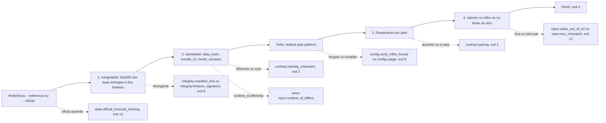

<span className="pc-overline">Execução · 3.11</span>

<p className="pc-lead">O verbo <code>verificar</code> confere se uma entrega do <code>forecast</code> reproduz outra: uma segunda rodada, uma rodada em outra máquina ou a inferência oficial sincronizada (<code>--oficial</code>). Ele roda quatro fases estritas, integridade, identidade, pareamento e valores, e cada uma aborta antes da seguinte. Nenhum valor é lido antes de a integridade passar. A tolerância vem de um trilho fixo (1e-5 absoluto na mesma plataforma, 0,1% relativo entre plataformas) ou de um limiar assinado por alvo. Não existe tolerância livre na linha de comando.</p>

O verbo é um passthrough fino (`scripts/lib/cli/verificar.R`) sobre `prevcarga_verify_repro` (`scripts/lib/verify_repro.R`). Ele só lê arquivos sob as duas entregas, o arquivo de `--limiares` quando dado e, com `--oficial`, a chave sincronizada sob o `state_dir`. Não usa rede, relógio nem variável de ambiente. O critério de reprodutibilidade que ele implementa está em [Determinismo e reprodutibilidade](/metodologia/determinismo). O layout da entrega está em [Entrega e export imutável](/arquitetura/entrega-export).

## Uso

```bash title="Uso do verbo (scripts/lib/cli/verificar.R)"
prevcarga verificar --saida=<dir> (--referencia=<dir> | --oficial) [--trilho=<t>] [--alvo=<nome> --limiares=<arq>] [--sem-membros]
```

| Flag | O que faz |
|---|---|
| `--saida=<dir>` | Entrega local a verificar: `manifest.json`, `run_manifest.json` e os parquets. Obrigatória. |
| `--referencia=<dir>` | Entrega de referência, no mesmo layout. |
| `--oficial` | Usa como referência a inferência oficial sincronizada da mesma chave (origem, `available_until`, versão). |
| `--trilho=<t>` | `mesma-plataforma` ou `entre-plataformas`. Sem a flag, o trilho sai da `platform` dos dois `run_manifest.json`. |
| `--alvo=<nome>` | Alvo cujo `limiar_mw` substitui a tolerância do trilho. Anda junto com `--limiares`. |
| `--limiares=<arq>` | YAML de limiares por alvo, assinado com sha256. |
| `--sem-membros` | Ignora `membros/` nos dois lados do pareamento. |
| `--tol=<x>` | Não é aceita. Se for passada, o verbo recusa com um erro próprio (ver abaixo). |

As recusas de uso não acontecem todas no mesmo ponto. A coluna Momento diz quando cada uma é conferida:

| Situação | Erro | Exit | Momento |
|---|---|---|---|
| `--corte` (flag de escopo de `plan` e `backtest`) | `config.usage` | 8 | na fachada, antes do handler |
| `--tol` presente, com qualquer valor | `config.verify_tol_removed` | 8 | primeira conferência do handler |
| `--saida` ausente | `config.usage` | 8 | handler |
| diretório de `--saida` inexistente | `state.artifact_missing` | 13 | handler |
| `--referencia` e `--oficial` juntos, ou nenhum dos dois | `config.usage` | 8 | handler |
| diretório de `--referencia` inexistente | `state.artifact_missing` | 13 | handler |
| `--alvo` sem `--limiares`, ou o contrário | `config.usage` | 8 | início de `prevcarga_verify_repro`, antes da integridade |
| `--trilho` com valor fora dos dois trilhos | `config.usage` | 8 | depois da identidade, na resolução do trilho |

Com `--oficial`, a referência é resolvida no handler, antes de `prevcarga_verify_repro` (ver a referência oficial abaixo).

:::warning Sem tolerância livre
A tolerância não é parâmetro do operador. Para mudar o limite há dois caminhos: escolher o trilho, ou usar `--alvo` com um arquivo `--limiares` assinado.
:::

### Exemplos

<Terminal title="prevcarga — bash" lines={[
  {type:'dim', text:'# duas rodadas locais da mesma chave'},
  {type:'cmd', text:'prevcarga verificar --saida=./rodada-a --referencia=./rodada-b'},
  {type:'dim', text:'# contra a inferência oficial sincronizada, sem os membros'},
  {type:'cmd', text:'prevcarga verificar --saida=./rodada-a --oficial --sem-membros --format=json'},
  {type:'dim', text:'# modo alvo, com limiares assinados'},
  {type:'cmd', text:'prevcarga verificar --saida=./rodada-a --referencia=./rodada-b --alvo=SECO --limiares=./limiares.yaml'}
]} />

### O que o verbo devolve

Em texto, a primeira linha traz o resultado, o trilho, a tolerância e a origem dela (o nome do trilho, ou `alvo:<nome>` no modo alvo). Depois vêm os caminhos de saída e referência, uma linha por arquivo pareado com `pior_delta` e `n_fora`, uma linha por aviso e, por fim, o resultado sozinho (`PASS`).

Em `--format=json`, o `result` do envelope tem `resultado`, `trilho`, `tol`, `origem_tol`, `arquivos` (lista de `path`, `pior_delta`, `n_fora`), `avisos`, `saida`, `referencia` e `oficial`. Quando os valores reprovam, o envelope de erro carrega um `result` com `resultado = FAIL` e os mesmos `trilho`, `tol`, `origem_tol`, `arquivos` e `avisos`, sem `saida`, `referencia` e `oficial`. É em `arquivos` que se acha o parquet ofensor.

## As quatro fases

`prevcarga_verify_repro` executa a sequência abaixo. Cada fase aborta antes da seguinte: se uma fase reprova, nenhum valor é comparado.

<Figura id="FIG-E09" titulo="As quatro fases do verificar" natureza="Fluxo" fontes={['scripts/lib/verify_repro.R', 'scripts/lib/cli/verificar.R', 'docs/estado/verificar.md']} adrs={['ADR-0040']}>



</Figura>

### 1. Integridade

`pc_vr_integrity` roda na saída e depois na referência. Para cada entrada de `arquivos[]` do `manifest.json`, o arquivo tem de existir e ter o sha256 listado. Nenhum arquivo pode estar no diretório fora da lista. Ficam de fora da conferência só três nomes na raiz: `manifest.json`, `run_manifest.json` e `SHA256SUMS` (o índice de transporte que acompanha cada chave publicada e que o `prevcarga-sync` copia).

Qualquer divergência, ausência ou arquivo não listado dá `integrity.manifest_sha` (exit 9). O `where` é o primeiro arquivo divergente ou ausente em ordem radix; se não houver nenhum, o primeiro arquivo não listado. Os `details` listam `divergentes` e `nao_listados`. Um `manifest.json` ausente ou ilegível dá o mesmo erro.

Com `--limiares`, a assinatura do arquivo também é conferida nesta fase, antes da identidade e de qualquer valor (ver o modo alvo abaixo).

### 2. Identidade

`pc_vr_identity` lê o `run_manifest.json` de cada lado pelo leitor do `provenance.R` e compara três campos:

| Campo | Regra |
|---|---|
| `data_hash` | igual nos dois lados e não nulo |
| `bundle_id` | igual nos dois lados e não nulo |
| `model_versions` | igual nos dois lados e não nulo, comparado depois de ordenar por nome |
| `runtime_id` | se diferir, vira aviso `repro.runtime_id_differs`; a verificação segue |

Campo diferente ou nulo dá `contract.identity_mismatch` (exit 2), com o nome em `details$campo`. Sem `run_manifest.json`, a identidade não é verificável e o erro é o mesmo. O aviso de `runtime_id` vai em `result$avisos` e no `warnings` do envelope; o exit continua 0 se o resto passar.

Logo depois da identidade o trilho é resolvido, porque ele depende da `platform` dos dois lados (ver os trilhos abaixo).

### 3. Pareamento

`pc_vr_pair` pareia as duas entregas pelo `path` relativo listado em `arquivos[]`. Um arquivo que existe só na referência (`ausentes`) ou só na saída (`a_mais`) dá `contract.pairing` (exit 2). Com `--sem-membros`, todo caminho sob `membros/` é ignorado nos dois lados, o que permite comparar uma entrega feita com `--incluir-membros` com outra feita sem.

### 4. Valores

Para cada par, `pc_vr_values` lê os dois parquets pelo leitor único do LONG (`prevcarga_read_long`) e faz um join completo pela chave `area`, `forecast_origin`, `target_datetime`, `lead`, comparando `y_pred`.

- Linha sem par em um dos lados: `repro.key_mismatch` (exit 12), com a contagem `so_saida` e `so_referencia`.
- Linha fora da tolerância: o arquivo recebe `n_fora` maior que zero. Se algum arquivo tiver `n_fora` positivo, o resultado vira `FAIL` e o verbo aborta com `repro.value_out_of_tol` (exit 12). O `where` é o primeiro arquivo reprovado.

O fuso usado na leitura é o do contexto; sem ele, o `load_tz` do `run_manifest.json` da saída (ou o `timezone` do `manifest.json`). Sem nenhum dos três, o verbo aborta com `contract.identity_mismatch` (exit 2) e `campo = load_tz`, antes de comparar valores.

## Trilhos de tolerância

O critério que motiva os trilhos está em [Determinismo e reprodutibilidade](/metodologia/determinismo). Aqui fica a regra operacional, como está em `pc_vr_within`.

| Trilho | Passa quando | Uso |
|---|---|---|
| `mesma-plataforma` | `abs(delta) <= 1e-5`, absoluto | as duas entregas têm a mesma `platform` |
| `entre-plataformas` | `abs(delta) <= 0,001 * abs(ref)`, relativo; piso absoluto de 1e-5 quando `ref == 0` | plataformas diferentes ou desconhecidas, por exemplo Linux contra Windows |
| alvo | `abs(delta) <= limiar_mw` do alvo | `--alvo` com `--limiares` |

### Escolha do trilho

1. Sem `--trilho`, `pc_vr_trilho` olha a `platform` dos dois `run_manifest.json`. Iguais e conhecidas: `mesma-plataforma`. Diferentes, ou ausentes em algum lado: `entre-plataformas`.
2. `--trilho=mesma-plataforma` é sempre aceito.
3. `--trilho=entre-plataformas` com plataformas iguais é recusado com `config.verify_trilho_forced` (exit 8). Afrouxar a tolerância quando as plataformas são as mesmas esconderia uma quebra de determinismo.

### Modo alvo

`--alvo` com `--limiares` troca a tolerância do trilho pelo `limiar_mw` daquele alvo, aplicado a todos os arquivos pareados. O trilho continua resolvido (e a recusa do passo 3 continua valendo), mas a origem da tolerância no resultado é `alvo:<nome>`.

O arquivo de limiares é um YAML com a lista `limiares` (cada item com `alvo` e `limiar_mw`) e o campo `sha256`. Outros campos, como quem assinou e a data, podem existir e não entram na assinatura.

```yaml title="limiares.yaml (forma conferida por pc_vr_limiares)"
limiares:
- alvo: SECO
  limiar_mw: 5.0
- alvo: SIN
  limiar_mw: 10.0
sha256: <sha256 de yaml::as.yaml(limiares)>
```

`pc_vr_limiares` recalcula o sha256 de `yaml::as.yaml(limiares)` e compara com o campo `sha256`:

| Situação | Erro | Exit |
|---|---|---|
| arquivo inexistente | `config.usage` | 8 |
| sem `limiares` ou sem `sha256` | `integrity.limiares_signature` | 9 |
| sha256 recalculado diferente do declarado | `integrity.limiares_signature` | 9 |
| `--alvo` ausente da lista | `config.usage` | 8 |
| `limiar_mw` não numérico, não finito ou negativo | `config.usage` | 8 |

:::note Integridade não é autenticidade
A assinatura prova que os limiares não mudaram depois de assinados. Ela não prova quem assinou. O catálogo orienta refazer o arquivo com o responsável pelo corte e nunca editar os limiares à mão.
:::

## A referência oficial

Com `--oficial`, `pc_vr_resolve_oficial` monta o caminho da referência a partir da chave da própria saída:

1. Lê do `run_manifest.json` da saída (e do `manifest.json` como complemento) a origem (`forecast_origin`, `origin` ou `origem`), o `available_until` e a `versao`. O fuso vem de `load_tz` ou `timezone`; na falta dos dois, do contexto.
2. Interpreta o `available_until` com lubridate no fuso da carga.
3. Chama `prevcarga_export_key`, a mesma função do export, para formar `forecasts/<AAAA-MM-DD>/<AAAAMMDDTHHMM>/<versao>`.
4. Procura esse diretório sob o `state_dir` (flag `--state`, depois `state_dir` do `config.yaml`, depois `.state` na raiz).

Chave incompleta (inclusive sem fuso), `available_until` ilegível ou diretório ausente dão `state.official_forecast_missing` (exit 13). Quando o diretório falta, o `where` é o caminho esperado. Daí em diante, a referência oficial passa pelas mesmas quatro fases de uma referência local.

A inferência oficial chega ao `state_dir` pelo `prevcarga-sync` (ver [Sincronizar com os artefatos online](/execucao/sync)), em breve: o repositório online ainda não está no ar, então a comparação com a oficial depende dele):

<Terminal title="prevcarga — bash" lines={[
  {type:'cmd', text:'prevcarga-sync --what forecasts --origin 2026-01-15 --state ./state'},
  {type:'cmd', text:'prevcarga verificar --saida=./rodada-a --oficial --state=./state'}
]} />

O caminho da entrega oficial não tem `:` e usa `/` como separador em qualquer sistema. Por isso a mesma chave resolve igual no Linux e no Windows.

<Pendente titulo="Pendente · Windows em validação">
A verificação de uma entrega Linux no Windows (com `--trilho=entre-plataformas`) ainda não foi confirmada numa máquina Windows.
</Pendente>

## Coerência e revisão de um LONG publicado

O `verificar` compara duas entregas entre si. Dois outros verbos olham um LONG sozinho: `check-coherence` prova a coerência hierárquica dele e `score` o pontua contra a carga realizada.

### check-coherence

```bash title="Uso do verbo (scripts/lib/cli/check-coherence.R)"
prevcarga check-coherence --long=<f>
```

O verbo lê o LONG pelo leitor único no fuso do contexto ou, sem ele, no fuso da carga declarado no manifest do deck (por isso precisa achar o deck, com `--data` ou pela configuração). Depois chama `prevcarga_check_coherence` com a topologia como dado. Todos os achados são acumulados. A ordem de cálculo é:

| Verificação | Erro | Classe | Exit |
|---|---|---|---|
| alinhamento de grade entre origens | `coherence.alignment` | coherence | 11 |
| área fora da topologia | `topology.area_undeclared` | topology | 4 |
| nó exigido pela cobertura comum ausente | `completude.node_missing` | completude | 3 |
| SIN diferente da soma dos subsistemas, acima de 1e-5 | `coherence.sin_sum` | coherence | 11 |
| k-hat do subsistema fora da faixa da topologia, ou indefinido | `coherence.khat` | coherence | 11 |

Antes dos achados, uma linha duplicada por instante e área aborta direto com `contract.long_schema` (exit 2). Quando há achados, o exit é o da classe-dona pela precedência única de `prevcarga_exit_precedence` (completude antes de topology, topology antes de coherence). No texto, a tabela de achados vai para stdout e o erro classificado para stderr; em JSON, os achados vão em `result.findings` do envelope de erro. `--area` é recusado com `config.usage` (exit 8), porque o verbo não tem escopo de área. O método está em [Reconciliação hierárquica](/metodologia/reconciliacao).

<Pendente titulo="Pendente · ADR-0028">
A faixa default do k-hat ainda não foi decidida. O `check-coherence` usa a faixa efetiva por subsistema declarada em `prevcarga_topology`.
</Pendente>

### score: revisão D+1

```bash title="Uso do verbo (scripts/lib/cli/score.R)"
prevcarga score --long=<f> [--area=<a>] [--baseline=<b>] [--skip-validate]
```

O `score` pontua um LONG publicado de 8 colunas contra a carga realizada lida fresca do deck. O `y_true` que vier no LONG é sempre descartado e re-juntado do deck por igualdade exata `target_datetime == interval_end`. A sequência é:

1. `--model` (flag global), se dado, precisa existir.
2. O diretório do deck precisa estar resolvido.
3. `--area` é conferida contra a topologia antes de ler o deck (`topology.area_undeclared`, exit 4).
4. A validação do deck (`prevcarga_validate_deck`) roda, salvo com `--skip-validate` (ver [Validar o deck antes de rodar](/execucao/validar-deck)).
5. O LONG é lido e `prevcarga_score` monta o scorecard por área e `d_plus`, com a manchete em `d_plus = 1` (D+1). `d_plus = 0` aparece como resto do dia.

`--baseline` aceita `persistence` ou `seasonal_naive` e acrescenta o skill contra esse baseline. Outro valor dá `contract.baseline_kind` (exit 2). Se nenhum intervalo do LONG tiver carga realizada no deck, o verbo sai com exit 0 e o aviso `warning.nothing_to_score`. As métricas e os baselines estão descritos como método em [Avaliação](/metodologia/avaliacao).

<Terminal title="prevcarga — bash" lines={[
  {type:'cmd', text:'prevcarga check-coherence --long=./previsao.parquet --data=./deck'},
  {type:'cmd', text:'prevcarga score --long=./previsao.parquet --data=./deck --baseline=seasonal_naive'}
]} />

:::note Um parquet da entrega sozinho
A entrega grava um parquet por área (`SIN.parquet`, `subsistemas/`, `folhas/`). O `check-coherence` aplica a cobertura comum ao que recebe: um LONG que tem o SIN exige todos os subsistemas no mesmo instante. Passar só o `SIN.parquet` da entrega gera achados `completude.node_missing`.
:::

## Códigos de saída do verificar

| Exit | Classe | Quando |
|---|---|---|
| 0 | ok | todas as fases passaram (aviso de `runtime_id` não muda o exit) |
| 2 | contract | identidade diferente ou nula, sem `run_manifest.json`, sem fuso para a leitura, ou pareamento falhou |
| 8 | config | uso inválido, `--tol`, trilho forçado, alvo ou limiar inválido |
| 9 | integrity | sha256 da entrega ou assinatura dos limiares não confere |
| 12 | repro | chave sem par ou valor fora da tolerância |
| 13 | state | diretório de entrega inexistente ou oficial não sincronizada |

O catálogo completo e o que fazer em cada caso estão em [Erros e solução de problemas](/execucao/erros-troubleshooting).
