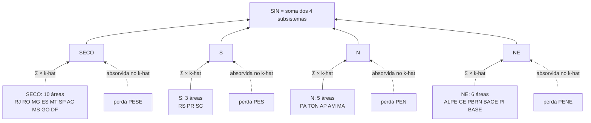

Metodologia · 1.1

O PrevCarga prevê a carga semi-horária (48 patamares por dia) de cada uma das 24 áreas-folha do SIN, a partir de uma origem O, por oito membros de cinco plugins de modelo. Em cada folha, os membros são combinados por uma média convexa com pesos congelados; os subsistemas saem da soma das folhas corrigida pelo k-hat, e o SIN é a soma dos quatro subsistemas. A entrega cobre de O a O+8 (D−1 a D+7). A rodada diária e o backtest rodam o mesmo código.

## Os modelos internos do DESSEM

O método DESSEM tem 14 modelos internos, declarados em <Tag>models/_dessem-engine/model_parameters.json</Tag>. Eles se dividem em quatro famílias, cada uma com variantes pela temperatura usada como exógena (máxima, média, máxima e mínima, ou nenhuma, nas variantes `Univariado`):

| Família | Modelos internos | Média diária | Perfil horário |
|---|---|---|---|
| Radial (SVM, kernel radial) | `Radial.TmpMaxima`, `Radial.TmpMedia`, `Radial.TmpMaxMin`, `Radial.Univariado` | SVM (`SVM_DemandaMedia`) | SVM horário (`SVMhorario`) |
| Linear (SVM, kernel linear) | `Linear.TmpMaxima`, `Linear.TmpMedia`, `Linear.TmpMaxMin`, `Linear.Univariado` | SVM (`SVM_DemandaMedia`) | SVM horário (`SVMhorario`) |
| RegDin.Radial | `RegDin.Radial.TmpMax`, `RegDin.Radial.TmpMed` | regressão dinâmica, ARIMA com regressores (`RD_DemandaMediaHyndman`) | SVM horário (`SVMhorario`) |
| RedeNeural | `RedeNeural.TmpMaxima`, `RedeNeural.TmpMedia`, `RedeNeural.TmpMaxMin`, `RedeNeural.Univariado` | rede neural (`RN_DemandaMedia`) | SVM horário (`SVMhorario`) |

Cada modelo interno prevê separadamente a média diária e o perfil horário. A configuração muda com o tipo de dia: para os dias especiais, a janela de dados e os lags de dia da semana vêm de `janelaDadosFer`, por código de tipo de dia (`tipoDiaEsp`).

O PrevCarga usa as famílias Linear e RegDin, como os plugins `dessem-linear` e `dessem-regdin` sobre um motor comum, `models/_dessem-engine` (ver [Família DESSEM](/metodologia/dessem-estrutura)). A família RedeNeural (`RN_DemandaMedia`) não está entre os membros. Ao lado das duas famílias DESSEM estão Random Forest, LightGBM e Holt-Winters.

## Duas decisões de desenho

| Decisão | Por quê | Onde está |
|---|---|---|
| Estágios de treino e inferência separados; o artefato é congelado (`engine_svm_freeze`/`engine_svm_thaw` no motor); o corte intradiário é derivado do próprio dado de carga | Com treino e previsão no mesmo passo, sem artefato persistido, a amostra de treino dependeria do dia previsto (a janela muda com o tipo do dia-alvo) | [Os três cortes](/metodologia/tres-cortes), [Os modelos](/metodologia/modelos-visao-geral) |
| Todo membro passa pelo mesmo conversor para o LONG de 8 colunas, validado | Um contrato de saída único evita a convenção D+n e a mistura de grades horária e semi-horária, que levam a erros de um dia inteiro | [Dados de entrada](/metodologia/dados-de-entrada), [Schema LONG](/arquitetura/schema-long) |

## O que é previsto

- **Variável:** carga semi-horária, 48 patamares por dia, por área-folha.
- **Grade:** todo membro entrega na grade de 30 min. Os plugins que modelam em base horária (Random Forest e DESSEM, `granularity_min: 60` no `run.yaml`) declaram no descriptor a regra de passagem para 30 min, e a fundação a aplica.
- **Faixa de entrega:** começa para todos no primeiro intervalo depois de `available_until` e termina por membro, pelo `delivery_days` do descriptor (a grade vai até `O + delivery_days` 00:00).

| Plugin | Membros | `delivery_days` | Entrega |
|---|---|---|---|
| `random-forest` | RF | 9 | O..O+8 (D−1..D+7) |
| `lgbm` | LGBM | 2 | O..O+1 (D−1..D) |
| `holt-winters` | HW | 9 | O..O+8 (D−1..D+7) |
| `dessem-regdin` | RGD_MED, RGD_MAX | 9 | O..O+8 (D−1..D+7) |
| `dessem-linear` | LIN_MED, LIN_MAX, LIN_MXMN | 9 | O..O+8 (D−1..D+7) |

Em cada lead, a combina usa só os membros que cobrem aquele lead. Depois de O+1, o LGBM sai da combinação.

## Nomenclatura: DESSEM e código

O código usa a origem O e o deslocamento `d_plus`. A nomenclatura de dias do DESSEM aparece entre parênteses quando ajuda. A correspondência abaixo é derivada de `scripts/lib/dates.R` e `scripts/lib/build_long_output.R`:

| Código | DESSEM | Significado |
|---|---|---|
| O (`--origin`) | D−1 | Dia da rodada. Omitido, é o dia do último intervalo de carga do deck, nunca o relógio |
| O−1 | D−2 | Último dia completo de carga; teto do `last_data_day` do treino |
| `d_plus = 0` | D−1 | Resto do dia O depois do corte (`available_until`) |
| `d_plus = 1` (O+1) | D | Primeiro dia cheio |
| `d_plus = k+1` | D+k | Dia k depois de D |
| `d_plus = 8` (O+8) | D+7 | Último dia da entrega |

As duas colunas de posição do LONG são:

- `d_plus` = dia do `interval_start` menos O;
- `lead = d_plus·48 + slot`, com `slot` de 1 a 48 dentro do dia. O lead é cumulativo no horizonte e não reinicia a cada dia (ver [Schema LONG](/arquitetura/schema-long)).

:::note Por que não usar D+n no código
O ADR-0002 registra que a convenção D+n e as grades mistas levam a erros de um dia inteiro. Por isso o LONG é ancorado em O (`d_plus = 0` é o dia da rodada) e o vocabulário D−1/D/D+1 fica só na leitura.
:::

## A árvore do SIN

A topologia tem uma fonte única: <Tag>config/topology.yaml</Tag>, carregada e validada por `scripts/lib/topology.R`. São quatro subsistemas na ordem SECO, S, N, NE, com 24 áreas-folha e uma perda declarada por subsistema:

| Subsistema | Áreas-folha | Perda |
|---|---|---|
| SECO | RJ, RO, MG, ES, MT, SP, AC, MS, GO, DF (10) | PESE |
| S | RS, PR, SC (3) | PES |
| N | PA, TON, AP, AM, MA (5) | PEN |
| NE | ALPE, CE, PBRN, BAOE, PI, BASE (6) | PENE |

A perda não é prevista nem somada como série. O ADR-0015 a trata como resíduo contábil, `L_true = SS_true − BU_true`, e o k-hat aprende a razão entre a carga verificada do subsistema e a soma das folhas. Área nova se cria só no YAML; nenhum código muda.

<Figura id="FIG-M01" titulo="Agregação folha → subsistema → SIN" natureza="Estrutura" fontes={['config/topology.yaml', 'docs/adr/0015-reconciliacao-bottomup-khat.md']} adrs={['ADR-0001', 'ADR-0015']}>

</Figura>

## Unidade de cálculo e MAP/REDUCE

A unidade atômica é a célula **membro × área × origem × modo** (treino ou inferência). Cada célula é independente e determinística: `prevcarga_train(member, area, origin, ctx)` e `prevcarga_infer_cell(member, area, origin, ctx)` tratam uma célula por chamada, e o laço sobre origens não mora no modelo (ADR-0009).

- **MAP:** todas as células de uma origem, sem dependência entre si. No backtest a célula ganha o corte intradiário (membro × folha × origem × corte, `scripts/lib/backtest.R`).
- **REDUCE:** por origem, depois que todas as células terminam. Combina os membros em cada folha e reconcilia na árvore (ADR-0001).

Um modelo novo é uma pasta nova em `models/`, sem edição no harness (ADR-0009).

## A cadeia em três etapas e a rodada

A previsão sobe em três etapas:

1. **Previsão por membro em cada folha.** Os oito membros de <Tag>config/topology.yaml</Tag> rodam em cada uma das 24 folhas. Um membro `origin_agnostic` (RF, LGBM) só lê o artefato já treinado; um membro `origin_scoped` (HW e DESSEM) treina uma vez na rodada quando não há artefato da origem O.
2. **Combinação por folha.** A combina aplica `a + Σ wᵢ·fᵢ`, com `wᵢ ≥ 0` e `Σ wᵢ = 1`, usando os pesos congelados no treino da combina, sem reajuste na rodada (ver [Combinação convexa](/metodologia/combina)).
3. **Reconciliação até o SIN.** Em cada subsistema, `y_pred = BU_pred × k-hat`, onde `BU_pred` é a soma das folhas e o k-hat é um perfil por hora × mês × dia da semana ajustado na janela `[O−W, O−1]` (W padrão 730 dias). O perfil usado na rodada tem de ter sido ajustado na própria origem (`khat_origin == O`). O SIN é a soma dos quatro subsistemas (ver [Reconciliação](/metodologia/reconciliacao)).

Na rodada diária, `prevcarga forecast` chama `prevcarga_forecast` (`scripts/lib/forecast.R`), que só compõe funções de outros módulos e roda uma única origem O. A ordem é fixa:

1. **validate-deck** (validação do deck), antes de qualquer inferência;
2. **plan**: as folhas pedidas contra a topologia;
3. **infer** por membro × folha;
4. **build_long**: a entrega de cada membro vira LONG;
5. **combina** por folha;
6. **reconcile**, uma vez e em memória;
7. **export** imutável da entrega.

A validação pode ser pulada com `--skip-validate`. Mesmo assim, os cortes (`available_until`, regra de clima, fuso) vêm sempre do leitor. O relatório é opcional (`--report`, em html por padrão; `--report-format` aceita `html` ou `pdf`) e roda só depois de a entrega estar gravada. Se ele falhar, a rodada sai com `partial.report_failed` (exit 14) e a entrega publicada não é desfeita.

<Terminal title="prevcarga — bash" lines={[{type:'cmd',text:'prevcarga forecast --origin 2026-10-15 --report'}]} />

Os passos exatos e o ponto em que cada falha encerra a rodada estão em [Rodada diária](/execucao/rodada-diaria).

O backtest reusa o mesmo código. O harness só trunca o tempo: o corte vira `truncate_at` para o leitor único, que deriva o `available_until` como na produção. O treino e a inferência de cada célula usam as fachadas de produção, e o REDUCE refaz a combina honesta por mês e o k-hat em cada origem (ver [Backtest](/metodologia/backtest)).

```mermaid
flowchart LR
  D["Deck: carga verificada, clima previsto e observado, feriados + manifest"]
  G["Validação do deck (validate-deck)"]
  C["Leitor: available_until do dado de carga"]:::corte
  T["Corte de treino por membro (dates.R)"]:::corte
  subgraph MAP["MAP: célula membro × folha"]
    M["8 membros × 24 folhas<br/>O..O+8; LGBM O..O+1"]:::plugin
    L["LONG de 8 colunas"]
  end
  subgraph REDUCE["REDUCE: por origem"]
    K["Combina por folha<br/>a + Σ wᵢ·fᵢ"]:::fundacao
    B["Bottom-Up por subsistema × k-hat"]:::fundacao
    S["SIN = soma dos subsistemas"]:::fundacao
  end
  E["Export imutável"]
  R["Relatório opcional"]
  BT["Backtest: o mesmo código, tempo truncado"]
  D --> G --> C --> T --> M --> L --> K --> B --> S --> E --> R
  BT -.-> C
```

<Figura id="FIG-M02" titulo="Da folha ao SIN: MAP e REDUCE" natureza="Fluxo" fontes={['scripts/lib/forecast.R', 'scripts/lib/dates.R', 'scripts/lib/backtest.R', 'config/topology.yaml', 'docs/estado/m6-forecast.md', 'docs/estado/combination.md', 'docs/estado/reconcile.md', 'docs/adr/0001-topologia-sin-map-reduce.md', 'docs/adr/0009-arquitetura-modular-modelo.md']} adrs={['ADR-0001', 'ADR-0009', 'ADR-0013', 'ADR-0015']}>

</Figura>

## Princípios que tornam a previsão sem vazamento e reprodutível

- **Três cortes de data distintos.** A origem O é o único flag humano; o corte de treino é derivado por membro pela classe de split; o corte intradiário vem do próprio dado de carga. Um corte uniforme vazaria horizonte ([Os três cortes](/metodologia/tres-cortes)).
- **Nenhum dado posterior ao corte.** A previsão nunca usa informação posterior aos cortes. Guardas de honestidade abortam a execução com a classe `honesty` (exit 15) quando um corte seria violado: `honesty.khat_after_origin` para um perfil k-hat ajustado com verdade posterior a O−1, `honesty.data_lag_negative` para um `data_lag_days` negativo que levaria o dia da origem para o treino ([Erros e códigos de saída](/arquitetura/erros-exit)).
- **Determinismo fixado no processo.** `scripts/lib/runtime.R` roda primeiro em todo comando e fixa fuso, locale e BLAS de uma thread dentro do processo, sobrescrevendo o que vier do shell; o resto do pacote não lê variáveis de ambiente ([Determinismo](/metodologia/determinismo)).
- **Módulos importáveis e fontes únicas.** Cada módulo é uma função R; topologia, métrica e ajuste de hora têm um dono só ([Princípios da arquitetura](/arquitetura/principios)).
