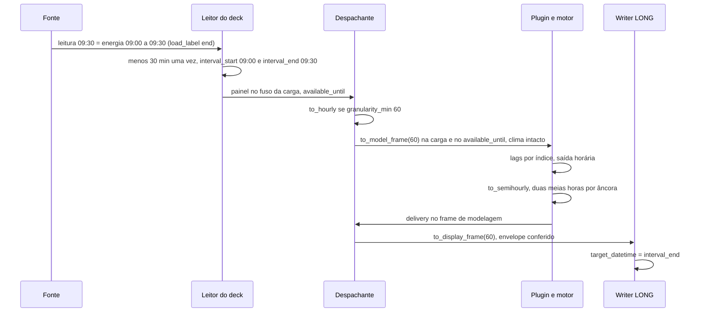

<span className="pc-overline">Metodologia · 1.3</span>

<p className="pc-lead">A carga é uma integral de meia hora. O leitor único do deck converte o rótulo da fonte uma vez, para o par <code>interval_start</code>/<code>interval_end</code>, e põe toda data-hora no fuso declarado no <code>manifest.json</code>. Daí em diante só a fundação mexe no tempo: o despachante reamostra para 60 min quando o modelo pede e aplica o deslocamento de modelagem declarado no descriptor (60 min no DESSEM, 0 nos demais). Nenhum plugin, motor ou adapter faz aritmética de hora. Na saída, o LONG carimba cada valor no fim do intervalo.</p>

Esta é a única página que explica o deslocamento de 60 min do DESSEM. As páginas da família DESSEM apontam para cá.

## Carga como integral e o rótulo da fonte

Cada linha de carga do deck é a energia de um intervalo de 30 min. A fonte carimba esse intervalo com um único instante, e o deck declara qual é: o fim (`end`) ou o início (`start`). O leitor (`scripts/lib/deck_reader.R`) converte esse carimbo em intervalo:

| Leitura na fonte | `load_label` | `interval_start` | `interval_end` |
|---|---|---|---|
| 09:30 | `end` | 09:00 | 09:30 |
| 09:30 | `start` | 09:30 | 10:00 |

Com `end` o leitor subtrai 30 min; com `start` o carimbo já é o início. Em ambos os casos `interval_end = interval_start + 30 min`, e a coluna crua `timestamp` não sai do leitor.

O template do manifest do store (`config/deck-manifest.store.json`) declara `start`. Esse valor ainda está a confirmar (ver a pendência na seção de fusos).

### Precedência

O valor do rótulo é resolvido por `prevcarga_resolve_load_label`, nesta ordem:

| Ordem | Origem | `load_label_source` |
|---|---|---|
| 1 | `load_label` no `manifest.json` do deck | `manifest` |
| 2 | flag `--load-label end\|start` | `flag` |
| 3 | `load_label` no `config.yaml` | `config` |
| 4 | padrão | `default` (valor `end`) |

O manifest vence. Se a flag for passada com um valor diferente do manifest, o leitor aborta com `contract.load_label_conflict` (classe `contract`, exit 2). O `config.yaml` não gera conflito: com manifest presente, ele é simplesmente ignorado. O valor e a origem viajam como atributos da carga (`load_label`, `load_label_source`) e aparecem no cabeçalho do `validate-deck`.

:::note O rótulo é propriedade do deck
`load_label` é opcional no schema v1 do manifest. Quando ausente, vale a flag, depois o config, depois `end`. Valor fora de `end`/`start` no manifest aborta com `contract.manifest_invalid`; na flag ou no config, com `config.bad_load_label`.
:::

## `interval_start` e `interval_end`

As duas colunas convivem dentro do sistema, cada uma com um papel:

| Coluna | Para que serve | Onde |
|---|---|---|
| `interval_start` | chave da carga `(area_code, interval_start)`; agregação horária; dia a que a meia hora pertence; recorte do treino pelo `last_data_day`; bucket do k-hat | leitor, `to_hourly`, despachante, ingestão dos plugins, reconciliação |
| `interval_end` | disponibilidade (`interval_end <= available_until`); o próprio `available_until`; grade de entrega; `target_datetime` do LONG | leitor, `prevcarga_delivery_grid`, envelope do membro, writer do LONG |

O `available_until` é o `interval_end` do último intervalo contíguo desde O 00:00, por área, e o global é o mínimo entre áreas. Ele é derivado do dado, nunca do relógio. O detalhe está em [Os três cortes de data](/metodologia/tres-cortes).

### A regra de borda: uma vez na entrada, uma vez na saída

O rótulo é operado em dois pontos, e só neles:

1. **Entrada** (`scripts/lib/deck_reader.R`): o carimbo da fonte vira `interval_start`/`interval_end`, conforme `load_label`.
2. **Saída** (`scripts/lib/schema_long.R`): o LONG tem uma única coluna de data-hora, `target_datetime`, rotulada pelo `interval_end`. O writer usa `prevcarga_long_target_datetime` (início + 30 min) e quem lê o LONG usa `prevcarga_long_interval_start` (fim − 30 min). As duas funções exigem `granularity_min = 30` e, quando recebem o fuso, conferem que é o da carga.

Os consumidores do LONG (combina, reconciliação, backtest, avaliação) obtêm `interval_start` por essas funções de borda. Nenhum deles soma ou subtrai 30 min por conta própria.

### Onde mora a aritmética de 30 min

Somar ou subtrair 30 min (`minutes(30)`, `minutes(-30)`, `dminutes(30)`, `seconds(1800)`, `± 1800`) só acontece em três arquivos:

| Arquivo | Por quê |
|---|---|
| `scripts/lib/deck_reader.R` | borda do deck: rótulo para intervalo e passo do `available_until` |
| `scripts/lib/features.R` | reamostragem `to_semihourly` (duas meias horas por âncora horária), não rótulo |
| `scripts/lib/schema_long.R` | borda do LONG: o único par `target_datetime` ↔ `interval_start` |

Passos de grade (`seq(..., by = "30 min")`) não são deslocamento de rótulo e ficam fora dessa regra.

## Fusos declarados no `manifest.json`

O store grava data-hora sem fuso (`timestamp[ns]` ingênuo). O fuso de cada coluna é declarado no bloco `timezone` do manifest, com nomes IANA (ADR-0037). Não existe fuso padrão.

| Chave em `timezone` | Coluna | Obrigatória | Template do store |
|---|---|---|---|
| `load` | `load.timestamp` | sempre | `Etc/GMT+3` |
| `weather_observed` | `weather_observed.timestamp` | se o dataset existe | `Etc/GMT+3` |
| `weather_forecast.valid_time` | `weather_forecast.valid_time` | se o dataset existe | `Etc/GMT+3` |
| `weather_forecast.issue_time` | `weather_forecast.issue_time` | se o dataset existe | `UTC` |
| `holidays` | `holidays.date` | opcional | `Etc/GMT+3` |
| `dst_periods` | `dst_periods.date` | opcional | não declarado |

`Etc/GMT+3` segue a convenção POSIX de sinal invertido: é UTC−3, sem horário de verão.

Fuso ausente aborta com `contract.tz_missing`; fora de `OlsonNames()`, com `contract.tz_invalid`; parquet que já traz fuso, com `contract.tz_in_parquet`. As três saem com exit 2.

### A conversão

Para cada coluna de data-hora, `.prevcarga_apply_tz` faz três passos com lubridate:

```r title="scripts/lib/deck_reader.R"
.prevcarga_apply_tz <- function(x, declared, tz_load) {
  digits <- lubridate::with_tz(x, tzone = "UTC")
  lubridate::with_tz(lubridate::force_tz(digits, tzone = declared), tzone = tz_load)
}
```

1. `with_tz(UTC)` recupera os dígitos gravados, sem depender do fuso da sessão.
2. `force_tz(declarado)` diz que fuso esses dígitos tinham.
3. `with_tz(fuso da carga)` leva o instante para o fuso de trabalho.

Toda coluna de data-hora sai do leitor no fuso da carga, inclusive o `issue_time` declarado em UTC. O fuso da carga vira o atributo `tz` do painel e o `cuts$tz` que os estágios recebem. No painel de treino, o despachante recusa coluna de tempo fora do fuso de `cuts` (`plugin.raw_timestamp`), e o motor DESSEM confere o mesmo no deck que recebe (`engine.dessem_tz_mismatch`).

### A armadilha do timestamp ingênuo

O arrow entrega o `timestamp[ns]` ingênuo como `POSIXct` cujo instante é o dos dígitos lidos como UTC, mas com o fuso do host. Numa sessão em `America/Sao_Paulo`, um valor gravado como 09:00 aparece como 06:00, três horas antes. O dado não está errado; a exibição está. Para inspecionar o store fora do leitor, formate em UTC:

```r
format(x, tz = "UTC")
```

O leitor não depende dessa exibição: o primeiro passo da conversão já recupera os dígitos.

<Pendente titulo="Pendente · manifest do store real">
O store real em <code>data/</code> ainda não tem <code>manifest.json</code>, e o leitor aborta com <code>contract.manifest_missing</code> até o store ser regravado. Os valores do template <code>config/deck-manifest.store.json</code> (rótulo <code>start</code>, fusos e atraso de publicação de 6 h) estão marcados como a confirmar.
</Pendente>

## Deslocamento de modelagem centralizado

### Por que existe

A relação física que o DESSEM modela é: a temperatura no instante t explica a energia consumida na hora que começa em t. Com o carimbo de fim de intervalo, essa energia está rotulada em t + 1 h. Para juntar as duas no mesmo rótulo, a carga precisa recuar 1 h no frame de modelagem e voltar 1 h no frame de exibição (ADR-0019). Isso é uma propriedade do dado, não do motor, e por isso mora na fundação.

### Como é aplicado

Cada plugin declara no descriptor o campo `model_time_offset_min`, inteiro ≥ 0, com padrão 0:

| Plugin | `model_time_offset_min` |
|---|---|
| `random-forest` | 0 (padrão) |
| `lgbm` | 0 (padrão) |
| `holt-winters` | 0 (padrão) |
| `dessem-linear` | 60 |
| `dessem-regdin` | 60 |

O despachante (`scripts/lib/registry.R`) é o único que chama `to_model_frame` e `to_display_frame` (`scripts/lib/features.R`):

- **Entrada**: `.prevcarga_plugin_to_model` aplica `to_model_frame` com o offset em `interval_start` e `interval_end` da carga e em `cuts$available_until`. Com offset 0 o painel passa intocado.
- **O que não é deslocado**: clima observado e previsto, dias e feriados. A temperatura fica no seu `valid_time`.
- **Saída**: o `delivery$interval_end` devolvido pelo plugin volta por `to_display_frame` antes da conferência do envelope. O carimbo do artefato e o envelope ficam no frame de exibição.

Dentro do motor DESSEM, os lags de atributo são por índice na grade regular (`obtemLagHora` na grade horária, `obtemLagSemiHora` na de 30 min), não por `hours(...)`. Série com slot faltante aborta com `engine.dessem_lag_grid_gap`. Toda construção de hora no motor usa lubridate com fuso explícito (`models/_dessem-engine/README.md`).

O LGBM mantém offset 0. O spike do ADR-0019 mediu o alinhamento temperatura-carga do LGBM e do RF e não indicou correção (`docs/estado/m5-training.md`).

<Figura id="FIG-M03" titulo="Rótulo da carga e deslocamento de modelagem: ida e volta" natureza="Fluxo" fontes={['docs/estado/deck_reader.md', 'docs/estado/plugin_dispatch.md', 'docs/estado/schema_long.md', 'scripts/lib/features.R', 'models/_dessem-engine/README.md', 'docs/adr/0019-alinhamento-temp-carga-invariante.md']} adrs={['ADR-0012', 'ADR-0019', 'ADR-0035']}>



</Figura>

### Exemplo de uma hora no DESSEM

Deck com `load_label: end`, hora 09:00–10:00 de um dia histórico:

| Etapa | Carga | Temperatura |
|---|---|---|
| Fonte | leituras 09:30 e 10:00 | instantes 09:00 e 09:30 |
| Leitor | `interval_start` 09:00 e 09:30 | `valid_time` 09:00 e 09:30 |
| `to_hourly` | hora com `interval_start` 09:00, `interval_end` 10:00, média das duas meias horas | `valid_time` 09:00, média dos dois instantes |
| `to_model_frame(60)` | `interval_end` 09:00 | sem mudança: 09:00 |
| Deck do motor | `CARGAHIST$DataHora` = 09:00 | `EXOGENAHIST$DataHora` = 09:00 |

A carga da hora que começa às 09:00 fica no mesmo rótulo da temperatura das 09:00, que é a relação que o motor modela.

### O princípio no código

O código dos plugins (`models/*/R`) e do motor (`models/_dessem-engine/R`) não tem aritmética de hora. A contagem registrada em `docs/estado/plugins_porte_fechamento.md` é zero ocorrência, sem exceção, nos 5 plugins (os 8 membros) e no motor.

## Granularidade 30 × 60 e a hora incompleta

### Quem modela em quê

| Membro | `granularity_min` (`run.yaml`) | `weather_resample` | Regra semi-horária |
|---|---|---|---|
| RF | 60 | `raw` | `rf_semihourly_rule` |
| LGBM | 30 | não se aplica | nenhuma |
| HW | 30 | não se aplica | nenhuma |
| dessem-linear (3 membros) | 60 | `hourly` | `dl_semihourly_rule` |
| dessem-regdin (2 membros) | 60 | `hourly` | `rd_semihourly_rule` |

O registro do plugin exige `weather_resample` (`hourly` ou `raw`) quando `granularity_supported` inclui 60 e o recusa quando o plugin só suporta 30 (`registry.weather_resample`). A regra semi-horária segue a mesma condição.

### Reamostragem só no despachante

`.prevcarga_plugin_resample` é o único ponto que reamostra. Com `granularity_min` 30 o painel passa cru. Com 60 roda `to_hourly`:

- **Carga**: a hora é a média dos dois intervalos com `interval_start` H:00 e H:30, agrupados por `interval_start`. A hora sai com `interval_start` H:00 e `interval_end` H+1:00.
- **Clima**: com `weather_resample: hourly`, a hora é a média dos instantes `valid_time` H:00 e H:30; com `raw`, o clima segue em 30 min. O RF usa `raw` porque calcula máxima e mínima diárias sobre as leituras de 30 min.
- **Hora incompleta**: só entra a hora com as duas meias horas presentes. A hora com uma só some, na carga e no clima.

Granularidade fora de 30 ou 60 aborta com `features.bad_granularity`. A reamostragem roda antes do deslocamento de modelagem, no treino e na inferência.

Na rodada, a hora incompleta tem efeito direto. Com `available_until` às 09:30 de O, a hora 09:00–10:00 tem só a primeira meia hora e é descartada pelo `to_hourly`. Entre os membros que leem o dia O (`reads_day_O`), o DESSEM, horário, enxerga a carga de O até 09:00, e o LGBM, em 30 min, até 09:30. RF e HW não leem a carga do dia O.

### Volta para 30 min

Os membros horários produzem 24 valores por dia. A volta para a grade de 48 intervalos acontece depois do modelo, na inferência, por `to_semihourly` (`scripts/lib/features.R`):

1. O plugin entrega a regra (`semihourly_rule`) que transforma cada valor horário em dois valores, na ordem meia hora anterior à âncora e âncora.
2. `to_semihourly` aplica a regra e carimba os dois `interval_end` (âncora − 30 min e âncora). O carimbo de 30 min é central; o plugin não o calcula.
3. Saem só os intervalos depois de `available_until` e até o fim do último dia.

As regras são desagregações monotônicas com spline `monoH.FC`:

- **RF**: spline na grade de meias horas, com cada meia hora interior presa entre as duas âncoras vizinhas e o último slot por extrapolação linear.
- **DESSEM**: `desagregaModeloSH` do motor, média de dois splines e reescala para que o par de meias horas preserve o valor horário. Se falhar, a regra duplica o valor horário nas duas meias horas e emite um aviso (`warning.dessem_linear_desagrega_fallback` ou `warning.regdin_desagrega_fallback`).

A regra só roda sobre a saída horária da inferência. O treino segue em 60 min e não recebe os valores desagregados.

### Início da entrega

A grade de entrega (`prevcarga_delivery_grid`) começa no primeiro intervalo depois do corte: o primeiro `interval_end` é `available_until` + 30 min, e o último é 00:00 do dia O + `delivery_days`. Com `available_until` às 09:30, a entrega começa em 10:00. A faixa de cada membro está em [Os modelos](/metodologia/modelos-visao-geral).
