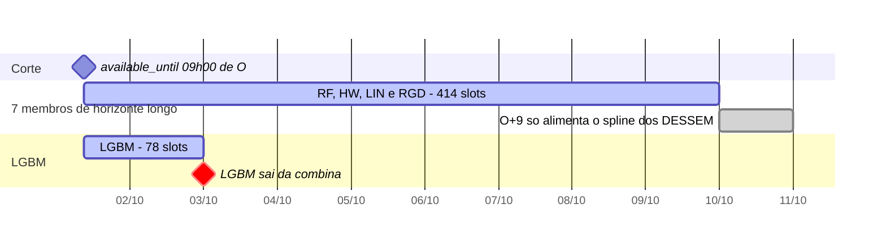

Metodologia · 1.5

A combina recebe 8 membros, gerados por 5 diretórios de modelo em <code>models/</code>. Cada membro declara no seu <code>run.yaml</code> e no descriptor do plugin tudo o que a fundação precisa saber dele: granularidade, classe de split, horizonte, faixa de entrega, janelas de histórico, semente e modos. Nenhum módulo da fundação decide nada pelo nome do modelo. Esta página reúne esses atributos num quadro e mostra o que se repete entre os modelos, antes das páginas de cada família.

## As 5 famílias e os 8 membros

Os membros da combina são a lista `members:` de `config/topology.yaml`. Cada entrada tem uma `sigla`, o diretório do modelo (`mdir`) e, quando o modelo tem variante, a `exogena`.

| Sigla | Diretório (`mdir`) | `exogena` | Família |
|---|---|---|---|
| `RF` | `random-forest` | — | Random Forest multi-saída |
| `LGBM` | `lgbm` | — | LightGBM semi-horário |
| `HW` | `holt-winters` | — | Holt-Winters semi-horário |
| `RGD_MED` | `dessem-regdin` | `MED` | DESSEM, regressão dinâmica |
| `RGD_MAX` | `dessem-regdin` | `MAX` | DESSEM, regressão dinâmica |
| `LIN_MED` | `dessem-linear` | `MED` | DESSEM, SVM linear |
| `LIN_MAX` | `dessem-linear` | `MAX` | DESSEM, SVM linear |
| `LIN_MXMN` | `dessem-linear` | `MXMN` | DESSEM, SVM linear |

Os 5 diretórios formam dois grupos:

- **Duas famílias DESSEM, com motor comum.** O `dessem-linear` (`LIN_MED`, `LIN_MAX`, `LIN_MXMN`) e o `dessem-regdin` (`RGD_MED`, `RGD_MAX`) rodam sobre o mesmo motor, `models/_dessem-engine`, que cada plugin declara em `engine = "_dessem-engine"`. A variante escolhe a chave do motor em `model_parameters.json`: `Linear.TmpMedia`, `Linear.TmpMaxima` e `Linear.TmpMaxMin` no linear; `RegDin.Radial.TmpMed` e `RegDin.Radial.TmpMax` no regdin.
- **Três famílias de código próprio:** `LGBM`, `RF` e `HW`. Cada uma tem um único membro e nenhuma usa motor compartilhado.

:::note O que não é membro
`_dessem-engine` não é membro. Ele não tem `run.yaml` nem entrada em `members:`: é só o motor de primitivas que os dois plugins DESSEM carregam. O loader da topologia recusa membro cujo `mdir` não tenha `run.yaml`. `RGD_MXMN` não existe: o `params_schema` do `dessem-regdin` só aceita `MED` e `MAX`, e o loader recusa outro valor de `exogena` com `plugin.bad_run_yaml`; o próprio plugin repete a guarda com `plugin.regdin_bad_exogena`.
:::

O detalhe de cada família está em [Random Forest](/metodologia/random-forest), [LightGBM](/metodologia/lightgbm), [Holt-Winters](/metodologia/holt-winters) e [Família DESSEM](/metodologia/dessem-estrutura).

## Quadro comparativo

Os atributos vêm de duas fontes. O `run.yaml` de cada diretório traz `split`, `granularity_min`, `horizon_days`, `history_days`, `seed`, `modes` e `backtest.protocol_default`. O descriptor (`plugin_descriptor()` em `R/register.R`) traz `delivery_days`, `data_lag_days`, `model_time_offset_min`, `reads_day_O`, `native_layout` e as demais flags. O loader da fundação (`scripts/lib/registry.R`) completa o que o descriptor omite: `data_lag_days` e `model_time_offset_min` valem 0, e as flags lógicas valem `FALSE`.

### Método e insumos

| | RF | LGBM | HW | dessem-linear | dessem-regdin |
|---|---|---|---|---|---|
| Granularidade interna | horária (216 leads) | semi-horária | semi-horária | horária | horária |
| Metodologia | 216 `randomForest`, um por lead horário | LightGBM com BLF de duas passadas | `forecast::hw` diário e 48 intervalares | demanda média diária (DM) e perfil horário, ambos por SVM de kernel linear | DM por regressão dinâmica (`ARIMA` do fable) e perfil horário por SVM de kernel radial |
| Temperatura | prevista: máxima e mínima diárias | prevista, semi-horária (no treino, lead 0) | observada no histórico, prevista no horizonte | observada no histórico, prevista no horizonte | observada no histórico, prevista no horizonte |
| `weather_resample` | `raw` | — | — | `hourly` | `hourly` |
| Variante | — | — | — | `exogena`: `MED`, `MAX`, `MXMN` | `exogena`: `MED`, `MAX` |

A regra semi-horária dos modelos horários também é do plugin: o RF interpola as 216 âncoras horárias para a grade de meia hora com um spline `monoH.FC`; os DESSEM usam `desagregaModeloSH` do motor. O carimbo de 30 min é sempre do `to_semihourly` da fundação.

### Contrato com a fundação

| Atributo | RF | LGBM | HW | dessem-linear | dessem-regdin |
|---|---|---|---|---|---|
| `split` | `origin_agnostic` | `origin_agnostic` | `origin_scoped` | `origin_scoped` | `origin_scoped` |
| `granularity_min` | 60 | 30 | 30 | 60 | 60 |
| `horizon_days` | 9 | 1 | 8 | 9 | 9 |
| `delivery_days` | 9 | 2 | 9 | 9 | 9 |
| Entrega | O..O+8 | O..O+1 | O..O+8 | O..O+8 | O..O+8 |
| `history_days` (train / infer) | 365 / 45 | 730 / 45 | 730 / 45 | 1.825 / 1.825 | 1.825 / 1.825 |
| `seed` | 123 | 123 | 1234 | 42 | 42 |
| `modes` | train, infer | train, infer | train, infer, forecast | train, infer, forecast | train, infer, forecast |
| `data_lag_days` | 0 | 2 | 0 (omitido) | 0 | 0 |
| `model_time_offset_min` | 0 (omitido) | 0 (omitido) | 0 (omitido) | 60 | 60 |
| `reads_day_O` | `FALSE` | `TRUE` | `FALSE` | `TRUE` | `TRUE` |
| `uses_rng` | `TRUE` | `FALSE` (omitido) | `TRUE` | `TRUE` | `TRUE` |
| `history_infer_equals_train` | `FALSE` | `FALSE` | `FALSE` | `TRUE` | `TRUE` |
| `native_layout` | `rf_wide_hourly_216` | `lgbm_day_48` | `hw_matrix_nx48` | `dessem_semihourly_48` | `dessem_semihourly_48` |
| `protocol_default` | `daily` | `daily` | `retrain_harness` | `retrain_harness` | `retrain_harness` |

Como ler algumas linhas:

- **`split`, `horizon_days` e `data_lag_days`** definem o corte de treino em `scripts/lib/dates.R` (ADR-0023). Em `origin_agnostic`, `train_origin = O − 1 − H`; em `origin_scoped`, `train_origin = O`. Em todos, `last_data_day = O − 1 − data_lag_days`: O−1 nos 7 membros de `data_lag_days` 0 e O−3 no LGBM. Ver [Os três cortes de data](/metodologia/tres-cortes).
- **`horizon_days` não é a faixa entregue.** A faixa vem de `delivery_days`. No HW, `horizon_days` 8 são os passos O+1..O+8 e o dia O sai de um passo a mais. No LGBM, H = 1 e a entrega cobre O e O+1.
- **`model_time_offset_min`** é a única declaração do deslocamento de hora de modelagem. Só os DESSEM declaram 60; o despachante aplica `to_model_frame` e `to_display_frame` por esse valor e nenhum plugin faz aritmética de hora. Ver [Tempo: rótulo da carga, fusos e ajuste de hora](/metodologia/tempo-rotulo-fusos).
- **`reads_day_O`** diz se o plugin lê a carga do próprio dia O até `available_until`. O LGBM a usa para completar o dia O; os DESSEM, para a cabeça de nowcast. RF e HW leem só dias anteriores a O.
- **`native_layout`**: os dois DESSEM declaram `dessem_semihourly_48`. O nome `dessem_matrix_nx48`, que aparece nos READMEs, não está na lista `prevcarga_native_layouts` do loader.
- **`history_infer_equals_train`**: nos DESSEM a janela da inferência é a mesma do treino (1.825 dias). O `run.yaml` do `dessem-regdin` reforça com `constraints: {infer_history_equals_train: true}`.

## Faixa de entrega

Todo membro começa a entregar no primeiro intervalo depois de `available_until` e termina às 00:00 do dia `O + delivery_days`. A grade é uma só, `prevcarga_delivery_grid` (`scripts/lib/features.R`): os `interval_end` de 30 em 30 min, de `available_until + 30 min` até `O + delivery_days` às 00:00. O início depende do dado de carga; o fim, só do descriptor. A combina lê `delivery_days` do run-manifest, nunca do nome do modelo (ADR-0032).

<Figura id="FIG-M06" titulo="Faixa de entrega por membro (exemplo O = 2024-10-01, corte 09:00)" natureza="Linha do tempo" fontes={['scripts/lib/features.R', 'models/lgbm/R/register.R', 'docs/estado/m5-training.md', 'docs/estado/combination.md']} adrs={['ADR-0032']}>

</Figura>

As barras cobrem o tempo dos intervalos entregues. Em `interval_end`, o primeiro é 09:30 de O.

| Corte (`available_until`) | 7 membros de horizonte longo | LGBM |
|---|---|---|
| 09:00 | 414 `interval_end`, de 09:30 de O até O+9 00:00 | 78, de 09:30 de O até O+2 00:00 |
| 09:30 | 413, de 10:00 de O até O+9 00:00 | 77, de 10:00 de O até O+2 00:00 |

A conta é direta. No corte 09:00 restam 30 meias horas no dia O; somam-se 8 dias inteiros de 48 nos membros de `delivery_days` 9 (30 + 384 = 414) e 1 dia inteiro no LGBM (30 + 48 = 78). No corte 09:30 cada faixa perde o primeiro slot.

- **Comparação entre cortes no DESSEM.** Entre os cortes 09:00 e 09:30, o conjunto comum é de 413 `interval_end`, de 10:00 de O até O+9 00:00. Nesse conjunto as saídas dos dois cortes são iguais, porque a meia hora isolada 09:00–09:30 é descartada pelo `to_hourly` em todas as séries do DESSEM: só hora completa entra na cabeça de nowcast. Ver [DESSEM: cabeça de nowcast, RNG e invariantes](/metodologia/dessem-nowcast-rng).
- **O+9 não é entregue.** Os DESSEM rodam o motor por `horizon_days + 1` = 10 dias (O..O+9) para que o spline do último dia entregue veja o dia seguinte; o leitor precisa entregar clima previsto até O+9. O RF também calcula O+9 no bloco da origem O e o descarta. A entrega para em O+9 00:00.
- **Faixas diferentes não são desalinhamento.** Depois de O+2 00:00 a combina segue com os 7 membros restantes; o tratamento está em [Combinação convexa](/metodologia/combina).

## Padrões que se repetem

### Recursivos e diretos

| Modelo | Classe | Como o horizonte é montado |
|---|---|---|
| LGBM | recursivo | Passada 1: o Stage A prevê a forma de 48 intervalos de O e o Stage B completa o dia O com a carga real até `available_until`. Passada 2: O+1 usa o dia O completado como defasagem (`CargaGlobal_anterior_BLF`). |
| `dessem-linear` | recursivo | O motor prevê dia a dia e grava cada previsão de volta na série (`execDemandaMedia`, `execPerfil`). As defasagens da DM (1, 2 e 7 dias) e do perfil (1, 168 e 336 horas) leem valores previstos à medida que o horizonte avança. |
| `dessem-regdin` | recursivo no perfil | A DM sai do ARIMA, projetada para todo o horizonte de uma vez (`execDemandaMediaTS`); as defasagens 1, 2 e 7 dias entram só na temperatura (`lagsExogenaDia`). O perfil de dia normal segue dia a dia, com as defasagens de 1, 168 e 336 horas e a previsão gravada de volta na série (`execPerfil`). |
| RF | direto | Cada um dos 216 leads horários tem o próprio `randomForest`; nenhum lead lê a previsão de outro. |
| HW | direto | O `forecast::hw` diário e os 48 intervalares projetam todos os passos do horizonte de uma vez. |

### Como a temperatura entra

| Modelo | Forma da temperatura |
|---|---|
| LGBM | semi-horária, prevista (o treino usa o lead 0) |
| RF | máxima e mínima diárias da previsão (`tmax`, `tmin` em `helpers_weather.R`) |
| DESSEM, DM | diária, agregada pela variante: média (`MED`), máxima (`MAX`) ou máxima e mínima (`MXMN`) |
| DESSEM, perfil | horária |
| HW | fora do ajuste: o `forecast::hw` é ajustado só sobre a carga; a temperatura entra depois, no efeito de temperatura (`efeitoTemp`) usado pela modulação de feriado (`SemiFer`) |

### Calendário: variável ou filtro de amostra

O calendário entra de duas maneiras. Como **variável**, ele é coluna do modelo (dummies ou fatores de dia, mês e dia especial). Como **filtro**, ele escolhe quais dias de histórico entram na amostra de treino.

| Modelo e componente | Calendário como | Detalhe no código |
|---|---|---|
| LGBM | variável | tipo de dia, rótulos de fim de ano e dummies (`helpers_calendar.R`) |
| RF | variável | blocos de dia da semana, Natal e Ano-Novo, feriados no horizonte |
| DM do `dessem-regdin` | variável | entrada `TS_FACTOR`: fatores de dia especial, dia da semana e mês |
| DM do `dessem-linear`, dia especial | variável | entrada `ML_DEFAULT`, com dummies de dia especial, dia e mês |
| Perfil do `dessem-linear`, dia especial | variável | entrada `ML_PERFILFER` no `SVMhorario`: o tipo de dia especial entra como fator, sobre uma amostra só de dias especiais (tipos 1 a 11) na janela de dias do ano |
| DM do `dessem-linear`, dia normal | filtro | entrada `ML_LOCAL`: amostra filtrada pelo mesmo dia da semana e por uma janela de dias do ano |
| Perfil do DESSEM, dia normal | filtro | entrada `DEFAULT`: amostra da mesma hora e do mesmo dia da semana, filtrada por uma janela de dias do ano |
| Perfil do `dessem-regdin`, dia especial | filtro | `RL_perfilFeriado`: regressão linear sobre a amostra filtrada pelo tipo de dia especial, com a hora como fator |
| HW | outra via | sazonalidade semanal do próprio Holt-Winters, tratamento do histórico (dias faltantes e feriados substituídos) e modulação de feriado (`SemiFer`) |

A escolha entre o ramo de dia normal e o de dia especial é do motor: `obterDiaEspDMConfig` e `obterDiaEspPerfilConfig` em `funcoes_apoio.R`. No `dessem-regdin`, `execHorasPerfil` desvia o dia especial para `RL_perfilFeriado`. No `dessem-linear`, o mesmo `SVMhorario` troca a entrada para `ML_PERFILFER`.

## Modos de execução

1. **Treino e inferência separados existem em todos.** Os verbos são `train-models` (treina e publica no registry) e `infer-model` (1 modelo × 1 área × 1 origem, com os params do artefato congelado).
2. **Previsão acoplada só nos `origin_scoped`.** HW, `dessem-linear` e `dessem-regdin` declaram o modo `forecast` e o estágio correspondente, que treina e infere em memória no mesmo painel. O loader exige que o modo e o estágio venham juntos no descriptor (`plugin.bad_descriptor`) e recusa o `run.yaml` em que o modo `forecast` aparece sem o split `origin_scoped`, ou falta nele (`plugin.bad_run_yaml`). O acoplado é o que o protocolo de backtest `retrain_harness` chama (ver [Backtest](/metodologia/backtest)).
3. **Artefato × origem.** No RF e no LGBM (`origin_agnostic`) o artefato é independente da origem: 1 treino serve N inferências. Nos `origin_scoped` o artefato é vinculado à origem O. Na rodada diária, se não houver artefato da origem O, o `forecast` treina uma vez pela fachada de treino; para um `origin_agnostic` sem artefato ele recusa com `state.artifact_missing` e nunca treina (`scripts/lib/forecast.R`).
4. **O que a inferência faz.** RF, LGBM e HW só leem o artefato: nada é reajustado. Os DESSEM reajustam parte da DM na inferência. No `dessem-linear`, a DM de O é re-treinada: com a cabeça de nowcast, sobre as médias das horas completas do dia O, quando há alguma; sem ela, pelo SVM da DM do motor. No `dessem-regdin`, o ARIMA da DM não é congelado: a inferência o reajusta sobre a série até O−1 e confere o resultado contra o fingerprint do treino. Quando há hora completa de O, a DM usa a cabeça de nowcast com o ARIMA reancorado em O (sem ela, vale esse ARIMA base). Em dia especial, o perfil (`RL_perfilFeriado`) é recalculado na inferência. O detalhe está em [DESSEM: cabeça de nowcast, RNG e invariantes](/metodologia/dessem-nowcast-rng).

| Modelo | `split` | Modos | Artefato | Reajuste na inferência |
|---|---|---|---|---|
| RF | `origin_agnostic` | train, infer | independente da origem | nenhum |
| LGBM | `origin_agnostic` | train, infer | independente da origem | nenhum |
| HW | `origin_scoped` | train, infer, forecast | vinculado a O | nenhum |
| dessem-linear | `origin_scoped` | train, infer, forecast | vinculado a O | DM de O re-treinada |
| dessem-regdin | `origin_scoped` | train, infer, forecast | vinculado a O | ARIMA da DM reajustado e conferido; cabeça de nowcast quando há hora completa de O; perfil de dia especial |

:::info Protocolo não é propriedade do modelo
`backtest.protocol_default` diz como o backtest treina: `fixed` uma vez, `daily` por origem ou `retrain_harness` pelo acoplado. A propriedade do modelo é o `split`. A compatibilidade é fechada em `scripts/lib/orchestrate.R`: `origin_agnostic` aceita `fixed` e `daily`; `origin_scoped` aceita `daily` e `retrain_harness`.
:::

## Como entra um modelo novo

1. Criar a pasta `models/<nome>/` com `R/register.R` (o `plugin_descriptor()`), um arquivo por estágio (`ingestion`, `feature_engineering`, `training`, `inference_features`, `inference` e, se o split for `origin_scoped` com modo acoplado, `forecast`) e o `run.yaml`.
2. Acrescentar uma entrada em `members:` de `config/topology.yaml` com `sigla`, `mdir` e, se houver variante, `exogena`. O loader da topologia recusa membro cujo `mdir` não tenha `run.yaml`.

O harness não muda: cortes, deslocamento de hora, faixa de entrega e protocolo saem do que o plugin declara. O contrato do descriptor e o loader estão em [Fundação de plugins](/arquitetura/fundacao-plugins).
