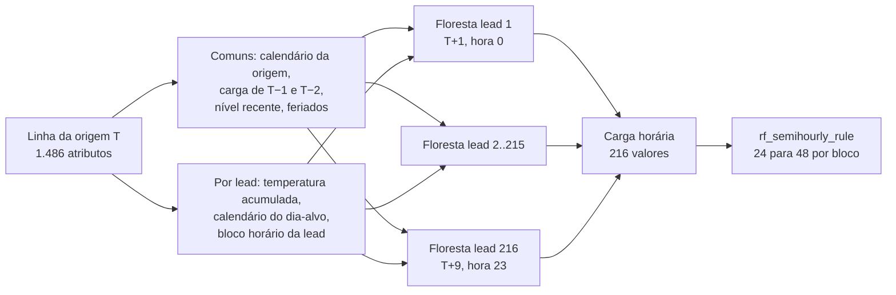
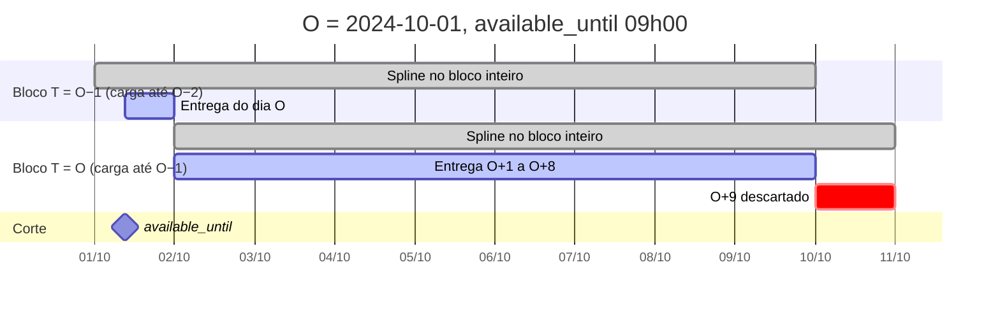

Metodologia · 1.6

O membro random-forest é uma previsão direta multi-saída: para cada origem nativa T, uma única linha de 1.486 atributos alimenta 216 florestas independentes, uma por hora de antecedência, que cobrem T+1..T+9. Não há recursão nem estado entre leads. Um treino serve a várias rodadas (split <code>origin_agnostic</code>), e a rodada da origem O infere duas origens nativas com o mesmo artefato: O−1 entrega o dia O e O entrega O+1..O+8.

## Metodologia

O modelo é o Random Forest de regressão (Breiman, 2001), aplicado por área. Cada lead tem a sua própria floresta, treinada só para aquela hora de antecedência. A previsão de uma lead nunca usa a previsão de outra: o modelo é direto, não recursivo.

A lead L, de 1 a 216, prevê a carga horária do dia `T + ceiling(L/24)` na hora `(L − 1) mod 24`:

| Lead | Dia-alvo | Hora do dia |
|---|---|---|
| 1 | T+1 | 0 |
| 24 | T+1 | 23 |
| 25 | T+2 | 0 |
| 216 | T+9 | 23 |

As constantes intrínsecas vêm de `plugin_constants()` em `register.R` (`horizon_days_native = 9`, `n_leads = 216`); os parâmetros de execução vêm do `run.yaml`.

| Campo | Valor | Origem |
|---|---|---|
| `split` | `origin_agnostic` | `run.yaml` |
| `granularity_min` | 60 | `run.yaml` |
| `horizon_days` | 9 | `run.yaml` |
| `history_days` | train 365, infer 45 | `run.yaml` |
| `seed` | 123 | `run.yaml` |
| `params.ntree` | 100 | `run.yaml` |
| `delivery_days` | 9 (O..O+8) | descriptor |
| `data_lag_days` | 0 (`last_data_day` = O−1) | descriptor |
| `reads_day_O` | FALSE | descriptor |
| `weather_resample` | `raw` | descriptor |
| `weather_forecast_in_train` | TRUE | descriptor |

`ntree` e `seed` não têm default no código: sem eles no `run.yaml`, o carregamento do plugin aborta com `plugin.bad_run_yaml`; numa chamada direta sem eles, `plugin_train` aborta com `plugin.contract`.

<Figura id="FIG-M23" titulo="RF: uma linha de origem, 216 florestas" natureza="Estrutura" fontes={['models/random-forest/R/feature_engineering.R', 'models/random-forest/R/training.R', 'models/random-forest/R/inference.R', 'docs/estado/random_forest.md']} adrs={['ADR-0023']}>

</Figura>

Com T = O, o bloco cobre O+1..O+9 e o dia O+9 é descartado. O dia O vem do bloco T = O−1, no mesmo infer (ver a emenda abaixo).

## Entradas e janelas

O plugin lê três datasets do deck, declarados como tokens em `rf_deck_tokens()`: a carga (`load_mwh`), a temperatura prevista (`issue_time`, `valid_time`, `temperature`) e os feriados (`date`). Não usa temperatura observada.

A carga chega horária pela fundação. Como o membro modela em 60 min, o despachante aplica `to_hourly` antes da ingestão: a hora é a média dos intervalos H:00 e H:30, e a hora incompleta é descartada. Com `weather_resample: raw`, o clima segue cru em 30 min, porque o plugin toma a máxima e a mínima diárias sobre todas as leituras do dia.

As janelas saem de `cuts` e do `run.yaml`, nunca de literais:

| Fase | Carga lida | Origens nativas |
|---|---|---|
| train | `[train_origin − 365, last_data_day]` | de `train_origin − 365 + H` até `train_origin` |
| infer | `[O − 45, O − 1]` | O−1 e O (a safra usa `O − 45 .. O` para o LOCF) |

Com O = 2026-10-01, `train_origin` = O−1−H = 2026-09-21 e `last_data_day` = 2026-09-30. O treino lê a carga de 2025-09-21 a 2026-09-30, com origens de 2025-09-30 a 2026-09-21. O alvo mais distante da origem de treino mais recente é 2026-09-30, hora 23, ou seja, `last_data_day`. O infer lê a carga de 2026-08-17 a 2026-09-30. O dia O nunca entra.

O plugin confere os cortes e nunca filtra. A ingestão aborta se encontrar:

| Condição | Erro |
|---|---|
| carga com dia posterior a `last_data_day` no treino | `plugin.train_beyond_cut` |
| carga com `interval_end` posterior a `available_until` no infer | `plugin.infer_beyond_cut` |
| emissão com `issue_time` posterior a `weather_issue_limit` | `plugin.weather_beyond_limit` |
| coluna `timestamp` ou `load_label` na carga, ou `interval_start`, `interval_end` da carga e `valid_time` do clima fora do fuso `cuts$tz` | `plugin.raw_timestamp` |
| área e dia sem as 24 horas na janela | `plugin.completude` |
| carga que começa depois do primeiro dia exigido | `plugin.window` |

Os feriados são a união das datas do painel para a área com uma lista fixa de 69 datas de 2022 a 2025 (`holidays_legacy`). Sem o dataset de feriados no painel, a ingestão aborta com `plugin.missing_column`, sem fallback silencioso.

## Atributos e alvos

`plugin_build_features` monta uma tabela com uma linha por origem nativa (`dataOrigem`), 1.486 colunas de atributo e 216 alvos (`y_h001`..`y_h216`). A ordem das colunas é fixa e é parte do contrato: ela define a ordem das colunas de `x` em cada floresta e, portanto, o sorteio de `mtry`.

| Bloco | Atributos | Conteúdo |
|---|---|---|
| Temperatura | 18 | `tmax_1..tmax_9` e `tmin_1..tmin_9`: máxima e mínima previstas de cada dia do horizonte |
| Calendário da origem | 4 | dia da semana, mês, fim de semana e feriado de T |
| Calendário do dia-alvo | 90 | 9 dias × 10: dia da semana, fim de semana, um indicador por dia da semana e feriado |
| Bloco horário | 1.296 | 216 leads × 6: pico diário (9h–18h), pico noturno (18h–23h), mínimo (0h–8h), seno e cosseno da hora, hora × mês do dia-alvo |
| Sazonalidade | 36 | 9 dias × 4: mês, trimestre, verão (dez–fev) e inverno (jun–ago) do dia-alvo |
| Natal e Ano-Novo | 20 | 2 da origem e 9 dias × 2; Natal de 23 a 29 de dezembro, Ano-Novo de 30 de dezembro a 4 de janeiro |
| Proximidade de feriado | 3 | feriado em T+1..T+9, dias até o próximo e desde o último (365 sem feriado) |
| Carga de T−1 | 8 | média, máxima, mínima, pico diário (máx. 9h–17h), pico noturno (máx. 18h–23h), dia da semana, fim de semana, feriado |
| Carga de T−2 | 8 | as mesmas 8 estatísticas do dia T−2 |
| Nível recente | 3 | média diária de T−7..T−1, de T−3..T−1 e a razão entre as duas |
| **Total** | **1.486** | |

O alvo `y_hLLL` é a carga horária do dia `T + ceiling(L/24)` na hora `(L − 1) mod 24`. Quando o dia não está na janela, o alvo fica NA.

### Subconjunto por floresta

Cada floresta usa só parte das colunas (`.select_features_for_lead`). Para a lead L com dia-alvo d = `ceiling(L/24)`:

| Grupo | Colunas | Quantidade |
|---|---|---|
| Comuns | `origin_*` (os 4 de calendário e os 2 de Natal e Ano-Novo), `prev_day_*`, `prev_2day_*`, nível recente, proximidade de feriado | 28 |
| Temperatura acumulada | `tmax_1..tmax_d` e `tmin_1..tmin_d` | 2d |
| Dia-alvo | `dayd_*`: calendário (10), sazonalidade (4), Natal e Ano-Novo (2) | 16 |
| Hora da lead | `hLLL_*` | 6 |

São 52 atributos nas leads do dia 1 e 68 nas do dia 9. O vetor de colunas de cada floresta é gravado no artefato, e a inferência usa só esse vetor, nunca a regra de seleção.

### Completude do clima previsto

A completude da janela de clima previsto é conferida depois do LOCF sobre a grade origem × dia do horizonte (`.rf_weather_locf`). Para cada `day_of_horizon`, a máxima e a mínima ausentes são preenchidas com o valor da origem anterior, e a linha preenchida fica marcada com `locf = TRUE`. O que segue NA depois disso tem tratamento distinto por fase:

- no treino, a origem que segue incompleta sai da tabela e fica registrada em `dropped_origins`;
- no infer, falta em O−1 ou em O aborta com `plugin.completude` (exit 3), nomeando a origem.

A inferência também confere, para cada floresta, que toda coluna guardada no artefato existe e não é NA nas duas linhas. Coluna ausente aborta com `plugin.contract`; valor NA aborta com `plugin.completude`. Não existe previsão com subconjunto de atributos.

## Treino

`train_multioutput_rf` ajusta 216 florestas com `randomForest::randomForest`, em sequência:

1. Seleciona as colunas da lead e monta `X` e `Y`.
2. Mantém só as linhas completas daquela floresta (`complete.cases(X)` e `Y` não NA). Não há remoção global de linhas.
3. Com menos de 2 linhas completas, aborta com `plugin.completude`.
4. Chama `set.seed(seed)` imediatamente antes de cada floresta.
5. Ajusta com `ntree = 100` e `importance = TRUE`; `mtry` e `nodesize` ficam nos defaults do pacote.

A previsão de cada floresta é a média das árvores. O RNG do chamador é preservado (`prevcarga_preserve_rng`).

O corte de treino (ADR-0023) é conferido em camadas, sempre com `plugin.contract`: `plugin_build_features` recusa origem além de `train_origin` e carga além de `train_origin + H`; `plugin_train` recusa de novo origem além de `train_origin`. Quando recebe os `cuts` (chamada direta), `plugin_train` confere também que `train_origin` não passa o do corte e que `max(dataOrigem) + H` não passa `last_data_day`. Na ingestão, carga além de `last_data_day` já aborta com `plugin.train_beyond_cut`. O plugin nunca calcula corte próprio: `train_origin` e `last_data_day` chegam de `prevcarga_resolve_cuts`, em `dates.R`.

O artefato é dado puro: as 216 florestas com o vetor de colunas de cada uma, `feature_cols`, `target_cols`, `train_origin` e `n_train`. `rf_freeze` troca a chamada guardada em cada objeto `randomForest` por uma constante e remove o ambiente de `terms`, e o carimbo e a persistência são da fundação.

## Safra de clima por origem nativa

Cada origem nativa T usa a temperatura prevista como estava disponível naquela origem, no treino e no infer (`weather_forecast_in_train = TRUE`). A regra de corte da emissão é da fundação; o plugin só a desloca por dia de origem (`.rf_weather_vintage`):

1. O limite da origem T é `limit(T) = weather_issue_limit − days(O − T)`.
2. As candidatas são as emissões com `issue_time` em `(limit(T) − 1 dia, limit(T)]`; vale a mais recente.
3. `day_of_horizon` é o dia de `valid_time`, no fuso do deck, menos T, de 1 a 9.
4. `tmax` e `tmin` são a máxima e a mínima de todas as leituras de 30 min do dia.
5. A origem sem candidata não gera linha e é coberta pelo LOCF.

`weather_issue_limit` vem de `prevcarga_weather_issue_limit` e depende da regra `weather_issue_cutoff` (ADR-0024):

| Regra | Limite em O |
|---|---|
| `available_until` | `available_until` menos o atraso de publicação declarado no `manifest.json` do deck |
| `origin_midnight_utc` | 00:00 UTC do dia O |

## Inferência em duas origens e emenda do dia O

O RF não lê a carga do dia O. No mesmo infer e com o mesmo artefato, o plugin prevê duas origens nativas:

| Bloco | Carga até | Entrega |
|---|---|---|
| T = O−1 | O−2 | dia O, a partir de `available_until` |
| T = O | O−1 | O+1..O+8 |

O dia O+9 do bloco O não é entregue. A matriz nativa `values` tem 2 × 216 (linhas O−1 e O).

Cada bloco passa inteiro por `to_semihourly` com a regra `rf_semihourly_rule` e só depois é cortado. A regra recebe as 216 âncoras horárias e devolve 432 valores: uma spline monotônica (`monoH.FC`) na grade de meias horas, com o valor intermediário preso ao intervalo das duas âncoras vizinhas e o último slot por extrapolação linear. `to_semihourly` mantém só os slots com `interval_end` posterior a `available_until` e até o fim do último dia do bloco (O para o bloco O−1, O+8 para o bloco O). A emenda concatena os dois blocos por `interval_end`; nenhuma spline atravessa a fronteira entre eles.

A saída tem de coincidir com `prevcarga_delivery_grid(cuts, 9)`, de `available_until` + 30 min até O+9 00:00. Com corte às 09:00, são 414 slots por área. Duplicata ou desalinhamento aborta com `plugin.output_misaligned`.

<Figura id="FIG-M07" titulo="RF: duas origens nativas e a emenda do dia O" natureza="Linha do tempo" fontes={['models/random-forest/README.md', 'models/random-forest/R/inference.R', 'docs/estado/random_forest.md']} adrs={['ADR-0023']}>

</Figura>

O artefato é aceito em qualquer rodada cujo `train_origin` seja igual ou posterior ao dele: um treino serve a N inferências. Um artefato com `train_origin` além do corte da rodada aborta com `plugin.artifact_mismatch`. A inferência não reajusta nada, não usa `params` nem RNG: `predict` do `randomForest` é determinístico.

Para os cortes por modelo, ver [Os três cortes de data](/metodologia/tres-cortes). Para a faixa de entrega comparada com os outros membros, ver [Os modelos](/metodologia/modelos-visao-geral).
