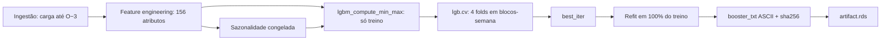
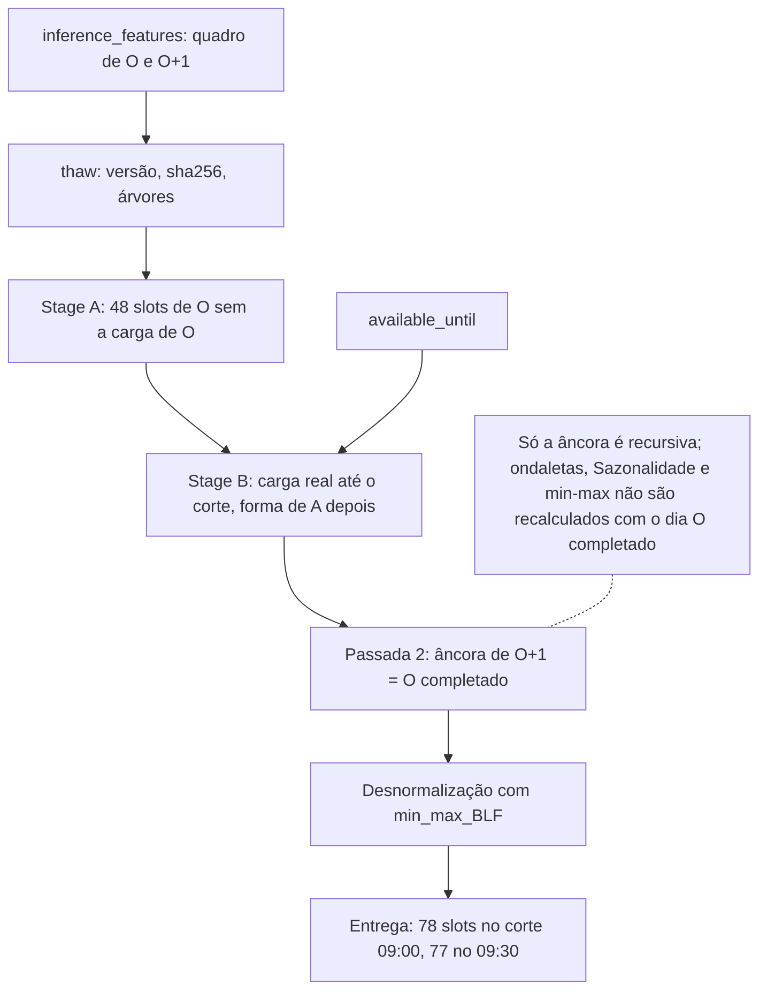

Metodologia · 1.7

O membro <code>lgbm</code> é um gradient boosting (LightGBM) com um booster por área, ajustado direto na grade semi-horária: uma linha por patamar de 30 min. O horizonte é de um dia (H = 1), e a entrega cobre o resto do dia O depois do corte mais o dia O+1 (D−1 e D, na nomenclatura DESSEM). O treino lê carga só até O−3. Na inferência, o dia O é completado em duas passadas (BLF): a carga real até o corte, a forma prevista depois dele, e esse dia completado vira a âncora de O+1.

## Metodologia

O modelo é um gradient boosting de árvores de decisão (Ke et al., 2017, LightGBM), com objetivo de regressão e perda quadrática (MSE). Há um único booster por área. Ele vê todos os 48 patamares do dia como linhas de uma mesma tabela. A posição do patamar no dia entra como atributo, não como modelos separados:

- `Hora_seno`, igual a `sin(2π · Hora / 48)`, com `Hora` de 0 a 47;
- a `Sazonalidade`, média histórica da carga por tipo de dia e patamar;
- as ondaletas de carga e de temperatura, que descrevem a forma recente da curva até o patamar (as de carga, deslocadas 48 h).

O horizonte declarado no `run.yaml` é `horizon_days: 1`. O descriptor do plugin declara `delivery_days: 2`: a grade de entrega vai de `available_until` + 30 min até a meia-noite de O+2. A entrega é, portanto, o resto de O e o dia O+1 inteiro.

| Atributo do membro | Valor no código |
|---|---|
| `split` | `origin_agnostic` (ADR-0023) |
| `granularity_min` | 30 (modela na grade de 30 min; offset de modelagem 0) |
| `horizon_days` | 1 |
| `history_days` | treino 730, inferência 45 |
| `seed` | 123 |
| `modes` | `train`, `infer` |
| `data_lag_days` | 2 |
| `reads_day_O` | `TRUE` |
| `delivery_days` | 2 |
| `native_layout` | `lgbm_day_48` |
| Pacotes | `lightgbm`, `data.table`, `lubridate`, `wavelets`, `zoo` |

O artefato não depende da origem: um treino serve várias inferências, desde que o `train_origin` carimbado no artefato não passe do `train_origin` da rodada. Quem confere é o despachante da fundação, antes dos estágios (`prevcarga_plugin_check_artifact`, que recusa com `plugin.artifact_mismatch`); `plugin_thaw` repete a conferência, com `lgbm.contract`, quando recebe o artefato carimbado.

## Entradas, cortes e safra de clima

### O que o plugin lê do deck

O estágio de ingestão exige três colunas do deck: `data.load.load_mwh`, `data.weather_forecast.temperature` e `data.holidays.prevcarga_code`. A temperatura é só a prevista, também nas origens passadas do treino. O plugin confere o painel recebido e nunca corta nem preenche: coluna ausente, fuso diferente do de `cuts`, carga além do corte ou emissão de clima além do limite abortam com `lgbm.contract`.

A grade interna tem 48 slots por dia, com `DataHora` igual ao `interval_start` do leitor. Dia de histórico sem os 48 intervalos aborta com `lgbm.completude`. Na inferência, o slot cujo `interval_end` passa de `available_until` é marcado como sintético (`is_synthetic`) e fica sem carga; um intervalo ausente antes do corte é furo e aborta com `lgbm.completude`. A inferência exige ao menos 4 dias completos antes de O (`min_history_days_infer`), senão `lgbm.window`.

### Os cortes do LGBM

Os cortes chegam prontos de `scripts/lib/dates.R`; o plugin só os confere. Com `split: origin_agnostic` e H = 1, `train_origin = O − 1 − H = O − 2`. Com `data_lag_days: 2`, `last_data_day = O − 1 − 2 = O − 3`. A regra geral dos cortes está em [Os três cortes de data](/metodologia/tres-cortes).

| Corte | LGBM | Nomenclatura DESSEM |
|---|---|---|
| `train_origin` | O−2 | D−3 |
| `last_data_day` (último dia de carga no treino) | O−3 | D−4 |
| Carga lida na inferência | até `available_until` no dia O | até o corte em D−1 |
| Entrega | de `available_until` + 30 min até O+2 00:00 | resto de D−1 e D |

Com `available_until` em O 09:00, a entrega tem 78 slots (30 do resto de O e 48 de O+1). Com 09:30, 77.

### Safra de clima por lead

A temperatura prevista de cada slot sai de `lgbm_weather_vintage`. Para um lead mínimo dado, ficam só as emissões em que o dia válido menos o dia da emissão é maior ou igual ao lead; entre elas, por slot, vale a emissão mais recente. O dia da emissão é o dia em UTC (`issue_day_tz = "UTC"`); o dia válido é o dia civil no fuso da carga.

| Trecho | Lead |
|---|---|
| Histórico do treino e da inferência, e o dia O | 0 (`lead_train`) |
| Dia O+1 | 1 (`lead_target`) |

Além da safra, nenhuma emissão pode passar de `weather_issue_limit`, o limite da regra de clima da rodada (`available_until` ou `origin_midnight_utc`). O plugin só confere esse limite; quem o resolve é a fundação.

### Série de clima por área: `heat_area`

Cada área lê a temperatura de uma série de clima fixada em `plugin_constants()$heat_area`. Em geral é a própria área; as exceções são agregados que usam a série de uma área representativa.

| Área | Série de clima |
|---|---|
| `S` | `RS` |
| `SECO` | `SP` |
| `N` | `AM` |
| `NE` | `CE` |
| demais áreas da tabela | a própria área |

Área fora da tabela aborta com `lgbm.contract`.

### Feriados

O vetor de feriados é a união dos dias com `prevcarga_code` maior ou igual a 1 no deck da área com uma lista fixa de feriados nacionais de 2022 a 2025 declarada em `plugin_constants()$holidays_fixed`. São datas civis, sem deslocamento. Sem o dataset `holidays`, a ingestão aborta.

## Feature engineering

Em produção, o booster usa 156 atributos: 148 da base mais 8 de fim de ano, ligados por `calendar_yearend: true`. A ordem das colunas é fixa (`lgbm_input_cols`) e faz parte do artefato, porque o LightGBM indexa as variáveis categóricas por posição.

| Bloco | Atributos | Como é construído |
|---|---|---|
| Âncora de carga | 1 | `CargaGlobal_anterior_BLF`: a carga do mesmo patamar no dia anterior |
| Temperatura | 1 | `Temperatura_prevista_BLF`: a temperatura prevista do próprio slot do dia-alvo |
| Sazonalidade | 1 | média da carga por `TipoDia` × `Hora`, só das linhas de treino |
| Posição no dia | 1 | `Hora_seno` |
| Ondaletas de carga | 62 | `CarWav_1..62`: Haar sobre a âncora, janela de 32 meias-horas, deslocada 48 h |
| Ondaletas de temperatura | 62 | `TempWav_1..62`: Haar sobre a temperatura prevista, janela de 32 meias-horas |
| Dia da semana | 6 | `DiaSemana_1..6`, referência sexta-feira |
| Tipo de dia especial | 3 | `DiaEspecial_FDS`, `DiaEspecial_FE`, `DiaEspecial_FEFDS`, referência dia normal |
| Mês | 11 | `Mes_2..12`, referência janeiro |
| Fim de ano e vizinhança de feriado | 8 | 6 rótulos de fim de ano, `PreFeriado` e `PosFeriado` |

### Âncora e temperatura

A âncora é a carga de cada patamar no dia anterior, casada pela chave de calendário (dia + 1, patamar). Para o dia O, a âncora é a carga observada de O−1. Em produção, `disable_loess: true` desliga a suavização LOESS por dia, e a âncora é a carga crua. A temperatura do dia-alvo é a prevista, também sem suavização.

### Sazonalidade

A `Sazonalidade` é a média da carga por (`TipoDia`, `Hora`), calculada só nas linhas com `Data` até o corte interno de treino. O `TipoDia` tem quatro níveis: `ND` (dia normal), `FDS` (sábado ou domingo), `FE` (feriado em dia útil) e `FE+FDS`. A tabela é congelada no artefato e aplicada na inferência sem recálculo.

### Ondaletas

Cada janela de 32 meias-horas (16 h) alinhada à direita é decomposta pela transformada discreta de Haar (`wavelets::dwt`), com 62 coeficientes, que é 2 × (32 − 1). Janela com algum valor faltante vira linha faltante, nunca erro.

- As ondaletas de carga partem da série da âncora e entram com deslocamento de 48 h, pela chave de calendário (dia + 2, patamar), sem aritmética de hora. No dia O+1, a janela termina na âncora de O−1, isto é, na carga de O−2. Usam só carga observada.
- As ondaletas de temperatura partem da temperatura prevista e entram no mesmo slot.

### Calendário

Os rótulos de calendário são calculados na feature engineering, por mapa fixo a partir de `lubridate::wday`, sem depender do locale: domingo 1, sábado 2, segunda 3 até sexta 7. Os rótulos de fim de ano saem do mês e do dia:

| Rótulo | Dias |
|---|---|
| `Natal_AnoNovo` | 25/12, 01/01 |
| `Vespera` | 24/12, 31/12 |
| `PreVespera` | 23/12 |
| `PosNatalAnoNovo` | 26/12, 02/01 |
| `SemanaNatalAnoNovo` | 27/12 a 30/12 |
| `PrimeiraSemanaAno` | 03/01 a 07/01 |

O 30/12 entra como `PreVespera` e é sobrescrito por `SemanaNatalAnoNovo`; `prevespera_1230: true` o manteria como `PreVespera`. `PreFeriado` e `PosFeriado` marcam o dia anterior e o dia seguinte a um feriado.

### Linhas do treino

A tabela de treino descarta as linhas sem âncora e, por fim, toda linha com algum valor faltante. Os primeiros dias da janela saem por causa da âncora e das janelas de ondaleta. O treino confere que nenhuma linha passa de `last_data_day`.

## Normalização e treino

### Normalização min-max

As colunas escalares e as ondaletas, mais o alvo `CargaGlobal`, são normalizadas por min-max: `(x − min) / (max − min)`, com amplitude zero levando a 0. O mínimo e o máximo vêm só das linhas de treino (`Data` até o corte interno) e são gravados no artefato como `min_max_BLF`. A inferência nunca os recalcula. As dummies não são normalizadas e entram como categóricas.

Se a âncora chegar ao treino com máximo menor ou igual a 1, o treino aborta com `lgbm.double_norm`: a carga já teria sido normalizada antes.

### Hiperparâmetros

Os hiperparâmetros são constantes do código (`plugin_constants()`), não parâmetros do `run.yaml`.

| Hiperparâmetro | Valor |
|---|---|
| `objective` / `metric` | `regression` / `mse` |
| `num_leaves` | 16 |
| `min_data_in_leaf` | 50 |
| `learning_rate` | 0,1 |
| `num_iterations` (máximo de árvores) | 5.000 |
| `early_stopping_rounds` | 50 |
| `cv_nfolds` | 4 |
| `cv_week_block` | 336 linhas (7 dias × 48) |

O booster roda com `seed` igual ao `seed` da spec, `num_threads = 1`, `deterministic = TRUE` e `force_row_wise = TRUE`, dentro de `prevcarga_preserve_rng`.

### Dois modos de treino

- **`train_cv: true` (produção).** O corte interno de treino é o próprio `last_data_day`. As linhas são divididas em blocos de uma semana (336 linhas), distribuídos em rodízio entre 4 folds. O `lgb.cv` acha o número de árvores pelo early stopping (`best_iter`); depois o booster é reajustado em 100% das linhas de treino com `best_iter` árvores.
- **`train_cv: false`.** Holdout pelos cortes internos do `cutoff_scheme` (`v2_old`, `legacy_month` ou `rolling`), com validação e early stopping, sem reajuste.

<Figura id="FIG-M08" titulo="LGBM: treino com CV em blocos-semana" natureza="Fluxo" fontes={['models/lgbm/R/ingestion.R', 'models/lgbm/R/feature_engineering.R', 'models/lgbm/R/helpers_norm.R', 'models/lgbm/R/training.R', 'models/lgbm/R/freeze.R']} adrs={['ADR-0023']}>

</Figura>

### Congelamento do booster

`lgbm_freeze` converte o booster em texto (`save_model_to_string`), ASCII com quebras LF, e grava o sha256 desse texto. O artefato é dado puro: o texto do booster, `best_iter`, `min_max_BLF`, as tabelas de `Sazonalidade`, as listas de colunas, os `params` do treino, o `seed` e a versão do `lightgbm`. A persistência em `artifact.rds` é do registry.

Ao descongelar, `lgbm_thaw` confere, nesta ordem:

1. a versão do `lightgbm` da sessão contra a do artefato (`lgbm.engine_version`);
2. o sha256 do texto (`lgbm.integrity`);
3. a estrutura do texto, antes de entregá-lo ao motor (`lgbm.integrity`);
4. o número de árvores contra `best_iter` (`lgbm.integrity`).

## Parâmetros do `run.yaml`

Os sete `params` do `run.yaml` configuram o plugin. O plugin não lê variável de ambiente. Os params não têm default no código: chave ausente, tipo errado ou valor fora do schema abortam com `lgbm.params`.

| Param | Valor em produção | Efeito |
|---|---|---|
| `disable_loess` | `true` | desliga as suavizações LOESS do treino e da inferência |
| `calendar_yearend` | `true` | liga os 8 atributos de fim de ano e vizinhança de feriado |
| `train_cv` | `true` | CV em blocos-semana com refit; `false` usa holdout |
| `tipodia_legacy` | `false` | `true` usaria o `TipoDia` de 5 níveis por dia da semana e a Sazonalidade com chave rica |
| `cutoff_scheme` | `v2_old` | cortes internos do holdout: `v2_old`, `legacy_month` ou `rolling` |
| `sazonalidade_scope` | `train` | único valor aceito pelo schema |
| `prevespera_1230` | `false` | `true` mantém 30/12 como `PreVespera` |

A Sazonalidade não tem escopo `full_window`: calcular a média sobre a janela inteira usaria informação do horizonte. O artefato carrega os `params` do treino, e a inferência os confere contra as colunas treinadas (`lgbm_check_artifact_params`); nunca herda flag do processo.

## Inferência BLF de duas passadas

A inferência usa só o artefato: nenhum refit, nenhum `params` da spec. As features de inferência (`plugin_inference_features`) são montadas pelas mesmas funções do treino, com a `Sazonalidade` e o `min_max_BLF` do artefato. O quadro tem exatamente 48 linhas para O e 48 para O+1. Em seguida, o estágio de inferência (`plugin_infer`) descongela o booster (`plugin_thaw`) e confere os `params` do artefato (`lgbm_check_artifact_params`).

1. **Stage A.** O booster prevê os 48 patamares de O. A carga de O não é atributo: a âncora de O é a carga de O−1, e as ondaletas de carga vêm de dias anteriores. O resultado é a forma do dia O, em escala normalizada.
2. **Stage B.** O dia O é completado. Nos slots com carga real (até o corte), vale a carga real normalizada. A partir do primeiro slot sintético, cada valor é o anterior multiplicado pela razão entre patamares consecutivos do Stage A, arredondada a 7 casas: a forma de A, ancorada no último valor real. O perfil volta para MW pelo `min_max_BLF`.
3. **Passada 2.** No quadro de O+1, só a âncora (`CargaGlobal_anterior_BLF`) é sobrescrita com o dia O completado. O quadro é normalizado pelo `min_max_BLF` do artefato e o booster prevê os 48 patamares de O+1, desnormalizados em seguida.
4. **Entrega.** O trecho de O depois do corte vem do perfil completado; o dia O+1, da passada 2. Cada valor é casado por posição com a grade da fundação (`prevcarga_delivery_grid`), sem somar minutos.

Só a âncora é recursiva. As ondaletas de carga de O+1 não são recalculadas com o dia O completado: elas vêm da âncora deslocada 48 h e usam só carga observada. Sem nenhuma carga real em O, o Stage B usa só as razões do Stage A e emite um aviso. Valor não finito na entrega aborta com `lgbm.contract`.

<Figura id="FIG-M09" titulo="LGBM: inferência BLF de duas passadas" natureza="Fluxo" fontes={['models/lgbm/R/freeze.R', 'models/lgbm/R/inference_features.R', 'models/lgbm/R/inference.R', 'scripts/lib/features.R']} adrs={['ADR-0023']}>

</Figura>

A saída nativa (`values`, layout `lgbm_day_48`) tem duas linhas de 48: o dia O completado e o dia O+1. Quando o dia O está inteiro observado, ela tem uma linha só, a de O+1.

Os outros membros e o modo como a entrega curta do LGBM entra na combinação estão em [Os modelos](/metodologia/modelos-visao-geral) e em [Combinação convexa](/metodologia/combina).
