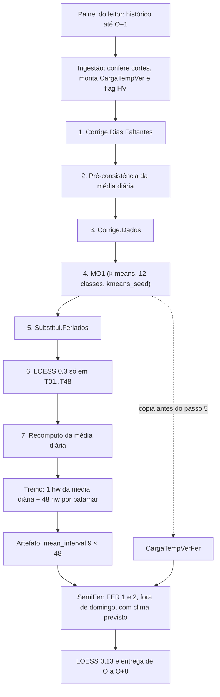

<span className="pc-overline">Metodologia · 1.8</span>

<p className="pc-lead">O Holt-Winters (HW) é o membro univariado do PrevCarga. Para cada origem O, ele trata o histórico de carga até O−1 (D−2) em sete passos, ajusta 49 modelos de suavização exponencial multiplicativa com sazonalidade semanal (um para a média diária e um para cada um dos 48 patamares de 30 minutos) e entrega a previsão do resto do dia O até O+8 (D−1 a D+7). Calendário e temperatura não são regressores: o calendário entra no tratamento do histórico e na modulação de feriado; o valor da temperatura não altera a previsão, só a presença de clima previsto decide o horizonte coberto e se um feriado é modulado.</p>

## Entradas e conferências

O HW é da classe de split `origin_scoped` (ADR-0023): um treino por origem, com a série até O−1. O `run.yaml` é a fonte de split, semente, horizonte, janelas e parâmetros. Os sete parâmetros não têm default no plugin.

```yaml title="models/holt-winters/run.yaml"
name: holt-winters
split: origin_scoped          # 1 treino por origem O, serie ate O-1 (ADR-0023)
granularity_min: 30
horizon_days: 8
history_days: {train: 730, infer: 45}
seed: 1234                    # set.seed antes do MO1
modes: [train, infer, forecast]
backtest: {protocol_default: retrain_harness}
constraints: {}
params:                       # sem default no plugin
  kmeans_seed: 123            # semente do k-means do MO1
  ic: 1                       # p_ic
  perfil_mo: C                # p_perfilMO (C | ST)
  classes_mo: 12              # p_classesMO
  similar: 0.8                # p_Similar
  feriado: true               # p_Feriado (Substitui.Feriados)
  suaviza: true               # p_Suaviza (LOESS 0,13 pos-infer)
```

O descriptor (`R/register.R`) completa o contrato:

| Campo | Valor | O que significa |
|---|---|---|
| `granularity_supported` | 30 | modela os 48 patamares semi-horários, sem reamostragem |
| `native_layout` | `hw_matrix_nx48` | linhas são dias, colunas H01..H48; H01 é 00:00–00:30, por `interval_start` |
| `delivery_days` | 9 | entrega de O a O+8 |
| `reads_day_O` | FALSE | a carga do dia O não entra no cálculo |
| `uses_rng` | TRUE | o k-means do passo 4 usa gerador aleatório; o despachante restaura o estado do RNG do chamador |
| `history_infer_equals_train` | FALSE | a janela do infer (45 dias) é diferente da do treino (730 dias) |
| `data_lag_days` | não declarado | vale 0; `last_data_day` = O−1 |

Os cortes vêm de `scripts/lib/dates.R`: `train_origin` = O e `last_data_day` = O−1 (ver [os três cortes de data](/metodologia/tres-cortes)). O plugin confere esses cortes e nunca corta nem preenche. A ingestão (`plugin_ingest`) aborta quando:

| Condição | Id | Classe |
|---|---|---|
| carga ou clima observado com a coluna crua `timestamp` (só o leitor converte o rótulo) | `hw.raw_timestamp` | contract |
| coluna ausente ou `interval_start`/`interval_end` fora do fuso de `cuts$tz` | `hw.input_column` | contract |
| intervalo de dia posterior a O, ou do dia O depois de `available_until` | `hw.train_day_o` | contract |
| O−1 sem os 48 intervalos de 30 minutos | `hw.last_day_incomplete` | completude |
| emissão de clima previsto com `issue_time` depois de `weather_issue_limit` | `hw.weather_beyond_cut` | contract |

O treino confere de novo que não há carga do dia O (`hw.train_day_o`), que a série termina em `last_data_day` (`hw.last_day_incomplete`) e que `train_origin` é O (`hw.bad_cut`). A janela de treino é conferida antes, pela fundação: menos dias que `history_days.train` até `last_data_day` aborta `window.history_short`. O plugin tem a guarda própria `hw.history_short`, mas ela só age quando recebe o spec completo; pelo despachante ele recebe só `params`.

A ingestão monta a tabela diária `CargaTempVer`, com 105 colunas nesta ordem: data, feriado, dia da semana, H01..H48 da carga, temperatura média, T01..T48 do clima observado, carga média, a flag `HV`, as colunas `FHV15` e `DHV15` (sempre NA) e o tipo de feriado. A flag `HV` marca o horário de verão histórico: vale 1 quando o fuso `America/Sao_Paulo`, lido às 06:00 UTC do dia, está em −02:00. O instante é montado com `make_datetime` e o offset é lido por `format(tz =)`, sem aritmética de hora. O passo 3 preenche o NA da flag, mas nenhum ajuste a usa.

Do clima previsto, a ingestão monta as tabelas `TempPre` e `CDDPre` do dia O a O+8. A regra de emissão (`weather_issue_cutoff`, ADR-0024) já foi aplicada pelo leitor; por dia e patamar fica a emissão mais fresca. Sem nenhuma emissão válida, as temperaturas ficam NA, o feriado vem do calendário e a ingestão emite uma vez o aviso `hw.weather_absent`.

## Feature engineering em 7 passos

`plugin_build_features` aplica os sete passos em ordem fixa e roda uma vez por treino. Os passos 1 e 3 a 6 vêm de `helpers_aux.R`, cópia única das funções auxiliares; os passos 2 e 7 estão em `feature_engineering.R`.

<Figura id="FIG-M10" titulo="Holt-Winters: tratamento do histórico, treino e inferência" natureza="Fluxo" fontes={['models/holt-winters/R/feature_engineering.R', 'models/holt-winters/R/helpers_aux.R', 'models/holt-winters/R/training.R', 'models/holt-winters/R/inference.R', 'docs/estado/holt_winters.md', 'models/holt-winters/README.md']} adrs={['ADR-0023']}>



</Figura>

| Passo | Função | O que faz |
|---|---|---|
| 1 | `Corrige.Dias.Faltantes` | dia repetido sai; dia faltante entra como cópia da linha de 7 posições antes (7 depois, na primeira semana), com a data corrigida; nunca 0 |
| 2 | `.preconsist_ctm` | na tabela de médias diárias, carga média NA ou fora de 1..999.999 e temperatura média NA ou fora de −10..50 °C recebem o valor de 7 dias antes (na primeira semana, de 7 dias depois ou a média da coluna) |
| 3 | `Corrige.Dados` | carga ≤ 1, ≥ 9.999.999 ou NA recebe a mediana da coluna do patamar; temperatura ≤ −20, ≥ 50 ou NA recebe a mediana da sua coluna; as médias da linha são recalculadas |
| 4 | `MO1` | imputação de dias atípicos por k-means (detalhe abaixo), semeado por `params.kmeans_seed` |
| 5 | `Substitui.Feriados` | se `feriado` for verdadeiro, o perfil de cada dia de feriado (1) ou semi-feriado (2) é trocado pelo do dia mais recente do mesmo dia da semana sem feriado, e a marca de feriado vira 0 |
| 6 | `Suaviza.LOESS` | LOESS com span 0,3, linha a linha, só nas temperaturas T01..T48 (NA vira a média da linha; ajustados arredondados); a carga não é suavizada |
| 7 | `.hw_recompute_ctm` | quando o número de linhas difere, alinha as duas tabelas pelas datas em comum; recalcula carga média e temperatura média a partir da tabela já tratada |

### O passo 4: MO1 com k-means

Com `perfil_mo: C`, cada dia é normalizado pela própria média e os dias são agrupados por `stats::kmeans` em `classes_mo` (12) classes, com `iter.max` 30. O k-means é semeado por `params.kmeans_seed` (123), em `classifica_kmeans`. O `set.seed(seed)` do `run.yaml` antes do MO1 só roda quando o estágio recebe o spec completo; pelo despachante, o estágio recebe só `params` e a semente do k-means é a única. Para cada dia, o centro mais próximo (distância euclidiana, só entre classes com mais de 2 dias) é comparado ao perfil do dia por uma regressão linear. Se o R² ajustado, em módulo, for ≤ `similar` (0,8) ou NA, o dia é atípico: a forma dele é trocada pela do centro, escalada pela média do próprio dia.

Antes do passo 5, o plugin guarda uma cópia da tabela (`CargaTempVerFer`), com os feriados ainda presentes. É dela que a modulação de feriado tira os perfis na inferência.

:::note Ramo ST
`perfil_mo: ST` troca o k-means por resíduos de um ARIMA sazonal por patamar. O `run.yaml` usa `C`.
:::

## Treino

O HW é a suavização exponencial de Holt-Winters (Winters, 1960) na forma multiplicativa, por `forecast::hw(y, h, seasonal = "multiplicative")`. É univariado: cada série é só a carga. A série diária entra num `ts` com `frequency` 7, iniciado no ano e no dia do ano do primeiro dia do histórico, então a sazonalidade modelada é a semanal.

`plugin_train` faz 49 ajustes independentes, sem recursão entre eles:

| Ajuste | Série | Para que serve |
|---|---|---|
| 1 | média diária da carga tratada | escala da modulação de feriado (`PrevMedDia`) |
| 48 | carga de cada patamar H01..H48 | os valores previstos |

O horizonte de ajuste `h_fit` é fixo em 9 (`horizon_days` + 1). O passo 1 é o dia O e os passos 2 a 9 são O+1 a O+8. O ajuste do `forecast::hw` não depende de `h`. Previsão não finita aborta `hw.non_finite`.

Do ajuste só sobrevivem números: a matriz `mean_interval` (9 × 48), o vetor `mean_daily` (9) e as tabelas que a inferência lê. `plugin_freeze` grava esses campos como dado puro, sem objeto `forecast` ou `ets`, sem relógio, caminho ou closure. A cópia `CargaTempVerFer` entra no artefato só a partir de 2019-01-01.

Os sete parâmetros não têm default no plugin. A fundação confere `params` contra o `params_schema` do descriptor antes do treino: parâmetro ausente, a mais ou fora do schema aborta `plugin.bad_run_yaml`. O feature engineering repete a conferência dos seis parâmetros que lê e aborta `hw.bad_param`: `perfil_mo` só aceita `C` ou `ST`, `classes_mo` ≥ 1, `similar` no intervalo aberto em 0 e fechado em 1.

### Por que nove dias e não oito

`horizon_days` é 8 e `delivery_days` é 9. O dia O entregue vem do passo `$mean[1]` da previsão. Por isso o ajuste usa `h_fit` 9 e a matriz tem 9 linhas: o dia O e os oito dias do horizonte.

## Inferência

O infer só lê o artefato: nenhum reajuste, nenhuma chamada a `forecast::`. A ingestão do infer recusa carga do dia O depois de `available_until` (`hw.train_day_o`), e `plugin_inference_features` e `plugin_infer` conferem que o artefato é da origem O (`hw.artifact_origin`). Os valores previstos não dependem de `available_until` nem da carga de O; a carga de O só delimita a entrega.

1. Passo cru: as 9 linhas de `mean_interval`, do dia O a O+8.
2. Modulação de feriado (`SemiFer`), linha a linha, com as condições abaixo.
3. LOESS com span 0,13 em cada uma das 9 linhas (a do dia O inteira, antes de truncar), se `suaviza` for verdadeiro; ajustados arredondados.
4. Entrega: as 9 linhas (432 valores) são casadas por posição com a grade de fim de intervalo de 30 minutos de O a O+8; sai só o trecho da grade da fundação (`prevcarga_delivery_grid`), do fim de intervalo `available_until` + 30 min até O+9 00:00.

### Modulação de feriado (SemiFer)

Um dia do horizonte passa pelo `SemiFer` quando todas as condições valem:

- a marca de feriado do dia é 1 (feriado) ou 2 (semi-feriado);
- o dia não é domingo;
- há temperatura prevista para o dia, e o horizonte não está no fallback sem clima;
- o artefato tem histórico de `CargaTempVerFer`.

O `SemiFer` monta perfis normalizados (cada patamar dividido pela média do conjunto) a partir de `CargaTempVerFer`, usando o mês da origem:

| Tipo | Perfil de feriado | Regressores |
|---|---|---|
| Feriado (1) | o dia mais recente do mesmo tipo de feriado, no mês da origem ou num mês vizinho | sábados e domingos sem feriado do mês da origem |
| Semi-feriado (2) | média dos dias do mesmo tipo de feriado (em janeiro e dezembro, só no mês da origem ou num mês vizinho) | sábados e dias úteis de segunda e sexta sem feriado do mês da origem |

O perfil do feriado é regredido nos dois perfis de referência, sem intercepto (`lm(fer ~ sab + dom + 0)`). O perfil ajustado é multiplicado pela média diária prevista para o dia (`PrevMedDia`). Os efeitos aditivos de feriado ficam em 0. Se o `SemiFer` falhar, a linha fica com o passo cru e sai o aviso `hw.semifer_failed`.

### O efeitoTemp e a temperatura

`plugin_inference_features` calcula o `efeitoTemp` de cada dia: a posição da temperatura média prevista na distribuição empírica (`stats::ecdf`) das temperaturas médias observadas da tabela já tratada, nos dias do mesmo dia da semana com marca de feriado 0, do mês da origem e do mês de O − 31 dias. A tabela auxiliar é reaproveitada de um dia para o outro sem ser truncada e pode reter linhas de dias anteriores. Sem temperatura prevista, o efeito é 0,5. Para o dia O, o cálculo usa uma tabela própria, para não contaminar O+1.

O `efeitoTemp` entra no `SemiFer` como `p_alfa`, mas o código só usa `p_alfa` num ramo que nunca executa (o modo do `SemiFer` está fixo em sábado e domingo). Por isso o valor da temperatura não altera a previsão: o que o clima previsto decide é o horizonte coberto e se um feriado passa pelo `SemiFer`.

## Calendário e temperatura no HW

Nenhum dos dois é regressor do ajuste. Os 49 modelos veem só a carga.

| Variável | Onde entra |
|---|---|
| Calendário (dia da semana) | define a sazonalidade semanal da série (`frequency` 7); orienta a cópia de dia faltante (passo 1) e a troca de feriado (passo 5) |
| Calendário (feriado e tipo) | passo 5 no histórico; seleção dos perfis e decisão de modular no `SemiFer` |
| Temperatura observada | limpa à parte (passos 3 e 6) e forma a distribuição empírica do `efeitoTemp` |
| Temperatura prevista | decide se o dia tem clima (condição do `SemiFer`) e o horizonte coberto; o valor não muda a previsão |

Para a comparação com os outros membros, ver [os modelos](/metodologia/modelos-visao-geral). Para o protocolo de backtest do HW (`retrain_harness`, um treino por origem), ver [backtest](/metodologia/backtest).
