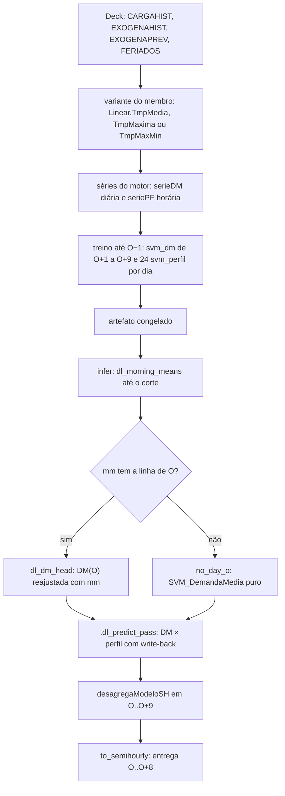

Metodologia · 1.9

Os dois plugins DESSEM, dessem-linear e dessem-regdin, preveem a carga em duas peças: a demanda média do dia (DM) e o perfil horário, a forma da carga de cada hora dividida pela média do dia. A carga prevista é a forma vezes a DM desnormalizada. As duas famílias rodam sobre um motor comum, <code>models/_dessem-engine</code>, que só tem primitivas. O dessem-linear tira a DM de um SVM de kernel linear e o perfil de SVMs lineares; o dessem-regdin tira a DM de uma regressão dinâmica (ARIMA com regressores) e o perfil de SVMs radiais (no dia especial, de uma regressão linear). Os dois treinam com 1.825 dias até O−1, rodam O..O+9 e entregam O..O+8.

Esta página trata da estrutura. O que só existe no dia O (a cabeça de nowcast, a posição do gerador aleatório e as guardas do infer) está em [DESSEM: cabeça de nowcast, RNG e invariantes](/metodologia/dessem-nowcast-rng). O lugar da família entre os membros está em [Os modelos](/metodologia/modelos-visao-geral).

## Estrutura comum do motor

### Motor único, plugins finos

O motor não é um modelo: não tem `run.yaml` e o prefixo `_` o tira da descoberta. Cada plugin declara `engine = "_dessem-engine"` no descriptor, e o loader da fundação monta um ambiente do motor por instância a partir de `engine_manifest()` (`R/manifest.R`). Esse ambiente só enxerga `base` e os pacotes que o plugin lista em `attach`. Os detalhes do loader estão em [Fundação de plugins](/arquitetura/fundacao-plugins).

| Peça | Onde mora | O que tem |
|---|---|---|
| Motor | `models/_dessem-engine/R/` | Primitivas do motor (`TransformaDeck`, `SVM_DemandaMedia`, `RD_DemandaMediaHyndman`, `SVMhorario`, `RL_perfilFeriado`, `desagregaModeloSH`), guardas de robustez, serializador de SVM e `model_parameters.json` |
| dessem-linear | `models/dessem-linear/R/` | Ingestão, séries, passe de treino, cabeça de nowcast e passe de predição; membros `LIN_MED`, `LIN_MAX`, `LIN_MXMN` |
| dessem-regdin | `models/dessem-regdin/R/` | Os mesmos estágios, com o ARIMA da DM e as guardas de janela; membros `RGD_MED`, `RGD_MAX` |

A cabeça de nowcast é do plugin (`helpers_nowcast.R` de cada um), não do motor. O motor não guarda estado e não faz aritmética de hora.

### Demanda média × perfil

O motor monta duas séries a partir da série horária do deck (`SERIECOMP`, com a coluna `Prev` que separa histórico de previsão):

1. **Série da DM** (`aggregaSerie`): a carga média de cada dia e a temperatura agregada no dia pela variante (média, máxima ou máxima e mínima).
2. **Série do perfil** (`inclui_CargaMediaRef` e `normalizaSerieRef`): a carga de cada hora dividida pela média do seu dia e a coluna `CargaMed`, a média do dia dividida pela constante de normalização. A DM prevista entra no perfil como essa escala `CargaMed`.

Na saída, `CargaMed` é multiplicada pela constante e a forma por `CargaMed`: carga = forma × DM desnormalizada.

### Um modelo por dia-alvo

No dessem-linear, cada dia-alvo tem uma DM e 24 SVMs de perfil, um por hora do dia. Nos 9 dias entregues são 9 × 24 = 216 perfis. O treino também ajusta os 24 perfis de O+9, que só alimentam o spline da desagregação (ver a faixa de entrega abaixo). No dessem-regdin, a DM é um ARIMA único para todos os dias, e só os dias normais têm os 24 SVMs de perfil.

Cada SVM é ajustado por `tune_wsvm` (pacote WeightSVM) com `iter.max = 500` e a grade de `model_parameters.json`: epsilon em 0,001, 0,01 e 0,1 e cost em 1 e 10. Com `alfa = 0`, `getSVMWeights` dá peso 1 a todos os dias da amostra.

### Recursão dia a dia

A predição percorre os dias em ordem e escreve cada previsão de volta na série antes do dia seguinte:

| Defasagem | De onde vem o valor |
|---|---|
| DM, lags de 1, 2 e 7 dias (dessem-linear) | A DM prevista de O vira o `LAG_1` de O+1; a partir daí os lags leem DM prevista sempre que o dia defasado é O ou posterior |
| Perfil, lag de 1 h | A forma prevista da hora anterior, escrita de volta em `seriePF` |
| Perfil, lag de 168 h | Observado até O+6; em O+7 e O+8 lê a forma prevista de O e O+1 |
| Perfil, lag de 336 h | Sempre observado (O+8 lê O−6; O+9 lê O−5) |

No dessem-regdin, o ARIMA base prevê a DM de todos os dias de uma vez e não tem defasagem da carga; a cabeça da DM(O) está na página 1.10. A recursão do perfil é a mesma.

### Desagregação semi-horária

A entrega é semi-horária. `desagregaModeloSH` transforma a série horária em duas meias horas por hora:

1. ajusta dois splines monotônicos (`splinefun` com o método `monoH.FC`), um com os valores horários nas posições ímpares da grade de 30 min e outro nas pares;
2. tira a média dos dois splines em cada meia hora;
3. reescala o par de cada hora para que a média das duas meias horas seja igual ao valor horário.

A regra entra no descriptor como `semihourly_rule` (`dl_semihourly_rule`, `rd_semihourly_rule`). Se o motor falhar ou devolver valor não finito, a regra repete o valor horário nas duas meias horas e registra o aviso `warning.dessem_linear_desagrega_fallback` ou `warning.regdin_desagrega_fallback`. O carimbo de 30 min é da fundação (`to_semihourly`), não do motor.

## Variantes exógenas e diferenças entre as famílias

A variante é o parâmetro `exogena` do plugin (`variant_param = "exogena"` no descriptor) e vem do membro em `config/topology.yaml`. O valor `exogena: MED` do `run.yaml` é só o placeholder do loader.

| Membro | Plugin | `exogena` | Chave do motor | Temperatura do dia na DM |
|---|---|---|---|---|
| `LIN_MED` | dessem-linear | MED | `Linear.TmpMedia` | média das horas |
| `LIN_MAX` | dessem-linear | MAX | `Linear.TmpMaxima` | máxima das horas |
| `LIN_MXMN` | dessem-linear | MXMN | `Linear.TmpMaxMin` | máxima e mínima (duas colunas) |
| `RGD_MED` | dessem-regdin | MED | `RegDin.Radial.TmpMed` | média das horas |
| `RGD_MAX` | dessem-regdin | MAX | `RegDin.Radial.TmpMax` | máxima das horas |

O dessem-regdin aceita só MED e MAX. Qualquer outro valor, MXMN incluído, aborta com `plugin.regdin_bad_exogena` antes de qualquer treino. No dessem-linear, valor fora de MED, MAX e MXMN aborta com `plugin.dessem_linear_bad_exogena`.

Dentro de uma família, as entradas de `model_parameters.json` diferem só em `exogenaOper`, a agregação da temperatura (e no rótulo `nomModelo`). Entre as famílias, os campos que mudam o método são estes:

| Campo | dessem-linear | dessem-regdin |
|---|---|---|
| Modelo da DM (`funcModeloDemandaMedia`) | `SVM_DemandaMedia` (wSVM) | `RD_DemandaMediaHyndman` (`fable::ARIMA`) |
| Entrada da DM (`tipoEntradaDM`) | `ML_LOCAL`; `ML_DEFAULT` no dia especial | `TS_FACTOR` |
| Kernel dos SVMs (`kernel`) | linear | radial |
| Normalização da DM | carga e temperatura ligadas | desligada |
| Pipeline (`funcProcessamento`) | `processaModelosDMPerfil` | `processaModelosDMTSPerfil` |
| Defasagens da temperatura na DM | lags de 1, 2 e 7 dias como colunas | `lagsExogenaDia` 1, 2 e 7 na fórmula do ARIMA |

## Janela de treino e o invariante infer == train

Os dois `run.yaml` declaram `split: origin_scoped`, `horizon_days: 9` e `history_days: {train: 1825, infer: 1825}`. O descriptor declara `data_lag_days = 0`, então o último dia de dado do treino é O−1 (ver [Os três cortes de data](/metodologia/tres-cortes)). O treino de `origin_scoped` é refeito a cada origem.

| Fase | Janela no caminho da fundação |
|---|---|
| Treino (`scripts/lib/training.R`) | 1.825 dias, de O−1825 a O−1 |
| Infer (`scripts/lib/inference.R`) | a mesma história, a partir de O−1825, mais a carga do dia O até o corte intradiário |

Os dois descriptors declaram `history_infer_equals_train = TRUE`. O loader confere a declaração: com ela, `history_days.infer` diferente de `history_days.train` aborta com `plugin.history_window`. O `run.yaml` do dessem-regdin também declara `constraints: {infer_history_equals_train: true}`; o do dessem-linear tem `constraints: {}`.

Quando recebe o spec, o `plugin_ingest` do dessem-linear lê um dia de aquecimento antes da janela (1.826 dias de CARGAHIST): a janela de `history_days.train` dias termina em `last_data_day` e começa um dia antes. O despachante chama a ingestão sem spec, e a janela é a do painel que a fundação já recortou.

A ingestão confere a completude e não preenche lacunas da história. A única reposição é a da cauda curta da temperatura prevista (`fill_forecast_tail`, em Robustez do motor abaixo); o que sobra incompleto reprova:

| Conferência | dessem-linear | dessem-regdin |
|---|---|---|
| Carga e temperatura observada com 24 horas por dia, sem NA | `plugin.dessem_linear_series_gap` | `plugin.regdin_series_gap` (carga) e `plugin.regdin_panel_contract` (temperatura) |
| História menor que `history_days.train` (com spec) | `plugin.dessem_linear_window_short` | `plugin.regdin_history_short` |
| Temperatura prevista com 24 horas em O..O+9 | `plugin.dessem_linear_series_gap` | `plugin.regdin_panel_contract` |

As guardas extras do dessem-regdin no infer (janela do painel contra a do artefato e fingerprint do ARIMA) estão em [DESSEM: cabeça de nowcast, RNG e invariantes](/metodologia/dessem-nowcast-rng).

## Faixa do motor e faixa de entrega

O descriptor declara `delivery_days = 9`: a entrega vai de O (depois do corte intradiário) até O+8. O motor roda `horizon_days + 1` = 10 dias, O..O+9. O dia O+9 existe só para o spline `monoH.FC` de `desagregaModeloSH`, que nas últimas horas de O+8 precisa enxergar o dia seguinte. O+9 não é entregue. Por isso a ingestão exige temperatura prevista até O+9.

A matriz nativa (`values`, layout `dessem_semihourly_48`) tem 9 linhas, de O a O+8, e 48 colunas de 30 min. A grade de entrega é a da fundação (`prevcarga_delivery_grid` com 9 dias).

O deslocamento de 60 min do DESSEM é declarado só em `model_time_offset_min = 60` e aplicado pelo despachante. A explicação está em [Tempo: rótulo da carga, fusos e ajuste de hora](/metodologia/tempo-rotulo-fusos).

## Robustez do motor

O motor tem quatro guardas de robustez, sempre ligadas e sem chave por variável de ambiente. Duas cuidam do ajuste do SVM e são funções do próprio ambiente do motor, sem remendo no ambiente global. As outras duas cuidam dos dados:

| Guarda | Função | Quando age | Efeito |
|---|---|---|---|
| Modelo vazio | `.wsvm_guard_retry` (`robustez.R`) | `tune_wsvm` falha com erro de modelo vazio, constante ou de escala | Refaz o ajuste sem as dummies binárias raras (minoria até 3, depois 10, depois 30 linhas); em último caso, só com as variáveis contínuas |
| Clamp de cross | `.wsvm_clamp_cross` (`robustez.R`) | `tune_wsvm` falha por amostra menor que o número de dobras | Reduz `cross` ao número de linhas com peso; abaixo de 2, propaga o erro original |
| Código de dia especial | `normalize_special_day_codes` (`feriados.R`) | Código fora dos modelados: 0 (normal) e 1 a 11, os tipos que têm janela em `janelaDadosFer` | O código vira 0 (dia normal) em todas as datas |
| Cauda curta | `fill_forecast_tail` (`exogena.R`) | Até 2 dias curtos na temperatura prevista do horizonte | Repete o último dia completo anterior; com mais dias curtos não faz nada e a ingestão reprova |

O `tune_wsvm` do motor chama o `WeightSVM::tune_wsvm` real primeiro. No caminho feliz, o resultado é o do pacote, sem alteração. As duas guardas do SVM sinalizam a condição classificada `dessem_engine_guard`, uma subclasse de `message`, com os códigos `warning.engine_empty_model_guard` e `warning.engine_cross_clamped`. No infer, o plugin coleta essas condições com `withCallingHandlers` e grava os códigos em `meta$warnings` do envelope.

No dessem-regdin, antes do normalizador de códigos, `.rd_map_holidays` aplica o mapeamento de códigos do plugin: código acima de 11 vira 1 e `simplified_code` 0 vira 0.

## dessem-linear

<Figura id="FIG-M11" titulo="dessem-linear: DM × perfil com cabeça mm" natureza="Fluxo" fontes={['models/dessem-linear/README.md', 'models/dessem-linear/R/training.R', 'models/dessem-linear/R/inference.R', 'docs/estado/dessem_linear.md', 'models/_dessem-engine/README.md']} adrs={['ADR-0031', 'ADR-0023']}>

</Figura>

### Demanda média

A DM de cada dia-alvo de O+1 a O+9 é um wSVM de kernel linear ajustado por `SVM_DemandaMedia`. A DM de O é reajustada no infer pela cabeça de nowcast ([página 1.10](/metodologia/dessem-nowcast-rng)). A entrada depende do tipo de dia:

| Dia-alvo | Entrada (`tipoEntradaDM`) | Variáveis | Amostra |
|---|---|---|---|
| Normal | `ML_LOCAL` | `LAG_1`, `LAG_2`, `LAG_7` da DM; `LAG_FER_1`, `LAG_FER_2`, `LAG_FER_7` (o dia defasado era especial); temperatura do dia e seus lags de 1, 2 e 7 dias | Só dias normais, do mesmo dia da semana e com dia do ano a até 45 dias do dia-alvo |
| Especial | `ML_DEFAULT` | Lags 1, 2 e 7 da DM, temperatura e seus lags, dummies de tipo de dia especial, de dia da semana e de mês | Todos os dias da janela |

Um dia é especial quando o código de `FERIADOS` é maior que 0 e cai em um dos grupos de `janelaDadosFer`. Uma coluna `LAG_FER_*` com menos de 3 ocorrências na amostra é descartada.

### Perfil

O perfil de cada dia é feito por 24 wSVMs lineares (`SVMhorario`), um por hora.

| Dia-alvo | Entrada | Variáveis | Filtros da amostra |
|---|---|---|---|
| Normal | `DEFAULT` | Forma defasada de 1, 168 e 336 h, `CargaMed` e temperatura horária | Mesma hora, mesmo dia da semana, mesmo estado de horário de verão do dia-alvo, dia do ano a até 45 dias, só dias normais |
| Especial | `ML_PERFILFER` | Forma defasada de 1 h, forma da mesma hora em dias da semana de referência (`lagsdiasemana`), `CargaMed`, temperatura horária e tipo de dia especial | Mesma hora, só dias especiais, dia do ano a até 200 dias (tipos 9 a 11) ou 40 dias (tipos 1 a 8) |

No dia especial o perfil continua sendo SVM linear. O horário de verão é a flag `HV` do motor: 1 quando o meio-dia do dia, em `America/Sao_Paulo`, cai no fuso −02.

### Normalização

| Grandeza | Constante |
|---|---|
| Carga da DM | máximo do histórico horário × 1,25 |
| Temperatura da DM | máximo do histórico horário × 1,25 |
| Forma do perfil | média da carga do próprio dia |
| `CargaMed` | média do dia ÷ (máximo do histórico horário × 1,25) |

As constantes são calculadas nas linhas `Prev == FALSE`. A temperatura horária do perfil do dessem-linear fica sem normalização: `dl_build_series` lê a chave `normalizacao$exogena`, que o `model_parameters.json` não tem, como o `processaModelosDMPerfil` do motor.

## dessem-regdin

O fluxo de inferência do dessem-regdin, com as guardas de janela e de fingerprint, é a FIG-M13 em [DESSEM: cabeça de nowcast, RNG e invariantes](/metodologia/dessem-nowcast-rng).

### Demanda média

A DM é uma regressão dinâmica: `RD_DemandaMediaHyndman` ajusta `fable::ARIMA` com a ordem escolhida automaticamente sobre a série diária histórica e prevê os dias de `Prev == TRUE` de uma vez. A fórmula, montada por `obterEntradaFormulaDM_Reg` com a entrada `TS_FACTOR`, tem:

- a temperatura do dia (média ou máxima, pela variante);
- os lags de 1, 2 e 7 dias da temperatura (`lag(Exo_..., k)` na fórmula, de `lagsExogenaDia`);
- os fatores `DiaEspecial`, `DiaSemana` e `Mes`.

O ARIMA base não tem defasagem explícita da carga, e a ordem automática não garante termo autorregressivo nem sazonal. A DM do regdin não é normalizada: as flags de `normalizacao.dm` estão desligadas, e `processaModelosDMTSPerfil` lê chaves de normalização que não existem no JSON. Para entrar no perfil, a DM prevista é dividida pela constante de `CargaMed`.

A cabeça de nowcast da DM(O) usa `Carga_l1` e `Carga_l7` e está em [DESSEM: cabeça de nowcast, RNG e invariantes](/metodologia/dessem-nowcast-rng).

### Perfil

| Dia-alvo | Modelo | Quando é ajustado |
|---|---|---|
| Normal | 24 wSVMs radiais (`SVMhorario`, entrada `DEFAULT`, as mesmas variáveis e filtros do dessem-linear) | No treino; congelados no artefato |
| Especial | `RL_perfilFeriado`: padroniza a carga de cada dia, ajusta `lm` com a carga da mesma hora em dias da semana de referência, a temperatura e um fator de hora, e reconstrói a curva com o desvio padrão histórico do tipo de dia e a DM prevista; a forma e a `CargaMed` do dia saem dessa curva | Recalculado no infer; o treino não guarda SVM para esse dia |

No perfil do regdin, a temperatura horária é normalizada pelo máximo do histórico horário × 1,25 (`normalizacao$perfil$exogena`, lida por `.rd_build_series`).

### Histórico completo

A ingestão do dessem-regdin confere o painel e não corta nem preenche a história (só a cauda curta da temperatura prevista passa por `fill_forecast_tail`). Cada dia histórico tem de ter 24 horas de carga, sem NA; senão aborta com `plugin.regdin_series_gap`, nomeando o dia. A temperatura observada e a prevista seguem a mesma regra e abortam com `plugin.regdin_panel_contract`. Carga posterior ao dia O, ou do dia O além do que o corte intradiário libera, aborta com `plugin.regdin_train_panel_has_origin`.

