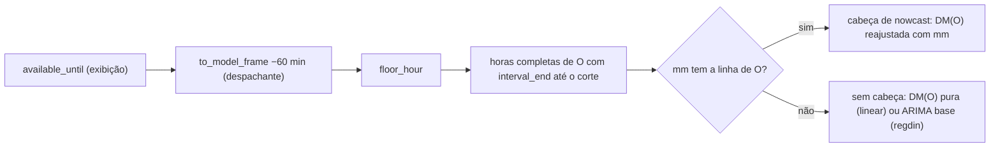
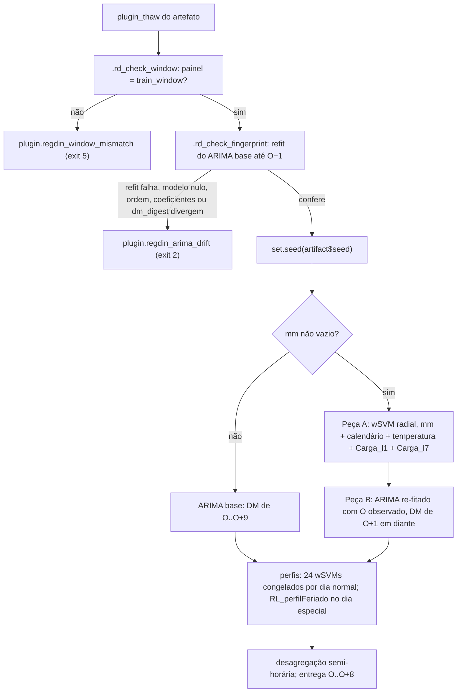
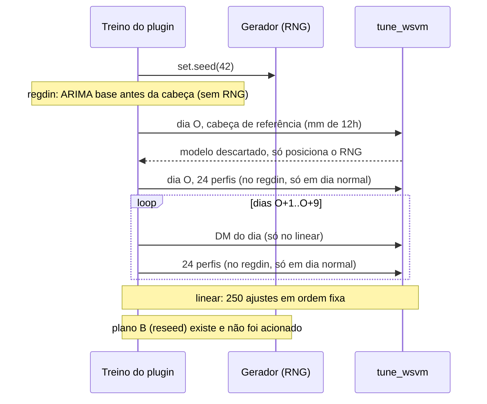

Metodologia · 1.10

Os dois plugins DESSEM treinam até O−1 e, na inferência, reajustam só a demanda média do dia O (a DM(O)) com <code>mm</code>, a média das horas cheias completas de O até o corte intradiário. Sem nenhuma hora completa de O, como na rodada das 00h, não há cabeça de nowcast: o dessem-linear usa a DM(O) pura do motor e o dessem-regdin, o ARIMA base. O treino consome o gerador aleatório numa ordem fixa, com uma cabeça de referência que é descartada, e o dessem-regdin recusa inferir sobre uma janela diferente da do treino.

A estrutura dos dois plugins (motor comum, DM × perfil, janela de 1.825 dias) está em [Família DESSEM](/metodologia/dessem-estrutura). Esta página trata do que só existe no dia O: a cabeça de nowcast, a posição do RNG e as guardas do infer. O corte intradiário `available_until` é o terceiro corte de [Os três cortes de data](/metodologia/tres-cortes).

## A regra do mm: só horas cheias completas

`mm[d]` é a média da carga horária do dia `d` nas horas completas cujo rótulo `interval_end` não passa de `floor_hour(available_until)`. A mesma regra vale para os dias históricos e para O: o modelo da cabeça aprende com a "manhã" de cada dia histórico cortada no mesmo horário do dia O.

Três detalhes do código fixam a regra:

1. A carga chega ao plugin já em base horária (`to_hourly` da fundação) e já no frame de modelagem: o despachante aplica `to_model_frame` com o `model_time_offset_min = 60` do descriptor à carga e ao `available_until`. O plugin não faz aritmética de hora; só lê a hora do rótulo.
2. A hora incompleta já foi descartada pelo `to_hourly`. Uma meia hora isolada nunca forma hora completa, por isso `available_until` 09:00 e 09:30 dão o mesmo `mm` e as mesmas saídas.
3. O modo da DM(O) vem do dado, nunca do relógio. No dessem-linear, `dl_dm_o_mode` devolve `nowcast` se `O %in% mm$Data` e `no_day_o` caso contrário. No dessem-regdin, `rd_inference_features` esvazia `mm` quando não há linha de O, e o infer só monta a cabeça com `mm` não vazio.

| Função | Plugin | O que faz |
|---|---|---|
| `dl_morning_means(hourly_load, available_until, origin_day)` | dessem-linear | Média por dia das horas com hora do `interval_end` até a hora de `floor_hour(available_until)`; se o corte cair no dia anterior a O, a hora de corte fica negativa e nenhuma hora entra |
| `dl_normalize_mm` | dessem-linear | Divide `mm` pela constante de DM do motor quando a normalização de DM está ligada |
| `rd_morning_means(panel_hourly, available_until, tz)` | dessem-regdin | Mesma regra, pelo núcleo `.rd_mm_core` (hora do fim no mesmo dia e até a hora de corte) |
| `rd_normalize_mm` | dessem-regdin | Normaliza só se a DM normaliza; no `model_parameters.json` atual a DM do regdin não é normalizada |

<Figura id="FIG-M12" titulo="Regra do mm por corte intradiário" natureza="Fluxo" fontes={['models/dessem-linear/R/helpers_nowcast.R', 'models/dessem-regdin/R/helpers_nowcast.R', 'models/dessem-regdin/R/inference_features.R', 'docs/estado/dessem_regdin.md']} adrs={['ADR-0019']}>

</Figura>

Exemplos de corte (horário de exibição), conferidos pela regra do código e pelas medições registradas em `docs/estado/dessem_regdin.md`:

| `available_until` | Horas de O no `mm` | Resultado |
|---|---|---|
| 00:00 | nenhuma | sem cabeça |
| 00:30 | nenhuma | sem cabeça |
| 01:00 | 00:00–01:00 | cabeça |
| 01:30 | 00:00–01:00 | cabeça, igual a 01:00 |
| 09:00 | 9 horas, até 09:00 | cabeça |
| 09:30 | as mesmas 9 horas | saída idêntica à de 09:00 |
| 12:00 | 12 horas, até 12:00 | cabeça |

:::note Só hora cheia completa
O `mm` só aceita hora cheia completa: nenhum dado de intervalo incompleto entra na média, nem a meia hora isolada do próprio corte. No regdin, 09:00 e 09:30 dão saídas idênticas nos 413 `interval_end` comuns.
:::

## dessem-linear: só a DM(O) é reajustada

O treino congela a DM de O+1..O+9 e todos os perfis horários. O motor roda `horizon_days + 1` = 10 dias (O..O+9): o artefato guarda `svm_dm` de O+1..O+9 e `svm_perfil` com 24 SVMs por dia de O a O+9. A entrega fica em O..O+8; o dia O+9 só alimenta o spline da desagregação semi-horária do último dia entregue.

No infer, `plugin_infer` faz um único ajuste:

1. `dl_thaw` descongela o artefato.
2. `set.seed(artifact$seed)` (semente 42, do `run.yaml`) fixa a posição inicial do gerador.
3. `dl_dm_o_fit` ajusta a DM(O) com uma chamada de `tune_wsvm`:
   - modo `nowcast`: `dl_dm_head`, com a entrada `obterEntradaFormulaDM` do motor mais a coluna `mm` e `+ mm` na fórmula (`dl_dm_head_input`), pesos `getSVMWeights` e `iter.max = 500`, os mesmos argumentos de `SVM_DemandaMedia`;
   - modo `no_day_o`: o `SVM_DemandaMedia` puro do motor, com a fórmula do motor e sem `mm`.
4. `.dl_predict_pass` percorre os dias O..O+9: a DM de O vem do ajuste acima, a de O+1..O+9 dos SVMs congelados. Cada DM prevista é escrita de volta em `serieDM` (write-back), de modo que o `LAG_1` de O+1 recebe a média de O prevista. Os 24 perfis de cada dia usam `CargaMed` = DM do dia.
5. `.dl_envelope` aplica a regra semi-horária uma vez sobre os 10 dias e entrega a matriz 9 × 48 e a grade de entrega da fundação.

O envelope registra o modo em `meta$dm_o_mode` (`nowcast` ou `no_day_o`) e `meta$dm_head_refit` (verdadeiro só em `nowcast`).

:::info Erro da chamada direta
`plugin.dessem_linear_mm_missing_origin` (classe `completude`, exit 3) só dispara quando `dl_dm_head` (ou `dl_dm_head_input`) recebe `mm` vazio ou, com `require_origin = TRUE`, sem a linha de O. O infer decide o modo antes do ajuste e não aborta por falta de hora de O: esse é o caso 00h, tratado pelo modo `no_day_o`.
:::

<Pendente titulo="Pendente · avisos da cabeça">
O ajuste da DM(O) roda fora do <code>withCallingHandlers</code> de <code>plugin_infer</code>. As guardas do motor disparadas nesse ajuste não chegam a <code>meta$warnings</code> (lacuna DL8-GAP-1 em <code>docs/estado/dessem_linear.md</code>).
</Pendente>

## dessem-regdin: peça A e peça B

No regdin a DM é uma regressão dinâmica (`fable::ARIMA`) e o ARIMA não é congelado. A cabeça de nowcast, `rd_dm_nowcast(serieDM, config_mdl, mm, origin_day, seed)`, é uma função explícita em duas peças. É um refit parcial: só a DM muda; os perfis vêm congelados.

| Peça | O que ajusta | Entradas | Saída |
|---|---|---|---|
| A | wSVM radial (`tune_wsvm`, pesos unitários) logo após `set.seed(seed)` | `mm`, `DiaEspecial`, `DiaSemana`, `Mes`, a primeira coluna `Exo_` (temperatura), `Carga_l1`, `Carga_l7`; grade `cost = c(1, 10, 100)` × `gamma = c(0.01, 0.1)`; amostra: dias históricos com carga, `mm` e os dois lags | `head_O`, a DM(O) prevista |
| B | `fable::ARIMA` re-fitado com a fórmula do motor | a série histórica com O tratado como observado (`Carga = head_O`) | DM de O+1 em diante |

`rd_dm_nowcast` junta `head_O` com a previsão do ARIMA e atualiza `serieDM` por referência, como o motor faz. Os perfis seguem como no treino: 24 SVMs radiais congelados por dia normal e `RL_perfilFeriado` recomputado no infer para dia especial. Sem `mm`, ou com O fora do horizonte, `rd_dm_nowcast` delega ao `execDemandaMediaTS` do motor: o ARIMA base, sem RNG. O envelope registra `meta$head_used`.

## Invariante de janela no regdin

O ARIMA é re-fitado no infer, então o infer só é honesto se vir exatamente a série do treino. O invariante `history_days.infer == train` tem três camadas:

| Camada | Onde | Falha |
|---|---|---|
| 1. Declaração | `constraints: {infer_history_equals_train: true}` no `run.yaml` (os dois `history_days` valem 1.825) e `history_infer_equals_train = TRUE` no descriptor | `history_days.infer` diferente de `train` é recusado pela restrição do `run.yaml` (`contract.constraint_violated`) e pelo loader de plugins (`plugin.history_window`) |
| 2. Guarda de painel | `.rd_check_window`: o painel do infer cobre exatamente o `train_window` do artefato, antes de qualquer ajuste | `plugin.regdin_window_mismatch` (classe `window`, exit 5) |
| 3. Fingerprint do ARIMA | `.rd_check_fingerprint`: refaz o ARIMA base sobre uma cópia da série até O−1, sem cabeça, e compara com o `arima_fingerprint` do artefato | `plugin.regdin_arima_drift` (classe `contract`, exit 2) |

O artefato não guarda o modelo ARIMA (sem `mable`). Guarda só o fingerprint, montado por `.rd_arima_fingerprint`: a ordem `(p,d,q)(P,D,Q)`, os coeficientes nomeados e `dm_digest`, o sha256 da série DM histórica (`Data`, `Carga` e as colunas `Exo*`). A conferência exige ordem idêntica, o mesmo `dm_digest`, o mesmo conjunto de coeficientes e cada coeficiente igual com tolerância 0. A mensagem nomeia o campo que divergiu. Um refit que devolva o modelo nulo do `fable`, o que acontece quando a janela não cobre os 12 níveis do fator `Mes` ou os regressores são colineares, também aborta com `plugin.regdin_arima_drift`, campo `null_model`.

<Figura id="FIG-M13" titulo="dessem-regdin: invariantes e nowcast" natureza="Fluxo" fontes={['models/dessem-regdin/R/inference.R', 'models/dessem-regdin/R/helpers_nowcast.R', 'models/dessem-regdin/README.md', 'docs/estado/dessem_regdin.md']} adrs={['ADR-0023']}>

</Figura>

<Pendente titulo="Pendente · fingerprint no treino">
No lado do treino, <code>.rd_arima_fingerprint</code> ainda falha com mensagem opaca em janela curta, sem id do catálogo de erros. O caso está aberto em <code>docs/estado/dessem_regdin.md</code>.
</Pendente>

## A ordem fixa do RNG

Como o `tune_wsvm` sorteia as dobras da validação cruzada, cada ajuste muda a posição do gerador. Por isso a ordem dos ajustes no treino é fixa: antes dos SVMs de perfil, o treino ajusta uma cabeça de referência com `mm` no corte fixo de 12h (`mm_ref_hour` no linear, `reference_mm_hour` no regdin, ambos 12) e a descarta. Ela só posiciona o gerador. Os valores de `mm` não importam, só o número de linhas; o resultado nunca entra no artefato, e o sha256 do artefato não depende do corte intradiário.

| | dessem-linear (`.dl_fit_pass`) | dessem-regdin (`.rd_fit_pass`) |
|---|---|---|
| Início | `set.seed(seed)` | `set.seed(seed)` |
| Antes do laço | – | ARIMA base (sem RNG, só para o fingerprint) e cabeça de referência (descartada) |
| Dia O | cabeça de referência (1 `tune_wsvm`, descartada) e 24 perfis | 24 SVMs de perfil, se for dia normal |
| Demais dias | DM (`SVM_DemandaMedia`) e 24 perfis por dia, O+1..O+9 | 24 SVMs de perfil por dia normal; dia especial fica sem SVM |
| Contagem | 10 × 25 = 250 ajustes, em ordem fixa | cabeça de referência e 24 por dia normal: 49 ajustes (1 + 24 + 24) nos dois primeiros dias-alvo |

<Figura id="FIG-M14" titulo="Posição do RNG no treino DESSEM" natureza="Linha do tempo" fontes={['models/dessem-linear/R/training.R', 'models/dessem-regdin/R/training.R', 'models/dessem-linear/README.md', 'models/dessem-regdin/README.md']} adrs={['ADR-0023']}>

</Figura>

O despachante da fundação isola o RNG: `prevcarga_preserve_rng` restaura o `.Random.seed` do chamador ao fim do estágio. A semente vem do `run.yaml` no treino e, no infer, do `artifact$seed` gravado pelo treino.

### Plano B, não acionado

Se a ordem fixa do RNG não puder ser mantida, o plano B é declarar `rng_deviation` no descriptor. `dl_rng_mode` e `rd_rng_mode` trocam o modo `preserve` por `reseed` e `set.seed` é re-fixado antes do perfil. No linear a cabeça de referência é pulada (249 ajustes); no regdin ela ainda roda e o `set.seed` vem logo depois. O plugin emite `warning.dessem_linear_rng_deviation` ou `warning.regdin_rng_deviation` (classe `repro`). Os dois descriptors têm `rng_deviation = NULL` e o modo é `preserve`. No regdin, o plano B não equivale ao caminho nativo; por isso ele continua desligado.

## Rodada das 00h no DESSEM

Com `available_until` = O 00:00 (exibição), nenhuma carga do dia O está disponível. No frame de modelagem o corte cai em O−1 23:00, e `mm` fica sem a linha de O. Os dois plugins aceitam essa rodada e entregam O..O+8 normalmente.

| Plugin | O que acontece na DM(O) | Ajustes no infer |
|---|---|---|
| dessem-linear | modo `no_day_o`: `SVM_DemandaMedia` puro do motor, sem `mm`, logo após `set.seed(artifact$seed)` | 1 `tune_wsvm` |
| dessem-regdin | `mm` vazio: `execDemandaMediaTS`, o ARIMA base, prevê O..O+9 | nenhum `tune_wsvm`; o ARIMA base é re-fitado (fingerprint e previsão) e os perfis vêm congelados |

O treino e o artefato não mudam com o corte: a mesma origem treinada às 09:00 ou às 12:00 dá o mesmo sha256, e o artefato serve tanto à rodada das 00h quanto às intradiárias.

## Erros desta página

| Id | Classe | Exit | Quando |
|---|---|---|---|
| `plugin.dessem_linear_mm_missing_origin` | `completude` | 3 | `dl_dm_head` recebe `mm` vazio, ou sem a linha de O com `require_origin = TRUE` |
| `plugin.dessem_linear_train_sees_day_o` | `contract` | 2 | o painel de treino do linear contém o dia O ou posterior |
| `plugin.regdin_train_panel_has_origin` | `contract` | 2 | o painel de treino do regdin contém o dia O ou posterior |
| `contract.constraint_violated` | `contract` | 2 | `history_days.infer` diferente de `train` com a restrição do `run.yaml` ligada |
| `plugin.history_window` | `contract` | 2 | o descriptor exige `infer == train` e o `run.yaml` diverge |
| `plugin.regdin_window_mismatch` | `window` | 5 | o painel do infer não cobre exatamente o `train_window` |
| `plugin.regdin_arima_drift` | `contract` | 2 | o ARIMA refeito diverge do fingerprint, ou o refit devolve modelo nulo |
| `warning.dessem_linear_rng_deviation`, `warning.regdin_rng_deviation` | `repro` | aviso | plano B ativo |

Os códigos de saída vêm da tabela única de `scripts/lib/errors.R`; o catálogo completo está em [Erros e solução de problemas](/execucao/erros-troubleshooting).
