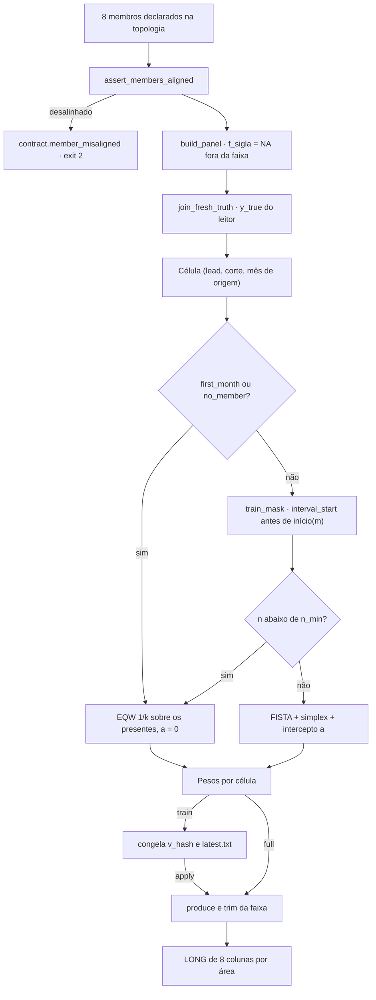
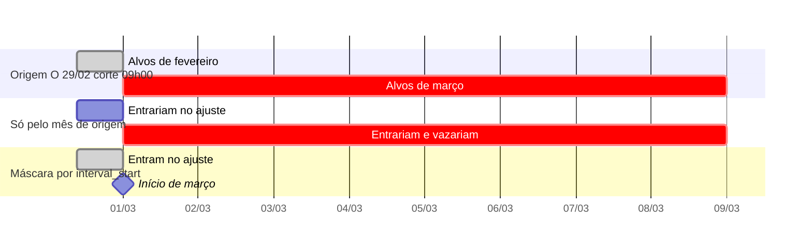

<span className="pc-overline">Metodologia · 1.11</span>

<p className="pc-lead">A combina transforma as previsões dos 8 membros de uma área numa única previsão por área. É uma média convexa com intercepto livre: pesos não negativos que somam 1, ajustados por célula (lead, corte, mês de origem). Os pesos de um mês m só aprendem com alvos anteriores ao início de m, para não usar informação do horizonte.</p>

Todo o método mora num só módulo, `scripts/lib/combination.R`. O verbo `combine` (`scripts/lib/cli/combine.R`) e a rodada (`forecast.R`) só o chamam.

## O modelo

Para cada célula, a previsão combinada é

> ŷ(t) = a + Σᵢ wᵢ · fᵢ(t), com wᵢ ≥ 0 e Σᵢ wᵢ = 1

onde fᵢ(t) é a previsão do membro i (coluna `f_<sigla>` do painel) e a é um intercepto escalar livre.

| Elemento | Como o código faz |
|---|---|
| Pesos | Ficam no simplex: a projeção de Duchi et al. (2008), `prevcarga_proj_simplex`, zera o que ficaria negativo. Um membro pode terminar com peso nulo. |
| Intercepto | Não é otimizado à parte. Sai do ajuste centrado: a = média(y) − Σᵢ wᵢ · média(fᵢ). Como a é livre, a combinada pode sair da faixa dos membros. |
| Solver | FISTA (`prevcarga_fit_convex`) no sistema normal centrado, com passo 1/L, onde L = 2 · maior autovalor de XᶜᵀXᶜ (mais 10⁻⁹). |
| Parada | Norma do *gradient mapping* do objetivo bruto ‖y − (a + Xw)‖² abaixo de `grad_tol = 1e-6`, ou o teto de `iters = 500` iterações. |
| Teto atingido | O ajuste vale, mas a célula é marcada `nonstationary` e o verbo emite um único aviso `warning.combina_nonstationary` (exit 0). |
| Um só membro | Peso 1 e a = média(y) − média(f), sem iterar. |

Os valores padrão estão em `prevcarga_combina_defaults`: `n_min = 24`, `iters = 500`, `grad_tol = 1e-6`.

### Por que convexa e não *stacking*

Uma regressão irrestrita (OLS, ridge, lasso) dá pesos livres, que podem ser negativos ou maiores que 1 e extrapolam. Com o simplex, cada peso é uma fração legível da previsão. Um membro ruim satura em zero em vez de explodir, e o auditor lê os pesos como mistura. O intercepto absorve o viés médio comum aos membros. A combina não declara vitória sobre os membros: a comparação com a média simples (EQW) e com o melhor membro é calculada e só reportada (ver [Avaliação](/metodologia/avaliacao)).

## Células, janela expansiva e fallback EQW

O painel de uma área tem uma linha por (origem, lead, corte). O lead é o índice semi-horário do alvo dentro da faixa de entrega:

> lead = `d_plus` · 48 + slot, com slot de 1 a 48 contado pelo `interval_start` do alvo (`build_long_output.R`)

`prevcarga_combina_fit` ajusta uma célula por **(lead, corte, mês de origem)**. O mês de origem (`ym`) são os 7 primeiros caracteres de `forecast_origin`. Dentro de cada par (lead, corte), os meses são percorridos em ordem, e o ajuste do mês m usa todas as linhas do par com alvo anterior ao início de m (ver [A máscara de treino](#a-máscara-de-treino)). A janela cresce a cada mês. O ajuste de m parte dos pesos do último mês ajustado do mesmo par quando o conjunto de membros presentes é o mesmo (*warm start*).

A célula cai no **fallback EQW** (pesos 1/k sobre os k membros presentes e a = 0) em três casos, gravados na coluna `fallback`:

| `fallback` | Quando |
|---|---|
| `first_month` | É o primeiro mês do par (lead, corte): não há passado para treinar. |
| `no_member` | Nenhum membro tem previsão naquela célula. |
| `n_min` | Menos de `n_min = 24` linhas de treino completas (alvo com verdade e todos os membros presentes sem NA). |

<Figura id="FIG-M15" titulo="Ajuste por célula da combina" natureza="Fluxo" fontes={['scripts/lib/combination.R', 'docs/estado/combination.md']} adrs={['ADR-0013', 'ADR-0032']}>



</Figura>

## Cobertura por lead

Os membros não cobrem o mesmo horizonte. Cada um entrega de `available_until` + 30 min até O + `delivery_days`, 00:00, e a faixa vem só do `delivery_days` gravado na proveniência do run, nunca do nome do modelo. Hoje o LGBM declara `delivery_days = 2` e os outros sete, `9` (`models/*/R/register.R`). A faixa de cada membro está desenhada na FIG-M06, em [Os modelos](/metodologia/modelos-visao-geral).

O código trata a diferença assim:

1. **Fora da faixa é ausente, nunca zero.** `prevcarga_build_panel` grava `NA` em `f_<sigla>` nos leads que o membro não cobre (`prevcarga_member_coverage`).
2. **Só os presentes entram no ajuste.** O X de cada célula usa só as colunas `f_*` com algum valor no mês, então o número de membros varia por lead e o simplex é sobre os presentes.
3. **Na aplicação, w renormaliza e a fica fixo.** Se numa linha falta um membro que tem peso, a previsão é a + Σ wᵢ fᵢ / Σ wᵢ sobre os presentes. Se todos os presentes têm peso zero, a linha vira a média simples deles.
4. **A faixa de saída é a maior faixa presente no corte.** `.prevcarga_cmb_trim_output` descarta os leads sem nenhum membro, recusa `y_pred` NA dentro da faixa e confere que os alvos de cada (origem, corte) são exatamente a grade de entrega (`prevcarga_delivery_grid`).

Faixas diferentes entre membros não são desalinhamento. Desalinhamento é outro membro com início, grade, fuso, rótulo ou regra de clima diferentes do contexto da rodada, ou com `delivery_days` ausente ou inconsistente. `prevcarga_assert_members_aligned` recusa esses casos com `contract.member_misaligned` (exit 2), sempre na mesma ordem: membros na ordem declarada, runs por `run_id`, e a primeira falha é a reportada.

## A máscara de treino

### Por que filtrar pelo instante do alvo

A combina agrupa por mês da origem. Uma origem O no fim de m − 1 prevê até O + 9, 00:00, ou seja, alvos que caem dentro de m. Se o treino dos pesos de m usasse todas as linhas das origens anteriores a m, sem olhar para onde caem os alvos, os `y_true` de m entrariam no ajuste dos pesos usados nas primeiras origens de m. Na operação real daquele dia, esses valores ainda não existiam.

Na rodada diária esse risco não se materializa, porque a verdade futura ainda é NA. Ele existe no backtest, onde o acervo já contém o futuro, e inflaria a acurácia aparente da combina contra a EQW e contra os membros. Por isso o filtro é pelo instante do alvo.

### A regra, pelo código

A máscara é uma única função, `prevcarga_combina_train_mask`:

```r title="scripts/lib/combination.R"
panel$interval_start < prevcarga_combina_month_start(m, tz[1L]) & !is.na(panel$y_true)
```

- O critério é o **instante do alvo**, não a origem: entra no treino dos pesos do mês m toda linha cujo `interval_start` é anterior a início(m) = 1º dia de m, 00:00, no fuso da carga, e que tem verdade.
- O intervalo que termina em início(m) entra; o que começa em início(m) já não entra.
- O eixo de agrupamento é o mês de origem. A máscara só filtra as linhas de treino.
- A combina não aplica aritmética de hora própria: o `interval_start` vem anexado pela borda de leitura do LONG.

O corte dos pesos não é o corte de treino dos membros (derivado por modelo pela classe de split, ver [Os três cortes de data](/metodologia/tres-cortes)). O horizonte de cada membro só decide quais colunas `f_*` têm valor; quem limita o que os pesos veem é a data do alvo.

<Figura id="FIG-M16" titulo="Máscara de treino por interval_start" natureza="Linha do tempo" fontes={['scripts/lib/combination.R', 'docs/estado/m4-combina.md', 'docs/reference/VAZAMENTO-HORIZONTE-COMBINA.md']} adrs={['ADR-0014']}>



</Figura>

No exemplo, os pesos de março (m = 2024-03) são ajustados com o painel de fevereiro. Para a origem de 29/02, um filtro só pelo mês de origem deixaria entrar os alvos de 01/03 a 09/03; a máscara só admite os alvos até 01/03, 00:00.

:::note Divergência de documentação
O registro local do ADR-0014 e `docs/reference/VAZAMENTO-HORIZONTE-COMBINA.md` descrevem a máscara como um corte `origem − 1 − horizonte` por membro, e o ADR-0014 prevê um solver QP. O código usa o filtro por `interval_start` acima e o FISTA. Esta página segue o código.
:::

## Reprodutibilidade

O determinismo se mede em `y_pred`, nunca em `w`. Num problema mal condicionado, pesos diferentes podem dar a mesma previsão, então comparar pesos geraria falso alarme. Ver [Determinismo e reprodutibilidade](/metodologia/determinismo).

## Escala da tolerância de parada

<Pendente titulo="Pendente · ADR-0026">O critério `grad_tol = 1e-6` é absoluto. Em carga real, na escala de ~1.000 MW com ~1.152 linhas por célula, ele não é alcançado e o FISTA bate o teto de 500 iterações, marcando a célula como não estacionária. A proposta registrada é normalizar o critério por ‖b‖ (b = Xᶜᵀyᶜ) para evitar a falsa parada; a decisão está em aberto (`[TBD: ADR-0026]` no código).</Pendente>

## Um ajuste por corte intradiário

O corte faz parte da célula, então cada corte intradiário (o HHMM de `available_until`) tem o seu próprio ajuste convexo, com a sua máscara e o seu fallback EQW.

- **Não há interpolação entre cortes.** Os pesos do corte 09:00 nunca são usados no corte 17:00. Um corte com poucas origens cai na EQW daquele corte, e aplicar os pesos de outro corte daria resultado diferente.
- **Célula sem peso é recusada.** Se o painel pede uma combinação (lead, corte, mês) que o artefato de pesos não tem, `prevcarga_produce_combined` aborta com `contract.combina_input` (exit 2). Um corte que não existe no painel também é recusado (`.prevcarga_cmb_select_cut`, que lista os cortes disponíveis).
- **O que é reusado entre cortes é o artefato do membro, não o peso.** A chave de cache do artefato treinado não inclui `available_until`, então variar o corte não retreina o membro (`cache.R`). A previsão do membro e o LONG, porém, são do corte, e cada corte recebe os seus próprios pesos.

## Entrada, saída e congelamento

### Entrada

O painel é largo, uma linha por (área, origem, lead, corte), com uma coluna `f_<sigla>` por membro na ordem da topologia (`config/topology.yaml`: RF, LGBM, HW, RGD_MED, RGD_MAX, LIN_MED, LIN_MAX, LIN_MXMN). O `y_true` que vem no LONG de cada membro é descartado. A verdade entra por `prevcarga_join_fresh_truth`, que lê a carga pelo leitor único (`prevcarga_read_actual`) e casa por igualdade exata `target_datetime == interval_end`. Na rodada, o painel não tem verdade: a combina só aplica.

O caminho de montagem é um só, `prevcarga_combina_load`: descoberta dos runs, alinhamento, painel e verdade fresca. A rodada e o backtest montam o mesmo painel por `prevcarga_assert_members_aligned` e `prevcarga_build_panel`.

### Saída

A saída é o LONG de 8 colunas por área (`area`, `forecast_origin`, `target_datetime`, `lead`, `y_pred`, `y_true`, `d_plus`, `granularity_min`), validado por `prevcarga_schema_long_check` e `prevcarga_assert_long`. O LONG combinado não é um membro: é a única entrada da [reconciliação](/metodologia/reconciliacao). O formato está em [Schema LONG](/arquitetura/schema-long).

### Congelamento

| Modo | O que faz | Onde |
|---|---|---|
| `train` | Ajusta todos os cortes e leads e congela os pesos | `prevcarga_combina_train` |
| `apply` | Lê os pesos congelados e aplica, sem reajustar | `prevcarga_combina_apply`; é o que a rodada (`forecast`) usa |
| `full` | Ajusta e aplica num passo, sem artefato | `prevcarga_combina_full`; é o que o backtest usa, por (área, corte), com o ajuste mês a mês |

Os pesos ficam em `<artifact_dir>/<área>/v_<hash>/weights.rds`, com o manifesto `weights.rds.manifest.json` ao lado, e `<área>/latest.txt` (uma linha com a versão, sem symlink, escrito por último). O hash é o `prevcarga_version_hash` do conteúdo do painel, da configuração (`n_min`, `iters`, `grad_tol`, cortes, conjunto de membros, `delivery_days`), do código, do `renv.lock` e da convenção de carga (rótulo e fuso). Reajustar com os mesmos insumos reaponta o `latest.txt` para a mesma versão, sem reescrever. O diretório padrão do verbo é `<state_dir>/artifacts/combina`.

Na aplicação, sem `latest.txt` a área dá `state.combina_not_trained` (exit 13); um `weights.rds` alterado falha na conferência de integridade (exit 9); pesos de outro conjunto de membros, rótulo ou fuso dão `contract.combina_artifact_mismatch` (exit 2).

`apply` sobre o resultado de `train` dá saída idêntica, bit a bit, à de `full` no mesmo painel.

```bash title="prevcarga combine"
prevcarga combine --mode=train --area=RJ --root=<runs>
prevcarga combine --mode=apply --area=RJ --root=<runs> --cut=0900 --out=<saida.parquet>
```

O fluxo de artefatos do treino até a rodada está em [Ciclo de vida dos artefatos](/execucao/artefatos).
