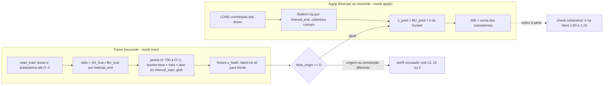

<span className="pc-overline">Metodologia · 1.12</span>

<p className="pc-lead">Só as áreas (folhas) são previstas. A previsão de cada subsistema é a soma das previsões das suas áreas (Bottom-Up) multiplicada por um fator sazonal k-hat, a média da razão entre a carga verificada do subsistema e a soma verificada das áreas, por hora × mês × dia da semana, nos 730 dias que terminam em O−1. O SIN é a soma dos quatro subsistemas. A perda nunca é prevista: ela sai pela diferença. O perfil k-hat é reajustado em toda origem e só pode ser usado na origem em que foi ajustado.</p>

## Diagnóstico: a identidade física e as alternativas descartadas

A carga verificada de um subsistema s obedece a uma identidade contábil: a carga do subsistema é a soma das cargas das suas áreas mais a perda do subsistema.

`S_s = Σ R_j + L_s`, com j nas áreas de s.

A topologia declara essa árvore em `config/topology.yaml`: quatro subsistemas, cada um com as suas áreas e o nome do nó de perda.

| Subsistema | Áreas (folhas) | Nó de perda |
|---|---|---|
| SECO | RJ, RO, MG, ES, MT, SP, AC, MS, GO, DF | PESE |
| S | RS, PR, SC | PES |
| N | PA, TON, AP, AM, MA | PEN |
| NE | ALPE, CE, PBRN, BAOE, PI, BASE | PENE |

A perda `L_s` não é uma série medida de fonte independente. Ela é o resíduo da identidade, `L_true = SS_true − BU_true`. Isso define o problema da coerência:

- **Prever o subsistema e as áreas à parte** deixa a perda como diferença entre duas previsões independentes. No Sul, a previsão de S e a soma das previsões de PR, RS e SC não fecham entre si, e a perda implícita oscila com os erros das duas.
- **A soma simples das áreas** (Bottom-Up puro) é coerente por construção, mas ignora a perda. Com perda não negativa, que é o que a faixa de coerência do k-hat pressupõe ao começar em 1,00, ela subestima o subsistema.
- **As alternativas clássicas** foram consideradas e descartadas no ADR-0015: MinT (Wickramasuriya), reconciliação OLS, top-down (prever o SIN e desagregar), perda aditiva, prever o SIN direto e medir a perda de fonte independente. A perda não é prevista em nenhum ponto da cadeia.

A decisão (ADR-0015) é corrigir a soma das áreas por um fator **multiplicativo e sazonal** estimado só com dados verificados do passado. A perda continua fora da previsão: ela é absorvida pelo fator. O nó de perda é declarado na topologia, mas fica fora do conjunto de nós que o sistema emite: o `check-coherence` não confere linhas desse nó.

:::note A escolha multiplicativa
Um fator multiplicativo assume que a perda escala com a carga. O ADR-0015 registra essa hipótese como plausível e revisável; trocar as chaves do perfil ou a janela é mudar o método.
:::

## Bottom-Up por subsistema

`prevcarga_reconcile_bottomup` soma o `y_pred` das áreas de um subsistema por `(forecast_origin, target_datetime, lead, d_plus, granularity_min)`. O `target_datetime` do LONG é o fim do intervalo (`interval_end`), então a soma é feita por `interval_end`.

Regras do código:

1. A soma só é mantida nos instantes em que **todas** as áreas do subsistema estão presentes. O instante com cobertura parcial é descartado, nunca preenchido com zero nem reescalado.
2. O descarte é sempre reportado: o aviso `reconcile.coverage_dropped` traz a contagem de instantes descartados por `d_plus`, e o resultado do apply a expõe em `cobertura_descartada`.
3. Área do subsistema ausente da entrada aborta com `completude.leaf_missing` (exit 3), com as áreas ausentes em `where`.
4. Duas linhas da mesma área no mesmo instante, ou `lead`/`d_plus` divergentes entre áreas no mesmo `(forecast_origin, target_datetime)`, abortam com `contract.reconcile_input` (exit 2).

O planejador `prevcarga_reconcile_plan` decide, antes, quais subsistemas fecham: um subsistema fecha se e só se todas as suas áreas estão presentes. As áreas de um subsistema que não fecha seguem como folhas soltas e nunca passam pela reconciliação.

## O perfil k-hat

O perfil é ajustado por subsistema, com a verdade lida só pelo leitor único do deck (`prevcarga_read_load`). São três passos.

### Razão por instante

`prevcarga_khat_ratio` calcula, por `interval_end`, a razão entre a carga verificada do subsistema e a soma verificada das suas áreas:

`ratio = SS_true / BU_true`

`BU_true` só existe nos instantes em que todas as áreas têm valor finito e a soma é positiva. Carga duplicada no mesmo `interval_end` aborta com `contract.reconcile_input`.

### Ajuste por bucket

`prevcarga_khat_fit` mantém só as razões cujo dia do `interval_start` cai na janela fechada `[O−W, O−1]`, inclusiva nas duas pontas, com `W = 730` dias por padrão (`prevcarga_khat_window_days`). A janela é móvel, não expansível: o ADR-0015 a fixa assim porque a perda deriva ao longo do tempo.

Cada razão vai para um bucket pela hora, pelo mês e pelo dia da semana do `interval_start`:

| Chave | Origem no código | Observação |
|---|---|---|
| `hour` | `lubridate::hour(interval_start)` | 0 a 23 |
| `month` | `lubridate::month(interval_start)` | 1 a 12 |
| `dow` | `lubridate::wday(interval_start, week_start = 7)` | semana a partir do domingo (domingo = 1) |

O valor do bucket é a média simples das razões dele, `k = mean(ratio)`, com a contagem `n`. O ajuste guarda também `glob`, a média de todas as razões da janela. Janela sem nenhuma razão aborta com `completude.khat_no_truth` (exit 3).

A regra do módulo é **soma por `interval_end`, bucket por `interval_start`**. O `interval_start` do LONG vem só de `prevcarga_long_interval_start` (no schema LONG); o módulo não faz aritmética de hora. A convenção de rótulo da carga está na página [Tempo: rótulo da carga, fusos e ajuste de hora](/metodologia/tempo-rotulo-fusos).

### Aplicação

`prevcarga_khat_apply` atribui a cada instante do Bottom-Up o k do seu bucket (hora, mês e dia da semana do `interval_start`) e calcula:

`y_pred = BU_pred × k`

Bucket sem observação na janela usa o `glob`, com o aviso `reconcile.khat_fallback` e a contagem em `n_fallback`. Não há clamp: o k aplicado é o ajustado, mesmo fora da faixa de coerência.

<Figura id="FIG-M17" titulo="Reconciliação Bottom-Up × k-hat: ramo de treino e ramo de apply" natureza="Fluxo" fontes={['scripts/lib/reconcile.R', 'scripts/lib/forecast.R', 'scripts/lib/evaluation.R', 'config/topology.yaml', 'docs/estado/reconcile.md']} adrs={['ADR-0015', 'ADR-0028']}>



</Figura>

## SIN como soma dos subsistemas

O SIN não tem previsão nem k-hat próprio. `prevcarga_reconcile_sin` soma o `y_pred` dos subsistemas por instante e mantém só os instantes em que os quatro subsistemas estão presentes; o descarte também é reportado por `reconcile.coverage_dropped`. O SIN é coerente com os subsistemas por construção, e a perda do SIN é, de novo, só resíduo.

O SIN só é produzido quando todos os subsistemas da topologia foram reconciliados na chamada. Na rodada diária isso significa que todas as 24 áreas fecharam os seus subsistemas.

## Política de uso do perfil e modos de execução

### khat_origin == O sempre

O perfil é reajustado em toda origem e só serve à origem em que foi ajustado. É decisão registrada em `docs/estado/reconcile.md` e imposta num único lugar do código, `prevcarga_khat_check_policy`:

| Situação do perfil | Resultado | Exit |
|---|---|---|
| Ajustado em O | aplicado; `khat_age_days = 0` | 0 |
| Ajustado depois de O | `honesty.khat_after_origin` | 15 |
| Ajustado antes de O | `state.khat_missing` (rode o train para esta origem) | 13 |
| Rótulo da carga ou fuso diferente da convenção atual | `contract.khat_convention`, `where` = `load_label` ou `timezone` | 2 |

O pino `--khat-version` só escolhe entre versões ajustadas em O; ele nunca libera o reuso de perfil de outra origem.

:::note Nota defasada no estado do módulo
Uma nota de `docs/estado/reconcile.md` fala em perfil reutilizado em O ≥ `khat_origin` no apply de produção. Ela contradiz a política registrada no mesmo arquivo e o código, que recusa qualquer perfil com `khat_origin` diferente de O. Vale o código.
:::

### Modos do verbo reconcile

O verbo `prevcarga reconcile` tem dois modos e exige o deck (`--data` ou `data_dir` no `config.yaml`). Os detalhes de uso estão na [Referência da CLI](/execucao/referencia-cli).

| Modo | O que faz | Lê a verdade? |
|---|---|---|
| `--mode=train` | Para a origem O (`--origin` ou o último dia de carga), ajusta o perfil de cada subsistema pedido (`--subsistema`, todos por padrão; janela em `--khat-window`, padrão 730), congela e tenta promover | sim, por `prevcarga_read_load` |
| `--mode=apply` | Lê um parquet LONG por área de `--leaves-dir`, aplica Bottom-Up × k-hat e escreve `subsistemas/<ss>.parquet` e `SIN.parquet` em `--out` (ou em `<state_dir>/scratch/<run_id>/`) | não, salvo com `--eval` |

```bash
prevcarga reconcile --mode=train --data=./deck --origin=2026-02-20
prevcarga reconcile --mode=apply --data=./deck --leaves-dir=./folhas --origin=2026-02-20
```

O apply é de uma origem só: entrada com mais de uma `forecast_origin` aborta com `contract.reconcile_input`. Sem `--eval`, a carga verificada não é lida e o `y_true` sai vazio; o `y_pred` nunca depende da verdade. O apply exige, ainda assim, o perfil ajustado na própria O.

A rodada diária não ajusta o perfil. Ela faz uma única chamada de apply em memória (`.forecast_reconcile`, em `scripts/lib/forecast.R`), sobre as áreas que fecham subsistema, e propaga intactos os erros da política. O perfil da origem tem de ter sido treinado antes. No backtest, cada origem ajusta e aplica o perfil em memória pelas mesmas funções puras (`prevcarga_khat_fit` e `prevcarga_khat_apply`), sem passar pelo registry; veja [Backtest](/metodologia/backtest).

### Versionamento do perfil

O perfil é um artefato do registry, em `<state_dir>/artifacts/reconcile/<ss>/`, com `latest.txt` e um diretório `v_<hash>/` por versão. O hash da versão sai de um fingerprint que inclui o subsistema (`model_id = reconcile/<ss>`), o hash dos dados de razão, o corte (O−1), a janela, as chaves do perfil, o início da semana, as áreas, o nó de perda, o commit do código, o hash do `renv.lock`, o rótulo da carga e o fuso. Na prática, cada par (subsistema, origem) tem a sua versão.

- O freeze é idempotente: os mesmos bytes não regravam nada. Versão existente com bytes diferentes aborta com `integrity.khat_conflict` (exit 9).
- O `latest.txt` só anda para frente: um ajuste com `khat_origin` anterior ao do `latest` grava a versão, mas não move o ponteiro (aviso `reconcile.khat_not_promoted`).
- No apply sem pino, a versão da origem é o `latest` se ele for de O; senão, o código varre as versões da célula atrás da ajustada em O. Como o ponteiro só anda para frente, é assim que um perfil ajustado para uma origem anterior à do `latest` é encontrado.

O ciclo de vida do artefato está em [Registry de artefatos](/arquitetura/registry).

## Faixa de coerência do k-hat

`config/topology.yaml` declara `khat_range: [1.00, 1.15]` como faixa padrão; cada subsistema pode ter um override. A faixa **não** limita o k aplicado. Ela é usada em dois lugares:

- No `check-coherence`: para cada subsistema com todas as áreas presentes no instante, calcula `k = y_pred(subsistema) / Σ y_pred(áreas)` e emite `coherence.khat` quando k sai da faixa (exit 11). Soma das áreas não positiva gera o mesmo finding como "indefinido".
- No resumo do train e do apply: `k_hat_resumo` traz o mínimo, o máximo e `fora_faixa`, a contagem de células do perfil fora da faixa. É só informação.

<Pendente titulo="Pendente · ADR-0028">O valor final da faixa padrão do k-hat ainda não está decidido. O `[1,00; 1,15]` atual é o valor de partida em `config/topology.yaml`; mudar a faixa é editar só esse arquivo.</Pendente>

## Honestidade do k-hat

O perfil de O só pode depender da verdade dentro da janela `[O−W, O−1]`. O código garante isso em execução, em três pontos:

1. **Leitura.** O train lê a verdade só pelo leitor único (`prevcarga_read_load`), de O−W até o último dia de dado resolvido pelos cortes de `scripts/lib/dates.R`.
2. **Ajuste.** `prevcarga_khat_fit` mantém só as razões cujo dia do `interval_start` cai em `[O−W, O−1]`; razões fora da janela não entram no perfil nem no `glob`.
3. **Uso.** No apply, `prevcarga_khat_check_policy` recusa perfil ajustado depois de O com a guarda de honestidade `honesty.khat_after_origin` (exit 15). O `y_pred` do apply nunca lê a verdade.

A garantia geral de que a previsão não usa dado posterior ao corte está em [Os três cortes de data](/metodologia/tres-cortes).

## Leitura da correção

A previsão do subsistema é o Bottom-Up multiplicado pelo k do bucket. Com perda não negativa, espera-se k pouco acima de 1, dentro da faixa de coerência. Isso dá à reconciliação três propriedades:

1. **Correção residual.** A soma das áreas, termo dominante, é só escalada. A informação das previsões das áreas passa inteira para o subsistema.
2. **Auditável.** O fator aplicado em cada instante é um número de uma tabela congelada por (subsistema, origem), recuperável pelo `v_<hash>` registrado na entrega, e a sua faixa é conferida pelo `check-coherence`.
3. **Degradação gradual.** Com k → 1, o resultado tende ao Bottom-Up puro. Um bucket sem dado na janela cai no `glob`, não num valor arbitrário.

## Códigos de erro e avisos

| Id | Classe | Exit | Quando |
|---|---|---|---|
| `contract.reconcile_input` | contract | 2 | entrada malformada, duplicada, `lead`/`d_plus` divergente ou mais de uma origem |
| `contract.khat_convention` | contract | 2 | perfil com rótulo da carga ou fuso diferente da convenção atual |
| `contract.khat_profile` | contract | 2 | perfil malformado (colunas, chaves, `glob`, meta) |
| `completude.leaf_missing` | completude | 3 | área ausente impede fechar o subsistema |
| `completude.khat_no_truth` | completude | 3 | nenhuma razão na janela |
| `integrity.khat_conflict` | integrity | 9 | versão já gravada com bytes diferentes |
| `state.khat_missing` | state | 13 | sem perfil ajustado na origem |
| `honesty.khat_after_origin` | honesty | 15 | perfil ajustado depois da origem |
| `coherence.khat` | coherence | 11 | k fora da faixa no `check-coherence` |
| `reconcile.coverage_dropped` | completude (aviso) | — | instantes sem cobertura comum descartados |
| `reconcile.khat_fallback` | completude (aviso) | — | bucket sem dado usou o `glob` |
| `reconcile.khat_not_promoted` | completude (aviso) | — | perfil gravado sem mover o `latest.txt` |
