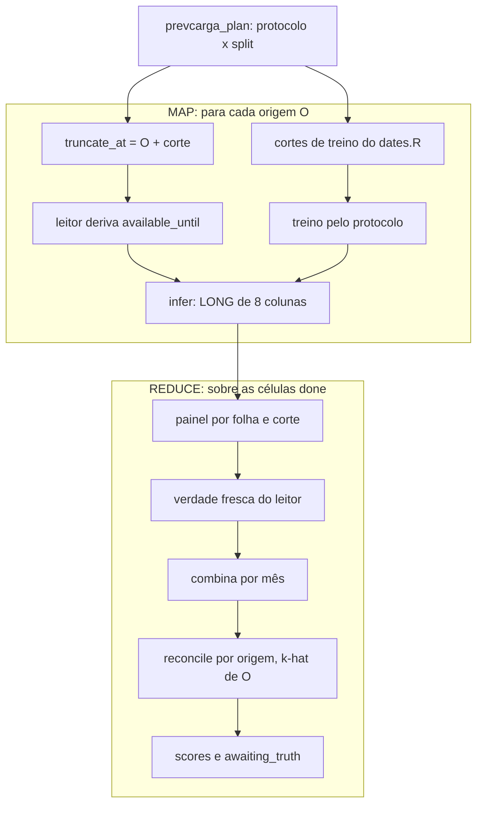
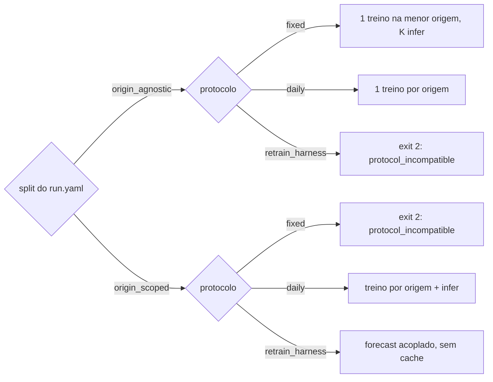

Metodologia · 1.13

O backtest é a rodada diária repetida em várias origens, com o tempo truncado. Para cada origem O, o harness só entrega ao leitor único o instante de truncagem (O mais o corte intradiário); o corte de treino, o treino e a inferência são os mesmos da produção. O protocolo de backtest (<code>fixed</code>, <code>daily</code> ou <code>retrain_harness</code>) só decide quando treinar, e precisa ser compatível com a classe de split do modelo. Depois das células, um REDUCE combina por mês, reconcilia por origem e avalia contra a verdade lida de novo do deck.

## O harness só trunca o tempo

A classe de bug mais perigosa é o backtest usar um código e a produção outro. Por isso o backtest não tem motor de previsão próprio: cada célula chama as mesmas funções da rodada.

| Etapa da célula | O que o harness faz | Quem decide |
|---|---|---|
| Truncagem | monta `truncate_at` = O + `HH:MM` do `--corte`, no fuso da carga declarado no manifest do deck (`.bt_cut_instant`) | `backtest.R` |
| Corte intradiário | nada: o `available_until` nasce no leitor, a partir da carga com `interval_end <= truncate_at` | `deck_reader.R` |
| Corte de treino | nada: `train_origin` e `last_data_day` chegam prontos na linha do plano | `dates.R` (`prevcarga_train_cut`, via `prevcarga_resolve_cuts`) |
| Treino | `prevcarga_train_inputs` + `prevcarga_plugin_train` + `prevcarga_artifact_build` | fachada de treino e despachante |
| Inferência | `prevcarga_infer_cell(artifact =, truncate_at =)` ou o forecast acoplado do plugin | fachada de inferência e despachante |

O orquestrador (`orchestrate.R`) não calcula corte de treino. Ao montar o plano, ele pede a `prevcarga_resolve_cuts` a linha de cada modelo, com o `data_lag_days` do descriptor do plugin. Nos protocolos com artefato (`fixed` e `daily`), o treino da célula deriva de novo os cortes pelo mesmo `dates.R`; se divergirem da linha do plano, a célula aborta com <Tag>contract.cut_mismatch</Tag>. Divergência é bug, nunca recálculo.

A regra de corte de treino é uma só, na rodada e no backtest (ADR-0023). A rodada (`forecast.R`) e as fachadas de treino e inferência (`training.R`, `inference.R`) chamam o mesmo `prevcarga_resolve_cuts`.

| Classe de split | `train_origin` | `last_data_day` |
|---|---|---|
| `origin_agnostic` | O − 1 − H (H = `horizon_days` do `run.yaml`) | O − 1 − `data_lag_days` |
| `origin_scoped` | O (um re-treino por dia) | O − 1 − `data_lag_days` |

Exemplos (H do `run.yaml`, `data_lag_days` do descriptor em `R/register.R`): o RF (H = 9, `data_lag_days` 0) treina com `train_origin` = O − 10 e dados até O − 1; o LightGBM (H = 1, `data_lag_days` 2) treina com `train_origin` = O − 2 e dados até O − 3. A derivação completa está em [Os três cortes de data](/metodologia/tres-cortes).

O instante do corte entra no plano como `available_until` simulado (O + corte), que vai para a chave da célula e para o relatório. O corte efetivo da célula é o que o leitor deriva da carga truncada; o LONG da célula começa em `available_until` + 30 min, e uma entrega com `target_datetime <= available_until` aborta com <Tag>contract.backtest_long_na</Tag>. Um `y_pred` NA também aborta: o backtest nunca preenche com 0.

:::note Decisões
O ADR-0006 fixa que o harness só controla o relógio. O corte de treino por classe de split da tabela acima é do ADR-0023, que substitui o corte uniforme do ADR-0006 (origem − 1 − horizonte, "idêntico em todos os protocolos"): um corte único para todos os modelos usaria informação do horizonte. Os ADRs locais de `docs/adr/` são o registro das decisões; ver [Registro de decisões](/arquitetura/adrs).
:::

## Origens em sequência

Uma rodada diária é uma origem. O backtest é uma janela de origens (`--origin A..B`), cada uma com o seu próprio treino e a sua própria inferência. O plano (`prevcarga_plan`) é a matriz membro × folha × origem × corte, montada a partir da topologia e dos `run.yaml`, sem lista de modelos no código.

1. O plano resolve, para cada membro, a classe de split e o protocolo efetivo, e aborta se forem incompatíveis (seção seguinte).
2. Para cada célula, `truncate_at` = O + corte vai ao leitor, que deriva o `available_until`.
3. O treino segue o protocolo, com os cortes do `dates.R` já na linha do plano.
4. A inferência produz o LONG de 8 colunas da célula, publicado em `members/<sigla>/<FOLHA>/<AAAA-MM-DD>/<HHMM>/long.parquet` com o arquivo `.key` (a chave esperada da célula).
5. Depois de todas as células, o REDUCE lê os LONG `done` e produz combinado, reconciliado e scores.

O despacho vai da origem mais recente para a mais antiga e, dentro da origem, por membro, folha e corte. A semente do `run.yaml` do membro é aplicada imediatamente antes de cada célula, igual no modo serial e nos workers PSOCK (`--jobs N`). O ledger é derivado de presença: uma célula está `done` quando `long.parquet` e `.key` existem e a chave bate com a do plano, o que permite `--resume`.

O k-hat da reconciliação também é refeito por origem: para cada (origem, corte), o perfil é ajustado na própria origem O, sobre a janela `[O − W, O − 1]` (W = 730 dias por padrão), e nunca é lido do registry de produção.

<Figura id="FIG-M18" titulo="Backtest: origens em sequência" natureza="Fluxo" fontes={['scripts/lib/orchestrate.R', 'scripts/lib/backtest.R', 'scripts/lib/dates.R', 'docs/estado/backtest.md', 'docs/estado/m7-orquestracao.md']} adrs={['ADR-0023']}>

</Figura>

## Classe de split × protocolo

A classe de split é propriedade do modelo e está declarada no `run.yaml` (`split`). O protocolo é uma escolha do backtest: vale `--protocol` quando passado, senão o `backtest.protocol_default` do `run.yaml` do membro. A compatibilidade é decidida em `.m7_class`, já no momento do plano.

| Split | `fixed` | `daily` | `retrain_harness` |
|---|---|---|---|
| `origin_agnostic` | sim: 1 treino na menor origem da janela, K inferências | sim: 1 treino por origem | não |
| `origin_scoped` | não | sim: treino por origem + infer do artefato | sim: forecast acoplado do plugin, sem artefato de cache |

Os padrões declarados nos `run.yaml`:

| Modelo | `split` | `backtest.protocol_default` |
|---|---|---|
| `random-forest` | `origin_agnostic` | `daily` |
| `lgbm` | `origin_agnostic` | `daily` |
| `holt-winters` | `origin_scoped` | `retrain_harness` |
| `dessem-linear` | `origin_scoped` | `retrain_harness` |
| `dessem-regdin` | `origin_scoped` | `retrain_harness` |

Uma combinação proibida aborta no plano, antes de criar qualquer célula ou arquivo, com <Tag>contract.protocol_incompatible</Tag> (exit 2). Como `--protocol` vale para todos os membros do plano, `--protocol=fixed` sem `--model` falha nos membros `origin_scoped`. Um valor fora de `fixed`, `daily` e `retrain_harness` é <Tag>config.bad_protocol</Tag> (exit 8).

No `retrain_harness`, a célula não usa artefato: lê um painel com a história do treino e a da inferência e chama o despachante `prevcarga_plugin_forecast`, que treina até `last_data_day` e infere no mesmo painel. O despachante não tem um estágio próprio de forecast acoplado: é a composição de treino e inferência em memória (ver [Despachante de plugin](/arquitetura/despachante)).

<Figura id="FIG-M19" titulo="Classe de split × protocolo" natureza="Fluxo" fontes={['scripts/lib/orchestrate.R', 'scripts/lib/backtest.R', 'models/*/run.yaml', 'docs/estado/m7-orquestracao.md']} adrs={['ADR-0023']}>

</Figura>

:::note Classe e protocolo
A classe do modelo é o `split` do `run.yaml`. O protocolo não é propriedade do modelo: é um parâmetro do backtest, com padrão por modelo, validado contra a matriz acima. O texto local do ADR-0011 trata o protocolo como propriedade da classe (origem-agnósticos reusam o artefato em qualquer origem, origem-escopados fitam na própria origem) e prevê um campo `protocol` no manifest (decisão de 2026-10-10); nesses pontos vale a matriz acima. Ver [Registro de decisões](/arquitetura/adrs).
:::

## REDUCE: combina, reconcile e avaliação

O REDUCE roda depois do MAP, só sobre as células `done`, e escreve só em `<state_dir>/backtest/<run_id>/` (`combined/`, `weights/`, `reconciled/`, `scores/`). O registry de produção não é aberto e nenhum ponteiro `latest` é lido.

| Passo | Granularidade | O que acontece |
|---|---|---|
| Painel | por (folha, corte) | LONG das células pelo leitor (`prevcarga_read_long`), alinhamento conferido (`prevcarga_assert_members_aligned`), painel da combina (`prevcarga_build_panel`) e verdade fresca por `interval_end` (`prevcarga_join_fresh_truth`) |
| Combina | por (folha, corte), um ajuste por mês | `prevcarga_combina_full` com a máscara de treino da combina, `interval_start < início(m)`; meses em fallback EQW vão para `fallback_months` |
| Reconcile | por (origem, corte) | bottom-up por subsistema, k-hat ajustado em O sobre `[O − W, O − 1]`, SIN = soma dos subsistemas |
| Avaliação | por corte, `d_plus` e área (e membro) | verdade re-lida do deck em membros, combinado e reconciliado; métricas só de `evaluation.R` |

### Combina por mês

Os pesos de cada mês m são ajustados com o painel anterior ao início de m, pela mesma máscara da combina de produção (`prevcarga_combina_train_mask`), sem redefinição no backtest. Um membro ausente numa origem fica com a coluna `f_*` em NA e a combina renormaliza. O `n_min` é o da combina (24 por padrão). O método está em [Combinação convexa](/metodologia/combina).

### Reconcile por origem

A reconciliação só roda quando o plano cobre todas as folhas da topologia; um `--area` parcial não gera reconciliação. Se uma folha não tem linha combinada numa origem, a origem entra em `incompleto` (origem, corte, `available_until`, folhas faltando) e nada é escrito em `reconciled/` para ela. Um erro do reconcile numa (origem, corte) não interrompe as demais: entra em `reconcile_failures` com o id do erro e a mensagem. O método está em [Reconciliação hierárquica](/metodologia/reconciliacao).

### Verdade fresca

O `y_true` embutido no LONG dos membros é descartado. A verdade é lida de novo pelo leitor (`prevcarga_read_actual`), por área e por igualdade exata de `interval_end`. O SIN não existe no deck: a sua verdade é a soma dos subsistemas no mesmo instante, só quando todos estão presentes e finitos.

### Origens aguardando verdade

`awaiting_truth` tem uma linha por (origem, corte) do plano. Quando nenhuma linha avaliada da origem tem verdade finita, `awaiting = TRUE`: a métrica fica NA, nunca 0. No relatório, o NA aparece como `aguardando verdade`.

### Veredito

O veredito é `ok` só com todas as células `done`, nenhuma origem incompleta e nenhuma falha de reconcile. Caso contrário é `partial` (ou `failed`, se nenhuma célula concluiu), e o verbo sai com exit 14 (<Tag>partial.backtest_delivery</Tag>), com o resumo das falhas no `result`. As métricas e os baselines estão em [Avaliação](/metodologia/avaliacao).

## O que não re-treina

A chave de cache do artefato (`kind` `artifact`, em `cache.R`) leva o corte pela classe de split e nunca inclui `available_until`.

| Kind | Corte na chave |
|---|---|
| `artifact`, `origin_agnostic` | `split`, `train_origin`, `last_data_day` |
| `artifact`, `origin_scoped` | `split`, `train_origin` |
| `features`, `member_long` | `origin`, `available_until` |

Consequências:

- Varrer cortes (`--corte=08:00,09:30`) não re-treina nos protocolos com artefato: as células de cortes diferentes da mesma origem acham o mesmo artefato no cache e só a inferência é refeita.
- No `fixed`, todas as origens usam os cortes da menor origem da janela, a chave se repete e o treino acontece uma vez.
- No `daily` `origin_agnostic`, `train_origin` = O − 1 − H muda a cada origem, então há um treino por origem.
- No `retrain_harness` não há artefato de cache: cada célula, inclusive cada corte, treina e infere acoplado.
- O LONG da célula (`member_long`) leva origem e `available_until` na chave e é refeito por corte.

A chave também leva a identidade do deck, o rótulo da carga, o fuso, a versão do código, o hash do `renv.lock` e, quando o modelo usa clima previsto no treino, a regra de clima e o limite de emissão do treino. Regra de clima diferente produz `run_id` diferente e chave diferente no LONG da célula (`member_long`). O artefato do backtest vive só em `<state_dir>/cache/artifact/`: o treino do backtest não publica no registry.

## Comandos

O plano pode ser inspecionado sem treinar nem criar artefato; `backtest --dry-run` usa o mesmo handler de `plan`.

<Terminal title="prevcarga — bash" lines={[
  {type:'cmd', text:'prevcarga plan --origin=2025-01-01..2025-01-07 --corte=08:00,09:30'},
  {type:'cmd', text:'prevcarga backtest --origin=2025-01-01..2025-01-07 --model=random-forest --protocol=fixed'},
  {type:'cmd', text:'prevcarga backtest --origin=2025-01-01..2025-01-07 --resume --keep-going --jobs=4'}
]} />

Sem `--corte`, vale `backtest.corte_default` do `config.yaml` (08:00 por padrão). O corte tem de estar na grade de 30 min (`HH:00` ou `HH:30`), senão <Tag>config.bad_corte</Tag> (exit 8). O passo a passo da execução está em [Backtest e plano](/execucao/backtest).
