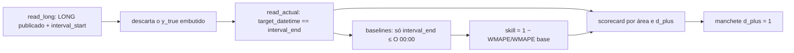

<span className="pc-overline">Metodologia · 1.15</span>

<p className="pc-lead">Toda métrica do PrevCarga sai de um só arquivo, <code>scripts/lib/evaluation.R</code>: WMAPE, MAPE, MAE, RMSE, viés e WMAPE de ponta, mais dois baselines (persistência de O−1 e sazonal ingênuo) e o skill score contra eles. O score, o REDUCE do backtest, o <code>reconcile --eval</code> e o relatório da rodada chamam as mesmas funções, por isso os scorecards não divergem. A verdade é sempre fresca: o <code>y_true</code> que vem dentro do LONG é descartado e a carga realizada é relida do deck, casada por <code>target_datetime == interval_end</code>. Esta página descreve o que é medido e por quê. Ela não traz valores medidos.</p>

## Métricas canônicas numa fonte única

Há uma definição de cada métrica, para que dois scorecards da mesma previsão nunca divirjam. `evaluation.R` é o único lugar do repositório que soma erros absolutos (`.prevcarga_abs_total`). O arquivo não usa relógio, variável de ambiente nem subprocesso.

Cada métrica trabalha sobre os pares `(y_true, y_pred)` em que os dois valores são finitos. Vetores de comprimentos diferentes são erro de contrato (<Tag>contract.metric_length</Tag>). Sem nenhum par válido, a métrica é NA, nunca 0.

Com erro e = y_pred − y_true:

| Métrica | Função | Definição | Observação |
|---|---|---|---|
| WMAPE (%) | `prevcarga_wmape` | 100 · Σ\|e\| / Σ\|y_true\| | NA se Σ\|y_true\| = 0. O argumento `weights` existe, mas é inerte |
| MAPE (%) | `prevcarga_mape` | 100 · média de \|e / y_true\| | Exclui os pares com y_true = 0, sem piso |
| MAE (MW) | `prevcarga_mae` | média de \|e\| | |
| RMSE (MW) | `prevcarga_rmse` | raiz da média de e² | |
| Viés (MW) | `prevcarga_bias` | média de e, com sinal | Positivo quando a previsão fica acima da carga |
| Viés (%) | `prevcarga_bias` | 100 · Σe / Σ\|y_true\| | Razão de somas, na mesma base do WMAPE |
| WMAPE de ponta (%) | `prevcarga_peak_wmape` | WMAPE só nos intervalos da janela de ponta | Ver abaixo |

O WMAPE é a métrica principal porque pondera o erro pelo tamanho da carga: um intervalo de madrugada com carga baixa não domina a média como domina no MAPE. O viés com sinal complementa o WMAPE, que só mede magnitude.

### Janela de ponta

A janela de ponta é fixa: `prevcarga_peak_hours <- 18:22`, aplicada à hora do `interval_start`. Na grade de 30 minutos, isso seleciona os intervalos que começam de 18:00 a 22:30, ou seja, a carga de 18:00 a 23:00. No scorecard, essa métrica aparece na coluna `peak`.

A escolha pelo `interval_start` é deliberada: cada intervalo conta na hora em que começa, e não pelo carimbo de fim.

<Pendente titulo="Pendente · ADR-0028">A janela de ponta de 18:00 a 23:00, a regra dos baselines e o próprio contrato de métrica são o default de trabalho do código, marcado como `[TBD: ADR-0028]`. Ponderação do WMAPE, métricas de rampa e de timing e ponta por regime estão adiadas.</Pendente>

### Todo agrupamento é por `interval_start`

Os buckets por hora, por dia, por ponta e por `d_plus` usam a coluna `interval_start`. Essa coluna não existe no LONG em disco, onde `target_datetime` é o fim do intervalo. Ela é anexada uma única vez pela borda do LONG (`prevcarga_long_attach_interval_start`, em `schema_long.R`), quando o leitor único `prevcarga_read_long` confere o arquivo. `evaluation.R` não faz aritmética de 30 minutos, e `prevcarga_scorecard` recusa um LONG sem essa coluna (<Tag>contract.long_schema</Tag>).

Na mesma conferência, o leitor recalcula o `d_plus` de cada linha como o dia do `interval_start` menos O. Se o rótulo gravado diverge, o LONG é recusado (<Tag>contract.long_dplus_label</Tag>). Um fuso diferente do fuso da carga também é recusado (<Tag>contract.long_tz</Tag>). Mais detalhes em [Schema LONG e o conversor único](/arquitetura/schema-long) e em [Tempo: rótulo da carga, fusos e ajuste de hora](/metodologia/tempo-rotulo-fusos).

### Scorecard

`prevcarga_scorecard(long, by, baseline_long)` é o motor único de agregação. Ele descarta as linhas sem par finito, agrupa pelas colunas de `by` e devolve, por grupo:

| Coluna | Conteúdo |
|---|---|
| `n` | Número de pares avaliados |
| `wmape`, `mape`, `mae`, `rmse` | As métricas da tabela acima |
| `bias`, `bias_pct` | Viés em MW e em % |
| `peak` | WMAPE de ponta |
| `skill` | Só quando há `baseline_long`: skill score contra o baseline |

O agrupamento por subsistema e por SIN é responsabilidade de quem chama, por meio de `by` e do conjunto de linhas que entrega.

## Baselines e skill score

Um WMAPE isolado não diz se o modelo é bom. Os baselines dão a régua: o que se obteria com uma regra trivial que qualquer operador poderia aplicar na origem. `prevcarga_baseline` constrói um deles por chamada, para uma (área, origem); há dois tipos:

| Baseline | Valor previsto para um intervalo do dia O + k | Deslocamento |
|---|---|---|
| `persistence` | A carga realizada no mesmo intervalo de O−1 | k + 1 dias |
| `seasonal_naive` | A carga realizada no mesmo intervalo e mesmo dia da semana, no último dia anterior a O | 7 · (⌊k / 7⌋ + 1) dias |

Para k de 0 a 6, o sazonal ingênuo recua 7 dias. Para k de 7 a 13, recua 14 dias, e assim por diante: o dia de origem do valor fica sempre antes de O.

Os baselines também passam pelo critério de honestidade. Cada valor só pode vir de um intervalo com `interval_end` até O 00:00 no fuso da carga: a função confere isso com `stopifnot` e refiltra a carga lida, sem depender do filtro do leitor. Um tipo de baseline desconhecido é erro de contrato (<Tag>contract.baseline_kind</Tag>).

O skill score é

skill = 1 − WMAPE(modelo) / WMAPE(baseline)

calculado por `prevcarga_skill_score` só nos pares em que modelo e baseline têm a mesma chave (área, origem, `target_datetime`, lead) e os três valores, verdade, previsão e baseline, são finitos. Skill positivo quer dizer que o modelo erra menos que a regra trivial; zero, que empata; negativo, que erra mais. Se o WMAPE do baseline for NA ou 0, o skill é NA.

:::note Baseline no relatório da rodada
O relatório diagnóstico do `forecast` também usa `prevcarga_baseline`, mas sem verdade: ele mostra, por área, a diferença percentual entre a média do previsto para o dia O e a média de cada baseline. É uma comparação descritiva, previsto contra regra trivial, e não uma métrica de erro.
:::

## Verdade fresca

A carga realizada que entra na avaliação nunca é a que veio gravada no LONG. O `y_true` gravado reflete o deck do momento em que o LONG foi escrito, e a avaliação tem de usar o deck de agora. Por isso o `score` descarta a coluna `y_true` de todas as linhas (põe NA) e a reconstrói do deck.

A leitura é `prevcarga_read_actual(ctx, area, from, to)`, um invólucro fino sobre o leitor único do deck. Ela é ex-post por construção: não recebe origem nem corte, e lê inclusive depois do `available_until` da rodada. Por isso nunca é insumo de modelo, só de avaliação. A janela é `(from, to]` sobre `interval_end`, e uma partição ausente devolve zero linhas, não um erro.

O casamento é por igualdade exata de instante: `target_datetime` do LONG contra `interval_end` da carga, no mesmo fuso. Como `target_datetime` já é o fim do intervalo, não há conversão nem tolerância no join. Um intervalo sem carga realizada fica com `y_true` NA e sai do scorecard.

<Figura id="FIG-M22" titulo="Pontuação com verdade fresca" natureza="Fluxo" fontes={['scripts/lib/evaluation.R', 'scripts/lib/cli/score.R', 'docs/estado/score.md', 'docs/estado/evaluation.md']} adrs={['ADR-0028']}>



</Figura>

## Escopo do score e a manchete `d_plus = 1`

O verbo `score` pontua um LONG publicado contra a verdade fresca do deck. É a revisão do dia seguinte: quando a carga de O+1 chega, o operador pontua a entrega daquela rodada.

```bash title="Pontuar uma entrega"
prevcarga score --long=./long.parquet --baseline=persistence
```

O handler (`scripts/lib/cli/score.R`) é fino e segue esta ordem:

1. Com `--model`, confere se o modelo existe.
2. Com `--area`, confere a área contra a topologia antes de ler o deck. Uma área fora da topologia sai com <Tag>topology.area_undeclared</Tag> (exit 4).
3. Roda a validação do deck, salvo com `--skip-validate`. Ver [Validação do deck](/arquitetura/validacao-deck).
4. Lê o LONG pelo leitor único (`prevcarga_read_long`).
5. Chama `prevcarga_score`, que filtra pela origem (`--origin`, quando dada), refaz a verdade, monta os baselines por (área × origem) e o scorecard por (área, `d_plus`).

As áreas pontuáveis são as folhas e os subsistemas da topologia. Os nós de perda ficam de fora, e o SIN também: ele não é área da topologia, e o `score` não o pontua. Quem pontua o SIN são o REDUCE do backtest e o `reconcile --eval`, que montam a verdade dele como a soma dos subsistemas. Sem `--area`, ou com `--area=SIN`, entram todas as áreas pontuáveis presentes no LONG, na ordem da topologia.

O resultado traz o scorecard completo por (área, `d_plus`) e uma manchete com só as linhas de `d_plus = 1`, o dia O+1 (o dia D, na nomenclatura DESSEM). O `d_plus = 0` cobre apenas o resto do dia O depois do corte, por isso é parcial; o O+1 é o primeiro dia inteiro previsto. Na saída de texto, o bloco `MANCHETE D+1` vem antes do bloco `HORIZONTE`, em que a linha de `d_plus = 0` é rotulada `0 resto-do-dia`. O `D+1` desse rótulo é o `d_plus = 1` da notação do código, não a nomenclatura DESSEM.

As colunas da saída de texto são `AREA`, `D_PLUS` (só no horizonte), `OBS`, `WMAPE`, `MAPE`, `MAE`, `RMSE`, `BIAS`, `BIAS%`, `PEAK` e, com `--baseline`, `SKILL`. Nenhuma métrica é calculada no render. Com `--format=json`, o `result` tem `schema_version`, `origins`, `available_until`, `data_hash`, `baseline`, `headline` e `scorecard`.

O `available_until` do resultado vem do leitor único sobre a última origem pontuada, nunca do relógio. Se nada puder ser pontuado, porque nenhum intervalo do LONG tem carga realizada no deck, o verbo sai com exit 0 e o aviso <Tag>warning.nothing_to_score</Tag>.

<Pendente titulo="Pendente · data_hash">O `data_hash` do deck entra no resultado do score, mas a definição dele ainda não tem ADR.</Pendente>

## Onde as métricas são calculadas

As mesmas funções de `evaluation.R` aparecem em quatro consumidores. Nenhum deles redefine métrica.

| Consumidor | O que mede | Agrupamento |
|---|---|---|
| `prevcarga score` | Um LONG publicado contra a verdade fresca, com skill opcional | (área, `d_plus`) |
| REDUCE do `backtest` | Membros, combinado e reconciliado | (`corte_hm`, membro, `d_plus`, área) para membros; (`corte_hm`, `d_plus`, área) para combinado e reconciliado |
| `reconcile --eval` | WMAPE do subsistema pelo Bottom-Up, pelo reconciliado e por um teto (Bottom-Up mais a perda verdadeira), e o scorecard do conjunto reconciliado, com o SIN | WMAPE por subsistema; scorecard por área |
| Relatório do `forecast` | Só a diferença do previsto contra os baselines, sem verdade | Por área |

No REDUCE do backtest, a verdade também é relida do deck por área. O SIN não existe no deck: a verdade dele é a soma dos subsistemas no mesmo instante, e só quando todos estão presentes e finitos. Por padrão (`--baseline=todos`), o REDUCE grava duas colunas de skill, `skill_persistencia_O1` e `skill_sazonal_O7`; `--baseline=none` desliga as duas. O resultado também traz a ponta e o viés com sinal do conjunto reconciliado (`peak_fixed_18_22`), o WMAPE do SIN com a verificação da soma (`sin_fresh`) e, por (origem, corte), a marca `awaiting_truth`: uma origem sem nenhuma verdade finita fica marcada como aguardando verdade e sem WMAPE, nunca com 0. Ver [Backtest](/metodologia/backtest).

:::info O que este site não publica
O site descreve o que é medido e por quê, nunca os valores medidos. Não há tabela de resultados, comparação com o modelo tradicional nem ranking de membros. Os números de uma rodada saem do `score` ou do relatório do backtest, sobre o deck de quem roda.
:::

Para os três cortes que determinam o que cada previsão pôde ver, ver [Os três cortes de data](/metodologia/tres-cortes).
